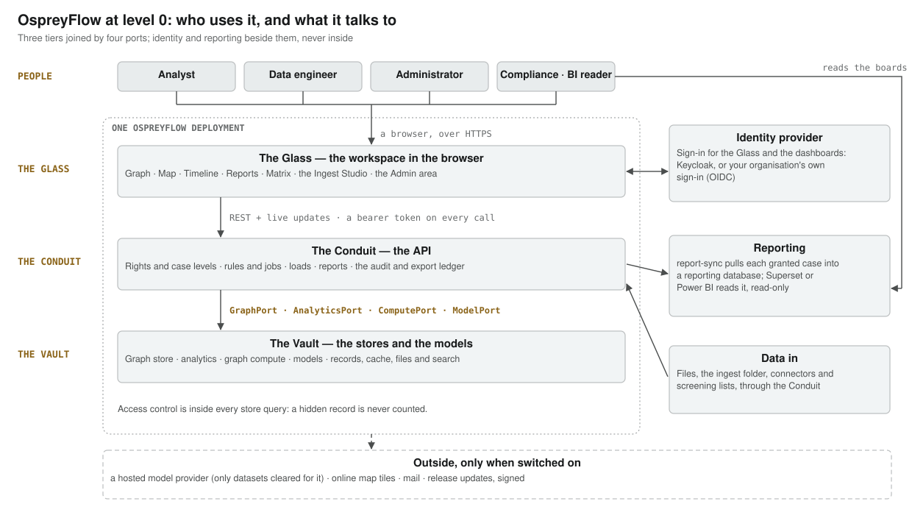
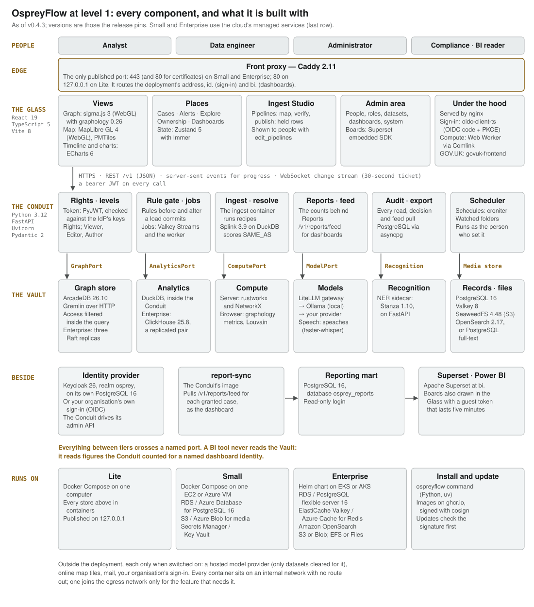
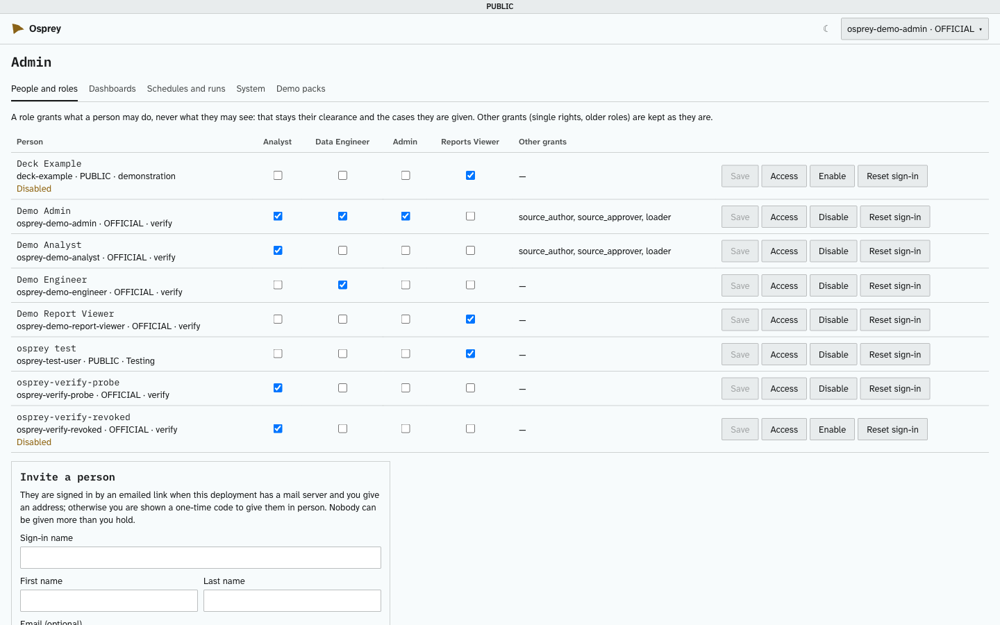
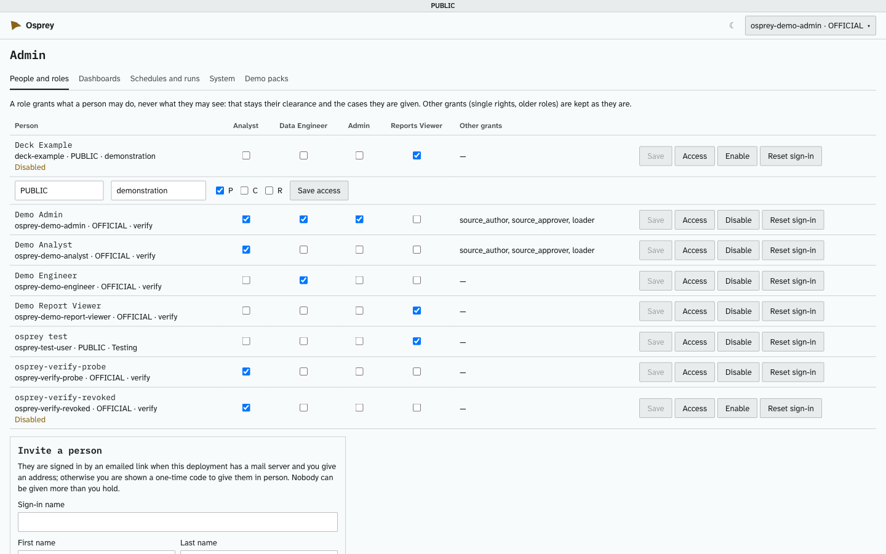
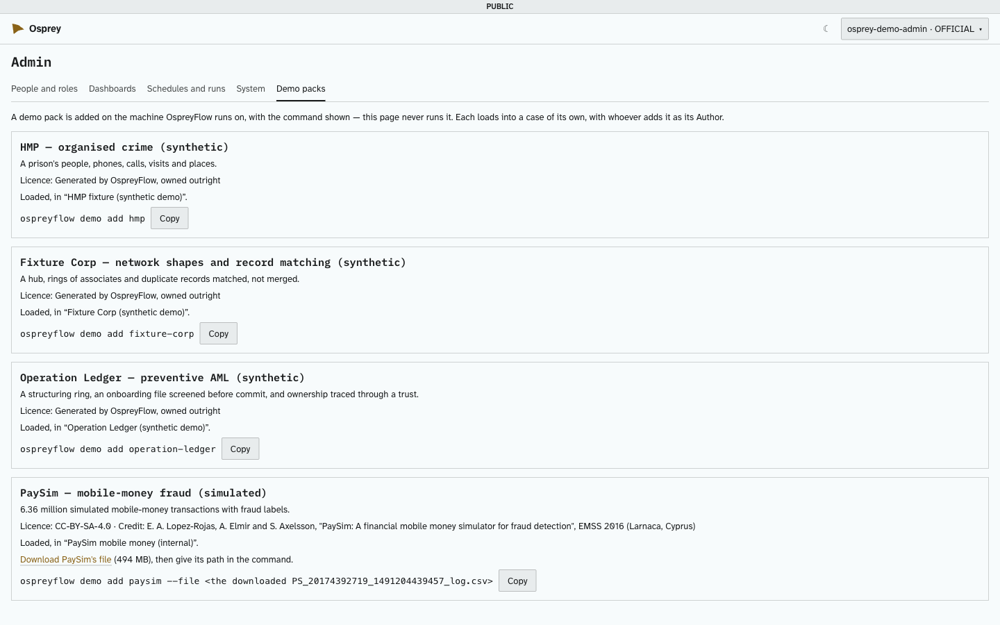
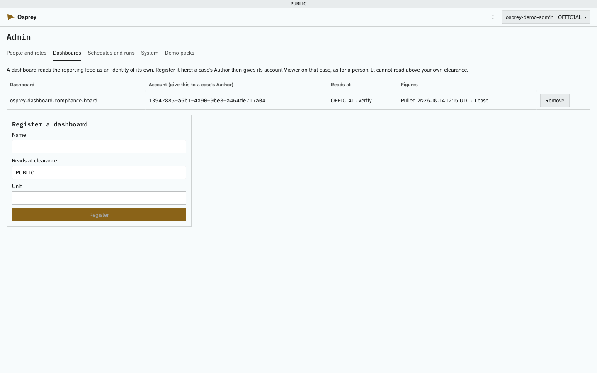
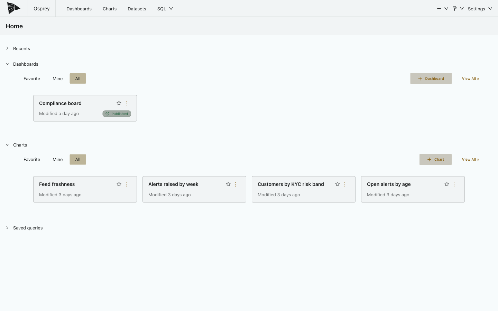
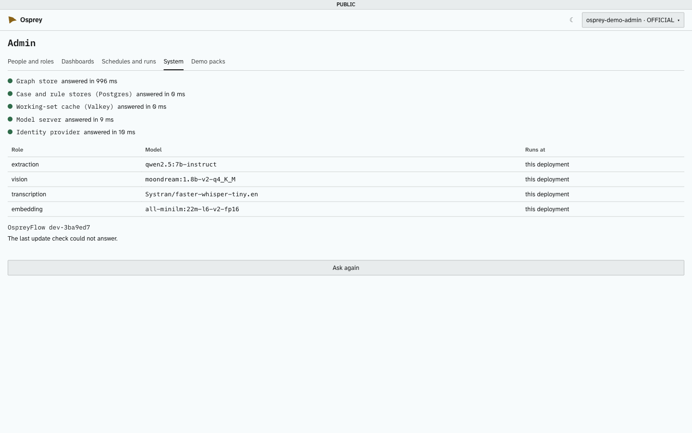
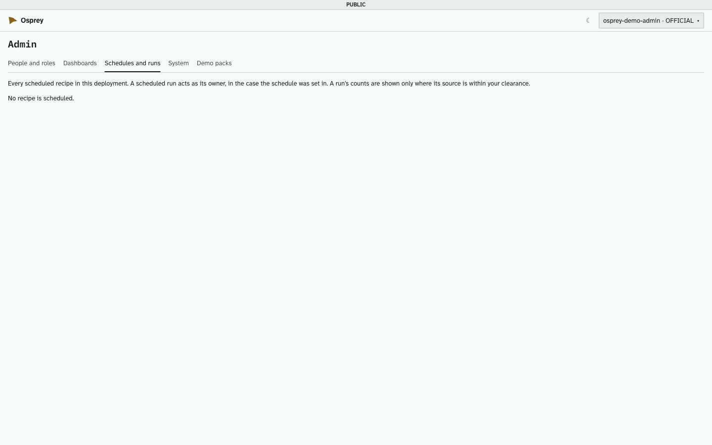

# OspreyFlow — Installation and Administration Guide

OspreyFlow is an open-source intelligence mapping platform for crime analysis, anti-money-laundering,
fraud detection, and event monitoring and alerting.

For whoever installs OspreyFlow and looks after it: **Lite** (one computer), **Small** (one cloud
server on the cloud's managed services, or one server of your own with every store on it) and
**Enterprise** (a Kubernetes cluster on the cloud's managed services). It describes what is built, and says plainly where something is not yet.

The other guides in this folder are the [user guide](user-guide.md), for analysts, and the
[developer guide](developer-guide.md), for data engineers. Appendix A, every `osprey.yaml` setting,
is made from the deployment's own schema, and is checked against it on every change.

<!-- document-control:begin -->
## Document control

**Version 1.55** · 2026-11-05 · For OspreyFlow v0.4.12 · Issued

| Version | Date | What changed |
| --- | --- | --- |
| 1.55 | 2026-11-05 | Describes v0.4.12 (v0.4.11 was not released). No change to its content. |
| 1.54 | 2026-11-05 | Describes v0.4.11. No change to its content. |
| 1.53 | 2026-11-05 | The owner's rulings (build order step 33; ADR-112 Amendment 3, ADR-114 Amendment 33 "Step 33"): §5a.1, someone whose email an account holds can be joined to that account in Admin → People, or the account removed; joining by email (`sign_in.organisation.trust_email`, off by default) and its account-takeover risk; §7 the answer; §8 what `repair-sign-in` now also does; §9.1 and new §9.7, removing someone and joining an organisation account; §16 the refusal's new answers, an empty *Refused organisation sign-ins*, the Conduit needing `view-events`, a refused removal, and the joining-by-email warning. Appendix A: `governance.organisation_provider.trust_email`. |
| 1.52 | 2026-11-04 | The owner's ruling (build order step 29; ADR-114 Amendment 34): §14, an offline bundle carries one platform's images, `linux/amd64` unless `ospreyflow update --make-bundle FILE --platform linux/arm64` names the other, from any machine; any other platform is refused, and `update --from` refuses a bundle for another platform than its machine's, in words, before anything is checked or loaded. |
| 1.51 | 2026-11-04 | The owner's rulings on sign-in (build order step 28): §5a.1, the welcome page's button names the organisation's provider by `sign_in.organisation.label` (ADR-115 Amendment 5), and someone whose email an OspreyFlow account already holds is told so in words and never joined to it (ADR-114 Amendment 33); §8, `repair-sign-in` also gives the workspace's client no refresh token (ADR-050 Amendment 2) and registers the organisation's first sign-in; §9.1, Admin → System's **Acting for people** says when the Conduit cannot act for people and to run `ospreyflow repair-sign-in` (ADR-114 Amendment 36); §16, that line, an arrival whose email is held, and windows that ask to sign in again after about half an hour left alone (a window renews only after the person has done something, ADR-050 Amendment 2). Appendix A: `governance.organisation_sign_in` and `governance.organisation_provider.label` name the button. |
| 1.50 | 2026-11-04 | The owner's ruling (ADR-099 Amendment 11; build order step 27), "no role, no list": §5a.1 and §9.2, a person holding no role is told no dataset's name or id, even when their unit is set before a role; Home says *No cases to show* when they hold no case. |
| 1.49 | 2026-11-04 | As found on the first server (ADR-114 Amendment 35 point 7): §13 and §14, Valkey's data was inside its container and is now moved too; a move that is refused puts back every file the command wrote, so `ospreyflow start` runs the deployment on its old data, and its words say so; the move checks each store apart from the deployment's own containers; a restore starts the identity provider again after PostgreSQL. §16 the move's refusal, and a restore refused with "could not authenticate to Keycloak: 500". |
| 1.48 | 2026-11-04 | The owner's ruling (ADR-114 Amendment 35; build order step 26): the stores keep their data in named volumes. §8 `uninstall --keep-data` now keeps data a later install finds; §13 where each store's data is kept, what a backup reads, and OpenSearch; §14 the one-time move of an existing deployment's data, its words, and what a failed move does to an update; new §14.1 removing the old volumes; §16 a move that is refused. |
| 1.47 | 2026-11-04 | The owner's ruling (ADR-127 Amendment 46; build order step 25): §1a and §11, the Prison Intelligence pack handles post-ingest resolution itself — an install that chooses it writes `components.post_ingest_resolution: false`, and `ospreyflow demo add prison-intelligence` refuses, in words, while it is on. |
| 1.46 | 2026-11-04 | The owner's ruling (ADR-114 Amendment 33; build order step 25): §5a and §7, `server.certificate` and `server.key` are required, and an answers file without them is refused in words; the doctor no longer checks port 80 for a certificate the proxy would obtain itself. |
| 1.45 | 2026-11-04 | Found on the first server (ADR-114 Amendment 33; build order step 25): §4 and §5a, the install waits for the extraction model to download, says so with its size, and only then says it is installed. |
| 1.44 | 2026-11-04 | Describes v0.4.10. No change to its content. |
| 1.43 | 2026-11-04 | §5a.4: on a GPU the model stays loaded (`OLLAMA_KEEP_ALIVE=-1`), so the first question after a pause does not wait for it to load. |
| 1.42 | 2026-11-04 | Describes v0.4.9. No change to its content. |
| 1.41 | 2026-11-04 | The owner's ruling (ADR-132 Amendment 5): §1a, the GOV.UK service's name is shown in the page title on every page, the sign-in page's included; no band under the GOV.UK header names it any more. Appendix A: `appearance` and `appearance.service_name` say the same. |
| 1.40 | 2026-11-04 | As measured and found on the first server (ADR-135 Amendment 1, ADR-114 Amendment 33): §5a.4 the model server's KV cache at q8_0 with flash attention on a GPU, the measured times, the doctor's 14 GiB for the 14b (was 12), and `apply` fetching a newly chosen model; §13 the object store copied as the account that runs the backup, and a failed backup's set it cannot remove marked incomplete; §16 a backup refused with "Permission denied", and Ask failing after the extraction model changed. |
| 1.39 | 2026-11-04 | Found on the first server (ADR-114 Amendment 33): §5a the Ingest Studio's upload folder, given to the Conduit's user (uid 10001) before anything starts, and never writable by every account; §16 an upload or a demo pack refused with "Permission denied" on Linux. |
| 1.38 | 2026-11-04 | Describes v0.4.8. No change to its content. |
| 1.37 | 2026-11-04 | Describes v0.4.7. No change to its content. |
| 1.36 | 2026-11-04 | The owner's ruling (ADR-114 Amendment 33): the first administrator holds the Admin and the Analyst roles from the start, whether or not demo packs load, so the cases they author open for them. §1a and §11 no longer ask anyone to give them the Analyst role; §5 and §5a say which roles the account is made with; §9.2 says so too, and that an `admin` made by v0.4.6 or earlier needs the Analyst role added. |
| 1.35 | 2026-11-04 | Found installing Small on the first server of its own (ADR-114 Amendment 33): §1a and §11 a demo pack on a deployment with no demo accounts — its case's Author is the first administrator, in their own unit, with no Editor, and the Admin role does not open a case's graph until someone holds the Analyst role; §5a the answers' `demo_packs` load after the first administrator exists, the installing account's umask does not matter, and `ca` must be readable by every account; §13 a fresh deployment's first backup, its empty items, and a failed backup leaving no partial set; §16 an unreadable CA. |
| 1.34 | 2026-11-04 | The local engine on an NVIDIA GPU (ADR-135 Amendment 1): §2.2a the NVIDIA driver and Container Toolkit, installed by the server's administrator; §2.4 and §5a the doctor's GPU checks; §5a the answers file's `server.gpu`; new §5a.4, what the GPU changes (the model server alone reserves it; the 14b extraction model unless one is named), what is checked before anything starts, and Lite on a Linux computer; §7 `server.gpu`; §16 a refused GPU. Appendix A: `resources.gpu`, and `models.extraction`'s default on a GPU. |
| 1.33 | 2026-11-04 | Describes v0.4.6. No change to its content. |
| 1.32 | 2026-11-04 | §5a: a `DOCKER-USER` rule that matches only arriving connections (`--ctdir ORIGINAL`), found on the first Linux server. |
| 1.31 | 2026-11-04 | Describes v0.4.5. No change to its content. |
| 1.30 | 2026-11-03 | Small on your own server, second part (ADR-114 Amendment 33 drop 2): §2.2a the backups folder and what the organisation's sign-in needs; §5a the answers file's `server.backups`, `server.memory_gib` and `sign_in`, and the doctor's new checks; new §5a.1 sign-in through the organisation's identity provider (Entra ID: the application, its two addresses, its client secret, assignment, the route out; no role until an administrator grants one); new §5a.2 memory sized to the server; new §5a.3 backups to `server.backups` with a cron line; §7 the answers' settings; §8 `repair-sign-in` restores the organisation's sign-in and gives a Small no demo accounts; §13 and §14 backup and `update` on this kind of Small; §16 the organisation's sign-in and the backups folder. Appendix A: `governance.organisation_provider`, `resources`. |
| 1.29 | 2026-11-03 | Small on your own server (ADR-114 Amendment 33, first part): §1 a fourth column and the organisation's own certificate under "HTTP or HTTPS"; new §2.2a, its prerequisites; §2.4 `ospreyflow doctor --mode small --config install.yaml`; new §5a, installing it — the answers file's `server:`, the three names and the one-label wildcard, what is checked before anything starts, port 443 alone, the first administrator, renewing the certificate, and what is not built yet; §5.2's refusal names all three ways; §7 `server`, `admin_email`, `sign_in`; §8.1 what it publishes; §16 the certificate's refusals and a network that cannot connect. Appendix A: `network.tls`, `network.redirect_http`, `network.listen_address`. |
| 1.28 | 2026-11-03 | §8: `ospreyflow repair-sign-in` also sets the Conduit's own client secret again, so a deployment whose stores were wiped can act for its people again. §16: rules that say "the rule's deployer could not be resolved", a hotlist that stops, and a list refresh that re-screens no one. |
| 1.27 | 2026-11-03 | "How OspreyFlow is built": a level 0 diagram (who uses OspreyFlow and what it talks to), a level 1 diagram (every component with the technology it is built on, and what each mode runs on), and a new section, "The interfaces, and what crosses each", giving each interface's direction, protocol, what crosses it and what guards it. |
| 1.26 | 2026-11-02 | Checked against the code end to end (build order step 10). §10: Ask to search carries the case's handling and datasets, so the analyst's engine choice applies to it as to Ask the case; it no longer always runs on the local engine. |
| 1.25 | 2026-11-02 | §9.2: the right to manage connection-strength influencers, held by the Analyst and Admin roles. §9.6: approving an installation-wide influencer version, a second person's decision; a case's own influencers need none. |
| 1.24 | 2026-11-02 | §1, "HTTP or HTTPS": Lite now answers on this computer only — every port it publishes is bound to `127.0.0.1`, the Conduit's own port included — so other machines cannot reach it; Small and Enterprise must have an `https://` address, and `osprey.yaml` refuses a plain-HTTP one; a gov.uk address is refused for Lite. §8.1 says the same. |
| 1.23 | 2026-11-02 | §1: a note, "HTTP or HTTPS" — Lite is plain HTTP on a `localhost` address and has no HTTPS option, and its port is published on every network interface, so it is never opened to a network; Small and Enterprise are HTTPS with a certificate Caddy obtains and renews, port 80 only for the certificate and the move to HTTPS; the managed services over TLS; a gov.uk service over HTTPS. §8.1 links to it. |
| 1.22 | 2026-11-02 | New §1a, Choosing a starter: a theme and a domain at install (`--starter`, and the guided page's first screen), the GOV.UK service's name, several deployments side by side (`--name`, `ospreyflow deployments`, `ospreyflow switch <name>`) and how the checkout's own deployment fits in, and a public dataset of your own choosing (`ospreyflow demo add public`) with the VAST Challenge catalogue and its terms. §7: `starter`, `appearance`, `demo_accounts`. §8: `ospreyflow deployments`, `ospreyflow starters`, `--name`. §11: the `cyber-intrusion` pack, and where each starter's demo comes from. Appendix A: `deployment.graph_port`. |
| 1.21 | 2026-11-01 | §9.5: a sixth connector, the FCDO's UK Sanctions List (the XML file, Open Government Licence v3.0); the OFSI connector marked as reading a closed list, on the Lists tab and in the subscribe form. §12: the `closed` section's labels are the five closing reasons as stored. |
| 1.20 | 2026-11-01 | §9.5: the UN and OpenSanctions connectors are marked "licence not confirmed" and read OspreyFlow's synthetic lists only, whatever this device's exceptions admit; the refreshes' counts of customers re-screened and alerts raised are your own unit's. |
| 1.19 | 2026-11-01 | §9.5: a list's refresh schedule, set in Monitoring → Lists and run as the person who set it. §9.6: approval rights — a second person for a rule for the whole deployment and for closing a high-severity alert, and who holds the right to approve; whole-deployment rules live before this version wait for approval after upgrading. |
| 1.18 | 2026-11-01 | §9.5: screening lists — subscribing to a list through its connector, each list's licence, the rule on real lists, and the refresh (*Refresh now*, `python -m scripts.refresh_screening_list`), which re-screens customers against the changed entries only. |
| 1.17 | 2026-11-01 | §12: the monitoring board, and the four monitoring sections the feed carries (`raised_by_rule`, `closed`, `time_to_close`, `hotlist_matches`). |
| 1.16 | 2026-11-01 | §9.4: monitoring, and whom a hotlist's alerts reach (`monitoring.hotlist_audience`, `hotlist_audience_editable`). Appendix A: the `monitoring` settings. |
| 1.15 | 2026-11-01 | §9.1: the Datasets tab. §10: a provider's privacy-contract mark (`privacy_contract`, `contract_reference`); each dataset's egress (`none`, `contracted`, `any`), set in Admin → Datasets and audited; every dataset is `none` after upgrading, so hosted engines receive nothing until an administrator changes one. Appendix A: the two new provider settings. |
| 1.14 | 2026-11-01 | §8: `ospreyflow apply`, and a new §8.3, "Changing a setting". `deployment.env` is readable by its owner alone. §10: a provider enabled on a running deployment, and key entry on the guided install's Models screen. |
| 1.13 | 2026-11-01 | §10 rewritten for several model engines: providers, defaults, labels, keys as `OSPREY_MODEL_KEY_<NAME>`, and what may leave. §8: `ospreyflow models`, `models key` and `models remove-key`. Appendix A: `models.providers`, `models.defaults` and a provider's `label`. |
| 1.12 | 2026-11-01 | The opening says what OspreyFlow is for: intelligence mapping, for crime analysis, anti-money-laundering, fraud detection, and event monitoring and alerting. |
| 1.11 | 2026-11-01 | §8: `ospreyflow switch`. Appendix A: `deployment.name`, the `appearance` settings (the GOV.UK look), and relative storage paths. |
| 1.10 | 2026-10-29 | §11: the Prison Intelligence pack's rehearsal commands are in `DEMO_GUIDE.md`, not the user guide. |
| 1.9 | 2026-10-29 | §11: the two Prison Intelligence packs, the demonstration case and its scale cohort. |
| 1.8 | 2026-10-28 | Describes v0.4.0. No change to how it is installed, updated or looked after. |
| 1.7 | 2026-10-27 | Appendix A: `components.post_ingest_resolution`, whether a load queues entity resolution afterwards. |
| 1.6 | 2026-10-18 | §11: the HMP pack as a prison intelligence network, and adding it again after an update. |
| 1.5 | 2026-10-15 | A cover page, contents, a list of figures, and this version history. |
| 1.4 | 2026-10-15 | §16: a model download that stopped with `rename …-partial …`, and how to finish it. |
| 1.3 | 2026-10-15 | §11: the Enron email corpus as an optional download, with its safeguards. |
| 1.2 | 2026-10-14 | `ospreyflow repair-sign-in`; no step sends an operator to `make`. |
| 1.1 | 2026-10-14 | §14 rewritten: which installs `update` moves, and checking for and moving to a release. |
| 1.0 | 2026-10-14 | First issue in the install package, with screenshots. |
| 0.4 | 2026-10-14 | Enterprise built from your own computer: `install --mode enterprise --cloud`. |
| 0.3 | 2026-10-14 | Enterprise on Kubernetes: the cluster's namespace, storage classes and managed services. |
| 0.2 | 2026-10-14 | The guided install page ships with each release. |
| 0.1 | 2026-10-13 | Lite and Small, with every setting taken from the deployment's own schema. |

<!-- document-control:end -->

---

## How OspreyFlow is built



Three tiers; everything that passes between them crosses one of four typed ports:

| Tier | What it is |
| --- | --- |
| **The Glass** | The browser workspace — the graph, map, timeline and reports, the Ingest Studio and the Admin area — one web application |
| **The Conduit** | The API (FastAPI). Every request is checked against the person making it: access control is applied inside each query to the stores, never after |
| **The Vault** | The stores: the graph store (ArcadeDB), the analytics database (DuckDB inside the Conduit, or ClickHouse shared by several Conduits), search (OpenSearch, or PostgreSQL full-text), PostgreSQL, the object store, and the models |

| Port | What passes through it |
| --- | --- |
| GraphPort | Typed traversal of the graph, with the person's clearance and handling injected into it |
| AnalyticsPort | Events, trends and histograms |
| ComputePort | Graph algorithms: centrality, communities, ownership chains |
| ModelPort | Extraction, vision, transcription and embedding, through the LiteLLM gateway |

Two narrower ports sit beside them: the media store, for content files (an S3-protocol store —
SeaweedFS or AWS S3 — or Azure Blob), and the recognition port.

The level 1 diagram names the technology in each component. Versions are those the release pins;
Small and Enterprise use the cloud's managed services where the diagram's last row says.



**One door in.** A front proxy (Caddy) is the only published port: 80 on Lite, 80 and 443 with
automatic HTTPS on Small and Enterprise. Behind it, at the deployment's address, are the Glass;
sign-in (Keycloak) at `id.`; and dashboards (Superset) at `bi.`.

**No route out by default.** Every container sits on an internal network with no route to the
internet. One joins the egress network only when a configured feature needs it: the model and
speech-model downloads, the proxy's certificate, a client's own model provider, mail, an
organisation's own sign-in, online map tiles, and on Small and Enterprise the cloud's managed
services.

**What the data is.** Model-derived data stays *inferred* until a person confirms it. Records are
never merged in storage: matching records are linked with a score and shown as one at query time.
Every read is checked against the reader's clearance, unit and handling codes,
and a hidden record cannot be detected from a count, a path length or a chart.

### The interfaces, and what crosses each

Each interface has one direction, one owner and one guard. None of them lets a store's own query
language, a source system's identifier or an unfiltered count reach the Glass.

| Interface | From → to | How | What crosses | Guarded by |
| --- | --- | --- | --- | --- |
| **The front door** | Browser → front proxy (Caddy) → the Glass, the Conduit (`/v1`, through the Glass's nginx), sign-in at `id.`, dashboards at `bi.` | HTTPS on 443, with 80 only for the certificate and the move to HTTPS (Small, Enterprise); HTTP on 80, bound to `127.0.0.1` (Lite) | Every request | The only published port; every other container is on an internal network |
| **Sign-in and token** | The Glass, Superset → identity provider → the Conduit | OpenID Connect, authorisation code with PKCE; a signed JWT access token | Credentials, typed only at the identity provider; then who the person is, their clearance, unit, handling codes and roles | Every token's signature checked against the provider's keys on every call |
| **Rights** | The Conduit → the Glass (`GET /v1/me/rights`) | REST | What this person may do; the rail and menus follow it | Each route checks its own right, so the Conduit refuses whatever a stale screen offers |
| **The API** | The Glass → the Conduit (`/v1/…`) | HTTPS, JSON, a bearer token on every call | Searches, working sets, edits, loads, reports, exports | Access control inside each store query; a result too large is refused with `limit_exceeded`, never cut silently |
| **Live updates** | The Conduit → the Glass | WebSocket `/v1/investigations/{id}/stream`, opened with a one-time ticket that lasts 30 seconds; server-sent events for long-running progress | Changes to the open case; progress | The ticket is the person's own; the same access as the API |
| **Administration** | The Admin area → the Conduit (`/v1/admin/…`) → the identity provider's admin API | REST | People, roles and access; datasets and their egress; dashboard identities; schedules; health and freshness | Administration rights (`manage_people`, `manage_dashboards`, `administer_system` and others); a dashboard is never given more than its registrar holds |
| **Case access** | The Share panel → the Conduit (`/v1/investigations/{id}/access`) | REST | Who holds Viewer, Editor or Author on the case, by account id | The case's Author; every change kept in the case's history |
| **GraphPort** | The Conduit → the graph store (ArcadeDB) | Gremlin over ArcadeDB's HTTP API, on the internal network only | Typed traversals; writes; a load's revert | The person's clearance and handling codes and the case's datasets are part of the traversal itself |
| **AnalyticsPort** | The Conduit → DuckDB (inside the Conduit) or ClickHouse (HTTP) | In process, or HTTP on the internal network | Event aggregates, trends and histograms; never raw SQL from the Glass | The same filters inside the query; no count includes a record the reader cannot see |
| **ComputePort** | The Conduit → rustworkx and NetworkX; the Glass → graphology in a Web Worker | In process | Centrality, communities, ownership chains | Computed over what the reader can see only; the two engines are held to the same conformance suite |
| **ModelPort** | The Conduit → LiteLLM → Ollama, speaches, or a provider you configure | HTTP, OpenAI-compatible | Text, images and audio to extract from, describe, transcribe or embed; what returns is *inferred* until a person confirms it | Each dataset's egress (`none`, `contracted`, `any`) and the handling codes that may be sent (§10) |
| **Recognition** | The Conduit → the NER sidecar (Stanza) | HTTP on the internal network | Text to tag with names, places and organisations | No route out; what it finds is *inferred* |
| **Media store** | The Conduit and the ingest container → SeaweedFS, S3 or Azure Blob | The S3 protocol, or Blob's API | Content files, staging, site images, the tile cache | Private, encrypted storage; files reach the Glass only through the Conduit |
| **Records, cache and search** | The Conduit → PostgreSQL, Valkey, OpenSearch | The internal network (TLS and a token on Enterprise's managed cache) | The Conduit's own records and audit; caches, the job queue and the change stream; text search | Reached only from the deployment's own network |
| **Ingest** | The Ingest Studio, the ingest folder and connectors → the Conduit → the ingest container | REST; a watched folder | Files and rows, loaded under a published recipe | `edit_pipelines` and `schedule_pipelines`; a run is made as the person who set it; the case's rules judge each load before and after it commits, and hold the rows they refuse |
| **Reporting feed** | report-sync → the Conduit (`/v1/reports/feed`) | REST, with the dashboard identity's own client credentials | Figures only, counted as that dashboard | The dashboard's own token and the cases it was given; every pull in the export ledger |
| **Reporting mart** | report-sync → PostgreSQL `osprey_reports` → Superset or another BI tool | SQL, a read-only login | The feed's rows; pull times and failures | A read-only login; never the Conduit's own tables |
| **Embedded board** | The Glass → the Conduit → Superset | Superset's embedded SDK, with a read-only guest token that lasts five minutes | One board | Given only to a viewer who could count every figure on it |
| **Updates** | `ospreyflow update` → the repository's releases on GitHub and its images on `ghcr.io` | HTTPS | The list of releases, the release's lock and its images | The release's signature, made by this repository's own release workflow, checked with cosign before anything changes (§14) |
| **Outside services** | A container on the egress network → model and speech-model downloads, a provider you configure, mail, your organisation's sign-in, online map tiles, the cloud's managed services | HTTPS | Only what the feature needs | A container joins the egress network only when its feature is switched on |

## 1. Choosing a mode

| | Lite | Small | Small, on your own server | Enterprise |
| --- | --- | --- | --- | --- |
| Where it runs | One computer (a laptop or a workstation) | One cloud server (AWS or Azure) | One Linux server you provide, inside your own network | A Kubernetes cluster (EKS or AKS), three or more nodes |
| Who looks after the data | You, with `ospreyflow backup` | The cloud: managed PostgreSQL, S3 or Blob, daily backups | You: every store is in a container on the server's disk (section 5a) | The cloud, for its managed services; the graph store in the cluster is not yet backed up (section 13) |
| Its address | `http://ospreyflow.localhost` | `https://<your domain>` | `https://<a name in your network>`, with your organisation's certificate | `https://<your domain>` |
| First sign-in | Demo accounts, passwords in `deployment.env` | A first administrator, by a one-time code | A first administrator, by a one-time code | A first administrator, by a one-time code |
| Built with | `ospreyflow install --mode lite` | `ospreyflow install --mode small --cloud aws\|azure`, from your own computer | `ospreyflow install --mode small --config install.yaml` with a `server:` section, on the server | `ospreyflow install --mode enterprise --cloud aws\|azure`, from your own computer, or onto a cluster you already have |

All three run the same product: the same containers, the same Glass, Ingest Studio and Admin area.
Small swaps the deployment's own PostgreSQL and object store for the cloud's, and gets a real
domain with HTTPS. Small on your own server keeps every store in a container, as Lite does, and is
reached over HTTPS with your organisation's own certificate, on port 443 alone. Enterprise runs the same services as replicas across the cluster's nodes, the
graph store and the analytics database as clusters of their own.

### HTTP or HTTPS

- **Lite serves plain HTTP** at a `localhost` address: `http://ospreyflow.localhost`, or a named
  deployment's `http://<name>.localhost:<port>` (section 1a.1). That is deliberate. Lite is for one
  computer, its traffic is meant to stay on that machine, and browsers treat `localhost` as a secure
  context, so sign-in works without a certificate.
- **Lite has no HTTPS option.** The install, the guided page and every starter give it an
  `http://…localhost` address, and Lite is not built or tested with a certificate.
- **Lite answers on this computer only.** Every port a Lite deployment publishes — the front proxy's,
  the graph store's and, when `network.expose_conduit` is on, the Conduit's — is bound to this
  computer's own address (`127.0.0.1`), so other machines on a network cannot reach it, whatever
  the firewall allows. A deployment kept by name (section 1a.1) is Lite, so the same holds. Use
  Small or Enterprise for anything other people reach.
- **Small and Enterprise serve HTTPS** at `https://<your domain>`, and must: `osprey.yaml` refuses a
  Small or Enterprise deployment whose `network.public_origin` is not an `https://` address, and
  `ospreyflow apply`, the guided page and the Set-up console say so and change nothing. The front
  proxy (Caddy) obtains the certificate for your domain and renews it automatically. Port 80 is
  open only for the certificate's challenge and to send a request for your domain on to HTTPS
  (443); any other request on port 80 gets "not found", apart from the proxy's own health check. On
  Enterprise, the cluster's load balancer passes 80 and 443 to the proxy.
- **Small on your own server serves HTTPS with your organisation's own certificate** (section 5a):
  the front proxy is given the certificate and key, obtains nothing and calls nothing; it publishes
  port 443 alone (80 only if you ask, and then only to send people to 443). The certificate is
  checked before anything starts.
- **The managed services behind Small and Enterprise are reached over TLS:** PostgreSQL always
  (`sslmode` is `require` at least), the object store always over HTTPS, and the cache and the
  mail server over TLS unless you turn it off (`external.*` and `mail.starttls`, Appendix A).
- **A service on a gov.uk domain must be served over HTTPS,** the GOV.UK theme included, so it is
  Small or Enterprise, never Lite: `osprey.yaml` refuses a Lite deployment at a gov.uk address. The
  GOV.UK theme on a `localhost` address stays available for a demonstration on one computer.

## 1a. Choosing a starter

A **starter** is a theme and a domain, chosen at install. It only fills in answers the install
already asks — the look, the GOV.UK service's name, organisation and phase, the demo packs and
whether demo accounts are made — and every one can still be changed. The `osprey.yaml` it makes
records the starter in a comment at the top; nothing at run time reads it. Every domain pack (FIBO,
NIEM, STIX) stays available to every case whatever the starter: the domain chooses the demo data
and what its demo cases are set to, never what the ontology offers.

| | `crime` | `aml` | `fraud` | `cyber` | `blank` |
| --- | --- | --- | --- | --- | --- |
| **Demo case's domains** | NIEM | FIBO | FIBO | STIX | none chosen |
| **Demo data** | `prison-intelligence`, `hmp` | `operation-ledger`, with its synthetic screening lists | `fixture-corp`; PaySim offered as your own download, never fetched | `cyber-intrusion` | none, and no demo accounts |
| **`ospreyflow` theme** (the base look) | `ospreyflow-crime` | `ospreyflow-aml` | `ospreyflow-fraud` | `ospreyflow-cyber` | `ospreyflow-blank` |
| **`govuk` theme** (GOV.UK, a gov.uk service only) | `govuk-crime` | `govuk-aml` | `govuk-fraud` | `govuk-cyber` | `govuk-blank` |

`ospreyflow starters` (or `ospreyflow install --list-starters`) prints the same table and the
command for each.

**A starter that loads `prison-intelligence`** (`crime`) also writes
`components.post_ingest_resolution: false` into the `osprey.yaml` it makes, and says so: that pack
needs post-ingest resolution off (section 11), and resolution is the whole deployment's setting, so
the deployment's other demo cases do not gain automatic "same as" links either. An analyst's own
Resolve now still works. The same holds for any answers file whose `demo_packs` names it; one whose
own `osprey.yaml` (`config:`) sets it `true` is refused before anything is installed.

**One command per starter.** Add `--yes` to take every other default; leave it out to be asked.

```
ospreyflow install --mode lite --starter ospreyflow-crime
ospreyflow install --mode lite --starter ospreyflow-aml
ospreyflow install --mode lite --starter ospreyflow-fraud
ospreyflow install --mode lite --starter ospreyflow-cyber
ospreyflow install --mode lite --starter ospreyflow-blank
ospreyflow install --mode lite --starter govuk-crime --service-name "Analyse crime intelligence" --organisation "<your organisation>"
ospreyflow install --mode lite --starter govuk-aml --service-name "Investigate money laundering" --organisation "<your organisation>"
ospreyflow install --mode lite --starter govuk-fraud --service-name "Investigate fraud" --organisation "<your organisation>"
ospreyflow install --mode lite --starter govuk-cyber --service-name "Investigate cyber incidents" --organisation "<your organisation>"
ospreyflow install --mode lite --starter govuk-blank --service-name "<your service's name>" --organisation "<your organisation>"
```

**The GOV.UK theme** asks for the service's name, organisation and phase (`--service-name`,
`--organisation`, `--phase alpha|beta|live|none`; the phase offered first is `beta`). Without a
service name the install is refused, in words, before anything is changed. **Name the service, not a
case:** the name is the page title (the browser tab's "<name> – GOV.UK") on every page of every
case, so the names offered above describe the whole deployment; "Prison Intelligence" over the
Ledger's case is the mistake this avoids. `blank` offers no name: a real service names itself.

**On the guided page** (`ospreyflow install --gui`, section 4.1) the starter is on the first screen,
Mode, under **Starter (optional)**; a GOV.UK starter shows the service's name (filled in with the
name above), organisation and phase there. The Demo packs screen then shows the starter's packs
ticked, to change if you wish.

**In an answers file** (section 7): `starter: govuk-aml`, with `appearance.service_name`,
`appearance.organisation` and `appearance.phase`.

**On a deployment with no demo accounts** — Small, on a cloud server or your own — a starter's demo
packs still load, each into its own case, with the first administrator (`admin`) as its Author, in
the administrator's own unit, and no Editor. The first administrator holds the Analyst role as well
as Admin (section 9.2), so the case opens for them; they can share it from there.

### 1a.1 Several deployments side by side

`--name` keeps a deployment of its own beside any other on the same computer:

```
ospreyflow install --mode lite --name crime-demo --starter ospreyflow-crime
ospreyflow install --mode lite --name aml-govuk --starter govuk-aml --service-name "Investigate money laundering" --organisation "<your organisation>"
```

Each one has:

- its own folder, `~/.ospreyflow/deployments/<name>/`, holding its `osprey.yaml`, every file
  rendered from it and its `deployment.env` (readable by your account alone, `600`; the folder is
  `700`);
- its own Compose project and volumes, named `<name>`: no case, account or index is shared;
- its own address — `--address`, by default `http://<name>.localhost:<the next free port>` from 8090
  — and its own graph-store port on this computer (`deployment.graph_port`, from 2500).

A name that Docker already knows as another folder's Compose project is refused, before anything is
written: two deployments under one name would share containers. The checkout itself is shared; no
second checkout or worktree is needed.

**Every command takes `--name`**: `ospreyflow start --name crime-demo`, `ospreyflow status --name
aml-govuk`, `ospreyflow demo add hmp --name crime-demo`, `ospreyflow backup --name aml-govuk` (whose
backups are kept in the deployment's own folder). Without `--name`, a command acts on the deployment
last used, or on the only one there is.

```
ospreyflow deployments          # each one's name, starter, address and whether it is running
ospreyflow switch aml-govuk     # stop the running one, start aml-govuk, open it
ospreyflow switch default       # back to the checkout's own
```

A Lite computer runs one deployment at a time by default, which is what `ospreyflow switch` is for.

**The deployment installed in the checkout** — every install before this version, with its
`osprey.yaml` in the checkout and its files in `deploy/generated/` — is listed as `default` and works
exactly as before: no command moves, renames or changes it. It could later be moved under
`~/.ospreyflow/deployments/` (install a named deployment, restore a backup of the checkout's into it,
check it, then uninstall the checkout's with `--keep-data` until you are sure); that is a step for
the administrator to take deliberately, never something an update does.

### 1a.2 Adding a public dataset

A public dataset you download yourself can be added to any deployment, at install or later:

```
ospreyflow demo add public --file <the downloaded file> --manifest <its dataset.yaml>
```

A **manifest** says what the dataset is, its source page, its licence or terms as the source states
them, the file's SHA-256, whether it holds real people's data, and the Ingest Studio recipe that
loads it. The file is checked against the checksum before anything else happens; a file that differs
is refused, and nothing is loaded. It loads into a case of its own, named after the dataset.

**Real personal data** (`real_personal_data: true` in its manifest) is loaded only once you type
`yes`, accepting that it is real people's data and that your organisation has its own lawful basis
to process it — as for Enron (section 11); `--accept-real-data` accepts in a scripted run. It never
belongs in a repository or a test run.

**The VAST Challenge catalogue.** OspreyFlow ships manifests and recipes — never the data — for two
IEEE VAST Challenge datasets, fictional scenarios published for visual-analytics research:

| Catalogue id | Dataset | Suits | Source |
| --- | --- | --- | --- |
| `vast-2012-mc2` | VAST Challenge 2012, Mini-Challenge 2: the fictional Bank of Money's regional network — its firewall log (`Firewall-04072012.csv`) | the `cyber` starter (its case is set to STIX) | the Visual Analytics Benchmark Repository, University of Maryland |
| `vast-2008-mc3` | VAST Challenge 2008, Mini Challenge 3: cell phone call records on the fictional island of Isla del Sueño (synthetic) | the `crime` starter (its case is set to NIEM) | the same repository |

**Their terms.** Neither the source pages, nor the challenges' task pages, nor the repository's
mirror at Washington University state any licence or terms of use (checked 2 November 2026). No
licence means no right to redistribute is granted: download the data yourself, use it on your own
computer, never pass it on, and do not rely on it for commercial use without the publishers'
permission. Each manifest says so.

**Their checksums.** OspreyFlow never downloads VAST data, so the catalogue records no checksum, and
`demo add public` refuses an entry until you record the checksum of the file you downloaded:

```
python -m scripts.public_dataset --list
python -m scripts.public_dataset pin --manifest vast-2012-mc2 --file Firewall-04072012.csv --out ~/OspreyFlow/vast-2012-mc2.yaml
ospreyflow demo add public --file Firewall-04072012.csv --manifest ~/OspreyFlow/vast-2012-mc2.yaml --name crime-demo
```

`pin` writes your own copy of the manifest, with the recipe beside it; check first that the file
came from the source page, since what you pin is what every later check holds the file to. The
column layout each recipe reads is the challenge's published one; check it against your download's
first line.

## 2. Before you start

### 2.1 Lite

- **Docker**: Docker Desktop on macOS and Windows (on Windows with the WSL 2 back end); Docker
  Engine with the Compose v2 plugin on Linux. Set it to start when you sign in: the stack comes
  back after a reboot only once Docker does.
- **Memory**: at least 16 GB available to Docker (32 GB is comfortable).
- **Disk**: at least 60 GB free, plus the demo packs you choose (PaySim is about 0.5 GB to download
  and more once loaded).
- **Git**, and **internet** for the first install.
- **Port 80 free** (the deployment's one door).

### 2.2 Small

On your own computer, from which you build the server:

- an **AWS or Azure account** you may create resources in;
- **OpenTofu** (`tofu`), which builds the server;
- the cloud's **command line** (`aws` or `az`), signed in to that account;
- **Git** and **uv**;
- a **DNS name** you control, such as `osprey.example.org`. If the name's zone is in the same cloud
  account (Route 53 or Azure DNS), the records are made for you.

The server itself needs nothing from you: it installs Docker and OspreyFlow on its first boot.

### 2.2a Small on your own server

On the server itself (section 5a):

- **Linux on `amd64`** (the releases are built for `linux/amd64` only), with at least **32 GB of
  memory** (30 GiB as Docker reports it) and **60 GB free where Docker keeps its data** — put Docker's
  data root on the server's data disk;
- **Docker Engine with the Compose v2 plugin**, enabled at boot (`sudo systemctl enable --now
  docker`);
- **Git**, **uv** and **Python 3.12** (Ubuntu 24.04's own; or `uv python install 3.12`);
- the **clock synchronised** (`timedatectl`), since sign-in checks tokens against it;
- **port 443 free** on every interface;
- a **service account** in the `docker` group to install and run it as (not root);
- from the organisation: the **three names** in its DNS, pointing at the server, and a
  **certificate** naming them, with its unencrypted key (section 5a);
- **outbound access** to the releases and their images, or the organisation's mirror of them;
- a **folder for backups** (`server.backups`), with room for several sets, ideally on a disk of
  its own;
- for sign-in through the organisation's identity provider (section 5a): OspreyFlow's application
  **registered with it** (the install prints the two addresses), a **group of the people** who may
  sign in assigned to it, and **outbound access from the server to the provider** — for Entra ID,
  `login.microsoftonline.com` on 443 (or through the organisation's proxy);
- for the local engine on the server's **NVIDIA GPU** (optional, `server.gpu: nvidia`, section
  5a.4): the **NVIDIA driver** for the GPU, and the **NVIDIA Container Toolkit** with Docker
  configured to use it, both installed by the server's administrator — OspreyFlow checks them and
  installs neither;
- recommended: `vm.max_map_count` at least 262144 (for OpenSearch).

### 2.3 Enterprise

On your own computer:

- what Small needs (an account, OpenTofu, the cloud's command line signed in, Git, uv, a DNS name);
- **kubectl** and **Helm**;
- on Azure, **kubelogin** (`az aks install-cli` installs it): the cluster takes Entra ID sign-ins
  only;
- the **addresses you work from** (`api_cidrs`): the cluster's API, and on Azure the Key Vault,
  answer those and nothing else, so this computer must be inside one of them.

Onto a cluster you already have, only kubectl, Helm, Git and uv are needed, with kubectl pointed at
it.

### 2.4 Checking a machine: `ospreyflow doctor`

`ospreyflow doctor --mode lite` checks, in the order to fix them: Docker installed, Docker running,
Compose v2, memory, free disk, Git, uv and port 80, and the GPU when `osprey.yaml` sets
`resources.gpu: nvidia` (section 5a.4). `ospreyflow doctor --mode small --cloud aws`
(or `azure`) checks Git, uv, OpenTofu and the cloud's command line. `ospreyflow doctor --mode
small --config install.yaml`, with a `server:` section in the answers, checks the server you are on
instead (section 5a): Docker, memory, disk, 443, the certificate, the clock and the rest, and the
GPU with `server.gpu: nvidia` (section 5a.4); a warning
(⚠) says what to change but does not stop an install. `ospreyflow doctor --mode
enterprise --cloud aws` adds kubectl and Helm (and on Azure kubelogin); without `--cloud` it checks
kubectl, Helm and that a cluster answers. Each line is a tick, or a cross
with what to do about it; the exit code is 1 when anything is missing. `install` runs the same
checks first and stops, having changed nothing, if one fails.

## 3. Getting the `ospreyflow` command

The command is installed once per computer by the bootstrap in the repository:

- **macOS and Linux**: `sh install.sh` from inside a checkout, or
  `OSPREYFLOW_REPO=<repository address> sh install.sh` to clone it into `~/ospreyflow`.
- **Windows**: `install.ps1` in PowerShell, the same way (`$HOME\ospreyflow`).

It installs **uv** if it is missing (from Astral's own installer), makes the checkout's Python
environment, installs the command as a uv tool, and records where the checkout is
(`~/.config/ospreyflow/home`, or `%APPDATA%\ospreyflow\home`). It starts nothing. If the command is
not found afterwards, open a new terminal, or run `uv tool update-shell`.

The command finds its checkout by `OSPREYFLOW_HOME` first, then the recorded file, then by looking
upwards from the folder you are in. Anything it prints that names a password, secret or token is
hidden and replaced by a pointer to `deployment.env`.

## 4. Installing Lite

```
ospreyflow install --mode lite
```

asks a few questions — dashboards on or off, the folder the Ingest Studio lists, the folder for a
basemap, which demo packs — then (`--starter <theme>-<domain>` fills these in first: section 1a):

1. writes `osprey.yaml` from the answers (refusing, with nothing changed, if a different
   `osprey.yaml` is already there, unless `--force`);
2. on a release (the checkout sits on a `vX.Y.Z` tag): checks the release's signatures and runs
   exactly its images, pinned by digest; otherwise builds the images from the checkout;
3. starts the deployment and waits until every service is healthy and the extraction model has
   downloaded (it says which, and its size: `qwen2.5:7b-instruct`, about 4.7 GB, or the 14b on a GPU,
   about 9 GB), so Ask works as soon as the install says it is done;
4. makes the demo accounts (unless `--no-demo-accounts`) and loads the chosen demo packs.

It ends by saying the address and that the sign-in details are in `deployment.env`.

**Without questions**: `ospreyflow install --mode lite --yes` takes every default;
`--config install.yaml` takes the answers from a file (section 7). **Building anyway**: `--build`
builds from the checkout even on a release tag.

### 4.1 The guided page: `ospreyflow install --gui`

Opens a page in your browser, on this computer only, behind a one-time link (anyone else, or any
other link, is refused). It walks through the same answers as screens, with a starter (section 1a)
offered on the first, Mode:

- **Lite**: Mode, Folders, Profile, Components, Map (register a local basemap, build it, verify
  it), Models, Governance, Demo packs, Review (which runs the doctor), then Install, with the
  install's own output shown live.
- **Small and Enterprise**: Mode, Cloud and region, Domain, Components, Models, Governance, Demo
  packs, Review — which **saves** the answers: a Small server is built from a terminal (section 5),
  never from the page.

Everything is worked on a draft copy of `osprey.yaml`; the page closes itself when the install
finishes, or after 30 idle minutes. On a release, the page is the release's own — fetched the first time,
with its signature checked against the release; in a developer's checkout it is built with
`cd apps/harness && npm ci && npm run build`, and the command says so if it is missing or out of date.

## 5. Installing Small

From your own computer:

```
ospreyflow install --mode small --cloud aws --config install.yaml
```

with at least:

```yaml
mode: small
cloud:
  provider: aws            # or azure
  region: eu-west-2        # or uksouth, …
  domain: osprey.example.org
  dns_zone: example.org    # optional: make the DNS records in this Route 53 / Azure DNS zone
  admin_email: ops@example.org   # optional
  size: small              # small (32 GB server), medium (64 GB) or large (128 GB)
```

What happens:

1. **Plan.** OpenTofu shows everything it would make in your account (below). Nothing is made yet.
2. **Build, on your yes.** Answer `yes` (or pass `--yes`) and OpenTofu builds it. Its state is kept
   in `.cloud/small-<cloud>/` in your checkout, readable only by you. **Keep it, privately**: it is
   how the server is changed later, and on Azure it holds the database password.
3. **DNS.** With a `dns_zone`, the three records (`osprey.example.org`, `id.…` and `bi.…`) are made
   for you. Without one, the command prints the address to point them at and waits — up to an hour
   — until the name resolves to the server.
4. **The server installs itself.** On first boot it installs Docker and OspreyFlow, reads the
   database password (and on Azure the storage key) with **its own cloud identity**, installs onto
   the managed services, and gets its HTTPS certificate. The command waits — up to 45 minutes — until
   `https://<domain>` answers. The server's own log is `/var/log/ospreyflow-first-boot.log`.
5. **The first administrator.** The server makes an account `admin` holding the Admin and Analyst
   roles and the highest clearance, with a **one-time code** instead of a password, and leaves the
   code in the cloud's secret store. The command reads it, **shows it once**, and deletes it from
   the store. At their first sign-in the administrator chooses their own password. Then they invite
   everyone else from the Admin area (section 9).

### 5.1 What is made in your account

| | AWS | Azure |
| --- | --- | --- |
| Server | One EC2 instance (r6i), encrypted disk, no SSH; reach it with Session Manager | One VM (E-series), no SSH port; Azure's service healing |
| Database | RDS for PostgreSQL 16, private, encrypted, its password kept by Secrets Manager | Azure Database for PostgreSQL, private, its password in Key Vault |
| Objects | S3: media, staging, site images, tile cache (private, encrypted) | Blob for media; the other stores on the server (SeaweedFS), covered by the server's backup |
| Secrets | Secrets Manager | Key Vault (purge protection on) |
| Recovery | EC2 automatic recovery; AWS Backup daily | Azure Backup daily |
| Open to the internet | 80 and 443 only | 80 and 443 only |

Backups are kept 14 days by default (`backup_days`, 7–35).

### 5.2 On the server, by hand

The server's first boot runs, in effect,
`ospreyflow install --mode small --config /etc/ospreyflow/install.yaml --yes --force
--first-admin-code-file <file>` with the passwords in its environment. Run without
`--first-admin-code-file`, it prints the first administrator's code once instead. `install --mode
small` with none of `--cloud`, the managed services in its answers, or a `server:` section (section
5a) is refused, naming all three.

## 5a. Installing Small on your own server

For an organisation that gives you one Linux server inside its own network, with its own
certificate: every store runs in a container on that server (no managed services), people reach it
over HTTPS on port 443 with the organisation's certificate, and nothing else is published. Nothing
is built in a cloud account. The decision is ADR-114 Amendment 33.

**On the server**, as the service account that will run it (not root; it must be in the `docker`
group, which is root-equivalent, so it is an administrator's account):

```
git clone https://github.com/aykr/OspreyFlow.git /opt/ospreyflow
cd /opt/ospreyflow && sh install.sh
ospreyflow doctor --mode small --config install.yaml
ospreyflow install --mode small --config install.yaml --force
```

(`--force`, because the answers make an `osprey.yaml` that differs from the checkout's own.) The
server needs outbound access to the releases and their images (or the organisation's mirror of them) for the install;
installing with no outbound access at all is not built. `install.yaml`:

```yaml
mode: small
server:
  address: https://osprey.example.internal       # https:// only; the names below derive from it
  certificate: /etc/ospreyflow/tls/osprey.crt     # PEM: the server certificate, then its intermediates
  key: /etc/ospreyflow/tls/osprey.key             # PEM, unencrypted; owned by the service account, mode 600
  ca: /etc/ospreyflow/tls/org-root.pem            # optional: the organisation's root
  ingest: /srv/ospreyflow/ingest                  # where the CSV exports are put
  redirect_http: false                            # true also publishes 80, only to send people to 443
  # listen_address: 192.0.2.10                    # optional: one interface of a server with several
  backups: /srv/ospreyflow/backups                # where `ospreyflow backup` writes
  memory_gib: auto                                # or a number of GiB: what the stores are sized to
  # gpu: nvidia                                   # optional: the local engine on the server's GPU (5a.4)
sign_in:                                          # optional: the organisation's identity provider
  organisation:
    alias: org                                    # part of the address the organisation registers
    label: Example Department account             # its name on the sign-in pages
    issuer: https://login.microsoftonline.com/<tenant-id>/v2.0
    client_id: 00000000-0000-0000-0000-000000000000
    # its client secret is never written here: OSPREY_ORG_SIGN_IN_SECRET in the terminal
admin_email: ops@example.internal                 # optional: the first administrator's email
components: {dashboards: false}
```

**The certificate and key are required.** An answers file whose `server:` lacks
`server.certificate` or `server.key` is refused, in words naming both, before anything is installed.
A server of your own always serves the organisation's own certificate: there is no certificate the
front proxy obtains for itself, which would need port 80 and a name the public internet can reach.

**The three names and the certificate.** The deployment answers at `<host>`, `id.<host>` (sign-in)
and `bi.<host>` (dashboards, when they are on), all on the one address. Ask the organisation's DNS
to point each at the server, and its CA for a certificate naming them as subject alternative names
— `osprey.example.internal`, `id.osprey.example.internal` and `bi.osprey.example.internal`, or
`osprey.example.internal` and `*.osprey.example.internal`. **A wildcard covers one label only:**
`*.example.internal` covers `osprey.example.internal` but not `id.osprey.example.internal`, so it is
not enough. The certificate's common name is not read, as browsers do not read it.

**What is checked before anything starts.** `doctor`, `install` and every `apply` check the
certificate and key and refuse, in words and with nothing changed: a file that cannot be read or is
not PEM; a key encrypted with a passphrase; a key that does not match the certificate; a
certificate that has expired or is not yet valid; a name of the deployment's it does not cover;
and, with `ca`, a chain that does not reach that root (put the intermediates after the server
certificate). Fewer than 30 days left is a warning. `doctor --mode small --config install.yaml`
also checks: Docker installed, running and started at boot; Compose v2; an `amd64` server (the
releases are built for `linux/amd64` only); 30 GiB of memory as Docker reports it (a 32 GB server);
60 GB free where Docker keeps its data; Git, uv and Python 3.12; the clock synchronised (sign-in
tokens are checked against it); port 443 free on **every** interface (and 80 with `redirect_http`);
port 2480 free; 20 GB free where backups are written (`server.backups`); with `sign_in`, that
`OSPREY_ORG_SIGN_IN_SECRET` is set (it also prints the two addresses the organisation registers);
and warns for `vm.max_map_count` below 262144, running as root, names that do not yet resolve from
the server, and an identity provider whose name does not resolve from it. With `server.gpu:
nvidia` it also checks the GPU (section 5a.4).

**What it publishes.** Port 443 (the address's own port), on every interface or on `listen_address`;
port 80 only with `redirect_http: true`, and then it only redirects; the graph store's door, 2480,
on the server itself (`127.0.0.1`), as is the Conduit's with `network.expose_conduit`. The front
proxy serves the organisation's certificate, read-only from where it is — the key is never copied
into the deployment's folder — and obtains no certificate, follows no redirect of its own and fetches
nothing from the CA. It runs as the account that owns the key, so the key stays `600`.

**Who may reach it** is set in front of the server: the organisation's firewall or security group,
or the `DOCKER-USER` chain. A port Docker publishes is **not** filtered by `ufw`'s rules.
In the `DOCKER-USER` chain, match only connections that **arrive** at 443, with `--ctdir ORIGINAL`;
without it the rule also drops the replies to the server's own outbound HTTPS (to the releases, the
images and cosign's transparency log), and the install fails with a time-out. For example, to let
one network reach the service through the interface `eth0`:

```
iptables -I DOCKER-USER -i eth0 -p tcp -m conntrack --ctdir ORIGINAL --ctorigdstport 443 \
  ! -s 192.0.2.0/24 -j DROP
```

The chain is emptied when Docker restarts, so put the rule in a unit that runs after
`docker.service`.

**The first administrator.** The install makes an account `admin` with the Admin and Analyst roles
and the highest clearance, and prints its **one-time code once**, on the terminal; there are no demo
accounts. At their first sign-in they choose their own password, then invite everyone else from the
Admin area (section 9). The answers' `demo_packs` are loaded after the administrator is made, each
into its own case with `admin` as its Author (section 1a says what that means for opening it).

**The extraction model.** Once every service is healthy, the install waits for the deployment's
extraction model (`models.extraction`; on a GPU, the 14b) to finish downloading and pass its digest
check, and says so on screen, with its size: about 4.7 GB for `qwen2.5:7b-instruct`, about 9 GB for
`qwen2.5:14b-instruct` (one to two minutes on the first server). Only then does it go on and say it is
installed, so Ask works from the start. A download that is refused stops the install at stage
`models`, naming `ospreyflow logs ollama-models`; run the install again once it can be fetched.
`ospreyflow update`, `start --build` and `apply` fetch a model whose choice has changed before
anything that uses it starts again (section 5a.4).

**The installing account's umask.** A server hardened to `umask 077` or `027` is fine: every file
the deployment's containers read from its folder is written readable by every account whatever the
umask, and `deployment.env`, which holds the secrets, stays readable by its owner alone. The
organisation's root, `ca`, is mounted into the identity provider, which runs as another account:
`doctor`, `install` and `apply` refuse one that not every account can read (`chmod 644` it; it holds
no secret). The key stays `600`. The install's own tools reach the three names on the server itself and
trust the deployment's certificate (and `ca`), so they work before the organisation's DNS does.

**The upload folder.** Files an analyst uploads in the Ingest Studio, and the demo packs' own
files, are written to `uploaded/` inside `server.ingest` by the Conduit, which runs as uid 10001.
Before anything starts, `install`, `apply`, `start` and `update` make that folder and, when uid
10001 cannot write it, give it to `10001:10001` with a short-lived container of the Conduit's own
image, so the service account needs no root for it. It is never made writable by every account, and
an arrangement of your own that already lets uid 10001 write (its group, and mode `2775`, say) is
left as it is. If it cannot be given over, the command says why and starts nothing (section 16).
Lite on a Linux computer does the same.

**Renewing the certificate.** Replace the two files (same paths), then run `ospreyflow apply`. It
checks the new certificate, and only the front proxy is started again.

### 5a.1 Sign-in through the organisation's identity provider

With `sign_in.organisation` in the answers, people sign in with their organisation's own account —
Microsoft Entra ID, ADFS, or any OpenID Connect provider — through OspreyFlow's identity provider
(Keycloak), which brokers it. The welcome page then offers **Continue with** and the provider's
name from `sign_in.organisation.label` — for example **Continue with Example Department account** —
first, which goes straight to the organisation's sign-in page, and **Sign in with an OspreyFlow
account** beside it, for the accounts an administrator makes (the first administrator's among them).
A deployment that names a provider with no label shows **Continue with organisation sign-in**.
Without `sign_in`, there is the one **Sign in**, for those accounts alone.

**What the organisation does first** — for Entra ID, in its admin centre's *App registrations*:

1. Register an application for OspreyFlow, a *web* application, and give it the **redirect URI**
   the install prints (and `ospreyflow doctor --mode small --config install.yaml` prints before it):
   `https://id.<host>/realms/osprey/broker/<alias>/endpoint` — exactly, with no slash added. Set its
   **front-channel logout / post-logout redirect URI** to the same address followed by
   `/logout_response`.
2. Make a **client secret** for it, and hand it over by the organisation's own secure route. It is
   never written in the answers file or `osprey.yaml`: set it in the terminal for the install,
   `export OSPREY_ORG_SIGN_IN_SECRET=…`; it is kept only in the deployment's `deployment.env`
   (mode 600), and the install refuses to start without it.
3. Turn on **assignment required** and assign the application to the **group of people** who may
   sign in: the organisation decides who may sign in at all.
4. Give the install the **issuer** (Entra ID: `https://login.microsoftonline.com/<tenant-id>/v2.0`)
   and the application's **client id**.
5. Allow the **server to reach the provider** on 443 — Entra ID is on the internet, at
   `login.microsoftonline.com` — directly or through the organisation's proxy. Nothing else on the
   server reaches out for sign-in, and only the identity provider does.

**Roles are OspreyFlow's.** Someone signing in through the organisation for the first time arrives
with **no role, no handling code, and a clearance and unit of `unassigned`** that see nothing: Home
shows every place dimmed until an administrator grants them. Nothing is taken from the
organisation's directory — no group becomes a role. An administrator finds them in Admin → People
and roles once they have signed in, and sets their roles, then their access (clearance, unit,
handling codes); a later sign-in never takes those back. **No role, no list:** until they hold a
role they are told no dataset's name, even if their unit is set first — the unit's dataset list and
a case's datasets come back empty (section 9.2).

**Someone whose email an OspreyFlow account already holds.** A person arriving through the
organisation for the first time is matched by nothing but their email, and an email the
organisation's provider sends is not proof that the person owns the OspreyFlow account with that
address (Entra ID does not promise it is verified). So OspreyFlow **never joins the two**: when an
account already holds that email — someone you invited by that address, say — the sign-in page
says "This email address already belongs to an OspreyFlow account, so your organisation account has
not been joined to it. Sign in to that account with its username and password instead, or ask your
OspreyFlow administrator." Nothing is made. Then, in Admin → People and roles (section 9.7):

- **Join them to that account**, if you are sure it is theirs: *Refused organisation sign-ins* lists
  each person refused in the last seven days by their name at the organisation; choose the account
  and confirm. Their next sign-in through the organisation lands in it, with its roles, clearance
  and cases. An invited account whose password was never set loses its one-time code: it is reached
  through the organisation from then on.
- **Or remove that account**, and ask them to sign in again: they arrive as someone new, with no
  role, and you grant their roles again.
- **Or leave it**: they go on with that account (**Sign in with an OspreyFlow account**).

To avoid it, invite only the people who cannot come through the organisation (the first
administrator, outside staff).

**Joining by email, for an organisation that verifies every address.** With
`sign_in.organisation.trust_email: true` in the answers (`governance.organisation_provider.trust_email`
in `osprey.yaml`; off by default), a person arriving through the organisation is **joined
automatically** to the OspreyFlow account holding the same email address, with its roles and
clearance, instead of being refused. **This hands any account to whoever the organisation's provider
gives its address**: where a person can set their own address, or another tenant can claim one, it is
an account takeover — the 2023 "nOAuth" takeovers of Entra ID applications were exactly this. Turn
it on only with the organisation's security officer's written sign-off that every address its
provider gives is verified and cannot be changed by the person who holds it. `ospreyflow doctor` and
the install warn of it every time, and so does each `repair-sign-in`. Only the provider's own address
is compared: a person is never asked to type one at first sign-in. An invited account whose password
was never set is joined, then asks for a password once. To turn it off, set `trust_email: false` in
`osprey.yaml` and run `ospreyflow apply` (it updates the identity provider too): people whose email
an account holds are refused again, and you join them by hand.

**The organisation's own certificate authority.** With `server.ca`, the identity provider trusts
it as well as the usual public authorities, so a provider on the organisation's own certificates
(ADFS, an internal Keycloak) is trusted too.

**After a wipe or a restore**, `ospreyflow repair-sign-in` registers the organisation's provider
again, with its client secret from `deployment.env` — safe to run again, and it prints no secret.
To change the secret, put the new one in `deployment.env` (`OSPREY_ORG_SIGN_IN_SECRET=`), then run
`ospreyflow repair-sign-in`. A Small deployment is never given demo accounts by `repair-sign-in` or
`start --build`.

### 5a.2 Memory

`server.memory_gib: auto` reads how much memory Docker has, once, at install, and writes it to
`osprey.yaml` as `resources.memory_gib`; the stores are sized to it (appendix A's `resources`):

| Memory | Graph store's heap | OpenSearch's heap | PostgreSQL's shared buffers |
| --- | --- | --- | --- |
| 32 GB | 12 GiB | 2 GiB | 1 GiB |
| 64 GB | 25 GiB | 4 GiB | 2 GiB |
| 128 GB | 31 GiB | 8 GiB | 4 GiB |

The three take at most half the server, leaving the rest to the model server, the identity provider,
the Conduit and the operating system. To resize, change `resources.memory_gib` (or one of its
overrides, `graph_heap_gib`, `search_heap_gib`, `postgres_shared_buffers_gib`) and run
`ospreyflow apply`: only the three stores are started again. An override that would give the three
more than three quarters of the server is refused.

### 5a.3 Backups

`ospreyflow backup` writes each set to `server.backups` (default `~/OspreyFlow/backups`), readable
by its owner only. A set never holds the certificate's key or `deployment.env`; it does hold the
case data and the people's identities. Nothing is registered with the operating system, so schedule
it with the service account's own crontab (`crontab -e`), beside the organisation's snapshots of the
server's disks:

```
0 2 * * * cd /opt/ospreyflow && ~/.local/bin/ospreyflow backup >> ~/ospreyflow-backup.log 2>&1
```

Old sets are not removed: remove them by hand, or with the organisation's own retention. Restoring
and updating are as for Lite (sections 13 and 14).

The guided page (`--gui`) does not install this kind of Small.

### 5a.4 The local engine on an NVIDIA GPU

Without a GPU the local engine (Ollama) runs on the server's processors, so a question to Ask the
case on the local engine is slow, and material that may not leave the deployment can only ever run
there. A server with an NVIDIA GPU can give the local engine the GPU. The decision is ADR-135
Amendment 1.

**Before the install**, the server's administrator installs, and OspreyFlow checks but never
installs:

- the **NVIDIA driver** for the GPU (on Ubuntu, `sudo ubuntu-drivers install`, then restart the
  server), until `nvidia-smi` lists the GPU;
- the **NVIDIA Container Toolkit**, with Docker configured to use it:

```
sudo nvidia-ctk runtime configure --runtime=docker
sudo systemctl restart docker
```

Then add `gpu: nvidia` under `server:` in `install.yaml`; it is written to `osprey.yaml` as
`resources.gpu: nvidia`. Lite on a Linux computer with an NVIDIA GPU may set `resources.gpu: nvidia`
in `osprey.yaml` itself and run `ospreyflow apply`. It is refused for Small in a cloud and for
Enterprise, whose servers are sized without a GPU, and on macOS and Windows, where Docker Desktop
gives a container no NVIDIA GPU.

**What changes.** The model server alone reserves every NVIDIA GPU on the server; its image, the
models' pinned weights and the gateway are the same. Image descriptions and embeddings run in the
same model server, so they use the GPU too; transcription stays on the processors. The extraction
model, which also answers Ask the case and Ask to search on the local engine, becomes
`qwen2.5:14b-instruct` (about 9 GB, downloaded once) instead of `qwen2.5:7b-instruct`, unless
`osprey.yaml` names one under `models.extraction`, which always wins. `ospreyflow apply` fetches
a newly chosen model, and waits for it, before the services that use it start again. An `osprey.yaml` saved by the
guided page (`--gui`) names every model, `models.extraction: qwen2.5:7b-instruct` among them, so it
keeps the 7b on the GPU until that line is removed. On the GPU the model server also keeps its
working memory for a question at reduced precision (`OLLAMA_FLASH_ATTENTION=1` and
`OLLAMA_KV_CACHE_TYPE=q8_0`), which is what fits the 14b, with the long context it is given, wholly
on a 16 GB card. On the GPU the model also stays loaded (`OLLAMA_KEEP_ALIVE=-1`): left to Ollama's default, an idle model was unloaded after five minutes and the next question waited 56 s for it to load again, against 3.3 s once loaded. Without a GPU nothing changes.

**As measured, 4 November 2026**, on the first server (an RTX 5060 Ti, 16 GB), the same question
through the product's own route: the 14b on the GPU without those two settings used 18 GB, ran 15%
on the processors and 85% on the GPU, and took 9–11 s an answer of about 120 tokens; with them it
used 14 GB, ran wholly on the GPU (12.0 GiB, per `nvidia-smi`), and took 3.3–3.6 s. The 7b on the
processors took 17.3 s.

**What is checked before anything starts.** `doctor`, `install` and `apply` refuse, in words and
with nothing changed: a computer that is not Linux; `nvidia-smi` not installed, or not answering
("NVIDIA-SMI has failed because it couldn't communicate with the NVIDIA driver": install the
driver, or restart after installing it); and Docker listing neither the toolkit's `nvidia` runtime
nor an NVIDIA CDI device (`docker info`). With the 14b model, less than 14 GiB of GPU memory is a
warning naming the 7b: set `models.extraction: qwen2.5:7b-instruct` in `osprey.yaml` and run
`ospreyflow apply`. The doctor names the GPU, its memory and its driver, for example:

```
✔ The NVIDIA GPU is NVIDIA GeForce RTX 5060 Ti, 15.9 GiB (driver 595.99.02).
✔ Docker can run a container on the GPU (the nvidia runtime of the NVIDIA Container Toolkit).
✔ The GPU has 15.9 GiB of memory; qwen2.5:14b-instruct asks for at least 14 GiB.
```

To turn it off, set `resources.gpu: none` in `osprey.yaml` and run `ospreyflow apply`.

## 6. Installing Enterprise

From your own computer:

```
ospreyflow install --mode enterprise --cloud aws --config install.yaml
```

with at least:

```yaml
mode: enterprise
cloud:
  provider: aws            # or azure
  region: eu-west-2        # or uksouth, …
  domain: osprey.example.org
  api_cidrs: [203.0.113.0/24]    # the addresses you work from; never 0.0.0.0/0
  admin_email: ops@example.org   # optional
  size: small              # small (3 nodes of 32 GB), medium (4 of 64 GB) or large (6 of 128 GB)
cluster:
  namespace: ospreyflow    # optional
```

What happens:

1. **Plan, then build on your yes**, as for Small (section 5): OpenTofu shows the cluster and the
   services it would make, and makes them when you answer `yes` (or pass `--yes`). Its state is
   kept in `.cloud/enterprise-<cloud>/`, readable only by you. **Keep it, privately**: it is how the
   cluster is changed later, and it holds secrets.
2. **What OpenTofu made becomes the answers.** It names the cluster's two storage classes and every
   managed service; these join your answers in `osprey.yaml`. Do not give `external:` or the storage
   classes yourself: with `--cloud` they are refused, since OpenTofu makes them.
3. **A kubeconfig of the install's own**, in the state folder; your `~/.kube/config` is not
   changed. Use it yourself with `KUBECONFIG=.cloud/enterprise-<cloud>/kubeconfig kubectl get pods
   -n ospreyflow`.
4. **The passwords and keys** of the managed services are read from the cloud's secret store with
   your own identity and handed to the install in its environment only — never on a command line,
   in `osprey.yaml` or on the screen.
5. **The install** puts the chart onto the cluster, makes its Secret (keeping every value already
   there when run again), configures sign-in, makes the first administrator, prints their one-time
   code once, and says the address to point `osprey.example.org`, `id.…` and `bi.…` at.

Run again, it changes nothing OpenTofu need not change, no password and no account.

**Onto a cluster you already have**: leave out `--cloud`, point kubectl at the cluster, and give
the managed services yourself under `external:` and the cluster's classes under `cluster:` (section
7), with their passwords in the environment: `OSPREY_POSTGRES_PASSWORD`, `VALKEY_PASSWORD`, and for
media on Blob `AZURE_STORAGE_KEY`. A site's own Helm values go in with `--chart-values <file>`
(repeatable), applied over the rendered ones.

### 6.1 What is made in your account

| | AWS | Azure |
| --- | --- | --- |
| Cluster | EKS, its Kubernetes secrets encrypted with their own key; nodes in three private subnets | AKS, no local accounts (Entra ID only); a system pool and the deployment's own pool, three zones |
| Its API | Answers `api_cidrs` only | Answers `api_cidrs` only |
| Network policy | The VPC CNI's engine, so the chart's policies are enforced | Azure network policy |
| Database | RDS for PostgreSQL 16, two zones, password in Secrets Manager, deletion protection | PostgreSQL flexible server 16, zone-redundant, a delete lock, password in Key Vault |
| Cache | ElastiCache for Valkey, TLS and a token | Azure Cache for Redis, TLS only |
| Objects | S3 (as Small) | Blob for media; the other stores in the cluster |
| Search | Amazon OpenSearch Service (the install always asks for it; the module's own `search = false` leaves it to the cluster) | In the cluster |
| Shared volume | EFS (`ospreyflow-shared`) | Azure Files (`ospreyflow-shared`) |
| Store volumes | Encrypted gp3 (`ospreyflow-volumes`) | Zone-redundant premium disks (`ospreyflow-volumes`) |

Every managed store is reached only from inside the cluster's network. Neither module has yet been
built in a real account; the chart and the install have been proved in a local cluster.

## 7. The answers file, `install.yaml`

Every question `install` asks can be answered in this file; unknown settings are refused by name.

| Setting | Meaning |
| --- | --- |
| `mode` | `lite`, `small` or `enterprise` |
| `components.dashboards` | Superset and report sync on (`true`, the default) or off |
| `folders.ingest` | The folder the Ingest Studio lists (absolute, or from `~`); default `~/OspreyFlow/ingest` |
| `folders.tiles` | Where a built basemap lives; default `~/OspreyFlow/basemap` |
| `models.local_only` | `true` (default): no case content leaves the deployment |
| `demo_packs` | A list of pack ids (section 11) |
| `paysim_file` | The downloaded PaySim file, when `paysim` is chosen |
| `mail.host`, `mail.port`, `mail.from`, `mail.starttls`, `mail.username` | A mail server for invitations (section 9.3); its password is never here |
| `cloud.provider`, `cloud.region`, `cloud.domain`, `cloud.size`, `cloud.dns_zone`, `cloud.admin_email` | Small (section 5) and Enterprise (section 6) |
| `cloud.api_cidrs` | Enterprise with `--cloud`: the addresses the cluster's API answers (section 6) |
| `cluster.namespace`, `cluster.storage_class`, `cluster.shared_storage_class` | Enterprise: the namespace, and onto a cluster you already have its storage classes (section 6) |
| `server`: `server.address`, `server.certificate`, `server.key`, `server.ca`, `server.ingest`, `server.redirect_http`, `server.listen_address`, `server.backups`, `server.memory_gib`, `server.gpu` | Small on your own server (section 5a); refused with `cloud` or `external`, and for Lite and Enterprise. `server.certificate` and `server.key` are required. `server.backups` is where backups are written (default `~/OspreyFlow/backups`); `server.memory_gib` is `auto` or a number of GiB, at least 16 (section 5a.2); `server.gpu` is `none` (the default) or `nvidia`, the local engine on the server's NVIDIA GPU (section 5a.4) |
| `admin_email` | Small on your own server: the first administrator's email |
| `sign_in.organisation`: `alias`, `label`, `issuer`, `client_id`, `trust_email` | Small on your own server: sign-in through the organisation's identity provider (section 5a.1). `alias` defaults to `org`; `issuer` is `https://`. Its client secret is never here — `OSPREY_ORG_SIGN_IN_SECRET` in the terminal — and a setting naming a secret is refused. `trust_email` is `false` (the default) or `true`, joining by email — only with the security officer's sign-off (section 5a.1) |
| `external` | The managed services the deployment runs on — written by OpenTofu, or by you for a cluster you already have |
| `config` | Use this `osprey.yaml` exactly as it is, instead of `components`, `folders` and `models` |
| `starter` | A starter, `<theme>-<domain>` (section 1a): fills in the answers below that are not given |
| `appearance.brand`, `appearance.service_name`, `appearance.organisation`, `appearance.phase` | The look (appendix A's `appearance`); `govuk` needs `service_name`, which names the whole service |
| `demo_accounts` | `true` (default) makes the demo accounts; `false` makes none (the `blank` starter's answer) |

The answers become `osprey.yaml` (appendix A): `mode` sets `profile`, `components.dashboards` sets
both `reporting.sync` and `reporting.superset`, and the address is `http://ospreyflow.localhost` for
Lite, `https://<domain>` for Small and Enterprise, and `server.address` for Small on your own
server (with `server.certificate`, `key` and `ca` as `network.tls`, `server.backups` as
`components.storage.backups`, `server.memory_gib` as `resources.memory_gib`, `server.gpu` as
`resources.gpu`, and
`sign_in.organisation` as `governance.organisation_sign_in` and `governance.organisation_provider`).

## 8. Running it

| Command | What it does |
| --- | --- |
| `ospreyflow start` | Brings the deployment up and waits for every service; `--build` rebuilds from the checkout first |
| `ospreyflow stop` | Stops every container; nothing is removed |
| `ospreyflow switch [<name>]` | Makes this the deployment running: stops any other OspreyFlow deployment on the machine (each with its own settings), then starts and opens the named one (`default` for the checkout's; section 1a.1). `--list` names each deployment, running or stopped, and changes nothing. A deployment in another checkout is still picked with `OSPREYFLOW_HOME=<its product folder> ospreyflow switch` |
| `ospreyflow deployments` | Lists this computer's deployments — the checkout's as `default`, and each kept by name — with the starter each was made from, its address and whether it is running |
| `ospreyflow starters` | Lists the starters, and the install command for each (section 1a) |
| `ospreyflow status` | Each service's state and health; exits 1 unless everything is running and healthy |
| `ospreyflow open` | Opens the Glass in your browser |
| `ospreyflow logs [service] [--follow] [--tail N]` | The services' logs (the last 200 lines by default) |
| `ospreyflow apply` | Applies a changed `osprey.yaml` to the installed deployment (section 8.3): renders it again, keeps every password and key, asks for a newly enabled provider's key (from `OSPREY_MODEL_KEY_<NAME>` or a hidden prompt), and restarts only the services whose settings changed. It makes no account, adds no demo pack and touches no data |
| `ospreyflow repair-sign-in [--no-demo-accounts]` | Registers the sign-in again — the identity provider's clients, roles and the demo accounts (leave them out with `--no-demo-accounts`; a Small deployment installed without them never gets them), the Conduit's own client secret from the deployment's settings, which a wiped or re-imported identity provider no longer holds, the workspace's own client (which is given no refresh token), and the organisation's identity provider with its client secret, its first sign-in (refusing, or joining by email when `trust_email` is on) and the record of refused sign-ins Admin → People lists (section 5a.1); safe to run again, and prints no secret |
| `ospreyflow models` | Lists the model engines, each role's default engine, and whether each provider's key is present (yes or no — never the key) |
| `ospreyflow models key <name>` | Sets or replaces a provider's key, from `OSPREY_MODEL_KEY_<NAME>` in the terminal or a hidden prompt; writes it to `deployment.env` alone and restarts the model gateway (and the Conduit when the key's presence changes) |
| `ospreyflow models remove-key <name>` | Removes a provider's key; the provider stays enabled but shows "no key" and is not offered to analysts |
| `ospreyflow uninstall [--keep-data] [--yes]` | Removes the containers; with `--keep-data` the data volumes stay, and the next install of the same deployment finds them; without it cases, accounts and indexes go too. Your checkout, `osprey.yaml` and your own folders are never touched. (Before the stores had named volumes, section 13, a reinstall did not find the stores' data) |

Every command takes `--name <name>` to act on a deployment kept by name, or `--name default` for the
checkout's own (section 1a.1). Every service restarts itself if it stops; nothing is registered with
the operating system.

**Enterprise** is looked after with Kubernetes' own tools, not these verbs (which drive a Compose
deployment): `kubectl get pods -n ospreyflow`, `kubectl logs`, and `helm uninstall ospreyflow -n
ospreyflow` to remove it (the stores' volume claims are left in place, and the classes OpenTofu
makes keep a volume even when its claim is deleted).

### 8.1 Addresses

One front proxy is the deployment's only door. Under the address in `network.public_origin`:

- the **Glass** — with the Ingest Studio and the Admin area inside it — at the name itself;
- **sign-in** (Keycloak) at `id.`;
- **dashboards** (Superset) at `bi.`, when dashboards are on.

Lite publishes port 80 (or its own address's port) and `2480` for the graph store's own tools, both
on this computer only (`127.0.0.1`): other machines cannot reach a Lite deployment. Small publishes
80 (for the certificate and the move to HTTPS) and 443 on every network interface, because other
people reach it. Small on your own server publishes 443 alone (80 only with
`redirect_http`, and then only to redirect), and 2480 and the Conduit's door on the server only
(section 5a). Which of them is plain HTTP and which HTTPS: the note **HTTP or HTTPS** in
section 1. The Conduit's own port is published only with `network.expose_conduit: true` — on Lite,
on this computer only.

### 8.2 Where things are

| Where | What |
| --- | --- |
| `osprey.yaml` (the checkout) | The deployment's settings; never a secret |
| `~/.ospreyflow/deployments/<name>/` | A deployment kept by name (section 1a.1): its own `osprey.yaml`, every file rendered from it, its `deployment.env` (`600`) and its `backups/`; `~/.ospreyflow/current` names the one last used |
| `deploy/generated/<profile>/` | The deployment: `compose.yaml`, `deployment.env` (every password and key it made), `Caddyfile`, `glass.json`, `realm.json`, `litellm.yaml`, `versions.lock`, `RUNBOOK.md`, `state/` |
| `backups/` | Backup sets |
| `.install/` | The guided page's draft and answers; a release install's verified lock |
| `.cloud/` | OpenTofu's state for a Small server or an Enterprise cluster, and the cluster's kubeconfig — keep it private |
| Your ingest and basemap folders | As the answers named them |

`RUNBOOK.md`, written for each deployment, lists what runs, its paths and its addresses.

`deployment.env` is readable by your own account alone (`600`): `ospreyflow install` writes it so,
and `ospreyflow apply`, `models key` and `models remove-key` keep it so.

### 8.3 Changing a setting

Edit `osprey.yaml` in the checkout, then run:

```
ospreyflow apply
```

It checks the file first, and if anything in it is wrong it says what, and changes nothing. Then it
renders the deployment again from it, keeping every password and key the deployment already has,
and starts again only the services whose settings changed; the rest keep running. A provider newly
enabled under `models.providers` needs its key: give it as `OSPREY_MODEL_KEY_<NAME>` in the same
terminal, or type it at the hidden prompt `apply` shows. `apply` makes no account, adds no demo pack,
rebuilds nothing and never touches the stored data. Do not run `ospreyflow install` again over a
running deployment to change a setting; `ospreyflow start --build` rebuilds the code but reads the
settings the deployment already has.

A changed `deployment.name` names a different deployment, which `apply` refuses: install it as a new
one.

## 9. People and accounts

Everyone signs in through the deployment's identity provider; the password is only ever typed on
its own sign-in page. What a person may do is their **roles**; what they may see is their
**clearance**, unit and handling codes, and the cases they are given.

### 9.1 The Admin area

Signed in with an administration right, choose **Admin** on Start. Each tab shows only to someone
holding its right:

| Tab | Right | What it does |
| --- | --- | --- |
| People and roles | `manage_people` | Invite people; set their roles, clearance, unit and handling codes; disable, re-enable; reset a sign-in; remove an account; join someone the organisation's sign-in refused to their account (section 9.7) |
| Dashboards | `manage_dashboards` | Register a dashboard's account (its secret shown once), see when it last pulled, remove it |
| Schedules and runs | `operate_schedules` | Every scheduled or watched pipeline: pause, resume, run now, change its time, its runs |
| System | `administer_system` | Each component's health — **Acting for people** among them, which says "The Conduit cannot act for people: run `ospreyflow repair-sign-in`" when the identity provider refuses the Conduit's own credential — the models in use, the version and whether an update exists |
| Datasets | `administer_system` | Every dataset and its egress — whether its material may be sent to a hosted model engine (section 10) |
| Demo packs | `administer_system` | Which packs are loaded, and the command that adds one |



### 9.2 Roles

| Role | For |
| --- | --- |
| **Analyst** | Cases: investigate, edit the graph, confirm what models proposed, alerts and rules, exports, watches; proposing and approving connection-strength influencers |
| **Data Engineer** | Pipelines: build, verify, publish, run and schedule them; the source files they load; held rows; screening lists. (It also carries the right to revert a load, which no screen or command uses yet) |
| **Admin** (`osprey-admin`) | The Admin area; the ontology and the map; the audit and export ledgers; proposing and approving connection-strength influencers |
| **Reports Viewer** | Reports and data feeds; the alert queue, read-only |

A single right can be given on its own. **Nobody can be given more than the person giving it
holds** — clearance included — which is why the first administrator holds the highest clearance.

**Someone with no role sees no datasets.** A person holding no role (or only a role this deployment
does not know) is told no dataset's name or id anywhere: the list a new case chooses from and the
datasets a case reads come back empty, and a model engine's reason for being unavailable names none,
whatever unit or case level they have been given. Home shows them every place dimmed with the role each needs,
and *No cases to show* when they hold no case. A single right given on its own counts as a role here.
Set their roles first, or straight after their access, and they see what that role allows.

**The first administrator** (`admin`, on a deployment with no demo accounts) holds both the
**Admin** and the **Analyst** roles from the start, whether or not demo packs are loaded. The Admin
role alone does not open a case's graph, and the first administrator is the Author of every demo
pack's case there. An `admin` made by v0.4.6 or earlier holds Admin alone: add the Analyst role in
People and roles.

### 9.3 Inviting someone

**Invite** asks for a sign-in name, their name, optionally an email, a clearance, a unit, handling
codes and roles. With a mail server configured and an email given, they get an email with a link to
set their password. Otherwise you are shown a **one-time code** (sixteen letters in four groups) to
give them in person; it is shown once, and at first sign-in they choose their own password.
**Reset sign-in** works the same way.



A mail server is set in `osprey.yaml`'s `mail:` (appendix A); if it signs in, its password is given
once at install as `OSPREY_SMTP_PASSWORD` and kept only in `deployment.env`. With mail, the sign-in
page also offers *Reset your password*.

### 9.4 Monitoring: whom a hotlist's alerts reach

Analysts work alerts in one queue, in the Glass's **Monitoring** place: the case's rule alerts reach
every member of the case; a watched pattern's alerts reach its owner and the people of the owner's
**unit** (the unit set on their account, section 9.3); a hotlist's alerts reach its owner, and the
owner's unit too only when the hotlist is shared. Two settings in `osprey.yaml` decide hotlists:

```yaml
monitoring:
  hotlist_audience: only_me        # or team: a new hotlist is shared with its owner's unit
  hotlist_audience_editable: true  # false: owners cannot choose, and a change is refused
```

`hotlist_audience` is where a **new** hotlist starts; it never changes an existing one, and every
hotlist made before the setting existed reaches only its owner until the owner changes it. With
`hotlist_audience_editable: false`, every new hotlist takes `hotlist_audience`, the Glass offers no
choice and says so, and a change is refused in words. A match on data its owner cannot see is never
shared. Change either with `ospreyflow apply` (section 8.3). Both are in appendix A.

### 9.5 Screening lists: subscribing, licences and the refresh

OspreyFlow screens customers against sanctions, PEP and adverse-media lists that the deployment
**subscribes** to. Each list is read through its **connector**, which knows one publisher's own
export format:

| Connector | Reads | Licence (as its publisher states it, 1 November 2026) |
| --- | --- | --- |
| OFAC SDN list | `SDN.CSV`, with `ALT.CSV` and `ADD.CSV` beside it when present | A US Government work, in the public domain; OFAC's own pages state no licence |
| HM Treasury OFSI consolidated list | `ConList.csv` | Open Government Licence v3.0. **Reads a closed list**: the OFSI Consolidated List closed on 28 January 2026 and is no longer updated. Use the UK Sanctions List below for UK designations |
| UK Sanctions List (FCDO) | `UK-Sanctions-List.xml` (the XML format) | Open Government Licence v3.0 (Crown copyright). The only source of UK sanctions designations since 28 January 2026. Its XML schema carries a notice of its own about commercial use; OspreyFlow does not ship it |
| UN Security Council consolidated list | `consolidated.xml` | **Licence not confirmed.** No open licence found: the UN's terms of use allow personal, non-commercial use. Confirm with the UN before relying on it. Synthetic lists only until then |
| EU consolidated financial sanctions list | the FSF XML 1.1 file | The European Commission's reuse notice (Decision 2011/833/EU) |
| OpenSanctions | `entities.ftm.json` | **Licence not confirmed.** CC BY-NC 4.0: **non-commercial only**. Screening inside a business is commercial use and needs OpenSanctions' data licence. Synthetic lists only until then |

Check the licence for your use before you subscribe. The architecture's licence register (spec 00 §7)
records where each statement was read.

**A closed list: OFSI.** HM Treasury closed the OFSI Consolidated List on 28 January 2026; the FCDO's
UK Sanctions List is now the only source of UK designations. OspreyFlow keeps the OFSI connector, so a
file you already hold can still be read, but nothing new will ever be published to it: the Lists tab
says "Closed list" on such a list's row, and the subscribe form names the connector "reads a closed
list" and points to the UK Sanctions List. To screen against UK designations, download
`UK-Sanctions-List.xml` from the list's page (gov.uk/government/publications/the-uk-sanctions-list;
the FCDO keeps it at a fixed address, `sanctionslist.fcdo.gov.uk/docs/UK-Sanctions-List.xml`), put it
in the ingest folder, and subscribe to it through the **UK Sanctions List (FCDO)** connector. OspreyFlow
does not fetch it for you. The connector reads the XML only (its schema is published; the CSV's column
order is not).

**Licence not confirmed: UN and OpenSanctions.** Until their licences for a customer's screening are
confirmed, these two connectors read OspreyFlow's own synthetic lists only. The Lists tab marks each
such list "Licence not confirmed", with the reason, and the subscribe form says so beside the
connector. A real UN or OpenSanctions file is refused, in words, even when this device's exceptions
admit its dataset, and nothing loads; `python -m scripts.load_screening_list` refuses a list whose
dataset is `opensanctions` or `un_consolidated` the same way.

**Real lists and this device.** OspreyFlow ships only synthetic lists. A real list loads only when this
device's own `config/real_data_exceptions.yaml` (never committed, never copied between machines) names
its dataset — for example `ofac_sdn` — for the use the subscription gives; otherwise the refresh is
refused, in words, and nothing loads. Add an entry with
`python -m scripts.real_data_exceptions add`. A list counts as synthetic only when its file is one of
OspreyFlow's own (`packages/demo_fixtures/screening_lists/`, known by its fingerprint); a file cannot
make itself synthetic by saying so.

**Subscribing.** In the Glass, open **Monitoring → Lists** (it needs the `load_screening_lists` right,
which the administrator and data-engineer roles hold). Under **Subscribe to a list**, give the list a
name, choose its connector, name its file inside the ingest folder (for example `lists/SDN.CSV`), and,
for a real list, the dataset it is. A location outside the ingest folder is refused. Put each new
download of the list in the same place.

**The refresh.** **Refresh now** beside a list (or, on the host,
`python -m scripts.refresh_screening_list "<list name>"`, with `--list` to see the subscriptions) reads
the file again and applies it as a new **version**: the publisher's own date where the format has one,
otherwise the file's fingerprint. OspreyFlow compares it with the version before and re-screens every
customer of every case with a screening rule against **the added and changed entries only**, as each
rule's deployer and within that case's datasets; each new match is a high-severity alert in that case's
queue, its link to the listed party inferred until a person confirms it. A file that is not in the
connector's format fails in words and leaves the list as it was. Every refresh is recorded under
**Latest refreshes**, with what it added, changed and removed, and how many customers it re-screened and
how many alerts it raised **in your own unit**: each screening rule re-screens as its deployer, and its
customers and alerts are counted for the deployer's unit alone, so an administrator never learns how
many of another unit's customers a list touched. *Refresh now* answers the same way. The audit
records who refreshed which list.

**When.** A list is refreshed when someone presses **Refresh now**, runs the command, or on the list's
own **refresh schedule**. Under **Refresh schedule** in Monitoring → Lists, choose the list, **every
day** or **every week** (and the day), and the hour (UK time), then **Save the schedule**; **by hand
only** stops it. The **Schedule** column shows when each list is refreshed and when next.

- **A scheduled refresh runs as the person who saved the schedule**, resolved afresh each time —
  never as the system. If they can no longer sign in or no longer hold `load_screening_lists`, that
  refresh is refused, recorded under **Latest refreshes** in words, and nothing is read; save the
  schedule again as someone who holds the right.
- Each scheduled time runs once, whichever Conduit replica takes it; after downtime only the latest
  runs. A refresh that ran on its schedule says so under **Latest refreshes**.
- Put each new download in the list's location before the scheduled hour: the schedule reads the file
  that is there.

### 9.6 Approval rights: a second person

Three decisions wait for a second person with the right, and **the person who proposed one can never
approve it** (ADR-133 decision 7):

| Decision | Who proposes it | Who approves it |
| --- | --- | --- |
| Deploying, changing or retiring a rule **for the whole deployment** | An Author of the case who holds `deploy_rules` and `administer_system` (an analyst who is also an administrator) | **Another** person with the same rights and level |
| Closing a **high-severity** alert another person may see | A member of the case who triages alerts (`triage_alerts`, Editor) | **Another** member who triages alerts in that case |
| A new version of the **installation-wide connection-strength influencers** (ADR-139) | Anyone holding `manage_strength_influencers` (the Analyst and Admin roles hold it) | **Another** person holding it |

A rule for one case, or just for its author, needs no approval. An alert only its owner may see (their
own hotlist's, kept to them) is closed by its owner alone, since no second person may read it. Writing
a rule as a sentence needs `keep_watches` as well as `deploy_rules`, so a data engineer attaches rules
to pipelines (Checks on load) but does not write them.

**So a deployment that writes whole-deployment rules needs at least two people holding both the
Analyst and the Admin roles** (or `deploy_rules` and `administer_system` granted singly), each an
Author of a case the rule is listed in (a whole-deployment rule is listed in every case). With one such person, a whole-deployment rule can be
proposed but never run.

**Approving influencers.** In **Monitoring → Connection strength**, a version waiting for a second
person shows what it would put in force, who proposed it and why. Another holder of the right chooses
**Approve version N**, or **Send it back** with words; its proposer sees the approval withheld and may
withdraw it. Until a version is approved, the influencers shipped in the weights file are in force.
Every version is kept, with who proposed and who decided it, and each step is in the audit stream. A
case's Author may add influencers for that case, or switch off installation-wide ones in it, without a
second person; that too is audited. Give the right singly (`right:manage_strength_influencers`) to
someone who should set influencers without the rest of a role.

Every proposal, approval and rejection is in the case's rule audit, and every rule keeps its versions
— who proposed each and who decided it. **After upgrading to this version**, a whole-deployment rule
that was running waits for a second person's approval before it runs again; Monitoring → Rules lists
it as waiting, "deployed before a second person's approval was needed".

### 9.7 Removing someone, and joining an organisation account

**Remove** on a person's row deletes their account from the identity provider, once you confirm it:
they can no longer sign in, and their sign-in name and email address are free again. Nothing they
made is changed — cases, alerts, recipes and history keep their id, which is shown where their name
was; the audit log's entry for the removal says whose id it was. A case whose last Author is removed
is still reached by an administrator's access to its sharing. To keep the account but stop them
signing in, **Disable** it instead. You cannot remove your own account, an account OspreyFlow itself
uses (none is offered), or the last enabled person who can manage people.

**Refused organisation sign-ins** shows, above the people, everyone who signed in through the
organisation in the last seven days and was refused because an OspreyFlow account already holds
their email address (section 5a.1) — by their name at the organisation, how often, and when last.
Choose the account that is theirs and **Join**; confirm, and their next sign-in through the
organisation lands in that account, with its roles, clearance and cases. Join only when you are
sure they are the same person: the organisation said only that its account carries the same
address. Each account joins one organisation account; an account already joined, or one OspreyFlow
itself uses, is not offered. Every removal and every join is in the audit log.

## 10. Models

By default every model runs on the deployment itself (extraction, vision, transcription and
embedding — appendix A, `models.*`) and **no case content leaves it**. A client with its own
agreement with one or more model providers may enable them as further **engines**: `openai`,
`anthropic` and `gemini` (Google), and other LiteLLM providers such as `azure` or `bedrock` in the
same shape.

```yaml
models:
  local_only: false
  sendable_handling_codes: [P]
  providers:
    - name: gemini
      roles: {extraction: gemini/gemini-2.5-flash}
    - name: openai
      label: OpenAI (client tenancy)
      roles: {extraction: gpt-4o, vision: gpt-4o-mini}
      privacy_contract: true
      contract_reference: DPA 2026/07
  defaults:
    extraction: gemini
```

- **`providers`** lists each enabled provider: its model for each role it takes, an optional
  `api_base` (`https://` only) and an optional `label` — the name analysts see. Without one, the
  label is OpenAI, Anthropic or Gemini.
- **`defaults`** names each role's default engine: `local` or a provider's name. A role not named
  runs on `local`.
- **`privacy_contract`** marks a provider as under a privacy contract: set it to `true` only when
  your organisation holds a data-processing agreement with the provider that covers this key. It is
  `false` unless you set it. **`contract_reference`** says which agreement, in words ("DPA 2026/07");
  it is shown to analysts, so it is never a secret, and one that looks like a key is refused.
- The older single `provider:` is still read, as a one-entry list whose roles default to it. Naming
  both `provider` and `providers` is refused.

**Keys.** Each provider's key is `OSPREY_MODEL_KEY_<NAME>` — for example `OSPREY_MODEL_KEY_GEMINI`
(the single `provider:` keeps `OSPREY_MODEL_PROVIDER_KEY`). Give it in the installer's terminal
before `ospreyflow install`, or on the guided install's Models screen; an enabled provider without
its key stops the install, and a later install keeps a key already given. To enable a provider on a
running deployment, add it to `osprey.yaml` and run `ospreyflow apply` (section 8.3), which takes
its key from `OSPREY_MODEL_KEY_<NAME>` or asks for it at a hidden prompt. On a running deployment,
`ospreyflow models key <name>` sets or replaces a key and `ospreyflow models remove-key <name>`
removes it (section 8); `ospreyflow models` says whether each is present. A key is kept in
`deployment.env` alone and read only by the deployment's model gateway — never by the Conduit,
never written to `osprey.yaml`, never shown in the Admin area or any page of the Glass.

**On the guided install page** (section 4.1), the Models screen has a key field for each enabled
provider. A key typed there is sent only to the install page, on this computer — a request from
anywhere else is refused — and is held there until the install gives it to `deployment.env`. It is
never written anywhere else, never logged and never shown again: the field empties once the key is
sent, and the page says only "key set" or "no key".

**What may leave.** Material is sent to a provider only when both of these allow it:

- **its handling code** is in `sendable_handling_codes` (one list, for every engine); and
- **every dataset it comes from** allows that provider. Each dataset has an **egress** setting:
  - `none` — never sent to a hosted engine. **This is every dataset's setting until you change
    it.**
  - `contracted` — sent only to a provider marked `privacy_contract: true`.
  - `any` — sent to any enabled provider.

Anything else runs on the local engine, whatever was chosen, and is refused in words when the
deployment has no local model for the role. Material whose datasets are not known is treated as
`none`, so nothing leaves by omission. Embeddings never leave the deployment.

**Setting a dataset's egress.** Only an administrator sets it: Admin → Datasets lists every dataset,
the unit that holds it and its egress; choose the setting and press Save beside it. Each change is
recorded in the audit log — who made it, when, and from what to what.

> **After upgrading to this release, hosted engines receive nothing** until an administrator sets
> a dataset's egress to `contracted` or `any`. Every existing dataset, demo packs included, starts
> at `none`; until you change one, every question runs on the deployment's own models, whatever
> engine an analyst chooses. Set only the datasets you are entitled to send.

**Who chooses.** The administrator sets each role's default. An analyst may choose, for each
question in Ask the case, among the engines offered — the local engine and each enabled provider
that has a key — each shown "under contract" or "no contract". An engine the case's datasets may not
reach is shown but cannot be chosen, with the reason beneath the choice. Ask to search offers the
same choice: its question goes under the case's handling and from the case's datasets, through the
same two checks, and the deployment's own model answers whenever they do not allow the engine
chosen. Every answer names the engine and model that produced it.

Admin → System shows each role's model, each engine with its models, the roles it is the default
for, whether its key is present and whether it is under a privacy contract (with its reference), and
a notice that case content then leaves the deployment. `ospreyflow models` shows the same mark
beside each provider ("privacy contract: yes (DPA 2026/07)" or "privacy contract: no"), and the
guided install's Models screen shows it as the configuration holds it.

## 11. Demo packs

| Id | What it shows | How it arrives |
| --- | --- | --- |
| `hmp` | Prison intelligence: a prison's people and places, cell shares, co-defendants, conflicts, incidents, visits in person and by video, phones, calls and payments (synthetic) | Generated |
| `fixture-corp` | Network shapes, and duplicate records matched without being merged (synthetic) | Generated |
| `operation-ledger` | Preventive AML: a structuring ring, onboarding screened before it commits, ownership through a trust (synthetic) | Generated |
| `prison-intelligence` | Prison intelligence, end to end: a fictional jail's records as an intelligence team receives them, loaded through the Ingest Studio from source files, each with its own marking (synthetic) | Generated |
| `prison-intelligence-scale` | The same estate at scale: 3,000 prisoners and 30,000 links across six establishments, to show a large network grouped by community (synthetic) | Generated |
| `cyber-intrusion` | Cyber threat analysis in STIX 2.1: a fictional threat actor's campaign against a water company — its backdoor, two command-and-control servers, the indicators that find them and the traffic observed; its case is set to STIX (synthetic) | Generated |
| `paysim` | Mobile-money fraud: 6.36 million simulated transactions with fraud labels | Downloaded by you |
| `enron` | **Real data**: about 150 people's real email at Enron, 1998–2002 — who wrote to whom, when, and about what | Downloaded by you; accepted before it loads; never by an install |

**Which a starter brings** is section 1a's table: a starter loads its domain's packs, into cases
set to its domain's packs. A **public dataset** of your own choosing, such as a VAST Challenge
dataset, is added with `ospreyflow demo add public` (section 1a.2).

Choose them at install (`demo_packs`), or later: `ospreyflow demo list`, `ospreyflow demo add
<id>`. Each loads into its own case, with the installing administrator as Author: the demo
administrator where there are demo accounts (the demo analyst its Editor), and otherwise the first
administrator, `admin`, in their own unit, with no Editor (section 1a); they hold the Analyst role
as well as Admin, so the case opens for them. Adding **HMP**
again is safe: a deployment that loaded it before v0.2.0 gains only its prison network, in the same
case, and one that already has the network is left as it is. **PaySim** is a
download: get `PS_20174392719_1491204439457_log.csv` from its Kaggle page and pass it with
`ospreyflow demo add paysim --file <path>`; it is checked by size and checksum before anything
starts. PaySim is CC BY-SA 4.0 (E. A. Lopez-Rojas, A. Elmir and S. Axelsson, 2016); its licence and
attribution travel with it.

**Prison Intelligence** seeds its case through the Ingest Studio's own pipelines, as a data engineer
would, and has commands for rehearsing a demonstration: `--reset-live` between rehearsals, and two
for the session itself (`DEMO_GUIDE.md` in the repository gives each, in full). It needs
`components.post_ingest_resolution` off (appendix A), or a live load in the demonstration adds
automatic "same as" links and every rehearsal reset then refuses. An install whose `demo_packs`
names it (the `crime` starter's does) writes the setting off itself (section 1a). Added later, on a
deployment where it is on, `ospreyflow demo add prison-intelligence` refuses, in words, with nothing
added: set `post_ingest_resolution: false` under `components:` in the deployment's `osprey.yaml`, run
`ospreyflow apply`, then add it again. Resolution is the whole deployment's setting; no case or
dataset can turn it off on its own. Its **scale cohort** (`prison-intelligence-scale`) is
written straight into the graph in a case of its own, with no pipeline runs, so the rehearsal reset
does not touch it; adding it again changes nothing, and a run that stopped part-way says so rather
than finishing it. `python -m scripts.write_pid_files --out <folder> --profile scale` writes its
3,000 prison numbers as `scale_cohort_list.txt`, to paste into *Add many from a list*.

**Enron** is the one pack of **real personal data**: the email of real people, released during the
US regulator's investigation and distributed by Carnegie Mellon University. OspreyFlow never carries
it, and an install never adds it. To use it, download `enron_mail_20150507.tar.gz` (423 MB) from
https://www.cs.cmu.edu/~enron/ yourself, then:

```
ospreyflow demo add enron --file enron_mail_20150507.tar.gz
```

It checks the file is exactly the May 7, 2015 version (size and SHA-256), then says what it is — real
people's names, addresses and private correspondence; **no licence is stated**, CMU distributing it
"as a resource for researchers" and asking that you "be sensitive to the privacy of the people
involved"; your organisation needs its **own lawful basis** to process it — and loads it only when you
type `yes`. (`--accept-real-data` accepts in a scripted run, and says so.) It is unpacked into the
demo data folder — 150 mailboxes, about 517,000 messages and 2.5 GB, so allow 3 GB free with the
download — with a record of the acceptance beside it, and loads into its own case, "Enron corpus
(real data)", shared with no demo account but the administrator and analyst. The terms are in
`packages/demo_fixtures/licences/enron/NOTICE.md`.



## 12. Dashboards

With dashboards on, **report sync** pulls each case's figures into a reporting database every 15
minutes (`reporting.sync_interval_seconds`), and **Superset** shows them at `bi.`, signing people in
through the deployment's identity provider (below). A business intelligence tool (Power BI, Tableau, Qlik)
reads the same figures:

1. register the dashboard in Admin → Dashboards and copy its secret (shown once);
2. add it to `REPORT_SYNC_DASHBOARDS` in `deployment.env` (a JSON list of `{"client_id", "secret"}`)
   and restart: `ospreyflow stop`, `ospreyflow start`;
3. a case's Author gives the dashboard's account Viewer on the case.

Each pull is made as that account, at its clearance, audited and recorded in the export ledger.





### The monitoring board

The feed also carries four monitoring sections, for every kind of alert (typology, hotlist and
monitor), each a row of `section`, `label`, `typology`, `week_start` and `value` in the reporting
database's `figures` table, beside `raised`, `open_by_age` and `outcome`:

| `section` | `label` | What it counts |
| --- | --- | --- |
| `raised_by_rule` | `typology` (with its `typology`), `hotlists` or `monitors` | alerts raised each week, by rule |
| `closed` | the closing reason as stored: `true_positive` (True match), `false_positive` (False positive), `duplicate`, `no_further_action` or `referred`; or `closed` (taken back, no outcome) | alerts closed each week, by outcome |
| `time_to_close` | `under a day`, `1 to 7 days`, `7 to 30 days`, `over 30 days` | alerts closed in the period, by how long they took |
| `hotlist_matches` | `hotlists` | hotlist matches each week |

A typology rule is named by its typology, never by its own name, which an analyst writes and the
feed does not carry. Every figure is counted as the dashboard's account may see it; a hotlist kept
"only me" is counted for its owner alone, so never on a dashboard. No board ships as a file: build
the monitoring board in Superset from the `figures` table, filtered on these sections — for
example a stacked bar of `raised_by_rule` by `week_start` and `label`, a bar of `closed` by
`label`, a table of `time_to_close`, and a line of `hotlist_matches` — with a filter on
`case_name`. Report sync fills it on its next pull; nothing else needs to change.

## 13. Backup and restore

**Lite.** `ospreyflow backup` writes a set to `backups/<time>-<profile>-<commit>/`: the graph
store, every PostgreSQL database (the identity provider's accounts as their own export), the
analytics database, the object store (each object with its checksum), the configuration, and a
manifest of checksums. Taken while the Conduit runs, the stores may be captured at slightly
different instants — it says so; `--require-quiesced` refuses to run unless the Conduit is stopped.

`ospreyflow restore <set>` is a **dry run** first: it checks every checksum and estimates how long
it will take. `ospreyflow restore <set> --yes` restores. It refuses a set whose checksums do not
match, a deployment that is not empty, and a set from another ontology version. Passwords are not
restored: the deployment's own are kept. Once PostgreSQL is restored, the restore starts the
identity provider (Keycloak) again and waits until it answers before it brings the accounts back: a
Keycloak left running while the database under it was replaced refused the restore, with "could not
authenticate to Keycloak: 500" (section 16).

**Small.** The cloud protects the data: the database's own backups and snapshots, and the
server's daily backup. `ospreyflow backup` refuses a deployment on a managed database, saying so;
restore from the cloud's console.

**Small on your own server.** As Lite, every store in the set, written to `server.backups`
(section 5a.3), each set readable by its owner only; the certificate's key and `deployment.env` are
never in it. Schedule it with a cron line, for example
`0 2 * * * cd /opt/ospreyflow && ~/.local/bin/ospreyflow backup`. A person who signs in through the
organisation's identity provider is restored still linked to it. OpenSearch is not in the set, as
on Lite (below).

**A fresh deployment** has no published recipes and no analytics events yet: its first set records
them as **empty** (the manifest's `empty` list, and the backup's last lines say so), and a restore
of it restores nothing for them. **Where the stores keep their data** (Lite, and Small on your own server). In Docker named volumes
of the deployment's own: `<project>_postgres-data` (every PostgreSQL database — the Conduit's
records, the accounts, the audit log), `<project>_arcadedb-databases` and `<project>_arcadedb-config`
(the graph and its server's settings), `<project>_valkey-data` (the working sets and job queues),
`<project>_opensearch-data`, beside `<project>_osprey-data`, `<project>_osprey-staging` and
`<project>_objectstore-data`. `<project>` is `osprey-local-lite`, `osprey-small`, or the
`deployment.name` you gave; `docker volume ls` lists them. They outlive a stopped, recreated or
removed container, so a restart, `ospreyflow apply`, an update and `uninstall --keep-data` keep them;
`ospreyflow uninstall` without `--keep-data` removes them. A deployment installed with v0.4.10 or
earlier kept PostgreSQL and ArcadeDB in unnamed volumes, and Valkey and OpenSearch inside their
containers; its data is moved into the named volumes once (section 14). A backup reads each store through its own
running server, so it is the same wherever the data is kept. **Not in a backup:** Valkey's working
sets and queues, and OpenSearch, which holds no index of OspreyFlow's yet — so there is nothing of it
to restore or rebuild, and a restore starts it empty.

**A backup that fails** removes the set it had started, and says
so, so no half-written set is left beside the good ones. If it cannot remove all of it, it says what
it could not remove, renames the set `<set>.incomplete` with a file `INCOMPLETE` in it, and
`ospreyflow restore` refuses it; remove it as root (`sudo rm -rf <set>.incomplete`).

**Once the object store holds files** (a demo pack or an upload has put some there), it is copied
as the account that runs `ospreyflow backup`, so that account can remove its working copy. With
v0.4.8 and earlier on Linux such a backup failed with "Permission denied" (section 16).

**Enterprise.** The cloud protects its managed services as for Small. **The graph store and the
analytics database run in the cluster, and nothing backs them up yet**: `ospreyflow backup` drives
a Compose deployment and does not reach a cluster. Until it does, take snapshots of their volumes
with the cloud's own tools.

**Audit.** The audit log is in the same PostgreSQL as everything else, so it is in the same backup
and shares its retention.

## 14. Updates

Releases are tagged `vMAJOR.MINOR.PATCH`, with signed images and a signed list of every image by
digest. Each release's notes are its section of `CHANGELOG.md`.

**Which installs `update` moves, and how the others are updated:**

| Your install | How it is updated |
| --- | --- |
| Lite, installed from a release tag | `ospreyflow update` (below) |
| Lite, built from the checkout (`--build`, or a checkout on no release tag) | `git pull`, then `ospreyflow start --build`. `update` refuses this install, saying so |
| Small | **Not yet by `update`**: its first step, the backup, refuses a deployment on a managed database (section 13). The cloud's own backups protect the data |
| Small on your own server, installed from a release tag | `ospreyflow update`, as Lite: its backup is written to `server.backups` first |
| Enterprise | Move the checkout to the release's tag and run the install again: the chart is upgraded in place, every password and account kept |

**Checking for a newer release.** The deployment never calls out to look. Run
`ospreyflow update --check` on the computer that holds the checkout: it asks the repository's
releases and leaves the answer where Admin → System shows it, with when it asked: "*vX.Y.Z* is
available", "Up to date", or "The last update check could not answer" and why; before the first
check it says "Not checked for updates yet", and an install built from its checkout is told it moves
with `git pull` and `ospreyflow start --build`. It checks only when you run it — to be told each
week, add it to that computer's own scheduler, for example a cron line
`0 8 * * 1 ospreyflow update --check`. If the repository is private, set `GITHUB_TOKEN` to a token
that can read it first; without one the check cannot answer, and says so.



**Moving to a release.**

- `ospreyflow update` moves to the newest release (`--to vX.Y.Z` for another; `--yes` asks
  nothing). It checks every image's signature first and changes nothing if one fails; refuses if a
  local change to a file would be overwritten ("commit or undo them first"); **backs everything up**;
  moves the checkout to the tag; starts the release's images and checks each service runs them. If
  anything fails after the backup it **rolls back** — the previous release and its data restored
  from the backup just taken — and says so.
- **Without internet**: on a machine with it, `ospreyflow update --make-bundle <file> --to
  vX.Y.Z` writes the release, verified, to one file; carry it over and run
  `ospreyflow update --from <file>`, which checks it again with no network.
  - **A bundle carries one platform's images**: `linux/amd64` unless `--platform` names another,
    whatever the machine making it runs on, so a bundle made on an Apple-silicon Mac is for an
    amd64 server as it stands. A release is built for `linux/amd64` and `linux/arm64`; for an arm64
    server, add `--platform linux/arm64`. Any other platform is refused before anything is
    fetched, and says which platforms a release has.
  - `--from` refuses a bundle for another platform than its machine's before it checks or loads
    anything, and says what to run instead, for example: "this bundle carries the images for
    linux/arm64, and this machine is linux/amd64; nothing was verified or loaded. Make one for it
    on any machine that reaches the release: ospreyflow update --make-bundle FILE --platform
    linux/amd64". A bundle made before this version names no platform: it carries the platform of
    the machine that made it, and on another it is refused when its cosign image is checked.

An update moves forward only.

**The stores' one-time move to named volumes.** A deployment installed with v0.4.10 or earlier keeps
its PostgreSQL and ArcadeDB data in unnamed volumes, and Valkey's and OpenSearch's inside their
containers (section 13). The first `ospreyflow update` after that — after its backup and before anything
starts — moves the data into the stores' named volumes, once; so does the first `ospreyflow start`,
`start --build`, `apply` or `install` that brings such a deployment up from a newer checkout. The
deployment is stopped while it moves: each store is started alone on its old data and asked what it
holds, its data is copied with its own image keeping every owner and permission (Valkey's from its
container, through a temporary image of it that is removed afterwards), the copy is checked file by
file against the original, and the store is started on its named volume in a container of its own,
apart from the deployment's, and must hold the same as before. Only then does the command start the
deployment on the named volumes. It says, for example:

```
The stores' data moves to named volumes, once: postgres, arcadedb, valkey, opensearch. The deployment is stopped while it moves; the old volumes are kept.
  postgres: the databases keycloak, osprey, postgres, superset.
  postgres: copying /var/lib/postgresql/data from 3f9c…e1 to osprey-small_postgres-data…
  postgres: /var/lib/postgresql/data copied and checked (2114 entries, the same owners, modes and contents).
  …
  valkey: keys that do not expire db0: 1.
  valkey: copying /data from valkey's container to osprey-small_valkey-data…
  …
  opensearch: holds no index of its own, so nothing is copied; it starts on its named volume empty.
  postgres: on its named volume it holds the databases keycloak, osprey, postgres, superset, as before.
  …
The stores' data is in their named volumes, checked; they start on them next.
The old volumes are left in place: 3f9c…e1, 7a20…4b, c51d…90, 0be8…7f. Once the deployment works as before, remove them with:
  docker volume rm 3f9c…e1 7a20…4b c51d…90 0be8…7f
```

Run again, it does nothing. It needs room for a second copy of the stores' data on the disk where
Docker keeps its volumes (`ospreyflow doctor` shows that disk). **If the move fails**, it says why and
removes nothing: the named volumes it filled are removed, each store's data is where it was, no
container of the deployment's has been replaced, and every file the command wrote is put back as it
was, so the deployment still runs from the files that name its old data. An update then rolls back
to the previous release on that data, with nothing restored ("rolled back to … on its own data,
which was never moved"). `apply`, `install` and `start --build` stop, saying "…, and the
deployment's files are as they were. The deployment is stopped; ospreyflow start starts it on that
data." — or "Nothing was stopped." when the move refused before it stopped anything — and
`ospreyflow start` then brings the deployment up on its old data. If an update fails after a move
that succeeded, it rolls back as for any other failure (the backup restored) and removes the named
volumes the move filled; the old volumes are kept either way.

### 14.1 Removing the old store volumes

After the move, each store's old volume is left as it was — a long hexadecimal name — and nothing
uses it. Check the deployment first: sign in, open a case, and take a backup (`ospreyflow backup`,
section 13). Then remove the volumes the move named, with the command it printed:

```
docker volume rm <name> <name> …
```

Docker refuses to remove a volume a container still uses, so nothing in use can be removed this way.
If the move's words are lost, `docker volume ls --filter dangling=true` lists the volumes no
container uses; this deployment's are among them, but so may be other programs', so do not remove
them all (`docker volume prune` would). Until they are removed they cost only disk.

## 15. Scheduled and watched pipelines

A published pipeline can run on a **schedule** (hourly, daily, on weekdays or weekly at a time, in a
named time zone, or a cron expression; never more often than every 15 minutes) and when a **file
arrives** in its dataset's folder (a filename pattern such as `*.csv`; each new file runs once, a
minute after it stops changing). Both are set on the Ingest Studio's Publish screen by someone
holding `schedule_pipelines`, and run **as that person**, with every check their own run would get.
A run that is refused or fails tells its owner in their alerts; three refusals in a row pause it.
Admin → Schedules and runs lists every one.



## 16. When something is wrong

| Symptom | Look at |
| --- | --- |
| `install` stops at the checks | The crossed line says what to fix; nothing was changed |
| A service is not healthy | `ospreyflow status`, then `ospreyflow logs <service>` |
| The page does not open | `ospreyflow status`; that port 80 (Lite) or the DNS records (Small) are right |
| Nobody can sign in | `ospreyflow logs keycloak`; that the address in `osprey.yaml` is the one in the browser; then `ospreyflow repair-sign-in` |
| Rules say "the rule's deployer could not be resolved", a hotlist reads **Stopped**, or a list refresh re-screens 0 customers — typically after the stores were wiped; Admin → System's **Acting for people** says "The Conduit cannot act for people" | The Conduit cannot act for people: the identity provider no longer holds its client secret. Run `ospreyflow repair-sign-in`, then run the rule again. The System line turns green within half a minute |
| Someone signing in through the organisation is told "This email address already belongs to an OspreyFlow account" | An account you made holds their email, and OspreyFlow does not join the two by itself (section 5a.1). Join them in Admin → People and roles' *Refused organisation sign-ins*, or remove that account and they arrive again, or they sign in with that account (section 9.7) |
| *Refused organisation sign-ins* does not list someone who was refused | It lists the last seven days, from a deployment updated to the release after v0.4.10 and repaired since (`ospreyflow repair-sign-in`, which also makes the identity provider record the refusals). Someone refused before that, or more than seven days ago, is not listed: ask them to sign in through the organisation once more, then look again. Someone already joined to an account is not listed either |
| Admin → People and roles says "the identity provider refused the Conduit — its account needs manage-users, manage-clients and view-events" | Run `ospreyflow repair-sign-in`, which grants the Conduit's account what it needs |
| Removing someone is refused: "the only enabled person who can manage people" | Give someone else the Admin role (or the `manage_people` right) first, so the deployment is never left with no administrator. Your own account cannot be removed either: another administrator removes it |
| `doctor`, the install or `repair-sign-in` warns "Sign-in through the organisation joins by email" | `sign_in.organisation.trust_email` is on (section 5a.1). Keep it only with the security officer's written sign-off; otherwise set `trust_email: false` in `osprey.yaml` and run `ospreyflow apply` |
| Windows ask people to sign in again after about half an hour away | As intended: a window renews its sign-in only after the person has done something, so one left alone ends at the identity provider's idle limit (Keycloak's default, 30 minutes). The page is kept; they sign in again in a small window |
| `doctor`, `install` or `apply` says "the certificate is refused" | Each reason is named, and nothing was changed. "does not match": the key is another certificate's. "encrypted with a passphrase": write the key unencrypted (`openssl pkey -in <encrypted> -out <key>`), mode 600. "does not cover id.…": a wildcard for the parent domain covers one label only; ask for `id.<host>` and `bi.<host>`, or `*.<host>` (section 5a). "expired" or "not valid until": a new certificate, or the server's clock. "does not reach the organisation's root": put the intermediates after the server certificate. "the identity provider … cannot" read the root: `chmod 644` the `ca` file. Then run the command again |
| Nobody can sign in through the organisation (Small on your own server) | The organisation's page says the redirect URI is not registered: register exactly the address `ospreyflow doctor --mode small --config install.yaml` prints (section 5a.1). The sign-in comes back with "Unexpected error when authenticating with identity provider": the client secret is wrong (put the right one in `deployment.env`, then `ospreyflow repair-sign-in`) or the server cannot reach the provider (`login.microsoftonline.com` for Entra ID). `repair-sign-in` says "could not read the organisation's sign-in settings": the issuer is wrong, the provider cannot be reached, or — for a provider on the organisation's own certificates — `server.ca` is missing |
| Someone signed in through the organisation and sees nothing | As intended until an administrator grants them roles and access in Admin → People and roles (section 5a.1) |
| `doctor` says too little disk where backups are written | Give `server.backups` more room, or name another folder; remove old sets |
| People on the network cannot connect to Small on your own server | Port 443 is open in front of the server — its firewall or security group, or the `DOCKER-USER` chain; `ufw` does not filter a port Docker publishes — and the three names resolve to the server in the organisation's DNS |
| `doctor`, `install` or `apply` refuses the GPU | Each reason is named, and nothing was changed: install the NVIDIA driver and restart until `nvidia-smi` lists the GPU; install the NVIDIA Container Toolkit and run `sudo nvidia-ctk runtime configure --runtime=docker` and `sudo systemctl restart docker`; on macOS or Windows, set the GPU to `none` (section 5a.4) |
| `ospreyflow update --from` says "this bundle carries the images for linux/arm64, and this machine is linux/amd64", or "the bundle's cosign image is not the one pinned for linux/amd64" | The bundle was made for another platform: the second words are a bundle made with v0.4.10 or earlier, before `--platform`, which carried the platform of the machine that made it (an Apple-silicon Mac's is arm64). Nothing was verified or loaded. Make it again with `ospreyflow update --make-bundle <file> --platform linux/amd64` (the default) on any machine that reaches the release (section 14) |
| `ospreyflow demo add` or an upload fails with "Permission denied: '/var/lib/osprey/ingest/uploaded/…'", or `install`, `apply`, `start` or `update` says "the Conduit (uid 10001) cannot write …/uploaded" | Linux only: the Conduit's upload folder in `server.ingest` (Lite: `components.storage.ingest`) is not its own. A deployment installed or updated with v0.4.8 or earlier has it so: run `ospreyflow apply` or `ospreyflow start` once with a later version, which gives the folder over (section 5a). When giving it over fails, the command names Docker's reason; or give it over yourself, `sudo chown 10001:10001 <server.ingest>/uploaded`, and run the command again |
| `ospreyflow backup` fails with "Permission denied" on a file under `.objects-staging`, or a folder named `….incomplete` is left where backups are written | Linux, v0.4.8 or earlier, once the object store holds files: the object store's copy belonged to the Conduit's user. Update, then back up again. Remove what was left as root (`sudo rm -rf <folder>`); a folder with an `INCOMPLETE` file in it is not a backup, and `restore` refuses it (section 13) |
| Ask on the local engine fails after the extraction model was changed (the GPU switched on, or `models.extraction`) | `ospreyflow apply` fetches the newly chosen model, and waits for it, before anything that uses it starts again; if the download fails it stops with nothing changed, saying "the model download (ollama-models) did not finish": `ospreyflow logs ollama-models` says why, then run `ospreyflow apply` again. With v0.4.8 or earlier, `apply` never fetched it: `docker compose --env-file <deployment>/deployment.env -f <deployment>/compose.yaml up -d --force-recreate --no-deps ollama-models` fetches it (the 14b is about 9 GB) |
| A Small server never answered | Its log, `/var/log/ospreyflow-first-boot.log` (Session Manager on AWS) |
| An update rolled back | Its own words say why, and where its backup is |
| `start`, `apply`, `install` or `update` says "the stores' data could not be moved to named volumes" | Nothing was removed, and the deployment's files are as they were: `ospreyflow start` runs it on its old data (section 14). "both its current volume … and the named volume … hold data": the named volume is left from an earlier attempt — look at it, and remove it (`docker volume rm <name>`) only if it holds nothing you need; then run the command again. "holds the indexes …": OpenSearch holds an index OspreyFlow did not write, which would not survive the move; snapshot or remove it first. "No space left on device": free room for a second copy of the stores' data where Docker keeps its volumes. "is not the same as the original": the copy did not keep an owner or a permission; say so, with the line it names |
| Old unnamed volumes after the move | Expected: section 14.1 says how to remove them once the deployment works as before |
| `restore` fails on 'identity' with "could not authenticate to Keycloak: 500" | The identity provider was running on a database replaced under it, and builds its tables only when it starts. From the release after v0.4.10 the restore starts it again itself before that step. With v0.4.10 or earlier, everything before the accounts is restored: run `ospreyflow stop` then `ospreyflow start`, and ask for the accounts to be brought back from the same set (the restore's identity step on its own); do not run the whole restore again, which refuses a deployment that is no longer empty |
| The model download stopped with `rename …-partial …: no such file or directory` | A model server restarted mid-download and removed the half-fetched file (fixed from the release after 15 October 2026). Run `ospreyflow start` while the deployment is up: it starts the download again and the server keeps running, so it completes |

---

## Appendix A — every `osprey.yaml` setting

Made from the deployment's own schema. Settings marked *section* hold the settings below them.

<!-- options:begin -->
| Option | Value | Default | What it does |
| --- | --- | --- | --- |
| `profile` | `local-lite` \| `small` \| `cluster` | `local-lite` | Which kind of deployment: one machine (local-lite), a cloud server on managed services or a server of your own with every store in a container (small), or a cluster. |
| `components` | section | — | Which stores the deployment runs, and where their data lives. |
| `components.graph_store` | `arcadedb` \| `janusgraph` | `arcadedb` | The graph store. |
| `components.analytics_engine` | `duckdb` \| `clickhouse` | `duckdb` | Where events are counted: DuckDB inside the Conduit, or ClickHouse shared by several. |
| `components.post_ingest_resolution` | bool | true | Whether a load queues entity resolution afterwards (`OSPREY_POST_INGEST_RESOLUTION`). False for a demonstration whose people must not gain automatic `SAME_AS` links; an analyst's own Resolve now still works. |
| `components.search` | `opensearch` \| `postgres-fulltext` | `opensearch` | Search; postgres-fulltext is the lighter variant. |
| `components.storage` | section | — | Folders: inside the containers, and on the host for ingest and tiles. |
| `components.storage.data` | str | `/var/lib/osprey/data` | Where the deployment keeps its data inside the containers. |
| `components.storage.staging` | str | `/var/lib/osprey/staging` | Where loads stage their rows before they reach the graph. |
| `components.storage.backups` | str | `/var/lib/osprey/backups` | Where backups are written. |
| `components.storage.ingest` | str | `/var/lib/osprey/ingest` | The host folder of source files the Ingest Studio lists (read-only to it; uploads go to its uploaded/ folder). A relative path is read from the folder osprey.yaml is in. |
| `components.storage.tiles` | str | `/var/lib/osprey/tiles` | The host folder a built basemap lives in. A relative path is read from the folder osprey.yaml is in. |
| `components.source_path` | str or none | none | The owned services (workspace, api, ingest) are PULLED, by the digest recorded in versions.lock, from the registry reference harness/render.py's own service_images names. This is the operator path: the harness image itself carries no services/ or apps/workspace source, and a review found that the documented one-command bootstrap could not Launch without it — a clean laptop has no checkout. Set to a checkout root containing services/api/Dockerfile, services/ingest/Dockerfile and apps/workspace/Dockerfile (this repository's own root, for a developer/CI run) to BUILD owned images from source instead. Declared and the Dockerfiles absent is refused by name (harness.render.MissingDockerfileError) — never silently treated as the pull path. |
| `models` | section | — | The local models, and the client's own model providers (engines) if any are enabled. |
| `models.local_only` | bool | true | No hosted fallback |
| `models.hosted_fallback` | str or none | none | A provider name, never a credential. |
| `models.sendable_handling_codes` | list of str | — | Which handling codes may leave for a hosted model. |
| `models.provider` | section or none | none | The older one-provider form, read as a one-entry providers list; not with providers. |
| `models.provider.name` | str | required | LiteLLM's name for the provider: openai, anthropic, gemini, azure, bedrock… |
| `models.provider.label` | str or none | none | The name analysts see for this engine. Default: OpenAI, Anthropic or Gemini for those three, else the provider's name capitalised. |
| `models.provider.roles` | mapping | required | The roles it takes, each with the provider's model for it |
| `models.provider.api_base` | str or none | none | The provider's address, where it is not LiteLLM's default (an Azure deployment, a proxy) |
| `models.provider.privacy_contract` | bool | false | True when the deployment's organisation holds a data-processing agreement with the provider covering this key. A dataset whose egress is `contracted` is sent only to a provider marked so. Default: false. |
| `models.provider.contract_reference` | str or none | none | The agreement's reference, in words (for example DPA 2026/07); never a secret. Shown beside the mark. |
| `models.providers` | list of section | — | The providers (engines) an administrator enables, each reached through the deployment's gateway; each key is OSPREY_MODEL_KEY_<NAME>. |
| `models.providers.name` | str | required | LiteLLM's name for the provider: openai, anthropic, gemini, azure, bedrock… |
| `models.providers.label` | str or none | none | The name analysts see for this engine. Default: OpenAI, Anthropic or Gemini for those three, else the provider's name capitalised. |
| `models.providers.roles` | mapping | required | The roles it takes, each with the provider's model for it |
| `models.providers.api_base` | str or none | none | The provider's address, where it is not LiteLLM's default (an Azure deployment, a proxy) |
| `models.providers.privacy_contract` | bool | false | True when the deployment's organisation holds a data-processing agreement with the provider covering this key. A dataset whose egress is `contracted` is sent only to a provider marked so. Default: false. |
| `models.providers.contract_reference` | str or none | none | The agreement's reference, in words (for example DPA 2026/07); never a secret. Shown beside the mark. |
| `models.defaults` | mapping | — | Each role's default engine, `local` or an enabled provider's name. A role not named runs on `local` (for the single `provider`, on it). |
| `models.extraction` | `qwen2.5:7b-instruct` \| `qwen2.5:14b-instruct` | `qwen2.5:7b-instruct` | The local model that extracts entities from text. Default: qwen2.5:7b-instruct, the model the product ships with; with resources.gpu: nvidia and this not named, qwen2.5:14b-instruct. |
| `models.vision` | `moondream:1.8b-v2-q4_K_M` | `moondream:1.8b-v2-q4_K_M` | The local model that describes an image and reads its text. |
| `models.transcription` | `Systran/faster-whisper-tiny.en` | `Systran/faster-whisper-tiny.en` | The local model that transcribes a video's speech. |
| `models.embedding` | `all-minilm:22m-l6-v2-fp16` | `all-minilm:22m-l6-v2-fp16` | The local model that turns text into vectors. |
| `governance` | section | — | Identity, handling, ontology and the marking shown on screen. |
| `governance.identity_provider` | str | `keycloak` | The identity provider people sign in through. |
| `governance.handling_scheme` | str | `uk-law-enforcement` | The handling scheme every item is marked under. |
| `governance.ontology` | str | `default` | The ontology the deployment starts from. |
| `governance.organisation_sign_in` | str or none | none | The alias of an organisation's own identity provider brokered by Keycloak. When set, the welcome page offers *Continue with organisation sign-in* (*Continue with <label>* when `organisation_provider` names one), which goes straight to it. Default: none — one *Sign in* to the OspreyFlow form. |
| `governance.organisation_provider` | section or none | none | Small on a server of your own: the organisation's identity provider, brokered by Keycloak; its client secret is never here (section 5a.1). |
| `governance.organisation_provider.label` | str | required | The provider's name as people know it, shown on the welcome page's button (Continue with <label>) and on the identity provider's own sign-in pages (for example 'Example Department account'). |
| `governance.organisation_provider.issuer` | str | required | The provider's issuer, an https:// address; its discovery document is read from <issuer>/.well-known/openid-configuration (for Entra ID, https://login.microsoftonline.com/<tenant>/v2.0). |
| `governance.organisation_provider.client_id` | str | required | The application (client) id the organisation registered for OspreyFlow. |
| `governance.organisation_provider.trust_email` | bool | false | ADR-114 Amendment 33, 'Step 33': true joins a person arriving through the organisation to the OspreyFlow account holding the same email address, automatically, with its roles and clearance. Off by default: a person whose email an account holds is refused in words, and an administrator joins them in Admin, People and roles. Turn it on only with the organisation's security officer's written sign-off that every address its provider gives is verified and cannot be set by the person who holds it: anyone who can make the provider give an address takes over the account that holds it (the 2023 'nOAuth' account takeovers). |
| `governance.marking` | str or none | none | The protective marking shown where no case data is on screen: the welcome page, Home, the Ingest Studio and the Admin area; inside a case, the strip shows this or the highest marking on screen, whichever is higher. One of the handling scheme's classifications. Default: the scheme's lowest. |
| `governance.real_data_exceptions` | str | `config/real_data_exceptions.yaml` | A path to the gitignored list, never its contents. |
| `cluster` | section | — | A Kubernetes deployment: its namespace, storage classes and machines. |
| `cluster.hosts` | list of section | — | One machine. |
| `cluster.hosts.name` | str | required | The machine's name |
| `cluster.hosts.address` | str | required | Where the machine is reached |
| `cluster.hosts.roles` | list of str | — | What runs on it |
| `cluster.namespace` | str | `ospreyflow` | The Kubernetes namespace the deployment is installed in |
| `cluster.storage_class` | str or none | none | The storage class each store's own volumes use; the cluster's default when unset |
| `cluster.shared_storage_class` | str or none | none | Required for a cluster: the storage class of the one volume every Conduit shares (ReadWriteMany) — EFS on AWS, Azure Files on Azure |
| `network` | section | — | The address the deployment answers at, and what it publishes. |
| `network.expose_conduit` | bool | false | Publish the Conduit's own port on the host in addition to the workspace's. Not needed to use the deployment — the workspace proxies /v1 — and turning it on widens the exposed surface by a whole tier. For an operator debugging the Conduit directly, or a second client that is not the Glass. |
| `network.public_origin` | str | `http://ospreyflow.localhost` | The origin a browser uses to reach the Glass; the identity provider is `id.` and the dashboards `bi.` in front of the same host, with the same scheme and port, and the front proxy publishes that port. `06_DECISIONS.md` ADR-050 objection 2's resolution: the identity-provider realm is rendered from this value at apply time and the Glass's public client is registered with an exact redirect URI and post-logout URI derived from it — no wildcards. Change this to move the deployment to another name or port; nothing else needs to agree with it. |
| `network.tls` | section or none | none | Small on a server of your own: the organisation's certificate (ADR-114 Amendment 33). |
| `network.tls.certificate` | str | required | The server certificate, then its intermediates, in PEM: an absolute path. |
| `network.tls.key` | str | required | The certificate's private key in PEM, unencrypted: an absolute path. Owned by the installing account, mode 600; the front proxy runs as that account to read it. |
| `network.tls.ca` | str or none | none | Optional: the organisation's root certificate (PEM), an absolute path. With it, the certificate's chain is checked to reach it, and the host's own tools trust it. |
| `network.redirect_http` | bool | false | Small on a server of your own, with network.tls only: also publish port 80, and only to send people to the https:// address. Default: false — port 443 alone. |
| `network.listen_address` | str or none | none | Small on a server of your own, with network.tls only: the one address of the server the front proxy publishes on. Default: none — every interface. |
| `map` | section or none | none | The basemaps the map offers. |
| `map.default` | str | required | The provider the map opens on, by its id |
| `map.providers` | list of section | required | One basemap. |
| `map.providers.id` | str | required | The provider's own name, as map.default names it |
| `map.providers.label` | str | required | What the Glass's map menu calls it |
| `map.providers.kind` | `vector` \| `raster` \| `image` \| `dem` | required |  |
| `map.providers.licence` | section | required | The basemap's licence. |
| `map.providers.licence.id` | str | required | The licence's identifier, e.g. ODbL-1.0 or OGL-UK-3.0 |
| `map.providers.licence.redistributable` | bool | required | Whether the tiles may be passed on to others |
| `map.providers.licence.client_scope` | `open` \| `per-deployment` \| `per-seat` | required | Who the licence covers: anyone, this deployment, or each seat |
| `map.providers.licence.note` | str or none | none | Anything the licence asks to be said |
| `map.providers.source` | str or none | none | Where the tiles are: a file (file://…pmtiles) or a provider's address; one of source, service and endpoint, or profile |
| `map.providers.service` | `wmts` \| `wms` \| `wfs` \| `ogc-features` or none | none |  |
| `map.providers.endpoint` | str or none | none | An OGC service's base address (with service), never a tile URL |
| `map.providers.layer` | str or none | none | The service's layer to show |
| `map.providers.tile_matrix_set` | str or none | none | WMTS: the tile matrix set |
| `map.providers.format` | str or none | none | WMTS: the tile image format |
| `map.providers.wmts_style` | str or none | none | WMTS: the service's STYLE |
| `map.providers.zoom_min` | int or none | none | The lowest zoom the provider serves |
| `map.providers.zoom_max` | int or none | none | The highest zoom the provider serves |
| `map.providers.profile` | str or none | none | A ready-made provider (providers/<profile>.yaml) to use |
| `map.providers.variables` | mapping | — | Values the profile's addresses are filled with |
| `map.providers.credential` | str or none | none | The provider's key, as env:VARIABLE — a name, never the key itself |
| `map.providers.proxy` | `required` \| `recommended` \| `none` | `none` | Whether tiles are fetched through the Conduit (which caches them and keeps the key on the server) rather than by the browser |
| `map.providers.cache` | section or none | none | Keeping fetched tiles a while (online providers only). |
| `map.providers.cache.ttl_days` | int | required | How long a fetched tile is kept, in days |
| `map.providers.cache.prefetch_areas` | list of str | — | Areas whose tiles are fetched ahead of use |
| `map.providers.style` | str or none | none | The map style: bundled:osprey-dark, bundled:osprey-light, or the profile's own |
| `map.providers.attribution` | str | required | The credit shown on the map, as the licence asks |
| `reporting` | section | — | Dashboards for the business: report sync and Superset. |
| `reporting.sync` | bool | false | Run report-sync |
| `reporting.sync_interval_seconds` | int | `900` | How often each case is pulled into the mart, in seconds. |
| `reporting.sync_memory` | str | `256m` | Report sync's memory limit. |
| `reporting.superset` | bool | false | Run Superset |
| `reporting.superset_memory` | str | `2g` | Superset's memory limit. |
| `monitoring` | section | — | Monitoring and alerts: whom a new hotlist's alerts reach, and who changes it. |
| `monitoring.hotlist_audience` | `only_me` \| `team` | `only_me` | Whom a new hotlist's alerts reach: its owner alone (only_me), or also the owner's team, the people of the owner's organisational unit (team). Applies to hotlists made after it is set, never to an existing one. |
| `monitoring.hotlist_audience_editable` | bool | true | Whether a hotlist's owner may choose its audience, when making it or later. When false, every new hotlist takes hotlist_audience and a change is refused. |
| `mail` | section or none | none | A mail server, for invitations and password resets by email. |
| `mail.host` | str | required | The mail server's name |
| `mail.port` | int | `587` | The mail server's port. |
| `mail.from_address` | str | required | The address invitations come from |
| `mail.starttls` | bool | true | Whether mail is sent over TLS (STARTTLS). |
| `mail.username` | str or none | none | A relay that takes mail without signing in. With one, the password comes from OSPREY_SMTP_PASSWORD at install. |
| `welcome` | section | — | The welcome page before sign-in: its About section and footer links. |
| `welcome.about` | bool | true | Off for an internal-only deployment. |
| `welcome.account_help` | str or none | none | Where people get help with their account. |
| `welcome.accessibility` | str or none | none | The organisation's accessibility statement. |
| `welcome.privacy` | str or none | none | The organisation's privacy notice. |
| `welcome.service_status` | str or none | none | A page saying whether the service is up. |
| `deployment` | section | — | Which deployment this is, on a machine that runs more than one. |
| `deployment.name` | str or none | none | Names this deployment's Compose project, its volumes and its rendered folder, so a second deployment on the same machine shares none of them. |
| `deployment.graph_port` | int or none | none | The port on this machine (127.0.0.1 only) the graph store's own tools reach it at. A deployment installed beside another with ospreyflow install --name is given one of its own, so the two share no port. |
| `appearance` | section | — | How every page looks: the deployment's brand, and what its page title names. |
| `appearance.brand` | `ospreyflow` \| `govuk` | `ospreyflow` | The GOV.UK look, for a service on a gov.uk domain only. |
| `appearance.service_name` | str or none | none | The service's name, in the page title. |
| `appearance.organisation` | str or none | none | The organisation in the GOV.UK footer and the page title. |
| `appearance.phase` | `alpha` \| `beta` \| `live` \| `none` | `none` | The phase banner shows at alpha or beta. |
| `external` | section | — | What a cloud runs for the deployment instead of a container (Small). |
| `external.postgres` | section or none | none | A cloud's managed PostgreSQL; its password arrives at install. |
| `external.postgres.host` | str | required | The managed server's address |
| `external.postgres.port` | int | `5432` | Its port |
| `external.postgres.database` | str | `ospreyflow` | The deployment's database on it |
| `external.postgres.user` | str | `osprey` | The login, which needs CREATEROLE and CREATEDB there |
| `external.postgres.sslmode` | `require` \| `verify-ca` \| `verify-full` | `require` | A managed server is reached over TLS. |
| `external.object_store` | section or none | none | A cloud's S3, for every S3-protocol store (AWS). |
| `external.object_store.endpoint` | str | required | Host and port, no scheme: always HTTPS |
| `external.object_store.region` | str | required | The region the buckets live in |
| `external.object_store.credentials` | `instance` \| `keys` | `instance` | The server's own cloud identity, no key anywhere; `keys` reads OSPREY_S3_ACCESS_KEY and OSPREY_S3_SECRET_KEY at apply. |
| `external.object_store.bucket_prefix` | str | `ospreyflow-` | Each bucket is <prefix><name>, as OpenTofu made them |
| `external.media` | section or none | none | Media on Azure Blob; its key arrives at install. |
| `external.media.blob_account` | str | required | The Blob storage account |
| `external.media.blob_container` | str | `media` | The container media is kept in |
| `external.valkey` | section or none | none | A cloud's managed Valkey or Redis (cluster only). |
| `external.valkey.host` | str | required | The managed cache's address |
| `external.valkey.port` | int | `6379` | Its port |
| `external.valkey.tls` | bool | true | Whether it is reached over TLS |
| `external.search` | section or none | none | A cloud's managed OpenSearch (cluster on AWS only). |
| `external.search.url` | str | required | The domain's HTTPS address |
| `resources` | section | — | Small on a server of your own: the stores sized to the server's memory (section 5a.2); and, on Lite or such a Small on Linux, the local engine on an NVIDIA GPU (section 5a.4). |
| `resources.memory_gib` | int or none | none | The memory the stores are sized to, in GiB (as Docker reports it). Default: none — the stores keep their fixed sizes. |
| `resources.graph_heap_gib` | int or none | none | Overrides the graph store's heap (-Xmx), in GiB; at most 31. |
| `resources.search_heap_gib` | float or none | none | Overrides OpenSearch's heap (-Xms and -Xmx), in GiB. |
| `resources.postgres_shared_buffers_gib` | float or none | none | Overrides PostgreSQL's shared_buffers, in GiB. |
| `resources.gpu` | `none` \| `nvidia` | `none` | The local engine runs on the CPU. nvidia: the ollama service reserves every NVIDIA GPU, and the extraction model is qwen2.5:14b-instruct unless models.extraction names one. The NVIDIA driver and Container Toolkit are the administrator's to install. |
<!-- options:end -->
