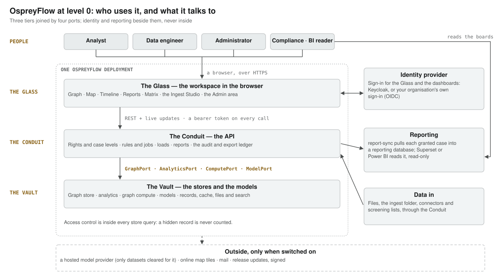
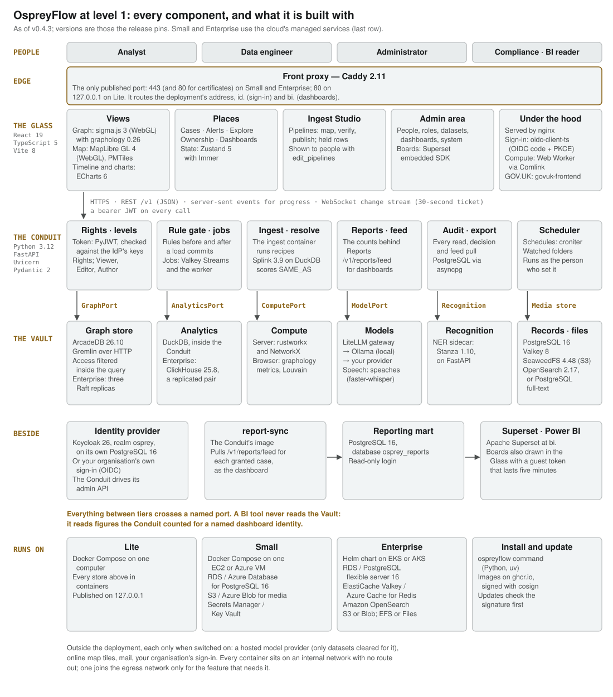

# OspreyFlow — Architecture Guide

OspreyFlow is an open source intelligence mapping platform for crime analysis, anti-money-laundering,
fraud detection, and event monitoring and alerting, developed by Solirius Reply and released under the
Apache License 2.0.

For architects, security reviewers and anyone deciding whether OspreyFlow fits their organisation:
how it is built, what crosses each boundary, how access is enforced, how cases and datasets relate,
and what it deliberately does not do. It describes what is built, and says plainly where something is
not yet ("coming").

The other guides in this folder are the [administration guide](administration-guide.md), for whoever
installs and runs OspreyFlow, the [user guide](user-guide.md), for analysts, and the
[developer guide](developer-guide.md), for data engineers.

<!-- document-control:begin -->
## Document control

**Version 1.1** · 2026-11-10 · For OspreyFlow v0.4.12 · Issued

| Version | Date | What changed |
| --- | --- | --- |
| 1.1 | 2026-11-10 | Promotion as built (case lane's L3.4). One door in: Small on your own server publishes 443 alone. |
| 1.0 | 2026-11-09 | First issue: the two architecture levels, the tiers and ports, the four places, cases and datasets (one dataset per case, home cases, the analyst layer, views instead of branches), access control in the store, where the data lives, every interface, the licence register's traps, and the limits. |

<!-- document-control:end -->

---

## 1. Level 0: who uses it, and what it touches

OspreyFlow is one deployment for one organisation. The people who use it each hold one or more
**roles** (the user guide's section 4 and the administration guide's section 9.2 say what each lets
a person do):

| Role | What they do in it |
| --- | --- |
| **Analyst** | Investigates cases, works alerts and keeps watches. Reads figures and boards. |
| **Data Engineer** | Builds and runs pipelines, reviews promotions into a dataset and decides held rows. |
| **Administrator** | Looks after people, roles, teams, datasets and the deployment. Does not investigate by being one. |
| **Reports Viewer** | Reads a case's figures and the dashboards, and sees the alerts on cases they can read. Never works an alert. |
| **Rule author** | Writes the rules that raise alerts, and works the alerts in the queue. |

Around the three tiers sit the **identity provider** (Keycloak, which says who someone is; it can
hand sign-in to the organisation's own provider), **reporting** (a feed the Conduit serves, pulled
into a reporting database that Superset or another BI tool reads), **data in** (files, a watched
ingest folder and connectors to SQL databases, HTTP APIs and screening lists), and the **outside
services** a deployment may switch on: a hosted model provider, mail, online map tiles, the
organisation's sign-in, and the cloud's managed services.

## 2. Three tiers, four ports

| Tier | What it is |
| --- | --- |
| **The Glass** | The browser workspace: one web application holding the four places (section 4) |
| **The Conduit** | The API (FastAPI), stateless and horizontally scaled. Every request is checked against the person making it, and access control is applied inside each query to the stores, never after |
| **The Vault** | The stores: the graph store (ArcadeDB), the analytics database (DuckDB inside the Conduit, or ClickHouse shared by several Conduits), search (OpenSearch, or PostgreSQL full-text), PostgreSQL, the object store, and the models |

Everything that passes between the Conduit and the Vault crosses one of four typed **ports**. A port
is a narrow interface (a Python `Protocol`) that everything above it may call and nothing else may.
Each has a conformance suite, written before any adapter, and an adapter is supported only once it
passes it. Swapping the engine behind a port, say a laptop's in-process DuckDB for a cluster's
ClickHouse, means writing one adapter and changing one line of configuration.

| Port | What passes through it |
| --- | --- |
| **GraphPort** | Typed traversal of the graph, with the person's clearance, handling codes and case datasets injected into it |
| **AnalyticsPort** | Events, trends and histograms, filtered the same way |
| **ComputePort** | Graph algorithms: centrality, communities, ownership chains, over what the reader can see |
| **ModelPort** | Extraction, vision, transcription and embedding, through the LiteLLM gateway |

Two narrower ports sit beside them: the **media store**, for content files (an S3-protocol store, or
Azure Blob), and the **recognition port**, for the fast named-entity pass (Stanza by default).

**Gremlin never leaves the Vault.** The Conduit builds the graph store's queries; the Glass never
sees one and never sends one. That keeps a move to another graph query language an adapter change,
and it is the security boundary: no analyst can write a traversal that steps around the access
filter.

## 3. Level 1: every component

The level 1 diagram names the technology in each component; versions are those the release pins.
Small and Enterprise use the cloud's managed services where the diagram's last row says.

**One door in.** A front proxy (Caddy) is the only published port: 80 on Lite (bound to the
machine itself), 80 and 443 with HTTPS on Enterprise and on Small in the cloud, and 443 alone on Small on your own server
(80 too only with `redirect_http`, as a redirect). Behind it, at the deployment's
address, are the Glass; sign-in at `id.`; and dashboards at `bi.`.

**No route out by default.** Every container sits on an internal network with no route to the
internet. A container joins the egress network only when a configured feature needs it: the model
downloads, the proxy's certificate, a client's own model provider, mail, an organisation's own
sign-in, online map tiles, and on Small and Enterprise the cloud's managed services.

**One set of images, three modes.** Lite runs on one computer under Docker; Small runs on one
server, in your cloud or your own network; Enterprise runs on Kubernetes (EKS or AKS). The same images
and the same acceptance suite serve all three. The administration guide's section 1 compares them.

## 4. The four places

The Glass holds four **places**. A person sees only the places their roles open; a place hidden from
them is one whose every route also refuses them, so hiding is never the control.

| Place | For | Holds |
| --- | --- | --- |
| **The Glass** | Investigate a case: search, expand, map, read its figures and its boards | Case · Boards |
| **Ingest Studio** | Bring data in: sources, pipelines, the domain model and held rows | 1 Model · 2 Sources · 3 Pipelines · 4 Runs |
| **Rules and Monitoring** | Work the alerts that rules and watches raise, and see what raises them | Alerts · What raises alerts · Held rows · Changes |
| **Admin** | Run the deployment: people, roles, teams, datasets, models, maps and operations | Sections, each shown only to the holder of its right |

A switcher in the top bar lists the places (keys G, I, R and A); under the GOV.UK theme the switch sits
inside the GOV.UK header. **Coming:** releases between environments in the Ingest Studio, and the
rule editor in Rules and Monitoring.

## 5. Cases and datasets

**A dataset** is a body of loaded data with one **domain model** (from a starter pack such as FIBO,
NIEM or STIX, or bare people, objects, locations and events), its own unit and its own highest
marking. Datasets are of three kinds: *Source* (loaded through the Ingest Studio), *Composite* (read
from several sources, read-only for now) and *Drawn* (made by drawing, below).

**A case** is the only container an analyst works in. Each case reads **one dataset**, and every
search, path, expansion, count and watch stays inside it. Each person holds a level on a case:
Viewer, Editor or Author.

**A home case per dataset.** Every dataset has one home case, made when it is first made live and
named for it. It holds the dataset's own reports and its dataset-wide alerts. A dataset's **Authors**
are its home case's Authors: they answer for the dataset.

**A case's analyst layer.** What analysts write in a case (marking a record by hand, a link drawn by
hand, a drawing board's items) goes into that case's own **analyst layer**, read together with the
dataset and never written into it. No other case sees the layer, and none can infer it from a
degree, a path length or a count. Accepted model proposals and extractions are written to the
dataset as before.

**Drawing boards.** A board belongs to a case. On it an analyst declares a person, an account or a
place and draws the links between them; each drawn item carries a marking, a grading in the
deployment's scheme and a source. A drawing started with no case makes a **drawn dataset** of its
own, with its home case and a board. **Promotion** sends drawn items into the case's dataset as one
load, checked against its highest marking and model, committed at once or reviewed by one of its
Authors first, as the dataset's policy says; a removed case's layer is merged the same way or deleted.
**Coming:** merging a drawn dataset into another.

**Views, never branches.** A **case view** is a saved lens on a case: what was drawn, the filters and
the period. Opening one reads the case through it, read-only. There are no branches and no copies of
a case.

**Records are never merged.** Records that look like the same person are joined by a scored
*same as* link and shown as one at the strictness the case is set to. Change the strictness and they
come apart again.

**What a model says is inferred.** Anything a model produces stays *inferred*, drawn dashed, until a
person confirms it. No confidence threshold promotes it on anyone's behalf.

## 6. Access control in the store

- **Every record carries its handling**: a classification, handling codes, an action code and a
  sanitisation code, set at load and checked again, item by item, at export.
- **The person travels with every read.** The Conduit resolves who is asking from the token and passes
  them into every read through the ports, counts included. The adapter puts the filter into the
  traversal or the `WHERE` clause. A record the reader may not see is absent, and so is any degree,
  path length, histogram bucket or figure that would reveal it. Each adapter's conformance suite
  holds it to that.
- **Seeing is not doing.** A case level and a right are checked before a route runs (a missing level
  answers as a missing case); neither widens what the reader may see.
- **The Glass never sees** a store's query language, a source system's identifier or an unfiltered
  count.
- **Nothing is cut silently.** A result over the working set's limit is refused with a typed
  `limit_exceeded` and three choices (save a smaller view, filter first, or run it as a batch job),
  never truncated.
- **Every read and write is audited**, with who, when and what; an expansion that crosses a handling
  boundary needs a justification.

## 7. Where the data lives during analysis

- **The persistent graph** is in the Vault and may be very large. Nobody queries it interactively.
- **The working set** is what one analyst is investigating: the subgraph they have expanded into and
  its events, bounded at 50,000 nodes and 250,000 links, held server-side in Valkey for the case and
  streamed to the browser as changes.
- **The browser set** is the working set in the browser's memory. The timeline brush, the map view and
  the filters work on it with no network call, which is why the views filter each other at once.
- **Kept out of the graph:** screening lists (their own store), held rows (a quarantine until a person
  releases or rejects them), and KYC status and risk, which are worked out at each read, as the reader,
  and never stored.

## 8. Every interface, and what crosses it

Each interface has one direction, one owner and one guard. The administration guide's *How OspreyFlow
is built* gives the same table with each interface's transport.

| Interface | From → to | What crosses | Guarded by |
| --- | --- | --- | --- |
| **The front door** | Browser → Caddy → the Glass, the Conduit (`/v1`), sign-in at `id.`, dashboards at `bi.` | Every request | The only published port |
| **Sign-in and token** | The Glass, Superset → identity provider → the Conduit | Credentials, typed only at the identity provider; then who the person is, their clearance, unit, handling codes and roles | Every token's signature checked on every call |
| **Rights** | The Conduit → the Glass (`GET /v1/me/rights`) | What this person may do; the places and menus follow it | Each route checks its own right |
| **The API** | The Glass → the Conduit (`/v1/…`) | Searches, working sets, edits, loads, figures, exports | Access control inside each store query; `limit_exceeded`, never a silent cut |
| **Live updates** | The Conduit → the Glass | Changes to the open case; progress | A one-time ticket, the person's own |
| **Administration** | Admin → the Conduit (`/v1/admin/…`) → the identity provider | People, roles, teams, datasets, models, maps, operations, audit | Each section's own right |
| **GraphPort** | The Conduit → ArcadeDB | Typed traversals; writes; a load's revert | The reader's clearance, handling codes and case dataset inside the traversal |
| **AnalyticsPort** | The Conduit → DuckDB or ClickHouse | Event aggregates, trends and histograms | The same filters inside the query |
| **ComputePort** | The Conduit → rustworkx and NetworkX; the Glass → graphology | Centrality, communities, ownership chains | Computed over what the reader can see |
| **ModelPort** | The Conduit → LiteLLM → the local models, or a provider you configure | Text, images and audio; what returns is *inferred* | Each dataset's egress and the handling codes that may be sent |
| **Media store** | The Conduit and the ingest container → the object store | Content files, staging, site images, the tile cache | Private storage; files reach the Glass only through the Conduit |
| **Ingest** | The Ingest Studio, the ingest folder and connectors → the Conduit → the ingest container | Files and rows, loaded under a deployed pipeline | The pipeline rights; a run is made as the person who set it |
| **Reporting feed** | report-sync → the Conduit (`/v1/reports/feed`) → PostgreSQL `osprey_reports` → Superset or a BI tool | Figures only, counted as that dashboard's account | The dashboard's own credentials; every pull in the export ledger |
| **Updates** | `ospreyflow update` → the repository's releases | The release list, its lock and its images | The release's signature, checked before anything changes |

## 9. Open source, and the licence traps

The build fails if a dependency's licence is not on the allowlist (Apache-2.0, MIT, the BSD
licences, ISC, MPL-2.0 and a short list of others). GPL and AGPL never pass; an LGPL package passes
only with a recorded exception, for dynamic linking alone. Several well-known components were
avoided for their licence:

| Avoided | Its licence | Used instead |
| --- | --- | --- |
| Redis 7.4 and later | RSAL / SSPL | Valkey (BSD-3-Clause) |
| Elasticsearch | SSPL / Elastic Licence | OpenSearch (Apache-2.0) |
| Neo4j Community | GPL-3.0 | ArcadeDB |
| ArangoDB | BSL 1.1 | ArcadeDB |
| FalkorDB | SSPL | rustworkx for in-memory algorithms |
| Mapbox GL JS 2 and later | Proprietary | MapLibre GL JS (BSD-3-Clause) |
| MongoDB | SSPL | PostgreSQL, and an S3-protocol object store |
| Highcharts, AG Grid Enterprise | Commercial | Apache ECharts, TanStack Table |
| Grafana 9 and later | AGPL-3.0 | Never bundled; acceptable only as an unmodified separate service |
| Stanford CoreNLP | GPL-3.0 | Stanza (Apache-2.0), held at a version with no GPL dependency |
| Terraform | BSL 1.1 | OpenTofu (MPL-2.0) |

**Data has licences too.** A screening list's licence is recorded before its connector ships. Two are
not confirmed for a customer's screening (the UN list; OpenSanctions, which is non-commercial only),
so their connectors read OspreyFlow's own synthetic lists until they are. OspreyFlow ships only
synthetic data: no real data is in the repository, its tests or its demonstrations, except a public
dataset an administrator chooses to download and add on their own deployment.

## 10. What it deliberately does not do

- **No real-time streaming ingestion.** Loads are batches and small batches, on demand, on a schedule
  or from a watched folder.
- **No vector search in the graph store.** Embeddings are kept in search, so the graph store stays
  swappable.
- **No multi-tenancy.** One deployment serves one organisation. Handling markings and datasets
  partition what each person reads within it; neither is a tenancy boundary.
- **No mobile client.** The workspace is for a desktop analyst; it is usable at 1024 pixels wide for
  review.
- **Not yet assessed.** OspreyFlow is designed to meet the GDS Service Standard; an independent
  accessibility audit, a penetration test and a DPIA are planned, and only a service assessment panel
  can say a service meets the Standard.
- **Enterprise's in-cluster stores are not backed up by `ospreyflow backup` yet**: take snapshots of
  their volumes with the cloud's own tools (administration guide, section 13).
