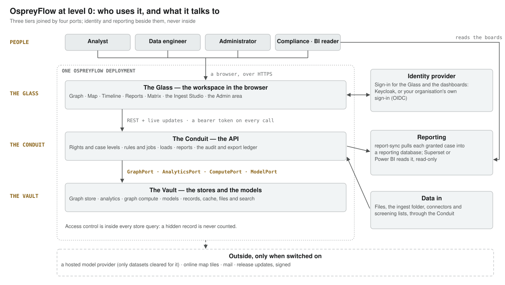
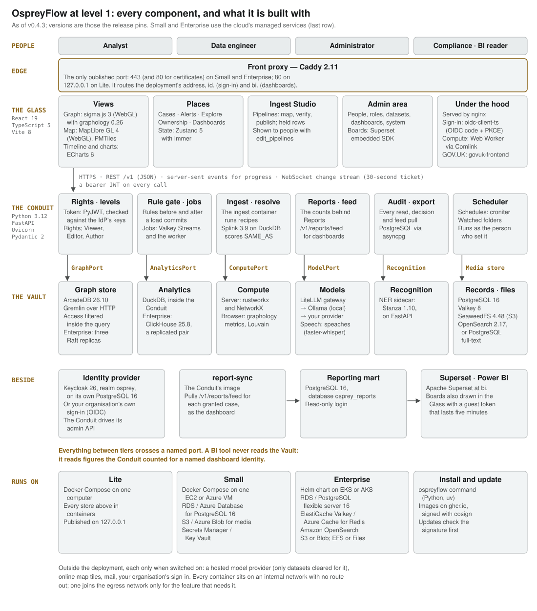

# OspreyFlow — Architecture Guide

OspreyFlow is an open source intelligence mapping platform for crime analysis, anti-money-laundering,
fraud detection, and event monitoring and alerting, developed by Solirius Reply and released under the
Apache License 2.0.

For architects, security reviewers and anyone deciding whether OspreyFlow fits their organisation:
how it is built, what crosses each boundary, how access is enforced, how cases and datasets relate,
and what it deliberately does not do. It describes what is built, and says plainly where something is
not yet ("coming").

The other guides in this folder are the [administration guide](administration-guide.md), for whoever
installs and runs OspreyFlow, the [user guide](user-guide.md), for analysts, and the
[developer guide](developer-guide.md), for data engineers.

## Why OspreyFlow is built this way

Intelligence mapping sits at the centre of sensitive work, and an organisation is only in charge of that
work if it is in charge of the software that holds it. OspreyFlow starts from that. A tool for this work
should be one you can read, change, host and replace, and one in which it is plain who did what. Open
source is what makes the first of those possible; it is not enough on its own. So the platform is built
to five constraints. Each is named below, said in plain words, and followed by what holds it today and
what does not yet. Where something is not built, this guide says "coming".

**Software sovereignty.** You can inspect, modify, host and replace the software that holds your
knowledge. Software you can read lets you check for yourself what it does with your data, without asking
its supplier. Software you can change lets you fix or adapt it on your own timetable. Software you can host
runs where your rules say it must, and software you can replace means a supplier's change of terms never
holds your records hostage. Here that means every dependency is under an open-source licence, and each
store or engine sits behind a port (section 2), so replacing one is one adapter and one line of
configuration. What holds it: a licence gate runs on every change and reads the Python and Node package
metadata of the build, the runtime each image carries and each demonstration dataset's licence (the Python
packages inside an image are checked for two images only); a package under the GPL
or AGPL never passes, and an LGPL one only with a recorded exception (section 9). The statement covers
software dependencies. Model weights, map data, fonts and base images are outside the gate; a register and
a gate for them are coming, and until they land their licences are not all stated in the repository.

**Data sovereignty.** The aim is a deployment that runs on your own network, with nothing leaving it
unless an administrator allows it. What holds it: every container sits on an internal network with no route out,
only the front proxy is published, and a container is given a route out only when what it does needs
one: the model downloads and, on an https address, the proxy's certificate fetch (both on by default), and the
features an administrator configures (section 3 lists them). The models run inside the deployment.
A hosted model engine is an opt-in: it is off while `models.local_only` is true, which is the default,
and when an administrator turns one on, what may be sent is bounded by each dataset's egress setting and
its handling codes. What does not yet hold: a first install needs the internet (the command, the images and
the model files are fetched on the way in), and a default install fetches its model files from outside on
every start; an offline bundle serves updates (administration guide, section 14). Superset's navigation
bar draws a small usage-tracking image from an address outside the deployment, and it is the person's browser that asks
for it, so the deployment's internal network does not stand in its way. Superset's content policy in
v0.6.1 and earlier allowed that address, so a browser that could reach the internet could send the request
(read in the image's code, not measured in a browser). The fix is in v0.6.2: a content policy for
Superset that allows no outside address, so a browser refuses the image before it asks. A Small deployment on an https
address fetches a certificate by default, unless the administrator gives it one. The model gateway's own
cost-map fetch is switched off, and the speech server runs with its model hub offline, but its download step
still reaches outside; the other stores and servers are kept in by the network, not by a setting of
their own. No test yet proves that no page
requests anything outside the deployment; a browser test that does is coming.

**Privacy control.** What each person sees is bounded by handling markings and by case membership. This
guide and the screens call it need-to-know, access control, clearance and *withheld*. What holds it:
access is applied inside the store's own query, in the graph traversal and in the analytics query, and
search has a filter of its own (section 6). The aim is that a record a person may not see is absent, and so is any degree,
path length, histogram bucket or figure that would reveal it. Each adapter's conformance suite, and a
test that walks every GET route as a person with no role, hold the store's queries to that. What does not
yet: an independent penetration test is planned, not done; the project's backlog lists known gaps on the
read side (for example, a pulls figure shown to an administrator who may not see those cases, and the
search index's own fine-grained access setting, which is not yet set, so the index is reachable below the
Conduit's filter); the reporting feed's access path has no clearance test of its own; and where Superset signs people
in through Entra ID, a person who may build dashboards reads the whole reporting store in their own
session, so that right is for people cleared for all of it (administration guide, section 6a.7).

**Security management.** What people do in the platform is recorded and can be traced to them. Here,
*access* means every read and write of case data. The reference reads that carry none, such as the type
list and map tiles, are outside it, and so is deployment metadata. What holds it: case reads, refusals of
access to a case and every change are written to an audit table, with who, when and what, and a failed
write fails the request. The export ledger records who, when, which case, the handling level and whether
anything was withheld, for report, assessment, pack and feed exports. What does not yet: model calls are
recorded with the person and the case for some jobs (asking, extraction and document designation), not for
all, and asking does not record the engine, so one record of every model call, with who asked, for which
case and to which engine, is coming; sign-in events are not recorded by the platform, and recording them
is coming; some exports (a dataset release, a rule file, a source file)
write an audit row but no ledger row, and a platform backup and an object transfer write neither, so a
ledger row for every export is coming. The audit table is append-only in intent, not yet refused by the
database to another role, and carries no hash chain. Section 6 lists what is not audited, by design.

**Analytical accountability.** A judgement carries its evidence and its uncertainty with it. What holds
it: the Inspector's Judgements records a statement, how likely it is on a seven-band probability
yardstick, and the evidence for and against; a judgement cannot be saved without at least one supporting
reference, checked on the screen and again on the server; citations are verified when it is saved and
again at each export; anything a model produces stays *inferred* until a person confirms it (section 5);
and every drawn item carries a grading and a source. What does not yet: the uncertainty a judgement
carries is its probability band and nothing finer, and a judgement has no inferred or confirmed status of
its own.

<!-- document-control:begin -->
## Document control

**Version 1.10** · 2026-11-21 · For OspreyFlow v0.6.1 · Issued

| Version | Date | What changed |
| --- | --- | --- |
| 1.10 | 2026-11-21 | *Why OspreyFlow is built this way* and §9, corrected to the truth check (DC1c, verifier's second findings): §9 says an open-source alternative is used or the component is not bundled, since the register's Grafana row records no alternative. Held by `tests/test_intent_in_the_guides.py`. PDF made again. |
| 1.9 | 2026-11-21 | *Why OspreyFlow is built this way*, corrected to the truth check (DC1c, verifier's findings): a container's route out is described as what the model downloads, the proxy's certificate fetch and the configured features need, not as configured alone; the speech server's download step and the certificate fetch are named among what does not yet hold; the licence gate is described as reading the build's package metadata, with the Python packages inside an image checked for two images only; Superset's tracking image is from "an address outside the deployment"; the privacy sentence is an aim held by the store's queries, with two named read-side gaps. Held by `tests/test_intent_in_the_guides.py`. PDF made again. |
| 1.8 | 2026-11-20 | A passage, *Why OspreyFlow is built this way*, after the opening: the intent and the five constraints (software sovereignty, data sovereignty, privacy control, security management, analytical accountability), each with what holds it today and what is "coming" (DC1c). §6: the audit sentence said to cover case data, with what is not audited by design, the export ledger's contents and the two records still to come, instead of "every read and write". §9: the licence rule and the allowlist in words, naming no product; the table of avoided components moved to the specification's licence register (the owner's ruling of 20 November 2026). Held by `tests/test_intent_in_the_guides.py`. PDF made again. |
| 1.7 | 2026-11-16 | The header names v0.6.1, the patch to v0.6.0 (Ask & Chat a drawer by default, ADR-145 Amendment 20; search on Small and Lite fed by the Conduit, ADR-150 Amendment 4). Held by `tests/test_guides_release_header.py`. Version set at the cut. PDF made by the orchestrator at the cut. |
| 1.6 | 2026-11-15 | The header names v0.6.0, the one release v0.5.2's work ships in (the owner's plan of 15 November). Held by `tests/test_guides_release_header.py`. Version set at merge. PDF made by the orchestrator at merge. |
| 1.5 | 2026-11-15 | The header names v0.5.2, the release this guide describes (step 5's sweep, §2, at the cut). Held by `tests/test_guides_release_header.py`. Version set at merge. PDF made by the orchestrator at merge. |
| 1.4 | 2026-11-14 | Step 5's wording sweep, early part. §2: search as built, OpenSearch or, with `postgres-fulltext`, the graph store's exact search alone (no PostgreSQL full-text exists); the third narrow port, `IndexFeedSource` (ADR-150, access in the index's query, ADR-149). §3: the `cloud-platform` profile beside the three modes. §5: a drawn dataset merged into another, as built, no longer *Coming*. Held by `tests/test_guides_ports_and_search.py`, `test_guides_drawn_merge.py` and `test_guides_v051_gaps.py`. PDF made by the orchestrator at merge. |
| 1.3 | 2026-11-13 | §1: on a shared platform the identity provider is the organisation's Entra ID, in Keycloak's place (docs' v0.5.2 sweep, part one). PDF made by the orchestrator at merge. |
| 1.2 | 2026-11-10 | Describes v0.5.0. §4: releases between environments and the rule editor as built, no longer *coming*. |
| 1.1 | 2026-11-10 | Promotion as built (case lane's L3.4). One door in: Small on your own server publishes 443 alone. |
| 1.0 | 2026-11-09 | First issue: the two architecture levels, the tiers and ports, the four places, cases and datasets (one dataset per case, home cases, the analyst layer, views instead of branches), access control in the store, where the data lives, every interface, the licence register's traps, and the limits. |

<!-- document-control:end -->

---

## 1. Level 0: who uses it, and what it touches

OspreyFlow is one deployment for one organisation. The people who use it each hold one or more
**roles** (the user guide's section 4 and the administration guide's section 9.2 say what each lets
a person do):

| Role | What they do in it |
| --- | --- |
| **Analyst** | Investigates cases, works alerts and keeps watches. Reads figures and boards. |
| **Data Engineer** | Builds and runs pipelines, reviews promotions into a dataset and decides held rows. |
| **Administrator** | Looks after people, roles, teams, datasets and the deployment. Does not investigate by being one. |
| **Reports Viewer** | Reads a case's figures and the dashboards, and sees the alerts on cases they can read. Never works an alert. |
| **Rule author** | Writes the rules that raise alerts, and works the alerts in the queue. |

Around the three tiers sit the **identity provider** (Keycloak, which says who someone is; it can
hand sign-in to the organisation's own provider; on a shared platform, the organisation's Entra ID
in its place), **reporting** (a feed the Conduit serves, pulled
into a reporting database that Superset or another BI tool reads), **data in** (files, a watched
ingest folder and connectors to SQL databases, HTTP APIs and screening lists), and the **outside
services** a deployment may switch on: a hosted model provider, mail, online map tiles, the
organisation's sign-in, and the cloud's managed services.

## 2. Three tiers, four ports

| Tier | What it is |
| --- | --- |
| **The Glass** | The browser workspace: one web application holding the four places (section 4) |
| **The Conduit** | The API (FastAPI), stateless and horizontally scaled. Every request is checked against the person making it, and access control is applied inside each query to the stores, never after |
| **The Vault** | The stores: the graph store (ArcadeDB), the analytics database (DuckDB inside the Conduit, or ClickHouse shared by several Conduits), search (OpenSearch; where a deployment has none, `postgres-fulltext`, the graph store's own reads, and the results page says search is limited to exact identifiers), PostgreSQL, the object store, and the models |

Everything that passes between the Conduit and the Vault crosses one of four typed **ports**. A port
is a narrow interface (a Python `Protocol`) that everything above it may call and nothing else may.
Each has a conformance suite, written before any adapter, and an adapter is supported only once it
passes it. Swapping the engine behind a port, say a laptop's in-process DuckDB for a cluster's
ClickHouse, means writing one adapter and changing one line of configuration.

| Port | What passes through it |
| --- | --- |
| **GraphPort** | Typed traversal of the graph, with the person's clearance, handling codes and case datasets injected into it |
| **AnalyticsPort** | Events, trends and histograms, filtered the same way |
| **ComputePort** | Graph algorithms: centrality, communities, ownership chains, over what the reader can see |
| **ModelPort** | Extraction, vision, transcription and embedding, through the LiteLLM gateway |

Three narrower ports sit beside them: the **media store**, for content files (an S3-protocol store, or
Azure Blob); the **recognition port**, for the fast named-entity pass (Stanza by default); and the **search
index feed's source** (`IndexFeedSource`), through which the indexer alone reads each node as stored, unfiltered,
to build its search document (ADR-150). It is kept apart from GraphPort so that no route can reach that read:
every route is given a GraphPort and no other graph read, and who may see a search result is decided in the query to
the index, with the same clearance, handling codes and case datasets (ADR-149).

**Gremlin never leaves the Vault.** The Conduit builds the graph store's queries; the Glass never
sees one and never sends one. That keeps a move to another graph query language an adapter change,
and it is the security boundary: no analyst can write a traversal that steps around the access
filter.

## 3. Level 1: every component

The level 1 diagram names the technology in each component; versions are those the release pins.
Small and Enterprise use the cloud's managed services where the diagram's last row says.

**One door in.** A front proxy (Caddy) is the only published port: 80 on Lite (bound to the
machine itself), 80 and 443 with HTTPS on Enterprise and on Small in the cloud, and 443 alone on Small on your own server
(80 too only with `redirect_http`, as a redirect). Behind it, at the deployment's
address, are the Glass; sign-in at `id.`; and dashboards at `bi.`.

**No route out by default.** Every container sits on an internal network with no route to the
internet. A container joins the egress network only when a configured feature needs it: the model
downloads, the proxy's certificate, a client's own model provider, mail, an organisation's own
sign-in, online map tiles, and on Small and Enterprise the cloud's managed services.

**One set of images, three modes.** Lite runs on one computer under Docker; Small runs on one
server, in your cloud or your own network; Enterprise runs on Kubernetes (EKS or AKS). The same images
and the same acceptance suite serve all three. The administration guide's section 1 compares them.
A namespace on an organisation's own shared Kubernetes platform is a profile of its own, `cloud-platform`
(the administration guide's section 6a): the platform's managed services, non-root containers, sign-in
through the organisation's Entra ID, and a single-copy shape for a proof of concept. There the Conduit's image is built without Java (so no basemap
is built on the platform), and the second extraction engine, Laurium, has an image of its own.

## 4. The four places

The Glass holds four **places**. A person sees only the places their roles open; a place hidden from
them is one whose every route also refuses them, so hiding is never the control.

| Place | For | Holds |
| --- | --- | --- |
| **The Glass** | Investigate a case: search, expand, map, read its figures and its boards | Case · Boards |
| **Ingest Studio** | Bring data in: sources, pipelines, the domain model and held rows | 1 Model · 2 Sources · 3 Pipelines · 4 Runs |
| **Rules and Monitoring** | Work the alerts that rules and watches raise, and see what raises them | Alerts · What raises alerts · Held rows · Changes |
| **Admin** | Run the deployment: people, roles, teams, datasets, models, maps and operations | Sections, each shown only to the holder of its right |

A switcher in the top bar lists the places (keys G, I, R and A); under the GOV.UK theme the switch sits
inside the GOV.UK header. Releases between environments are made in the Ingest Studio, and rules are
written in Rules and Monitoring's rule editor.

## 5. Cases and datasets

**A dataset** is a body of loaded data with one **domain model** (from a starter pack such as FIBO,
NIEM or STIX, or bare people, objects, locations and events), its own unit and its own highest
marking. Datasets are of three kinds: *Source* (loaded through the Ingest Studio), *Composite* (read
from several sources, read-only for now) and *Drawn* (made by drawing, below).

**A case** is the only container an analyst works in. Each case reads **one dataset**, and every
search, path, expansion, count and watch stays inside it. Each person holds a level on a case:
Viewer, Editor or Author.

**A home case per dataset.** Every dataset has one home case, made when it is first made live and
named for it. It holds the dataset's own reports and its dataset-wide alerts. A dataset's **Authors**
are its home case's Authors: they answer for the dataset.

**A case's analyst layer.** What analysts write in a case (marking a record by hand, a link drawn by
hand, a drawing board's items) goes into that case's own **analyst layer**, read together with the
dataset and never written into it. No other case sees the layer, and none can infer it from a
degree, a path length or a count. Accepted model proposals and extractions are written to the
dataset as before.

**Drawing boards.** A board belongs to a case. On it an analyst declares a person, an account or a
place and draws the links between them; each drawn item carries a marking, a grading in the
deployment's scheme and a source. A drawing started with no case makes a **drawn dataset** of its
own, with its home case and a board. **Promotion** sends drawn items into the case's dataset as one
load, checked against its highest marking and model, committed at once or reviewed by one of its
Authors first, as the dataset's policy says; a removed case's layer is merged the same way or deleted.
A drawn dataset is **merged into another** the same way, as one load into the target, after its types are
mapped onto the target's model and its likely matches proposed as scored links for a person to confirm (never
merged in storage); its boards then become views of the case.

**Views, never branches.** A **case view** is a saved lens on a case: what was drawn, the filters and
the period. Opening one reads the case through it, read-only. There are no branches and no copies of
a case.

**Records are never merged.** Records that look like the same person are joined by a scored
*same as* link and shown as one at the strictness the case is set to. Change the strictness and they
come apart again.

**What a model says is inferred.** Anything a model produces stays *inferred*, drawn dashed, until a
person confirms it. No confidence threshold promotes it on anyone's behalf.

## 6. Access control in the store

- **Every record carries its handling**: a classification, handling codes, an action code and a
  sanitisation code, set at load and checked again, item by item, at export.
- **The person travels with every read.** The Conduit resolves who is asking from the token and passes
  them into every read through the ports, counts included. The adapter puts the filter into the
  traversal or the `WHERE` clause. A record the reader may not see is absent, and so is any degree,
  path length, histogram bucket or figure that would reveal it. Each adapter's conformance suite
  holds it to that.
- **Seeing is not doing.** A case level and a right are checked before a route runs (a missing level
  answers as a missing case); neither widens what the reader may see.
- **The Glass never sees** a store's query language, a source system's identifier or an unfiltered
  count.
- **Nothing is cut silently.** A result over the working set's limit is refused with a typed
  `limit_exceeded` and three choices (save a smaller view, filter first, or run it as a batch job),
  never truncated.
- **Reads and writes of case data are audited**, with who, when and what. Case reads, refusals of access
  to a case and every change are recorded; an expansion that crosses a handling boundary needs a
  justification, which is recorded with it. A failed audit write fails the request. Here *access* means
  every read and write of case data. The reference reads that carry none, the type list and map tiles,
  are outside it.
- **Exports are recorded in a ledger.** It holds who, when, which case, the handling level and a
  withheld flag for report, assessment, pack and feed exports.
- **What is not audited, by design:** deployment metadata (the ontology, map providers, ingest
  connectors, packs and transforms, the tile proxy), some reads on a case (link types, promotable
  items, link history and the case brief) and the export ledger's own listing. Refusals other than
  refusals of case access, connector reads and Studio recipes are not audited either.
- **Coming:** one record of every model call, with who asked, for which case and to which engine, and a
  record of sign-in events. Until then the audit holds model calls for some jobs only (the passage
  *Why OspreyFlow is built this way*, above, says which), and sign-in events are not recorded by the platform.

## 7. Where the data lives during analysis

- **The persistent graph** is in the Vault and may be very large. Nobody queries it interactively.
- **The working set** is what one analyst is investigating: the subgraph they have expanded into and
  its events, bounded at 50,000 nodes and 250,000 links, held server-side in Valkey for the case and
  streamed to the browser as changes.
- **The browser set** is the working set in the browser's memory. The timeline brush, the map view and
  the filters work on it with no network call, which is why the views filter each other at once.
- **Kept out of the graph:** screening lists (their own store), held rows (a quarantine until a person
  releases or rejects them), and KYC status and risk, which are worked out at each read, as the reader,
  and never stored.

## 8. Every interface, and what crosses it

Each interface has one direction, one owner and one guard. The administration guide's *How OspreyFlow
is built* gives the same table with each interface's transport.

| Interface | From → to | What crosses | Guarded by |
| --- | --- | --- | --- |
| **The front door** | Browser → Caddy → the Glass, the Conduit (`/v1`), sign-in at `id.`, dashboards at `bi.` | Every request | The only published port |
| **Sign-in and token** | The Glass, Superset → identity provider → the Conduit | Credentials, typed only at the identity provider; then who the person is, their clearance, unit, handling codes and roles | Every token's signature checked on every call |
| **Rights** | The Conduit → the Glass (`GET /v1/me/rights`) | What this person may do; the places and menus follow it | Each route checks its own right |
| **The API** | The Glass → the Conduit (`/v1/…`) | Searches, working sets, edits, loads, figures, exports | Access control inside each store query; `limit_exceeded`, never a silent cut |
| **Live updates** | The Conduit → the Glass | Changes to the open case; progress | A one-time ticket, the person's own |
| **Administration** | Admin → the Conduit (`/v1/admin/…`) → the identity provider | People, roles, teams, datasets, models, maps, operations, audit | Each section's own right |
| **GraphPort** | The Conduit → ArcadeDB | Typed traversals; writes; a load's revert | The reader's clearance, handling codes and case dataset inside the traversal |
| **AnalyticsPort** | The Conduit → DuckDB or ClickHouse | Event aggregates, trends and histograms | The same filters inside the query |
| **ComputePort** | The Conduit → rustworkx and NetworkX; the Glass → graphology | Centrality, communities, ownership chains | Computed over what the reader can see |
| **ModelPort** | The Conduit → LiteLLM → the local models, or a provider you configure | Text, images and audio; what returns is *inferred* | Each dataset's egress and the handling codes that may be sent |
| **Media store** | The Conduit and the ingest container → the object store | Content files, staging, site images, the tile cache | Private storage; files reach the Glass only through the Conduit |
| **Ingest** | The Ingest Studio, the ingest folder and connectors → the Conduit → the ingest container | Files and rows, loaded under a deployed pipeline | The pipeline rights; a run is made as the person who set it |
| **Reporting feed** | report-sync → the Conduit (`/v1/reports/feed`) → PostgreSQL `osprey_reports` → Superset or a BI tool | Figures only, counted as that dashboard's account | The dashboard's own credentials; every pull in the export ledger |
| **Updates** | `ospreyflow update` → the repository's releases | The release list, its lock and its images | The release's signature, checked before anything changes |

## 9. Open source, and the licence traps

The build fails if a dependency's licence is not on the allowlist (Apache-2.0, MIT, the BSD
licences, ISC, MPL-2.0 and a short list of others). GPL and AGPL never pass; an LGPL package passes
only with a recorded exception, for dynamic linking alone.

The same rule decides what is chosen in the first place. Several well-known components were
avoided for their licence, in one of three ways: a licence that limits who may host or resell the
software, a commercial or proprietary licence that makes its use depend on a supplier's agreement, or
a licence that would bind the whole platform to the same terms, so that distributing it would mean
distributing everything built on it.
Where a component's licence was of one of these kinds, OspreyFlow uses an open-source alternative
instead, or does not bundle the component. The avoided components, their licences and what is used in their place are recorded in the
internal specification's licence register (`spec/00_ARCHITECTURE.md`, section 7), beside the allowlist
itself.

**Data has licences too.** A screening list's licence is recorded before its connector ships. Two are
not confirmed for a customer's screening (the UN list; OpenSanctions, which is non-commercial only),
so their connectors read OspreyFlow's own synthetic lists until they are. OspreyFlow ships only
synthetic data: no real data is in the repository, its tests or its demonstrations, except a public
dataset an administrator chooses to download and add on their own deployment.

## 10. What it deliberately does not do

- **No real-time streaming ingestion.** Loads are batches and small batches, on demand, on a schedule
  or from a watched folder.
- **No vector search in the graph store.** Embeddings are kept in search, so the graph store stays
  swappable.
- **No multi-tenancy.** One deployment serves one organisation. Handling markings and datasets
  partition what each person reads within it; neither is a tenancy boundary.
- **No mobile client.** The workspace is for a desktop analyst; it is usable at 1024 pixels wide for
  review.
- **Not yet assessed.** OspreyFlow is designed to meet the GDS Service Standard; an independent
  accessibility audit, a penetration test and a DPIA are planned, and only a service assessment panel
  can say a service meets the Standard.
- **Enterprise's in-cluster stores are not backed up by `ospreyflow backup` yet**: take snapshots of
  their volumes with the cloud's own tools (administration guide, section 13).
