# OspreyFlow — Developer Guide

OspreyFlow is an open-source intelligence mapping platform for crime analysis, anti-money-laundering,
fraud detection, and event monitoring and alerting.

For data engineers: the people who bring data into OspreyFlow. It covers the Ingest Studio from a
first pipeline to a scheduled one, the domain model data is mapped into, the rules a load must
pass, and the interfaces a data engineer uses beyond the screens. It describes what is built, and
says plainly where something is not yet.

The other guides in this folder are the [administration guide](administration-guide.md), for
whoever installs and runs OspreyFlow, and the [user guide](user-guide.md), for analysts.

<!-- document-control:begin -->
## Document control

**Version 1.35** · 2026-11-14 · For OspreyFlow v0.5.0 · Issued

| Version | Date | What changed |
| --- | --- | --- |
| 1.35 | 2026-11-14 | §6.3: where people sign in with Entra ID, a schedule or watched folder runs as the person who set it while they have signed in within the last 24 hours (administration guide §6a.7; ADR-148 Amendment 16). PDF made by the orchestrator at merge. |
| 1.34 | 2026-11-13 | §6.3: where people sign in with Entra ID (a shared platform), neither a schedule nor a watched folder runs: loads are started by hand (administration guide §6a.7; docs' v0.5.2 sweep, part one). PDF made by the orchestrator at merge. |
| 1.33 | 2026-11-10 | Describes v0.5.0. §3: Releases as built (studio's L1.7), no longer *coming*. |
| 1.32 | 2026-11-10 | Admin's L2.5c as built. §7.8: after the delete's dry run, an administrator may delete a removed case's layer on Admin → Datasets' screen; the merge is still the Ingest Studio's only. |
| 1.31 | 2026-11-10 | Studio's L1.5 and platform's P5 as built. §3.2: the expert steps offered by + Step in expert mode, with `write_sql_transforms`; new §3.4b: the SQL transform and the fuzzy match, their sandbox and limits, disclosed in Test, runs and 4 Runs; Admin → Connections' four kinds. §7.8: proposed link types only on 1 Model (Admin's Proposed types removed), its count and *Needs you*. §9.1: a dataset's gazetteers. |
| 1.30 | 2026-11-10 | §3: 4 Runs lists Analyst promotions and Removed cases' layers. §9.1: the routes of promotion, its review and a removed case's layer, and Admin's delete of one. §7.8: Admin's screen offers dry runs, though its delete route exists. |
| 1.29 | 2026-11-10 | Promotion as built (case lane's L3.4). §7.8: promotion as one load, the Studio's *Analyst promotions* in 4 Runs with its review, the revert command, and a removed case's layer merged or deleted. §9.1: an alert's address also asks Rules and Monitoring's gate. |
| 1.28 | 2026-11-09 | Brought up to the product as built (docs lane, D2a). §1: the four places; the architecture has its own guide. §3: the Studio's four steps (1 Model, 2 Sources, 3 Pipelines, 4 Runs), the readiness strip, guided and expert mode; *Make live* and its owner step; SQL, API and JSON sources and screening lists in 2 Sources; staging steps with a live sample; expert steps coming. §6: held rows in Rules and Monitoring and 4 Runs; Admin → Operations. New §7.8: a case's analyst layer, drawn datasets, link types proposed by analysts, and promotion (coming). §9.1: the routes of views, boards, drawings, link types, an alert's address, dataset models, ownership, model and map administration and the grading scheme. §9.3: the commands. Coming, and said so: releases between environments. |
| 1.27 | 2026-11-05 | Describes v0.4.12 (v0.4.11 was not released). No change to its content. |
| 1.26 | 2026-11-05 | Describes v0.4.11. No change to its content. |
| 1.25 | 2026-11-04 | The owner's rulings (build order step 30; spec 09 §5; ADR-127 Amendment 47): §3.8, Verify reads the files a run reads (a source node's own file included) and records each with a hash of its contents; §3.9, **Run now** runs on exactly the file Verify checked, and refuses in words, loading nothing, when that file has changed since or another file is named — the Run panel no longer takes a file; the run's answer no longer carries the server's path to the file. §3.6, the Map names each link type by its label ("Held at"), never its key. |
| 1.24 | 2026-11-04 | As found on the first server (ADR-114 Amendment 35 point 7): §9.5, Valkey's data in its container is moved too (through a committed image); the move checks each store apart and never replaces a container or writes a file of the deployment's; a refused move has the caller put back every file it wrote (`FilesHeld`); and the tests that fail if any of it breaks. |
| 1.23 | 2026-11-04 | New §9.5, where the stores keep their data in a Lite or Small `compose.yaml` (ADR-114 Amendment 35): each store's named volume, what stays on its image's unnamed volumes, the one-time move (`harness/store_volumes.py`) and the tests that fail if a store loses its volume. |
| 1.22 | 2026-11-04 | Describes v0.4.10. No change to its content. |
| 1.21 | 2026-11-04 | §9.4: the `ollama` service keeps the model loaded on a GPU (`OLLAMA_KEEP_ALIVE=-1`). |
| 1.20 | 2026-11-04 | Describes v0.4.9. No change to its content. |
| 1.19 | 2026-11-04 | §9.4, as measured on the first server (ADR-135 Amendment 1): the `ollama` service's flash attention and q8_0 KV cache on a GPU, with the measured times, and the doctor's 14 GiB for the 14b (was 12). |
| 1.18 | 2026-11-04 | Describes v0.4.8. No change to its content. |
| 1.17 | 2026-11-04 | Describes v0.4.7. No change to its content. |
| 1.16 | 2026-11-04 | New §9.4, the local engine on an NVIDIA GPU (ADR-135 Amendment 1): `resources.gpu`, how the render gives Ollama the GPU, `OspreyConfig.extraction_model` and the 14b default, the doctor's GPU checks and their tests, and a saved `osprey.yaml` keeping the 7b. |
| 1.15 | 2026-11-04 | Describes v0.4.6. No change to its content. |
| 1.14 | 2026-11-04 | Describes v0.4.5. No change to its content. |
| 1.13 | 2026-11-03 | §1: a level 0 diagram, who uses OspreyFlow and what it talks to. The administration guide has the level 1 diagram and every interface. |
| 1.12 | 2026-11-02 | Checked against the code end to end (build order step 10). §7.6 and §7.7: the tests named are in the developer repository, beside the test suites, not in this one. |
| 1.11 | 2026-11-02 | §7.6: the client's rarity measure (the default) and the IDF measure, the two compositions, dataset triggers and shared-value influencers, and the port's new parameters. New §7.7, The client's code and OspreyFlow's equivalent: their R function beside OspreyFlow's arithmetic, line by line, a worked synthetic example whose numbers match, the golden parity test, and the row shapes that do not map exactly. |
| 1.10 | 2026-11-02 | New §7.6, Connection strength: the stored weight's formula, the influencer schema and its resolution order, influencers applied at read time under the reader's access, the rarity query, and shipping influencers in the weights file. §9.1: the strength and rarity routes and the influencers' routes. |
| 1.9 | 2026-11-01 | §9.1: the API's OpenAPI document, `GET /v1/openapi.json`, signed in, its version the release. |
| 1.8 | 2026-11-01 | §3.8a: the Checks on load step — attaching the case's and the deployment's rules to a pipeline and choosing what a hit does there. §3.8: Verify shows the alerts its sample would raise, beside the rejections, and writes nothing. §2: a data engineer attaches rules but does not write them. |
| 1.7 | 2026-11-01 | The opening says what OspreyFlow is for: intelligence mapping, for crime analysis, anti-money-laundering, fraud detection, and event monitoring and alerting. |
| 1.6 | 2026-10-29 | Describes v0.4.1. No change to its content. |
| 1.5 | 2026-10-28 | §6.1: row numbers, counted from 1 in the Glass and from 0 in the API. |
| 1.4 | 2026-10-27 | §7.5: the tests behind it described, not named by path (the build's folder is not part of the product). |
| 1.3 | 2026-10-27 | §7.5: sources withheld for a reader whose case does not read all of an element's datasets, and what a contributor's writer must do about it. |
| 1.2 | 2026-10-18 | §3.3: the NIEM pack's incidents and custody links. |
| 1.1 | 2026-10-15 | A cover page, contents, a list of figures, and this version history. |
| 1.0 | 2026-10-14 | First issue, with screenshots. |

<!-- document-control:end -->

---

## 1. How OspreyFlow is built, for a data engineer

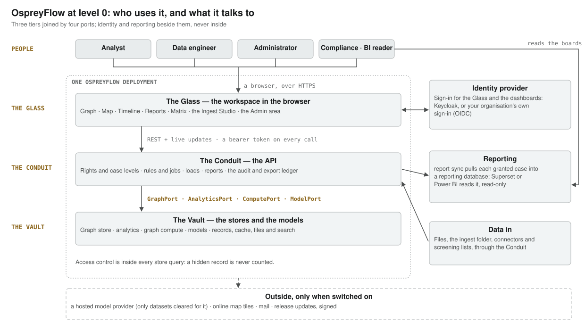

The [architecture guide](architecture-guide.md) has the level 1 diagram, with the technology in each
component, and every interface with what crosses it.

Three tiers; everything that passes between them crosses one of four typed ports:

| Tier | What it is |
| --- | --- |
| **The Glass** | The browser workspace, with four places: the Glass, the Ingest Studio (shown to anyone holding `edit_pipelines`), Rules and Monitoring, and Admin |
| **The Conduit** | The API. It holds the rights, the case levels and the audit, runs the loads, and judges each load with the case's rules |
| **The Vault** | The stores: the graph store (ArcadeDB), the analytics database (DuckDB, or ClickHouse), graph compute, the models, Valkey, the object store, OpenSearch, and PostgreSQL for the Conduit's own records |

| Port | What passes through it |
| --- | --- |
| GraphPort | Writing and finding nodes and links, reverting a load's elements, typed traversal |
| AnalyticsPort | Event aggregates — never raw SQL |
| ComputePort | Centrality, communities, ownership chains |
| ModelPort | Extraction, transcription, image description, embedding |

Three narrower ports sit beside them: the media store, for content files; the recognition port; and the search
index feed's source (`IndexFeedSource`), through which the indexer alone reads each node as stored, to build its
search document (ADR-150). It is a port of its own so that no route, which is given a GraphPort, can reach that
unfiltered read; who may see a search result is decided when the index is queried.

**Access control lives in the stores' queries.** Every read is made as a person: their clearance,
handling codes and the case's datasets are part of the query itself, never applied afterwards. The
Glass never sees a store's own query language or a source system's identifiers.

**Three separate questions decide what someone can do with data:** their **clearance and handling
codes** (what they may see), their **level on a case** — Viewer, Editor or Author (where they may
act), and their **rights** (what they may do). A right never widens what a person may see.

## 2. The Data Engineer role

| The role holds | What it lets you do |
| --- | --- |
| `edit_pipelines` | Open the Ingest Studio; make and edit pipelines |
| `verify_pipelines`, `publish_pipelines`, `run_pipelines`, `schedule_pipelines` | Verify, publish, run and schedule them |
| `add_ingest_files` | List and upload source files |
| `read_held_rows`, `decide_held_rows` | See, release and reject rows a rule held |
| `read_data_feeds`, `operate_schedules` | See what feeds a case; Admin → Operations |
| `load_screening_lists`, `deploy_rules`, `read_rule_audit`, `read_alert_queue` | Screening lists and the rules that judge loads |
| `create_case`, `share_case`, `investigate`, `run_analysis`, `read_reports` | Work in cases alongside analysts |

It also carries `revert_loads`, for reverting a load (section 6.4). It attaches rules to a pipeline (section 3.8a) but does not write them: a rule written as a
sentence needs the analyst's `keep_watches` as well as `deploy_rules`, so an analyst writes it in
Rules and Monitoring. It does **not** hold `edit_graph`, `confirm_inferred`, `extract_files`, `resolve_entities`,
`export` or `read_report_feed`: those are the Analyst's and Reports Viewer's. An administrator can
grant any single right on its own.

## 3. The Ingest Studio

The Studio is one of the four places (key `I`). It works for one **dataset** at a time, chosen in its
**Dataset** switch, and is reached for a case: the context banner says "You are in the Ingest Studio",
and **← Back to case ‹name› in the Glass** returns to it. Under the switch, a **readiness strip** says
where the dataset stands: its domain model, its sources (and how many files are not registered), its
pipelines (and how many are untested) and its last run. Its four steps are tabs:

| Step | What it holds |
| --- | --- |
| **1 Model** | The dataset's **domain model**: the POLE core and the packs over it (section 3.3), and the link types analysts proposed, to accept into the draft or decline (section 7.8) |
| **2 Sources** | **Source tables**, each registered with **Register a source** and given a page of its own; the **screening lists** (section 8); and **Files added to the dataset**, with **Add files** |
| **3 Pipelines** | Each pipeline, built in a drawer beside it: **guided** mode (a numbered list of steps, the default) or **expert** mode (the canvas). The choice is kept for you in this browser |
| **4 Runs** | One row per deployed pipeline and one cell per day; **Run now**, its schedule and its folder watch; held rows; the command that reverts a load; and, under the grid, **Analyst promotions** and **Removed cases' layers** (section 7.8) |

**A recipe** is what a pipeline is stored as: a declarative YAML description of how one source
becomes part of the dataset's graph. What it loads goes into the dataset. **Releases** move a
dataset's definitions (its domain model, pipelines and reference lists, never data, credentials,
membership or owners) between environments as YAML, with `ospreyflow release export` and
`import --dry-run` (the administration guide, section 8), or Studio › Releases' *Export*.

### 3.1 Pipelines

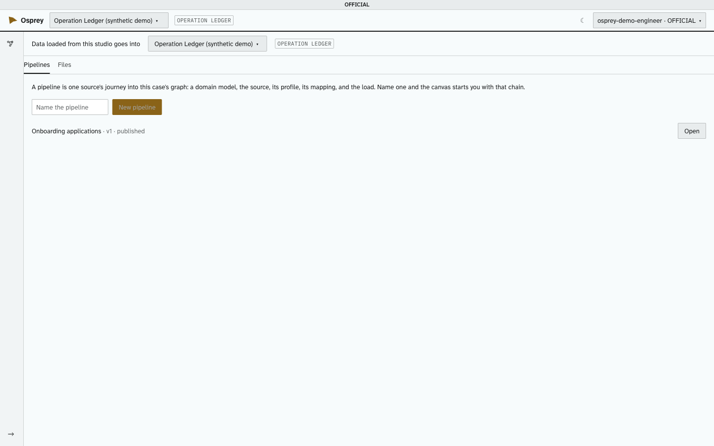

**Name the pipeline** and choose **New pipeline**. Each existing pipeline is listed with its version
and status (draft, published or flagged), and **Open** takes you to it, with its drawer beside it.

### 3.2 The steps of a pipeline

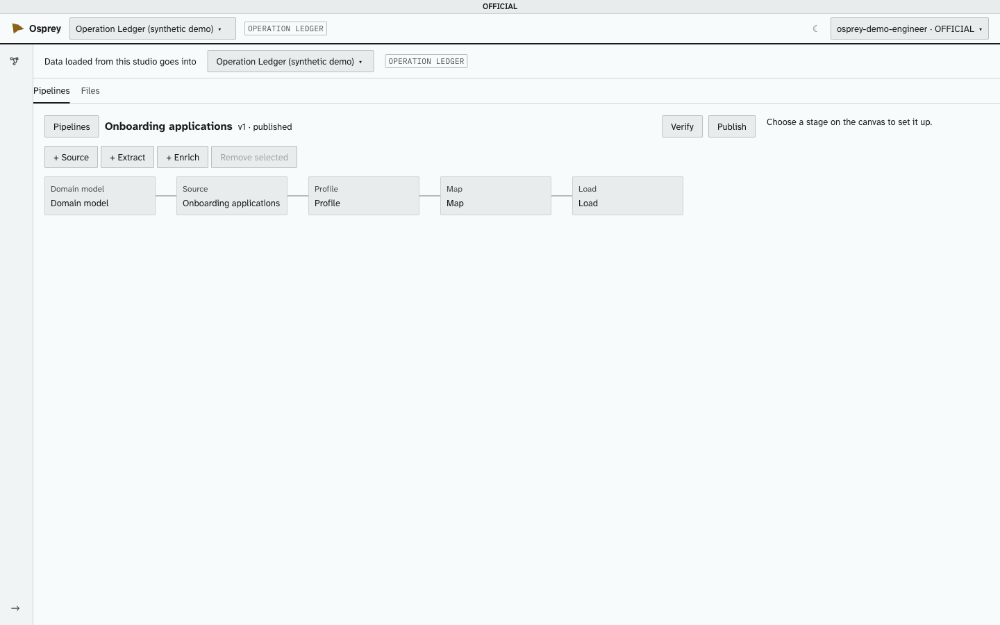

A pipeline is a chain of steps, each with one job:

| Step | What it does |
| --- | --- |
| **Domain model** | What the data means: the core model, and the packs it adds. Exactly one, at the root |
| **Source** | The registered source or file, its handling marking and its legal basis |
| **Staging steps** | Optional: shape the rows before they are mapped (section 3.4a) |
| **Profile** | What the source holds, column by column |
| **Map** | How one row becomes entities and links |
| **Extract** | Optional: finds entities in the text of Documents a map made |
| **Enrich** | Optional: geocodes places — the local gazetteer first |
| **Load** | Writes into the dataset. It has no settings |

- **+ Source** adds another whole source → profile → map → load chain. Each source is its own
  load, revertible on its own, and inherits the first source's marking and legal basis.
- **+ Extract** and **+ Enrich** go after the last map. **Remove selected** never removes the
  domain model.
- Every change is saved as you make it. A pipeline with a cycle, a second domain model, a source
  that reaches no load, or an extract not fed by a map is refused, in words, before it is saved.
- **The expert steps**, a **SQL transform** and a **Fuzzy match** (section 3.4b), are offered by
  **+ Step** in expert mode only, and only to a holder of `write_sql_transforms`, a right no
  built-in role holds and an administrator gives on its own. Guided mode shows them read-only
  ("Expert step, read-only here"). **Show YAML** opens the pipeline as YAML.

### 3.3 Domain model

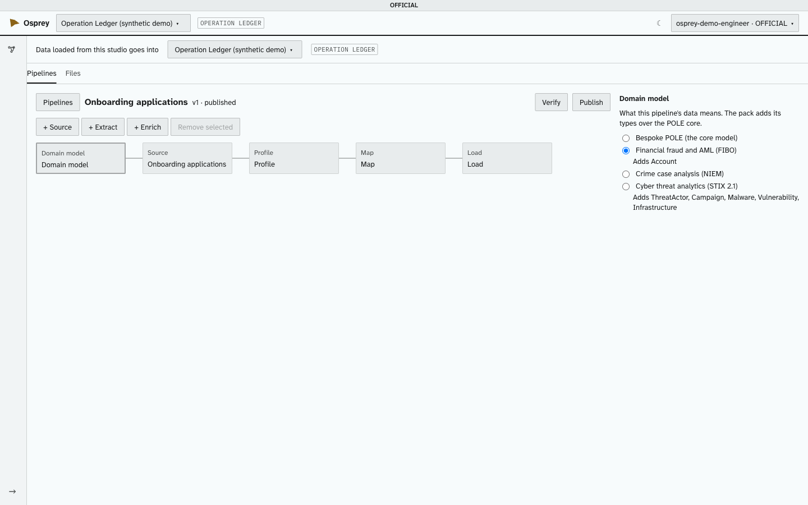

Every dataset has one **domain model**: the **POLE core** (people, objects, locations, events,
organisations) and the packs over it. The Studio's 1 Model shows it ("Domain model for ‹dataset›").
Its packs:

| Pack | Adds |
| --- | --- |
| Bespoke POLE | The core only |
| Financial fraud and AML (FIBO) | Account; registered at, beneficial owner of (with a percentage and nature), controls, holds account |
| Crime case analysis (NIEM) | Incident (name, category: assault, disorder, find or other; item; when); used as, role in — each with a required role; shared a cell with (cell, dates), co-defendant of (case reference), in conflict with (reason, dates), visited (in person or video, dates) |
| Cyber threat analytics (STIX 2.1) | ThreatActor, Campaign, Malware, Vulnerability, Infrastructure; attributed to, targets, indicates, compromises |

A pack only adds types, or widens which types a link may join; it cannot change the core.

**Draft and live.** A dataset's model has a draft and a live version, changed under
`edit_target_model` (the Data Engineer holds it; the API is in section 9.1): a draft is edited, its
impact read, then **made live**, and a live version can be reverted. A composite's model is never made
live. **The first *Make live* in an environment asks who answers for the dataset**: people, a team, or
both, as Admin → System allows, never a service account. It refuses to go live without them ("who
answers for this dataset?"), makes the dataset's **home case**, named for it, and makes them its
Authors. *Coming:* a *Make live* screen in the Studio; until then the route is the way.

### 3.4 Sources and connectors

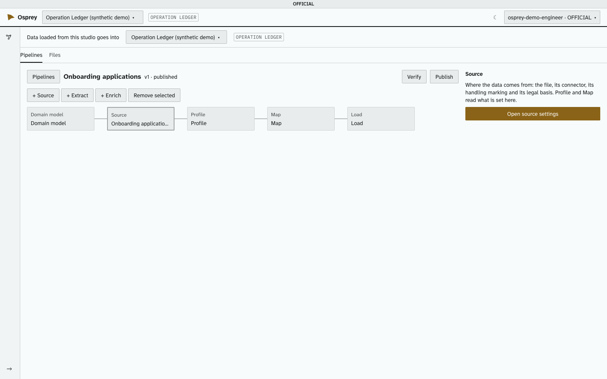

A source answers three things before anything else can happen:

1. **Where the data is**: a file from the ingest folder, a file from your computer (uploaded into
   the folder for you), one already on the server, or a connection (below).
2. **Its handling marking**: the classification and handling code everything from it will carry. A
   classification left blank is recorded as the scheme's lowest level, and the screen says so.
3. **Its legal basis**: the power or consent the data is held under.

**Register a source** (2 Sources) offers three kinds of read beside files: a **SQL** table (its
columns), an **API** path (where its records are in the answer) and **JSON** (a file pattern and where
its records are). Each read lands as its source's own file under the ingest folder's `uploaded/`
folder, so a pipeline reads it like any file. A connection is
named by an administrator (`/v1/admin/connections`, with a test), and its secret is given to the
Conduit alone (`OSPREY_CONNECTION_SECRET_<NAME>`), never written into a recipe. A connector reaches no
private host, this machine or the cloud's metadata service unless the operator admits that host or
network in `osprey.yaml`'s `connectors.private_hosts` (administration guide, appendix A). A source's
refresh can be paused and resumed. Admin → Connections names a connection of each kind: *Files*,
*SQL database*, *HTTP API* or *JSON files*, with its read-only login and the name of its secret.

**File connectors.** The catalogue lists every kind of source OspreyFlow is designed for —
communications records, mobile-device extractions, financial records, vehicle and movement data,
generic files, documents and media — and marks each as available or not. Available among them: generic
CSV, call records (day-first dates), cell sites (WGS 84 co-ordinates) and seizure records. A connector
is a small profile file in `connectors/`; adding one needs the Conduit restarted.

### 3.4a Staging steps

Between a source and its map, a pipeline may shape its rows with **staging steps**, each a step of
the pipeline with a drawer of typed settings (no expressions in guided mode): **lookup**, **join**,
**filter**, **derive** (concatenate, split, substring, parse a date, arithmetic, a case-by-case value,
normalise), **union** and **dedupe**. Each drawer shows a **live sample** over the first ten rows of
each source, refused in the same words a save would be, and the Map maps the last step's table,
profiled. A run records each step's counts; *coming:* drawing them on the run's report.

### 3.4b The expert steps

An expert step is for what the guided steps cannot say. Its drawer says "An expert step: it needs the
right to write SQL transforms, and every run report and Test disclose it." Without
`write_sql_transforms` the step is read-only, and a change to it is refused ("…which needs the right
to write SQL transforms (write_sql_transforms), granted by an administrator. The pipeline's other
steps can be edited without it.").

- **SQL transform** asks for a **Step name**, the **Tables it reads**, one **SELECT**, and **What it
  does, in plain words**; **Check SQL** checks it. It runs in a private, locked DuckDB with no file,
  network or temporary folder, one thread, 512 MB of memory and 30 seconds, and returns at most
  1,000,000 rows or 256 MB. What the sandbox refuses is said in words: a SELECT that "reads a file or
  the network, which is disabled by configuration", that "cannot be read as SQL", that "names a table
  or function that does not exist in the sandbox", or more than one statement.
- **Fuzzy match** compares a **Left table** with a **Right table**, each comparison by *Name
  similarity (Jaro-Winkler)*, *Spelling distance (Levenshtein)* or *Exactly the same*, within a
  **Blocking key** (exact, soundex or year), above a **Threshold** (0.85 unless you choose; part of
  the pipeline's version), with a **Column to bring across**. It is always the last staging step, and
  more than a million pairs without a blocking key is refused. It writes an **inferred** `SAME_AS`
  between two elements of the map, never a merge: a person confirms it.

**Disclosed everywhere.** *Test* lists **Expert steps in this test**, each run's report **Expert
steps in this run**, and 4 Runs **Expert steps in this pipeline**, each by its name, what it reads
and its plain words.

### 3.5 Profile

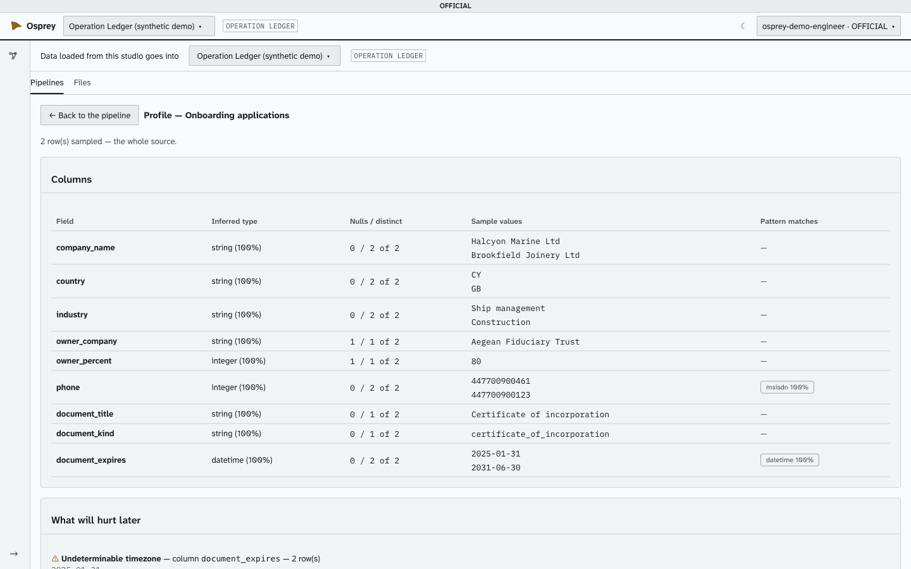

The profile reads up to 10,000 rows (or the whole source, if smaller) and shows, for each column, its
inferred type and how sure that is, how often it is empty, how many distinct values it has, five
sample values, and which known patterns it matches (a phone number, an IMEI, a date…) and how often.
A share is never rounded up to 100% when it is not.

**What will hurt later** names the problems before they reach the graph: mixed date formats, a
timezone that cannot be told, an encoding other than UTF-8, rows with differing column counts, and
apparent duplicates.

Someone not cleared for the source's marking sees the samples' shape only: letters as `A`, digits
as `#`. Map cannot be opened until the profile has run.

### 3.6 Map

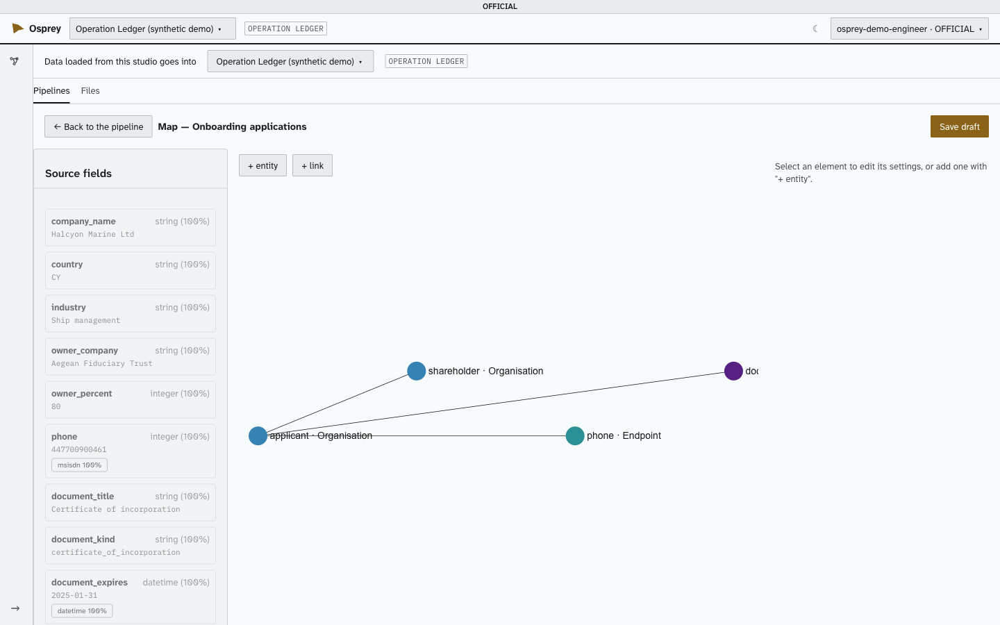

One row of the source becomes a small graph. **+ entity** adds an entity — first its POLE class,
then its type; **+ link** joins two. The source's fields are listed on the left with a sample of
each; every field not yet used is shown until it is mapped or marked **ignore**.

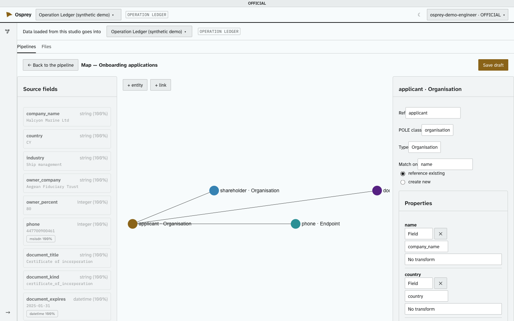

For each entity:

- **Match on** — the property that identifies it — and whether a row **references an existing**
  entity with that value or **creates a new** one.
- **Properties**: each takes a field, several fields, a fixed value, or a value map, optionally
  through a transform.
- **When**: an element can depend on a field's value.
- **Content this holds**: a Document's text, an image or a video.

For each link: its type, and its time — not recorded, or taken from a column. A link with a time can
mark text a model may later read. A link type is named by its label ("Held at") in the list of links,
the form that makes one, the link's settings and on the canvas; the ontology's key (`HELD_AT`) is what
the recipe stores, never what the Map shows.

**Transforms are Knowledge Adapters, never expressions.** OspreyFlow has no expression or scripting
language. A transform is one of a fixed set of tested adapters: `msisdn`, `imei`, `imsi`, `email`,
`datetime`, `person_name`, `address`, `iban`, `card`, `coordinate_lon`, `coordinate_lat`,
`geometry_ref`, `polygon_ref`, `grid_ref` and `postcode`. Some take more than one column
(co-ordinates two, a grid reference three). A structured result is bound one part at a time, such as
`person_name(part=family)`. A transform that does not exist yet is a new adapter, written with
golden test cases — not something typed into a recipe.

**Handling and provenance** default from the source; an element may **tighten** its handling, never
loosen it. Data a recipe loads is *asserted* — it came from a source, not a model.

**Refused at save, in words:** a link of a type the ontology marks as probabilistic, `SAME_AS` or
`NOT_SAME_AS` (resolution writes those, never a recipe), an unknown type, a property the ontology
does not have, and a link's model-readable text with no time.

**Save draft** saves the map; it does not verify it.

### 3.7 Load

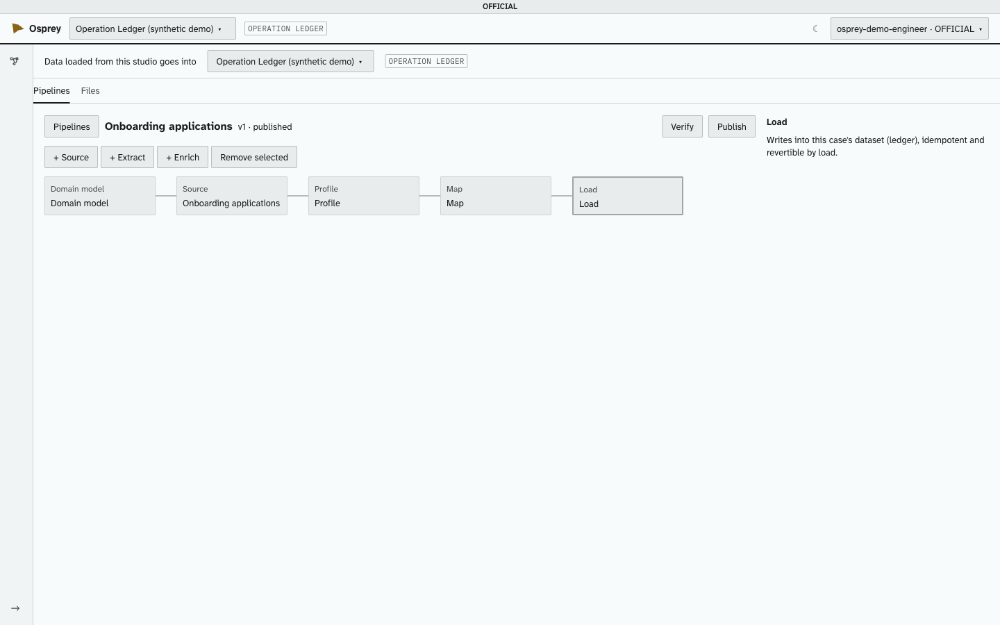

The load writes into the case's dataset. It is **idempotent** — running the same data again adds
nothing new — and every element it writes carries its load's id, so a load can be reverted as a
whole.

### 3.8 Verify

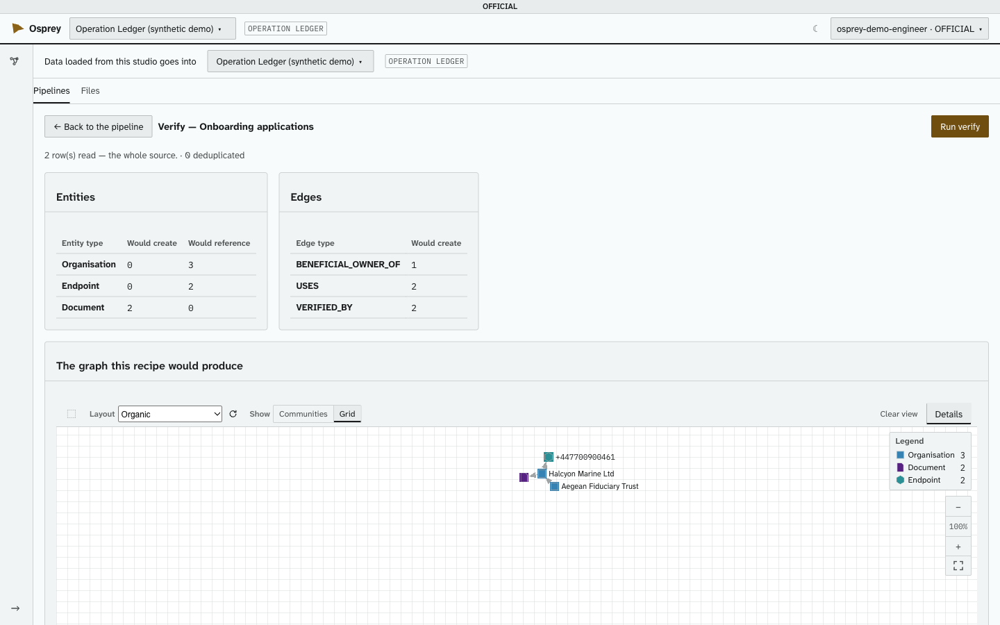

**Verify** is a dry run: nothing is written. It shows, for every type, how many entities and links
the recipe **would create**, how many it **would reference** (existing ones, looked up within the
case's datasets as you), how many rows were deduplicated or rejected, and the graph itself.

Rejections are grouped by cause, naming the adapter and field — never the value. A value the
ontology refuses (a date of birth that is not a date) rejects its row; nothing is silently
changed. **A recipe is published only after it has verified.**

**Verify reads the file a run will read.** A pipeline's source may name its own file (the source's
settings); Verify reads that file, each source's in turn, as the run does, not only the file chosen at
Connect. It records each file it read with a hash of its contents, which **Run now** is held to
(section 3.9). Verify on a published recipe records the file as it is now.

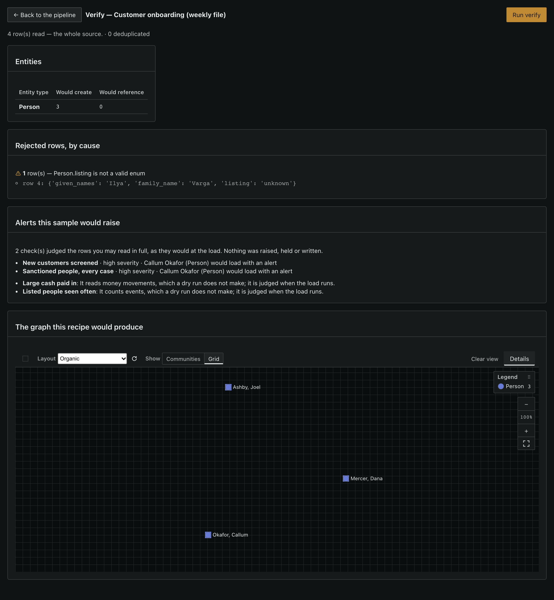

**Alerts this sample would raise.** Beside the rejections, Verify judges the sample with the
pipeline's checks on load (section 3.8a), each rule as its author, as the load would — and lists, for
each alert, the rule, its severity, the entity it names and what a hit would do here: load with an
alert, or hold the rows. Nothing is raised, held or written: the run that does this has no way to
write. It judges only the rows you may read in full, and names only entities the sample shows you.
Some checks cannot be judged in a dry run, and say why: one that reads money movements or counts
events (a dry run makes neither), and one that reads links already in the graph. Those are judged
when the load runs.

### 3.8a Checks on load

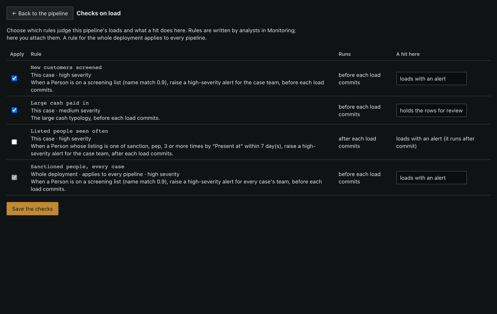

**Checks on load**, a button at the top of a pipeline, chooses which rules judge this source's loads
and what a hit does here. The list holds the case's rules and the whole deployment's that judge data
as it loads, each with its sentence or typology in words, its severity and when it runs.

- **Apply** attaches a rule to this pipeline. Until anyone chooses, every rule of the case judges the
  pipeline's loads, as it always has; once you save, only the rules you attached do.
- **A hit here** chooses what happens: **loads with an alert**, or **holds the rows for review** (they
  wait under Held rows for a reviewer). Holding is offered only for a rule that runs before the load
  commits.
- **A rule for the whole deployment applies to every pipeline**: it cannot be left off, though you may
  make its hits hold here. A rule an analyst keeps for themselves is their own watch, not a check on
  a load, and is not listed.
- A rule waiting for a second person's approval is listed, and runs once approved.

**Save the checks** records your choice, with your name; it is read at every run, scheduled or not,
and when held rows are released. You attach rules here; you do not write them. Rules are written by
analysts in Rules and Monitoring, as sentences or from templates.

### 3.9 Publish, versions and running

**Publish** commits the recipe to `recipes/<id>.yaml` in the deployment's recipe repository and marks
it published. To change a published recipe, **Reopen for editing** makes a new draft version; a
published version is never edited in place. If the ontology changes under a published recipe, the
recipe is **flagged**, and its scheduled runs stop until it is looked at again.

A publish is refused if a stage cannot run here: an extract library this deployment does not have,
an unknown geocoder, or a handling override with no reason.

**Run now** loads the source. Every row is staged in the object store first, then the graph is
written, then events go to the analytics database and places to the map. The run's report gives rows
read, rows deduplicated, entities created and referenced, links created, rejections, rows held, and
what the case's rules said. A run is refused if the source is marked above your clearance.

**Run now runs on exactly the file Verify checked.** Before anything is read into a store, the run
checks that each file it would read is the one Verify read, byte for byte. If the file has changed
since ("reports.csv has changed since Verify checked it"), or the run would read another file ("Verify
checked reports.csv; this run would read reports_corrected.csv"), it loads nothing and asks you to run
Verify again. The Run panel therefore takes no file of its own: to load another file, choose it as the
source and verify it. A recipe that no Verify has recorded a file for — one published before this
check, or by a demonstration pack's seed — runs on its recorded file as before. Scheduled and watched
runs read each new export by design and are not held to it.

**Known limits:** a re-run adds its events to the analytics database a second time (the graph is
unaffected); and loads write one element at a time, so a large source takes a while.

## 4. Files

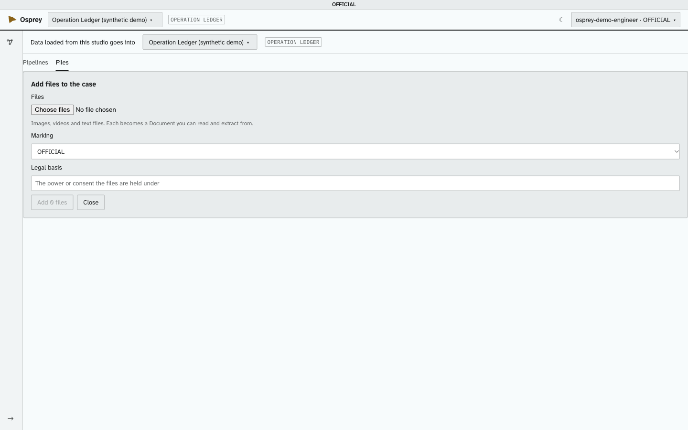

The Studio's **Files** tab adds images, videos and text files to the case, each becoming a Document
that can be read and extracted from (PNG, JPEG, GIF, WebP, TIFF, HEIC, MP4, MOV, WebM and plain
text). It takes a marking and a legal basis for the files. PDF and Word documents are not read yet.
**Adding files there needs `extract_files`**, which the Data Engineer role does not hold — an
analyst adds them, or an administrator grants the right.

## 5. The ingest folder

The source files a pipeline reads live in the deployment's **ingest folder**
(`components.storage.ingest`). OspreyFlow only ever **reads** it, except for its `uploaded/` folder,
where files uploaded through the Studio land, under the case's dataset. The Studio lists files
directly in the folder, in `uploaded/`, and in each of the case's dataset folders — never anything
outside the folder, in deeper folders, or hidden.

An upload is refused, in words, if its name has a folder in it, starts with a dot or is over 200
characters; if it is empty, or over the size limit (512 MiB by default); if its kind is not one
OspreyFlow takes; or if a file of that name is already there — **nothing is ever overwritten**.

## 6. After the load

### 6.1 Held rows

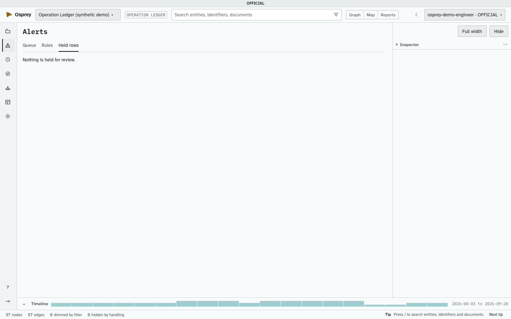

A case's rules judge every load before it commits. A row a rule could not judge is **held**: it
reaches no store until someone decides it, in Rules and Monitoring's **Held rows** (shared with the
Studio's 4 Runs), which shows why each row was held. **Release and load** writes it under a new load (it is judged again, and never
held a second time); **Reject** needs a written reason. Listing held rows needs Editor on the case;
**deciding them needs Author**.

**Row numbers.** The Glass counts rows from 1: the row under the header is row 1, in held rows,
Verify's rejected rows and a source's `row N`. The API and what is stored count from 0: a `row N`
locator, a rejection's or held row's `row_index`, and an alert's `fired_on` `row`. A tool of your
own that shows one of these to a person adds one. Sample rows (`…/map/sample-rows/{row_index}`)
are indexed from 0 too.

### 6.2 Data feeds

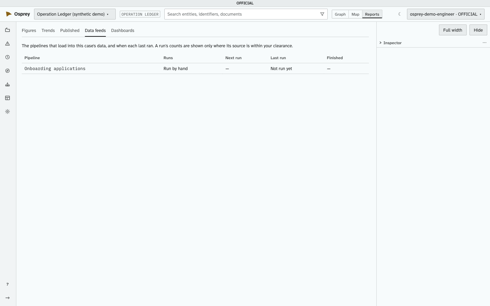

Beside the case's **Figures**, under **Data feeds**, anyone holding `read_data_feeds` with Viewer on a case sees the
pipelines that load into it,
how they run (by hand or on a schedule), and when each last ran. A run's counts are shown only to
someone cleared for its source.

### 6.3 Schedules and watched folders

A published pipeline can run on a **schedule** — every hour, every day, every weekday, every week, or
a cron expression — in a named time zone (Europe/London by default), never more often than every 15
minutes, since each run is a whole load. The screen previews the schedule in words with its next five
runs.

It can also run when a **file arrives** in its dataset's own folder, matching a pattern such as
`*.csv`: each file is taken once, a minute after it stops changing, one at a time.

Either way it runs **as the person who last set it**, with every check their own run would get. A
run that is refused — they can no longer sign in, have lost the right, are no longer an Editor, or
are cleared below the source — tells them on their alerts; **three refusals in a row pause it**.
Admin → Operations lists every one, and 4 Runs every one of the dataset's.

**Where people sign in with Entra ID** (a deployment on a shared platform), a schedule or watched
folder runs as the person who set it only while they have used OspreyFlow within the last 24 hours.
Otherwise each slot is refused, in those words, and runs at its next slot after they sign in; such a
refusal never counts toward the three that pause a schedule (administration guide, §6a.7).

### 6.4 Reverting a load

Every element a load writes carries its load's id, and reverting a load hides all of them from every
read without deleting anything. The Studio's **4 Runs** shows a holder of `revert_loads` the command
that reverts a run's load, to run on the deployment's host:
`python -m scripts.seed_internal <pack> --revert-load <load id> --reverted-by <your username> --stop-api`.
*Coming:* a revert button on the screen.

## 7. The domain model

### 7.1 Types

The ontology (`packages/ontology/default.yaml`) defines the entity types — **Person, Endpoint,
Device, Location, Organisation, Event, Document, Vehicle, Asset** — and the link types:
communicated with, uses, present at, mentioned in, verified by, holds, depicts, associate of, family
of, member of, transacted, paired with. A deployment may add types; it cannot add POLE classes. An
Endpoint's value is always held normalised, with its kind beside it.

The graph holds **one summarised link per pair per type**, with its first and last time, how often
it occurred and its weight; the individual events are in the analytics database.

### 7.2 What every record carries

| Part | What it holds |
| --- | --- |
| **Provenance** | Asserted, inferred or unresolved; its sources (withheld from a reader whose case does not read all of the element's datasets, section 7.5); what extracted it and how sure; when first seen, last confirmed, and by whom |
| **Handling** | Classification, handling code, action code, sanitisation code, originator, owning unit, review date, legal basis |
| **Datasets** | Which datasets it belongs to; a later load adds, never removes |
| **Audit** | The load, recipe and recipe version that wrote it; its revision; whether it was reverted |

**Handling never goes down.** Writing an element again never lowers its marking. A clearance the
deployment does not recognise sees nothing.

### 7.3 Inferred and confirmed

Anything a model produces is **inferred** until a person confirms it; confirming records who and
when. Nothing is promoted automatically, and no confidence score does it on anyone's behalf.

### 7.4 Resolution: never merged

Loads write each source's own records, and **nothing is ever merged in storage**. Resolution links
records it thinks are one with a scored `SAME_AS`, and the Conduit shows each linked group as one at
the moment it is read, at the case's chosen strictness: Strict (0.99), Balanced (0.95) or Broad
(0.80). An analyst can link two records by hand, or keep two apart — which is always honoured. A
recipe may not write either.

### 7.5 Sources withheld for a scoped reader

An element can belong to more than one dataset, and a case reads only the datasets it names. A reader
may see an element through any one of its datasets, but its **sources** (the files and rows it came
from) name no dataset. So the sources are sent to a reader only when every dataset the element belongs
to is one the reader's case reads. Otherwise the reader gets the node or link with its sources
emptied and a flag set: what it came from is held back, not the fact that it exists.

**Where it is applied.** In the Vault, where an element is read for a principal, so that nothing stored
or forwarded carries the sources past it:

- The graph adapter's element mapping, `node_from_element_map` and `edge_from_element_map` in
  `packages/adapters/graph_arcadedb/serialization.py`, which every read path goes through, given the
  reading principal.
- The working set's projection, `_project` and `project_delta` in
  `services/api/working_set/service.py`, which serve the replay, the live stream and a restore.
- A principal whose `datasets` is `None` is the Conduit's own unlimited work, and reads every dataset
  (`services/api/dataset_scope.py`). Nothing a request handler is given is that principal.

**The shape.** `Provenance.sources_withheld` (`packages/schemas/domain.py`) is `False` by default. When
it is `True`, `sources` is empty; when it is `False`, `sources` is never empty. The generated
TypeScript types follow. The predicate is one function, `sources_within_case`, in
`packages/ontology/handling.py`: every dataset of the element is in the principal's `datasets`; an
element that names no dataset, read by a scoped principal, is withheld. `withhold_sources` applies it
and returns a copy; it changes nothing stored.

**The rule for a writer that reads and writes back.** A writer that reads an element and writes its
provenance back (a link change, a picture, an extraction's replacement, a resolution, a pipeline run's
mention, confirming an alert's cited links) would rebuild the element from a withheld, empty list. That would
silently drop the stored sources, or be refused by the write guard below. So **a read whose result is
written back runs inside `ontology.handling.sources_in_full()`**:

```python
from ontology.handling import sources_in_full

with sources_in_full():
    found = await graph.get_edges([edge_id], principal)
# change what you mean to change in found[0], then write it back
```

The read is still made with the request's principal, so the access filter is applied in the adapter as
before; only the sources are left in. The scope is a context variable, so it holds for the calling task
alone, and the adapter and its test double honour it. The writers that do this today are
`services/api/link_changes.py`, `services/api/entity_pictures.py`, `services/extract/writer.py`,
`services/resolve/trigger.py`, `services/api/pipeline_run.py` and `services/api/alert_queue.py`. The
working set's own writes are covered the same way.
Never wrap a read whose result goes to the Glass.

**What such a writer sends back.** Whatever a writer returns or streams to the Glass (a delta's
`to_sent()`, a route's response) passes through `withhold_sources` for the reader first. A writer
that read in full has the sources in its hands, and a response built from them would send the sources
the reader may not have. `services/api/link_changes.py` does this for the edge it returns, and
`services/api/working_set/models.py` for the deltas it sends.

**A withheld provenance is never written.** The write guard, `_refuse_withheld` in
`packages/adapters/graph_arcadedb/serialization.py`, raises if a `NodeWrite` or `EdgeWrite` carries a
`Provenance` with `sources_withheld` set, since writing it would replace the stored sources with none.
A refusal there means a read that was written back was not inside `sources_in_full()`.

**For a new writer.** Ask two questions. Does it read an element and write its provenance back? Then
wrap the read. Does it send the element, or anything built from it, to a reader? Then pass it through
`withhold_sources` first. The build's tests hold every writer to this: each reads as a scoped
principal, changes an element in two datasets, and checks that every stored source is kept and that
what is sent back carries none.

### 7.6 Connection strength: weights, influencers and rarity

A link's **connection strength** is its stored weight with the influencers that apply to it, worked
out when it is read. **Shared-attribute rarity** is a separate measure beside it. Both are computed in
the graph adapter, as the reader, and neither is ever stored (ADR-139; spec 01 §6.1a).

**The stored weight** (weights version 3, `packages/ontology/weights/default.yaml`):

```
weight = normalise( α·log1p(occurrences)/log1p(heavy(type)) + β·recency(last seen) )
normalise(x) = 1 / (1 + e^(−(x − midpoint)/scale)),   recency(t) = 0.5^(age/90 days)
```

with α = 0.5, β = 0.2, `scale` = α/3 and `midpoint` = β + α/3, or a structural type's fixed weight.
It comes from the link alone (ADR-123): no other link's count reaches it.

**Influencers** (`packages/schemas/strength.py`, `StrengthInfluencer`):

| Field | Meaning |
| --- | --- |
| `id`, `label` | Its key (lower case, `-` and `_`) and what the legend says |
| `trigger` | `{entity_type, property, values}` (`kind: record`, the default): a record of that type whose property holds one of the values, at one end of the link or linked to both ends. `{kind: dataset, datasets}`: every link that belongs to one of those datasets, applied only where the reader may read it (ADR-139 Amendment 2). Omitted: a **direct-links** influencer, applying to its link types always |
| `link_types` | The link types it changes. `SHARED_VALUE` (reserved; no ontology declares it) is a pair linked through a shared value, the client's `dup_*` rows; it takes an `add` triggered by a dataset or by nothing |
| `change`, `size` | `add` (a boost to the pre-logistic score, above 0 and at most 2), `multiply` (0.1 to 5), `floor` (a strength, above 0 and at most 1) or `exclude` (size 0: no stronger than the stored weight) |
| `enabled` | `false` in a later layer switches off the influencer of the same id beneath it |
| `note` | Shown beside it, such as "to be confirmed with the client" |

Applied to a link of stored weight `w` (`ontology/influencers.py`, `connection_strength`):

```
raw      = midpoint + scale · ln(w / (1 − w))       # the logistic's inverse
strength = normalise( (raw + Σ add) · Π multiply )
strength = max(strength, every floor)
strength = min(strength, w)   if any exclude
```

With nothing applying, the strength is `w`. Each step rises with `w`, so adding occurrences never
lowers a strength, whatever influencers apply (the developer repository's
`tests/ontology/test_influencers.py` proves it over a grid of every combination).

**Resolution order:** a case override, then the installation set, then the weights file. Influencers
are matched by `id`; a later layer's replaces an earlier one's, and a case may switch any off by id.
The installation set is maker–checker (the right `manage_strength_influencers`; a second holder
approves, never the proposer; every version kept in `strength_influencer_versions`). A case override
is its Author's (`case_strength_influencers`, every version kept). Both are audited.

**Read time, under access.** `GraphPort.connection_strengths(edge_ids, principal, influencers=…)`
reads the links as `get_edges` does (the link and both ends visible), then, for each triggered
influencer, finds the evidencing records with the access step on every vertex and every link it
steps over. A record the reader may not see, or one reached only over a link they may not see, is not
found, so it changes nothing: the strength is the strength in a world without it. The conformance
suite's `test_unauthorised_connection_strength_matches_a_world_without_the_hidden_evidence` holds
every adapter to it.

**The rarity query.** `GraphPort.shared_attribute_rarity(node_ids, principal, scope=…, measure=…)`,
for two visible entities of one type. An attribute (a **shared value**) is a visible node (of no type in
the file's `rarity.exclude_types`) linked to each of the two by a visible link. Two measures, chosen by
the weights file's `rarity.measure` or an installation version (ADR-139 Amendment 2):

```
share (the client's, the default):
  rarity(a)    = 1 − C(k(a), 2) / Σ_b C(k(b), 2)      # b: every visible value of a's type in scope
  rarity(u, v) = max over shared values a of rarity(a)
idf:
  rarity(u, v) = Σ over shared attributes a of ln( N_visible / df_visible(a) )
```

`k(a)` and `df_visible(a)` both count the visible entities of the pair's type linked to `a` by a
visible link; `N_visible` counts the visible entities of the pair's type in scope. Under `share`, the
sum over the kind is read too: every visible value of the kind with its visible holders, counted first
and held to the cap (`render_kind_holders`), so a hidden holder is in no `k` and no sum
(`test_unauthorised_share_rarity_matches_a_world_without_the_hidden_holders`). **Per dataset** (the default) it is
worked out in each dataset the two and the attribute all belong to, the highest kept and named; **across
the case**, over every dataset the reader may read. In ArcadeDB it is three reads: the entities and
their attribute ids, each attribute's visible neighbours with their types and datasets, and the
visible count per type and dataset (and, under `share`, the kind's values and holders). More pairs to
score, or holders to read, than the cap (2,000,000) is refused as `limit_exceeded`, never scored in
part. The Glass is sent the score and the visible shared attributes, never `N`, `df`, `k` or a sum.

**Two compositions** (ADR-139 Amendment 2). The weights file's `composition:` (`standard`), an
installation version's `composition`, or a case override's `composition` (resolved case, installation,
file: `ontology/influencers.py`'s `resolve_settings`) chooses how strength is made:

```
standard:       strength = the influencers applied to the stored weight (above)
client_parity:  raw_sum  = rarity term + Σ add   (no count, no recency; no multiply, floor or exclude)
                strength = 1 / (1 + e^(−(raw_sum − 1) / 0.1))      # parity_drawn, order preserving
  a stored link's rarity term   = 1 − 1/n   (n: the visible links of its type in the dataset)
  a shared-value pair's term    = the share rarity of the value linking them
```

`connection_strengths(…, composition="client_parity")` returns each link's `rarity_term`, `raw_sum`
and the `dataset` it was worked out in (the highest-scoring of those it belongs to and the reader may
read); `shared_attribute_rarity(…, influencers=…, composition="client_parity")` returns each pair's
`parity_raw`, `parity_strength` and `parity_applied`. Client parity always reads the `share` measure.
The routes pass the case's resolved composition and measure; the legend carries them
(`composition`, `composition_layer`, `rarity_measure`) and names a dataset trigger only by the
datasets the reader may read.

**Shipping influencers in the weights file.** The developer defaults sit beside the weight versions,
under `influencers:`; they are not a weight version and change no stored weight:

```yaml
influencers:
  - id: direct
    label: Direct link
    link_types: [COMMUNICATED_WITH, TRANSACTED, VISITED, SHARED_CELL_WITH]
    change: add
    size: 0.1348
    note: to be confirmed with the client
rarity:
  exclude_types: [Alert]
  measure: share          # or idf
composition: standard     # or client_parity
```

A shipped boost's size is calibrated, not tuned: how far doubling an ordinary link's count (from the
default rule's heavy count, 10, to 20) moves its pre-logistic score, α·(ln 21 − ln 11)/ln 11 = 0.1348.
`test_influencers.py` holds the shipped sizes to it, and the loader refuses a malformed influencer by
its position and id.

### 7.7 The client's code and OspreyFlow's equivalent

The client supplied the R function their pipeline uses (ADR-139 Amendment 2). It is called once per
dataset's link table; `the_col` holds the shared value itself. Line by line, with what OspreyFlow does
in its place:

| The client's R | What it does | OspreyFlow's equivalent |
| --- | --- | --- |
| `shared_values_table_1 <- edges_dt[, .(shared_values=get(the_col))][, .N, by = shared_values]` | `N`: how many rows of the table carry each value | A value is an attribute node; the `dup_*` rows through it are its pairs of visible holders, `C(k, 2)` (`pair_links`), `k` counted by the adapter under access |
| `shared_values_table_1[, edge_strength_1 := (1 - (N / sum(N)))]` | `1 − N/ΣN`, `ΣN` being every row of the table | `share_rarity(C(k,2), Σ_b C(k_b,2))`, the sum over the visible values of the same kind in the dataset (`ShareTotals`) |
| `setnames(…)` | Renames the columns back | — (no arithmetic) |
| `edges_dt <- merge(edges_dt, shared_values_table_1, by = the_col, all.x = T)` | Each row takes its value's term | A shared-value pair takes the term of the value linking it (the highest, if several: Amendment 3); a stored link takes `1 − 1/n`, itself a value held by its two ends among the `n` visible links of its type |
| `edges_dt[, edge_strength := edge_strength_1 + abs_add]` | `abs_add` on every row of the table | A **dataset-triggered** influencer, `add` of `abs_add`, on the dataset's link types and `SHARED_VALUE` |
| `edges_dt[, edge_strength_1 := NULL]` | Drops the column | — |
| `edges_dt[!(type %like% "dup_"), edge_strength := edge_strength + non_dup_add]` | `non_dup_add` on every row not of a `dup_*` type | The **direct-links** influencer (no trigger), `add` of `non_dup_add`, on the stored link types; never on `SHARED_VALUE` |

`raw_sum` is the client's `edge_strength`; the Glass draws `parity_drawn(raw_sum)` and the Inspector
shows `raw_sum` to four places.

**A worked example** (synthetic; the developer repository's `tests/ontology/client_r_function.py`). Three tables, each called with
its own `abs_add` and a `non_dup_add` of 0.2:

| Dataset | Rows | `abs_add` | The client's figures | OspreyFlow's figures |
| --- | --- | --- | --- | --- |
| phones | `dup_phone`: P1–P2 (ph1); P3–P4, P3–P5, P4–P5 (ph2); P1–P6 (ph3); P2–P6 (ph4) | 0.05 | ΣN = 6; ph1, ph3, ph4: 1 − 1/6 + 0.05 = **0.8833**; ph2: 1 − 3/6 + 0.05 = **0.5500** | holders 2, 3, 2, 2: Σ C(k,2) = 1 + 3 + 1 + 1 = 6; the same two figures, as `parity_raw` |
| calls | `call`: X1–X2, X2–X3, X3–X4, X4–X5, each its own value | 0.1 | ΣN = 4; 1 − 1/4 + 0.1 + 0.2 = **1.0500** | four visible `COMMUNICATED_WITH` links: 1 − 1/4, plus the dataset and direct adds: **1.0500** as `raw_sum` |
| transfers | `money`: T1–T2, T2–T3 | 0.15 | ΣN = 2; 1 − 1/2 + 0.15 + 0.2 = **0.8500** | two visible `TRANSACTED` links: **0.8500** |

The golden parity test (`test_client_parity_scores_equal_a_transcription_of_the_clients_r_function`,
in the `GraphPort` conformance suite) runs that table through a line-by-line transcription of the R
function, loads the same data into the store, reads it back under `client_parity`, and asserts every
row's score is identical; planting a slip (counting holders instead of pairs, or leaving the dataset's
add off the shared values) turns it red.

**How a direct row's term arises in their code, and where the mapping stops.** The R function adds
`edge_strength_1` to every row, a direct row included: its `the_col` holds that row's own value, so its
term is `1 − N(v)/ΣN`, with `ΣN` every row of the table of every type. OspreyFlow reads a stored link as
a value of its own among the links of its type in the dataset. The two agree exactly when one call of
the function holds **one kind**: `dup_*` rows through values of one kind, or direct rows of one type,
each carrying its own value. They do **not** agree when one call mixes kinds (`dup_*` and direct rows
together, two shared-value kinds, or two direct types: the client's `ΣN` then counts every row,
OspreyFlow's one kind; `test_a_table_mixing_kinds_is_the_shape_that_does_not_map_exactly` shows it as
a figure), nor when several direct rows carry one value (OspreyFlow stores one link per pair and type).
Both are open questions for the client (ADR-139 Amendment 3).

### 7.8 A case's analyst layer, drawn datasets and promotion

**Each case has its own analyst layer**, made with the case, read together with its dataset and never
written into it. These go into the layer: an entity marked by hand, a `SAME_AS` or `NOT_SAME_AS` made by
hand, a drawing board's items and links, and an alert resting on any of them. Accepted model proposals,
accepted extractions and loads go into the dataset, as before. No other case reads a layer, and none
can infer it from a degree, a path length or a count.

**A drawn dataset** is made by a drawing begun with no case (`POST /v1/drawings`, or
`POST /v1/datasets/drawn`): the dataset, its home case, its board and a live model at version 1.
No pipeline loads into it and no rule runs on it.

**Link types proposed by analysts.** An analyst who finds no link type that fits proposes one in the
case; it is usable there at once, marked proposed. A holder of `accept_types` who may work on the
dataset decides it in 1 Model: **accept** writes it into the draft domain model (never by its proposer),
and it goes live with the next *Make live*; **decline** ends it, with a reason. The tab reads **1 Model ·
‹n› proposed** while proposals wait for you, and the top bar's **Needs you** lists them (user guide,
section 3).

**Promotion.** An Author of a case who holds `promote_to_dataset` sends items from their own board into
the case's dataset with **Promote…** (user guide, section 5.14). A promotion is **one load**, all or
nothing, into the dataset the case reads; each item is checked against the dataset's highest marking
and its live model, its grading and, for a link, both its ends going too, on the sheet and again when
it is sent. Each promoted item stays marked as drawn. Under the dataset's promotion policy (Admin →
Datasets) the load is committed at once (*Author promotes*) or waits (*Second person reviews*), and
nothing of it is in the dataset until it is approved.

**Analyst promotions**, under the grid in **4 Runs**, lists every promotion into the dataset: its load,
what it adds, who sent it, the case and its status. It needs `review_promotions` ("You need Review
promotions to see the analyst promotions into this dataset…"). **Review** opens one: one of the
dataset's Authors holding `review_promotions`, never its sender, chooses **Approve and commit** or
**Reject with a reason** (the reason is shown on the analyst's board); a reviewer who cannot see every
item is told "Some of its items are not shown to you, so you may not approve it." A committed
promotion is reverted by the operator command it shows, with the Conduit stopped:
`python -m scripts.revert_promotion <load id> --reverted-by <your username>` (`--dry-run` first). There
is no revert on screen.

**A removed case's layer.** **Removed cases' layers**, also in 4 Runs and shown to the dataset's
Authors, lists each removed case that read the dataset. **Merge into the dataset** opens a sheet that
lets you read that one layer for that one merge (recorded in the audit, and ended when the merge is
sent or cancelled); the merge is a promotion like any other, under the same policy. **Delete…** shows
what it would do, then "Its items are withdrawn and kept in the audit." Both need `investigate`, so a
Reports Viewer does neither. A composite case's layer is never merged, only deleted. Nothing deletes a
layer on its own. Admin → Datasets' screen offers both as a dry run, and after the delete's dry run
an administrator may delete the layer there too (section 9.1); the merge is done only here.

**Coming:** merging a drawn dataset into another. A waiting promotion grows overdue after the days
set in Admin → Operations (administration guide, section 9.11).

## 8. Screening lists

Sanctions, PEP and adverse-media lists are kept beside the graph, not in it, deployment-wide. In the
Studio, **2 Sources → screening lists** imports a list once for the deployment through a template for
its publisher's format, each import that changes its rows a new version, refreshed by hand or on a
schedule (`load_screening_lists`); each dataset then **subscribes** to the lists its rules read
(`add_ingest_files`). A list of real people is refused unless this device's real-data exceptions name
it. How lists raise alerts is rewritten with the alerts journey (coming). A list can also be loaded,
whole, from a YAML file on the server:

```
python -m scripts.load_screening_list <file.yaml>
```

The file names the list, whether it is synthetic, and its entries — each with an id, a listing
(`sanction`, `pep` or `adverse_media`), an entity type (Person or Organisation), a name, and
optionally a date of birth and country. **A list of real people is refused** unless the deployment's
local real-data exceptions name its dataset. A match reaches the graph only as a scored, inferred
`SAME_AS`, for a person to confirm.

## 9. Interfaces

### 9.1 The API

Every route is under `/v1`; a case's routes are under `/v1/investigations/{investigation_id}`. A
missing right is refused with `403` and the right's name; a case you have no level on answers as if
it did not exist.

**The OpenAPI document** describes every route: `GET /v1/openapi.json` at the deployment's own address,
signed in like every other route. Its `info.version` is the release the deployment runs (for example
`v0.4.1`, or `dev-<commit>` off a release), the same version Admin → System shows.

| Method and path | Needs |
| --- | --- |
| `GET /v1/ingest/connectors`, `/v1/ingest/packs`, `/v1/ingest/transforms` | Signed in |
| `GET`, `POST …/ingest/source-files` | `add_ingest_files` (upload: Editor) |
| `POST …/ingest/recipes`; `PATCH`, `GET …/ingest/recipes/{recipe_id}`; `GET …/ingest/recipes` | `edit_pipelines` |
| `PUT …/ingest/recipes/{recipe_id}/pipeline` | `edit_pipelines`, Editor |
| `GET …/ingest/recipes/{recipe_id}/profile` | `edit_pipelines` |
| `PUT …/row-template`; `GET …/map/sample-rows/{row_index}`; `POST …/map/handling-preview` | `edit_pipelines` |
| `POST …/ingest/recipes/{recipe_id}/verify` | `verify_pipelines`, Editor |
| `POST …/ingest/recipes/{recipe_id}/publish`; `POST …/versions` | `publish_pipelines` / `edit_pipelines`, Editor |
| `POST …/ingest/recipes/{recipe_id}/run` | `run_pipelines`, Editor |
| `PATCH …/schedule`; `POST …/schedule/pause`, `…/resume`; `POST /v1/ingest/schedule-preview` | `schedule_pipelines` |
| `GET …/ingest/recipes/{recipe_id}/runs`; `GET …/data-feeds` | `read_data_feeds`, Viewer |
| `GET …/held-rows` | `read_held_rows`, Editor |
| `POST …/ingest/recipes/{recipe_id}/held-rows/release`; `POST …/held-rows/reject` | `decide_held_rows`, Author |
| `GET /v1/admin/schedules` and its actions | `operate_schedules` |
| `POST …/connection-strength`; `POST …/rarity` | `investigate`, Viewer: strengths and rarity over the working set, as the reader |
| `GET …/strength-influencers` | `investigate`, Viewer: the legend and the case's override |
| `PUT …/strength-influencers` | `investigate`, Author: the case's override |
| `GET`, `POST /v1/strength-influencers`; `POST /v1/strength-influencers/{version}/approve`, `…/send-back` | `manage_strength_influencers`; never the proposer's approval |
| `GET`, `POST …/views`; `GET …/views/{view_id}`; `POST …/views/{view_id}/share`; `DELETE …/views/{view_id}` | A level on the case to list and open; `investigate` to save, share or delete, and only the view's creator shares or deletes it |
| `GET …/boards` and a board's reads, its matches, pictures and `…/drawn-watches` | `investigate` |
| `POST …/boards`, a board's share and delete, `…/items`, `…/links`, `…/layout`, its matches and pictures | `draw_on_boards` and `investigate`; only the board's creator draws |
| `POST /v1/drawings`; `POST /v1/datasets/drawn` | `create_case` (a drawing also `draw_on_boards` and `investigate`) |
| `GET …/boards/{board_id}/promotion-sheet`; `POST …/boards/{board_id}/promotions` | `promote_to_dataset` and `investigate`, the case's Author level, and the board your own |
| `GET …/boards/{board_id}/promotions` | as a board's reads |
| `GET /v1/datasets/{dataset_id}/promotions`, `…/promotions/{promotion_id}`; `POST …/promotions/{promotion_id}/decision` | `review_promotions`; deciding, one of the dataset's Authors, never the promotion's sender |
| `GET /v1/datasets/{dataset_id}/removed-cases`; `GET …/layer-merges/{grant_id}` | one of the dataset's Authors (owning needs no right) |
| `POST …/removed-cases/{case_id}/merge-sheet`; `POST`, `DELETE …/layer-merges/{grant_id}` (merge, cancel); `POST …/removed-cases/{case_id}/delete/dry-run`; `DELETE …/removed-cases/{case_id}/layer` | `investigate`, as one of the dataset's Authors |
| `GET …/map/gazetteers` (the gazetteers a case's map searches, by name); `PUT`, `DELETE /v1/datasets/{dataset_id}/gazetteers/{gazetteer_id}` (a gazetteer of the dataset's own unit, its places copied in) | `investigate`; adding and removing, `run_pipelines` |
| `POST /v1/admin/datasets/{dataset_id}/cases/{investigation_id}/delete` | `administer_system`, within the dataset's own unit (another unit's administrator is answered as for no such dataset) |
| `GET …/link-types`; `POST …/link-types/promotable` | `investigate` |
| `POST …/link-types`; `POST …/link-types/{proposal_id}/withdraw` | `propose_types`, Editor |
| `GET /v1/datasets/{dataset_id}/model/proposals`; `POST …/proposals/{proposal_id}/accept`, `…/decline` | `accept_types`, behind the dataset's own gate |
| `GET /v1/datasets/{dataset_id}/model`; `POST`, `PUT`, `DELETE …/model/draft`; `…/impact`; `…/make-live`; `…/revert` | `edit_target_model`, behind the dataset's own gate |
| `GET /v1/alerts/{alert_id}` | `read_alert_queue` and Rules and Monitoring's own gate (403 `place_required` without it): an alert's own address, answered as a missing alert to anyone who may not open its case |
| `GET …/ownership/{node_id}`; `POST …/ownership/{node_id}/canvas` | `trace_ownership` |
| `GET /v1/admin/people/{user_id}/ownership` | `manage_people` |
| `GET`, `POST /v1/admin/connections`; `POST …/connections/{id}/test`; `GET /v1/ingest/connections` | `administer_system`; the last `add_ingest_files` |
| `/v1/studio/screening-lists` and its refresh, imports and schedule | `load_screening_lists` |
| `…/screening-subscriptions` | `add_ingest_files` |
| `PUT /v1/admin/datasets/{dataset_id}/owners`; `…/promotion-policy`; `GET`, `PUT /v1/admin/settings/dataset-owners` | `administer_system` |
| `/v1/admin/models` and its engines, keys, limits, tests, defaults, usage and history | `manage_models` |
| `/v1/admin/maps` and its providers, keys, default, areas, schedule, prefetch and history | `manage_geospatial` |
| `GET /v1/grading-scheme` | Signed in |
| `GET /v1/me/rights` | Signed in: your own rights |
| `GET /v1/openapi.json` | Signed in: the OpenAPI document |

### 9.2 Files on the server

| Where | What |
| --- | --- |
| The ingest folder (`components.storage.ingest`) | Source files, read-only to OspreyFlow; `uploaded/` beneath it is where uploads land |
| `recipes/<id>.yaml` | Each published recipe |
| `connectors/<id>.yaml` | Each available connector's profile |
| `packages/ontology/default.yaml`, `packs/` | The ontology and its domain packs |

### 9.3 Commands

| Command | What it does |
| --- | --- |
| `ospreyflow demo list`, `ospreyflow demo add <id>` | The synthetic demo packs, each loaded into its own case |
| `python -m scripts.seed_ingest_folder` | Writes the demo packs' synthetic source files into the ingest folder |
| `python -m scripts.load_screening_list <file.yaml>` | Loads or replaces a screening list (section 8) |
| `python -m scripts.make_home_cases` | Gives every existing dataset its home case, dry run first |
| `ospreyflow grading change` | Changes the deployment's grading scheme, regrading every drawn item, with its dry run (administration guide, section 8) |
| `ospreyflow models`, `ospreyflow map` | Model engines and map providers from the command line, beside Admin → Models and Maps |

### 9.4 The local engine on an NVIDIA GPU

For whoever works on OspreyFlow itself. The decision is ADR-135 Amendment 1; the administration
guide's §5a.4 says how an administrator turns it on.

**The setting.** `resources.gpu` in `osprey.yaml` is `none` (the default) or `nvidia`. The answers
file's `server.gpu` writes it for Small on a server of your own; Lite on a Linux computer may set it
in `osprey.yaml`. The schema refuses `nvidia` for Enterprise and for a Small with `external:`
(`OspreyConfig._a_gpu_is_not_a_clouds`, in `packages/schemas/deployment.py`).

**How the render gives Ollama the GPU.** With `nvidia`, `harness.render` gives the `ollama` service
alone a device reservation in `compose.yaml`:

```yaml
deploy:
  resources:
    reservations:
      devices:
        - {driver: nvidia, count: all, capabilities: [gpu]}
```

It also gives the `ollama` service `OLLAMA_FLASH_ATTENTION=1` and `OLLAMA_KV_CACHE_TYPE=q8_0`, beside
its `OLLAMA_NOPRUNE=1`: the KV cache held at q8_0, which needs flash attention, is what fits the 14b
at its 32k context on a 16 GB card. It also keeps the model loaded (`OLLAMA_KEEP_ALIVE=-1`; tested by `test_on_a_gpu_the_model_stays_loaded`). As measured, 4 November 2026, on the first server (RTX 5060 Ti,
16 GB): without them Ollama reported `18 GB, 15%/85% CPU/GPU` and an answer of about 120 tokens took
9–11 s; with them `14 GB, 100% GPU` (12.0 GiB per `nvidia-smi`) and 3.3–3.6 s. The 7b on the CPU
took 17.3 s. Nothing else changes: the same pinned Ollama image (it carries CUDA), the same pinned
weights and the same gateway. `ollama-models` only downloads the weights, so it reserves nothing and
gets neither setting. Image
description and embeddings run in the same Ollama, so they use the GPU too; transcription does not.
With `none`, the render is byte for byte what it was with no setting.

**The extraction model.** `OspreyConfig.extraction_model` decides it. If `models.extraction` is in
`osprey.yaml`, that model, always (the key being there counts, not its value: `model_fields_set`).
Otherwise `qwen2.5:14b-instruct` with `resources.gpu: nvidia`, and `qwen2.5:7b-instruct` without.
The extraction model also answers Ask & Chat and Ask to search on the local engine. The render's
model pull, the gateway's routing table, the Conduit's `OSPREY_EXTRACTION_MODEL`, and the update
`start --build` makes to them (`scripts/refresh.py`) all read this one property, so they cannot
disagree.

**The doctor's checks** (`cli/ospreyflow/doctor.py`, `gpu_checks`). Each refuses in words, with
nothing changed; `doctor` runs them, `install` runs them before anything is written, and `apply`
before the harness runs:

| Check | What it reads | Refused or warned when |
| --- | --- | --- |
| `gpu-host` | The operating system | It is not Linux: Docker Desktop on macOS and Windows gives a container no NVIDIA GPU |
| `gpu` | `nvidia-smi`: each GPU's name, memory and driver | `nvidia-smi` is not installed, does not answer, or lists no GPU |
| `gpu-docker` | `docker info`: `Runtimes` and `DiscoveredDevices` | Neither the `nvidia` runtime nor a CDI device whose id begins `nvidia.com/gpu` is listed |
| `gpu-memory` | The total memory of every GPU listed | Under 14 GiB with the 14b (the measured need at 32k with q8_0): a warning naming the 7b, which does not stop an install |

OspreyFlow installs neither the NVIDIA driver nor the Container Toolkit.

**Its tests** are in the developer repository: `tests/harness/test_gpu_render.py` (the refusals,
the reservation on `ollama` alone, the two KV-cache settings on `ollama` with a GPU and on nothing
without one, the 14b default and a named model winning, the pull, the route and the Conduit
agreeing, `start --build`, and `gpu: none` rendering as no setting);
`tests/cli/test_gpu.py` (each check against stand-ins that refuse as `nvidia-smi` and `docker info`
do, an install and an `apply` refused with nothing changed, and the real probe against stand-in
programs on `PATH`); and `tests/cli/test_answers.py`'s `test_server_gpu_*`.

**A saved `osprey.yaml` keeps the 7b.** An `osprey.yaml` saved by the setup harness or by the
guided page (`ospreyflow install --gui`) is the whole schema written out with its defaults, so it
names `models.extraction: qwen2.5:7b-instruct`. On a GPU it then keeps the 7b until that line is
removed. Changing what the page writes is not part of the amendment.

### 9.5 Where the stores keep their data

For whoever works on OspreyFlow itself. The decision is ADR-114 Amendment 35; the administration
guide's §13 and §14 say what an administrator sees.

**The volumes.** `harness.render` gives each store of a Lite or Small `compose.yaml` a named volume,
declared under the file's top-level `volumes:` (so Docker names it `<project>_<volume>`), from
`harness.render.STORE_VOLUMES`:

| Service | Volume | Mounted at |
| --- | --- | --- |
| `postgres` | `postgres-data` | `/var/lib/postgresql/data` |
| `arcadedb` | `arcadedb-databases` | `/home/arcadedb/databases` |
| `arcadedb` | `arcadedb-config` | `/home/arcadedb/config` |
| `valkey` | `valkey-data` | `/data` |
| `opensearch` | `opensearch-data` | `/usr/share/opensearch/data` |

beside `osprey-data` and `osprey-staging` (the Conduit), `objectstore-data`, `ollama-models`,
`whisper-models`, and `clickhouse-data` or `proxy-data` where rendered. ArcadeDB's `backups/`, `log/`
and `replication/`, the `keycloak-db` step's PostgreSQL path, and Caddy's `/config` and `/data` with
the organisation's certificate stay on their images' unnamed volumes: nothing in them is needed after
a restart. The volumes are added to the compose document alone (`name_the_stores`), so the cluster's
translation of the same services keeps its own claims (`harness/cluster.py`'s `CLAIMS`). A store a
deployment does not run gets no volume.

**The one-time move.** A deployment rendered before kept PostgreSQL and ArcadeDB on unnamed volumes,
and Valkey and OpenSearch inside their containers. `scripts.refresh`'s `_stores_named` adds the volumes to its
`compose.yaml` (`update` and `start --build` take their files from it), and `harness.store_volumes`
moves the data before the next `up` — wherever `harness.ingest_uploads` runs: `harness.apply`,
`scripts.refresh`, the `ospreyflow` command's `start` and `switch`, and `harness.update` after its
backup and pull. It copies with the store's own image by ID (Valkey's data, in its container's
layer, from the stopped container committed to a temporary image), checks both sides entry by entry
(owner, group, mode, kind, SHA-256), and compares each store's databases (or Valkey's keys that do
not expire) before and after, the after in a container of its own (`compose run --no-deps`); it
never removes the old volume, never replaces a container of the deployment's and never writes one
of its files. A caller that wrote the deployment's files before it (`harness.apply`,
`scripts.refresh`) holds them first (`store_volumes.FilesHeld`) and puts them back when the move is
refused, so the compose file names the stores' volumes only once their data is in them. In the test
suite it is off (`tests/conftest.py`); its own tests turn it on against a Docker stand-in.

**The tests that fail if this breaks.** `tests/harness/test_store_volumes.py`:
`test_every_store_has_its_named_volume_on_lite_and_small` (a store left on an unnamed volume),
`test_the_move_keeps_every_stores_data_with_owners_and_modes`, `test_a_second_move_does_nothing`,
`test_a_failed_copy_leaves_the_old_volume_and_removes_the_new_one`,
`test_a_refused_move_leaves_the_files_as_they_were_and_start_runs_on_the_old_data` (through the
real `start --build`, then `start`), and the stand-in's own
`test_the_stand_in_keeps_anonymous_volumes_on_recreate_and_not_for_a_new_container`,
`test_the_stand_in_postgres_refuses_a_data_directory_with_the_wrong_owner_or_mode`,
`test_the_stand_in_valkey_keeps_its_data_in_its_container` and
`test_the_stand_in_compose_gives_a_named_volume_that_is_not_there_empty`. A restore starts Keycloak
again after PostgreSQL: `tests/harness/test_restore_identity_provider.py`.
