# OspreyFlow — Developer Guide

For data engineers: the people who bring data into OspreyFlow. It covers the Ingest Studio from a
first pipeline to a scheduled one, the domain model data is mapped into, the rules a load must
pass, and the interfaces a data engineer uses beyond the screens. It describes what is built, and
says plainly where something is not yet.

The other guides in this folder are the [administration guide](administration-guide.md), for
whoever installs and runs OspreyFlow, and the [user guide](user-guide.md), for analysts.

<!-- document-control:begin -->
## Document control

**Version 1.1** · 2026-10-15 · For OspreyFlow v0.1.0 · Issued

| Version | Date | What changed |
| --- | --- | --- |
| 1.1 | 2026-10-15 | A cover page, contents, a list of figures, and this version history. |
| 1.0 | 2026-10-14 | First issue, with screenshots. |

<!-- document-control:end -->

---

## 1. How OspreyFlow is built, for a data engineer

Three tiers; everything that passes between them crosses one of four typed ports:

| Tier | What it is |
| --- | --- |
| **The Glass** | The browser workspace. The Ingest Studio is one of its places, shown to anyone holding `edit_pipelines` |
| **The Conduit** | The API. It holds the rights, the case levels and the audit, runs the loads, and judges each load with the case's rules |
| **The Vault** | The stores: the graph store (ArcadeDB), the analytics database (DuckDB, or ClickHouse), graph compute, the models, Valkey, the object store, OpenSearch, and PostgreSQL for the Conduit's own records |

| Port | What passes through it |
| --- | --- |
| GraphPort | Writing and finding nodes and links, reverting a load's elements, typed traversal |
| AnalyticsPort | Event aggregates — never raw SQL |
| ComputePort | Centrality, communities, ownership chains |
| ModelPort | Extraction, transcription, image description, embedding |

Two narrower ports sit beside them: the media store, for content files, and the recognition port.

**Access control lives in the stores' queries.** Every read is made as a person: their clearance,
handling codes and the case's datasets are part of the query itself, never applied afterwards. The
Glass never sees a store's own query language or a source system's identifiers.

**Three separate questions decide what someone can do with data:** their **clearance and handling
codes** (what they may see), their **level on a case** — Viewer, Editor or Author (where they may
act), and their **rights** (what they may do). A right never widens what a person may see.

## 2. The Data Engineer role

| The role holds | What it lets you do |
| --- | --- |
| `edit_pipelines` | Open the Ingest Studio; make and edit pipelines |
| `verify_pipelines`, `publish_pipelines`, `run_pipelines`, `schedule_pipelines` | Verify, publish, run and schedule them |
| `add_ingest_files` | List and upload source files |
| `read_held_rows`, `decide_held_rows` | See, release and reject rows a rule held |
| `read_data_feeds`, `operate_schedules` | See what feeds a case; Admin → Schedules and runs |
| `load_screening_lists`, `deploy_rules`, `read_rule_audit`, `read_alert_queue` | Screening lists and the rules that judge loads |
| `create_case`, `share_case`, `investigate`, `run_analysis`, `read_reports` | Work in cases alongside analysts |

It also carries `revert_loads`, for reverting a load — which no screen or command uses yet (section
6.4). It does **not** hold `edit_graph`, `confirm_inferred`, `extract_files`, `resolve_entities`,
`export` or `read_report_feed`: those are the Analyst's and Reports Viewer's. An administrator can
grant any single right on its own.

## 3. The Ingest Studio

The Studio is an editor for a **recipe**: a declarative YAML description of how one source becomes
part of a case's graph. It works only inside a case — with no case open it says so — and what it
loads goes into that case's dataset. A recipe belongs to the first dataset of the case it was made
in, and is listed, verified, published and run only in cases that read that dataset.

### 3.1 Pipelines

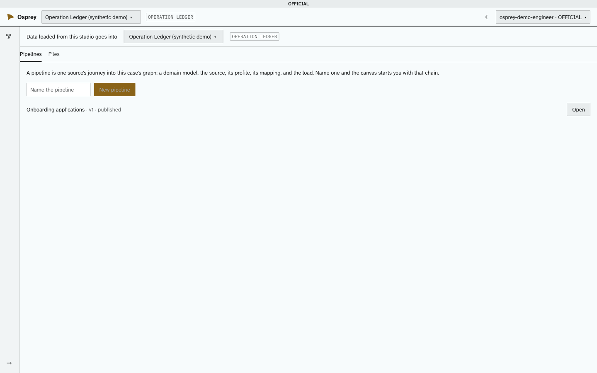

**Name the pipeline** and choose **New pipeline**: the canvas opens with a whole chain to fill in.
Each existing pipeline is listed with its version and status (draft, published or flagged), and
**Open** takes you to it.

### 3.2 The canvas

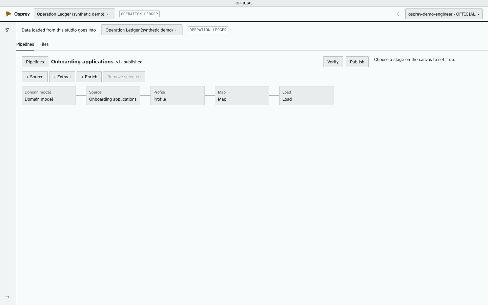

A pipeline is a chain of stages, each with one job:

| Stage | What it does |
| --- | --- |
| **Domain model** | What the data means: the core model, and the pack it adds. Exactly one, at the root |
| **Source** | The file, its connector, its handling marking and its legal basis |
| **Profile** | What the source holds, column by column |
| **Map** | How one row becomes entities and links |
| **Extract** | Optional: finds entities in the text of Documents a map made |
| **Enrich** | Optional: geocodes places — the local gazetteer first |
| **Load** | Writes into the case's dataset. It has no settings |

- **+ Source** adds another whole source → profile → map → load branch. Each source is its own
  load, revertible on its own, and inherits the first source's marking and legal basis.
- **+ Extract** and **+ Enrich** go after the last map. **Remove selected** never removes the
  domain model.
- **Verify** and **Publish** are buttons at the top, not stages.
- Every change is saved as you make it. A pipeline with a cycle, a second domain model, a source
  that reaches no load, or an extract not fed by a map is refused, in words, before it is saved.

### 3.3 Domain model

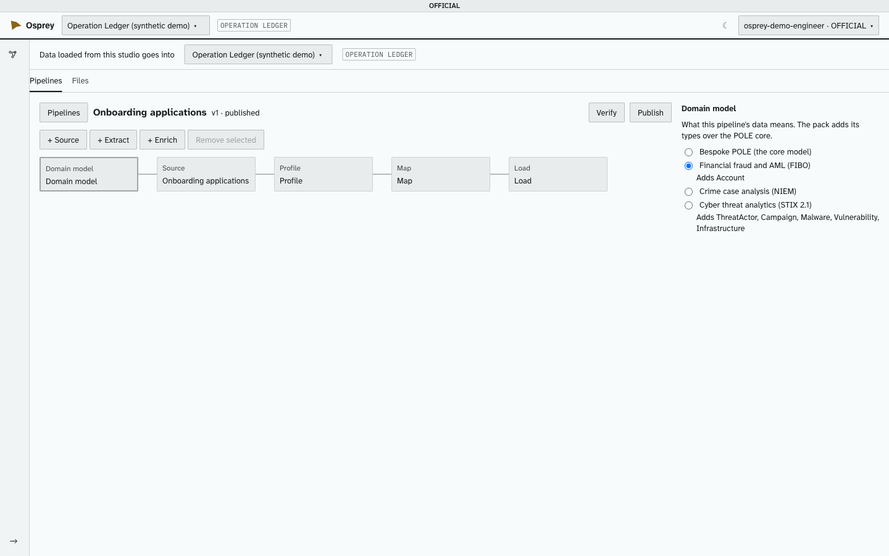

Every pipeline maps into the **POLE core** — people, objects, locations, events, organisations —
and may add one pack over it:

| Pack | Adds |
| --- | --- |
| Bespoke POLE | The core only |
| Financial fraud and AML (FIBO) | Account; registered at, beneficial owner of (with a percentage and nature), controls, holds account |
| Crime case analysis (NIEM) | Used as, role in — each with a required role |
| Cyber threat analytics (STIX 2.1) | ThreatActor, Campaign, Malware, Vulnerability, Infrastructure; attributed to, targets, indicates, compromises |

A pack only adds types, or widens which types a link may join; it cannot change the core.

### 3.4 Source and connectors

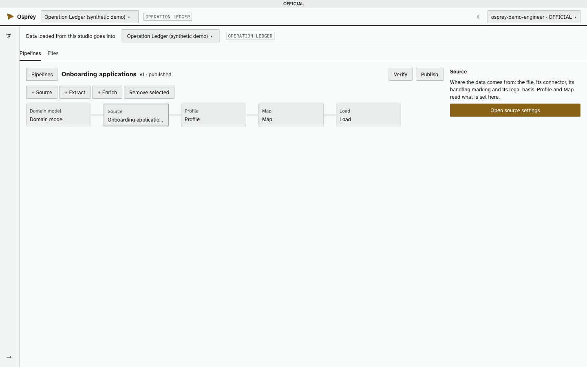

**Open source settings** asks three things before anything else can happen:

1. **Where the data is**: a file from the ingest folder, a file from your computer (uploaded into
   the folder for you), one already on the server, or a path or address you type.
2. **Its handling marking**: the classification and handling code everything from it will carry. A
   classification left blank is recorded as the scheme's lowest level, and the screen says so.
3. **Its legal basis**: the power or consent the data is held under.

**Connectors.** The catalogue lists every kind of source OspreyFlow is designed for —
communications records, mobile-device extractions, financial records, vehicle and movement data,
generic files, documents and media — and marks each as available or not. **Available today: four
connectors, all reading CSV**: generic CSV, call records (day-first dates), cell sites (WGS 84
co-ordinates) and seizure records. The others are shown as not yet available. A connector is a
small profile file in `connectors/`; adding one needs the Conduit restarted.

### 3.5 Profile

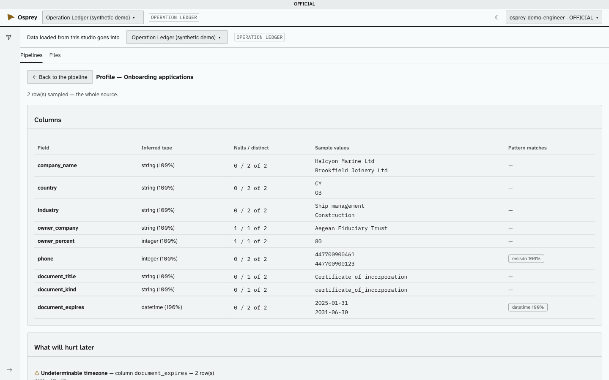

The profile reads up to 10,000 rows (or the whole source, if smaller) and shows, for each column, its
inferred type and how sure that is, how often it is empty, how many distinct values it has, five
sample values, and which known patterns it matches (a phone number, an IMEI, a date…) and how often.
A share is never rounded up to 100% when it is not.

**What will hurt later** names the problems before they reach the graph: mixed date formats, a
timezone that cannot be told, an encoding other than UTF-8, rows with differing column counts, and
apparent duplicates.

Someone not cleared for the source's marking sees the samples' shape only: letters as `A`, digits
as `#`. Map cannot be opened until the profile has run.

### 3.6 Map

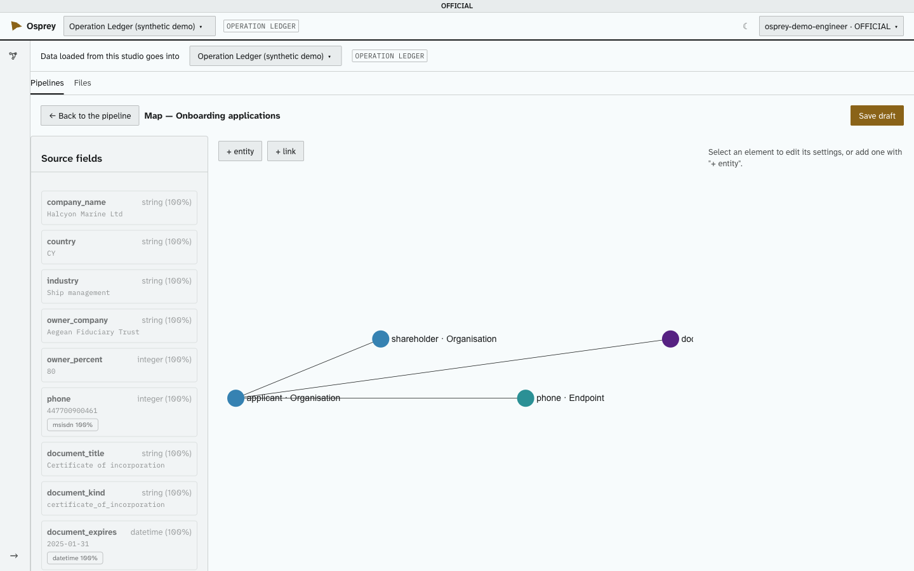

One row of the source becomes a small graph. **+ entity** adds an entity — first its POLE class,
then its type; **+ link** joins two. The source's fields are listed on the left with a sample of
each; every field not yet used is shown until it is mapped or marked **ignore**.

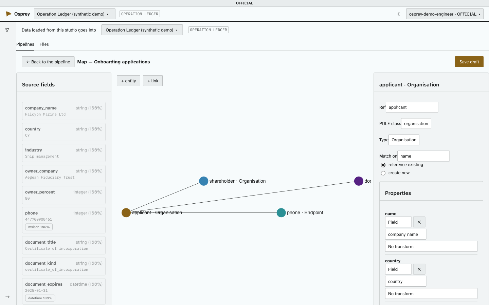

For each entity:

- **Match on** — the property that identifies it — and whether a row **references an existing**
  entity with that value or **creates a new** one.
- **Properties**: each takes a field, several fields, a fixed value, or a value map, optionally
  through a transform.
- **When**: an element can depend on a field's value.
- **Content this holds**: a Document's text, an image or a video.

For each link: its type, and its time — not recorded, or taken from a column. A link with a time can
mark text a model may later read.

**Transforms are Knowledge Adapters, never expressions.** OspreyFlow has no expression or scripting
language. A transform is one of a fixed set of tested adapters: `msisdn`, `imei`, `imsi`, `email`,
`datetime`, `person_name`, `address`, `iban`, `card`, `coordinate_lon`, `coordinate_lat`,
`geometry_ref`, `polygon_ref`, `grid_ref` and `postcode`. Some take more than one column
(co-ordinates two, a grid reference three). A structured result is bound one part at a time, such as
`person_name(part=family)`. A transform that does not exist yet is a new adapter, written with
golden test cases — not something typed into a recipe.

**Handling and provenance** default from the source; an element may **tighten** its handling, never
loosen it. Data a recipe loads is *asserted* — it came from a source, not a model.

**Refused at save, in words:** a link of a type the ontology marks as probabilistic, `SAME_AS` or
`NOT_SAME_AS` (resolution writes those, never a recipe), an unknown type, a property the ontology
does not have, and a link's model-readable text with no time.

**Save draft** saves the map; it does not verify it.

### 3.7 Load

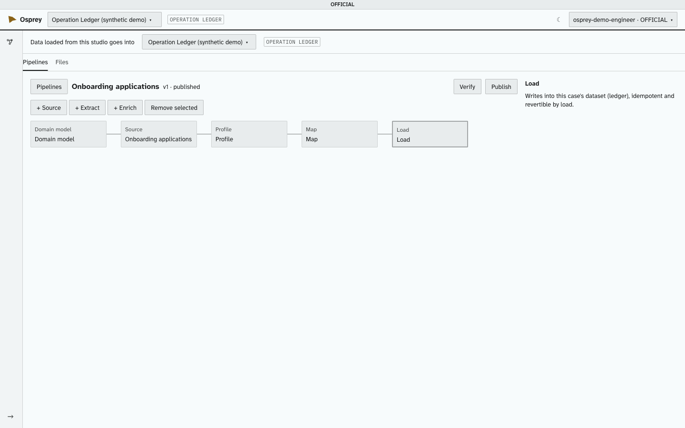

The load writes into the case's dataset. It is **idempotent** — running the same data again adds
nothing new — and every element it writes carries its load's id, so a load can be reverted as a
whole.

### 3.8 Verify

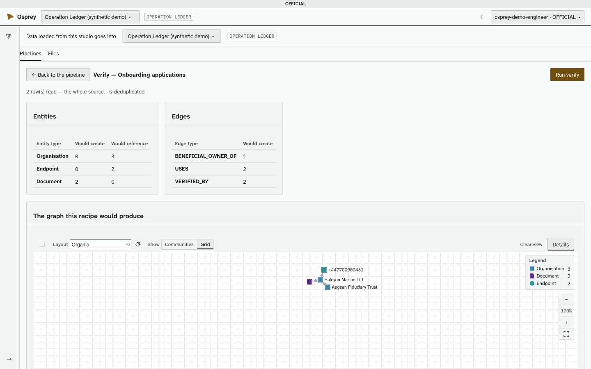

**Verify** is a dry run: nothing is written. It shows, for every type, how many entities and links
the recipe **would create**, how many it **would reference** (existing ones, looked up within the
case's datasets as you), how many rows were deduplicated or rejected, and the graph itself.

Rejections are grouped by cause, naming the adapter and field — never the value. A value the
ontology refuses (a date of birth that is not a date) rejects its row; nothing is silently
changed. **A recipe is published only after it has verified.**

### 3.9 Publish, versions and running

**Publish** commits the recipe to `recipes/<id>.yaml` in the deployment's recipe repository and marks
it published. To change a published recipe, **Reopen for editing** makes a new draft version; a
published version is never edited in place. If the ontology changes under a published recipe, the
recipe is **flagged**, and its scheduled runs stop until it is looked at again.

A publish is refused if a stage cannot run here: an extract library this deployment does not have,
an unknown geocoder, or a handling override with no reason.

**Run now** loads the source. Every row is staged in the object store first, then the graph is
written, then events go to the analytics database and places to the map. The run's report gives rows
read, rows deduplicated, entities created and referenced, links created, rejections, rows held, and
what the case's rules said. A run is refused if the source is marked above your clearance.

**Known limits:** a re-run adds its events to the analytics database a second time (the graph is
unaffected); and loads write one element at a time, so a large source takes a while.

## 4. Files

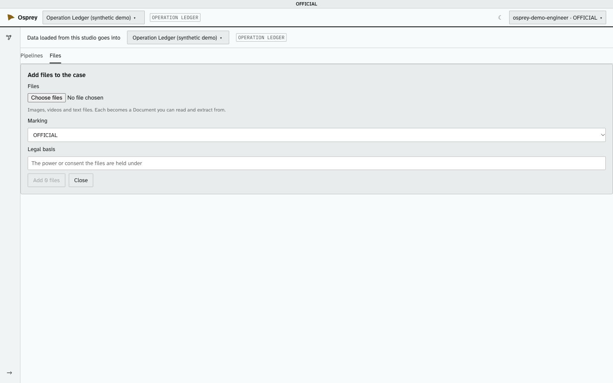

The Studio's **Files** tab adds images, videos and text files to the case, each becoming a Document
that can be read and extracted from (PNG, JPEG, GIF, WebP, TIFF, HEIC, MP4, MOV, WebM and plain
text). It takes a marking and a legal basis for the files. PDF and Word documents are not read yet.
**Adding files there needs `extract_files`**, which the Data Engineer role does not hold — an
analyst adds them, or an administrator grants the right.

## 5. The ingest folder

The source files a pipeline reads live in the deployment's **ingest folder**
(`components.storage.ingest`). OspreyFlow only ever **reads** it, except for its `uploaded/` folder,
where files uploaded through the Studio land, under the case's dataset. The Studio lists files
directly in the folder, in `uploaded/`, and in each of the case's dataset folders — never anything
outside the folder, in deeper folders, or hidden.

An upload is refused, in words, if its name has a folder in it, starts with a dot or is over 200
characters; if it is empty, or over the size limit (512 MiB by default); if its kind is not one
OspreyFlow takes; or if a file of that name is already there — **nothing is ever overwritten**.

## 6. After the load

### 6.1 Held rows

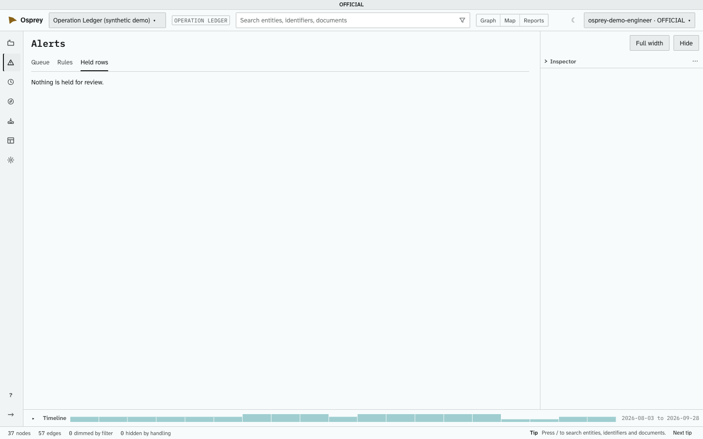

A case's rules judge every load before it commits. A row a rule could not judge is **held**: it
reaches no store until someone decides it, in the Glass under **Alerts → Held rows**, which shows why
each row was held. **Release and load** writes it under a new load (it is judged again, and never
held a second time); **Reject** needs a written reason. Listing held rows needs Editor on the case;
**deciding them needs Author**.

### 6.2 Data feeds

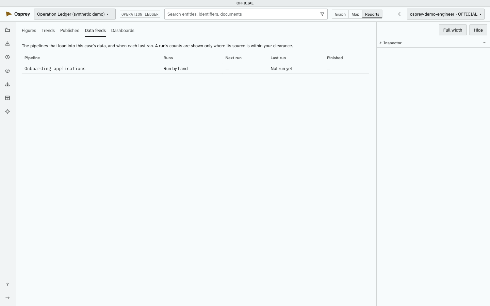

Under **Reports → Data feeds**, anyone holding `read_data_feeds` with Viewer on a case sees the
pipelines that load into it,
how they run (by hand or on a schedule), and when each last ran. A run's counts are shown only to
someone cleared for its source.

### 6.3 Schedules and watched folders

A published pipeline can run on a **schedule** — every hour, every day, every weekday, every week, or
a cron expression — in a named time zone (Europe/London by default), never more often than every 15
minutes, since each run is a whole load. The screen previews the schedule in words with its next five
runs.

It can also run when a **file arrives** in its dataset's own folder, matching a pattern such as
`*.csv`: each file is taken once, a minute after it stops changing, one at a time.

Either way it runs **as the person who last set it**, with every check their own run would get. A
run that is refused — they can no longer sign in, have lost the right, are no longer an Editor, or
are cleared below the source — tells them on their alerts; **three refusals in a row pause it**.
Admin → Schedules and runs lists every one.

### 6.4 Reverting a load

Every element a load writes carries its load's id, and reverting a load hides all of them from every
read without deleting anything. **The revert exists in the product's code but is not yet reachable
from a screen or a command**; when it is, it will need `revert_loads`.

## 7. The domain model

### 7.1 Types

The ontology (`packages/ontology/default.yaml`) defines the entity types — **Person, Endpoint,
Device, Location, Organisation, Event, Document, Vehicle, Asset** — and the link types:
communicated with, uses, present at, mentioned in, verified by, holds, depicts, associate of, family
of, member of, transacted, paired with. A deployment may add types; it cannot add POLE classes. An
Endpoint's value is always held normalised, with its kind beside it.

The graph holds **one summarised link per pair per type**, with its first and last time, how often
it occurred and its weight; the individual events are in the analytics database.

### 7.2 What every record carries

| Part | What it holds |
| --- | --- |
| **Provenance** | Asserted, inferred or unresolved; its sources; what extracted it and how sure; when first seen, last confirmed, and by whom |
| **Handling** | Classification, handling code, action code, sanitisation code, originator, owning unit, review date, legal basis |
| **Datasets** | Which datasets it belongs to; a later load adds, never removes |
| **Audit** | The load, recipe and recipe version that wrote it; its revision; whether it was reverted |

**Handling never goes down.** Writing an element again never lowers its marking. A clearance the
deployment does not recognise sees nothing.

### 7.3 Inferred and confirmed

Anything a model produces is **inferred** until a person confirms it; confirming records who and
when. Nothing is promoted automatically, and no confidence score does it on anyone's behalf.

### 7.4 Resolution: never merged

Loads write each source's own records, and **nothing is ever merged in storage**. Resolution links
records it thinks are one with a scored `SAME_AS`, and the Conduit shows each linked group as one at
the moment it is read, at the case's chosen strictness: Strict (0.99), Balanced (0.95) or Broad
(0.80). An analyst can link two records by hand, or keep two apart — which is always honoured. A
recipe may not write either.

## 8. Screening lists

Sanctions, PEP and adverse-media lists are kept beside the graph, not in it, deployment-wide, and
replaced a whole list at a time. They are loaded from a YAML file on the server:

```
python -m scripts.load_screening_list <file.yaml>
```

The file names the list, whether it is synthetic, and its entries — each with an id, a listing
(`sanction`, `pep` or `adverse_media`), an entity type (Person or Organisation), a name, and
optionally a date of birth and country. **A list of real people is refused** unless the deployment's
local real-data exceptions name its dataset. A match reaches the graph only as a scored, inferred
`SAME_AS`, for a person to confirm.

## 9. Interfaces

### 9.1 The API

Every route is under `/v1`; a case's routes are under `/v1/investigations/{investigation_id}`. A
missing right is refused with `403` and the right's name; a case you have no level on answers as if
it did not exist.

| Method and path | Needs |
| --- | --- |
| `GET /v1/ingest/connectors`, `/v1/ingest/packs`, `/v1/ingest/transforms` | Signed in |
| `GET`, `POST …/ingest/source-files` | `add_ingest_files` (upload: Editor) |
| `POST …/ingest/recipes`; `PATCH`, `GET …/ingest/recipes/{recipe_id}`; `GET …/ingest/recipes` | `edit_pipelines` |
| `PUT …/ingest/recipes/{recipe_id}/pipeline` | `edit_pipelines`, Editor |
| `GET …/ingest/recipes/{recipe_id}/profile` | `edit_pipelines` |
| `PUT …/row-template`; `GET …/map/sample-rows/{row_index}`; `POST …/map/handling-preview` | `edit_pipelines` |
| `POST …/ingest/recipes/{recipe_id}/verify` | `verify_pipelines`, Editor |
| `POST …/ingest/recipes/{recipe_id}/publish`; `POST …/versions` | `publish_pipelines` / `edit_pipelines`, Editor |
| `POST …/ingest/recipes/{recipe_id}/run` | `run_pipelines`, Editor |
| `PATCH …/schedule`; `POST …/schedule/pause`, `…/resume`; `POST /v1/ingest/schedule-preview` | `schedule_pipelines` |
| `GET …/ingest/recipes/{recipe_id}/runs`; `GET …/data-feeds` | `read_data_feeds`, Viewer |
| `GET …/held-rows` | `read_held_rows`, Editor |
| `POST …/ingest/recipes/{recipe_id}/held-rows/release`; `POST …/held-rows/reject` | `decide_held_rows`, Author |
| `GET /v1/admin/schedules` and its actions | `operate_schedules` |
| `GET /v1/me/rights` | Signed in: your own rights |

### 9.2 Files on the server

| Where | What |
| --- | --- |
| The ingest folder (`components.storage.ingest`) | Source files, read-only to OspreyFlow; `uploaded/` beneath it is where uploads land |
| `recipes/<id>.yaml` | Each published recipe |
| `connectors/<id>.yaml` | Each available connector's profile |
| `packages/ontology/default.yaml`, `packs/` | The ontology and its domain packs |

### 9.3 Commands

| Command | What it does |
| --- | --- |
| `ospreyflow demo list`, `ospreyflow demo add <id>` | The synthetic demo packs, each loaded into its own case |
| `python -m scripts.seed_ingest_folder` | Writes the demo packs' synthetic source files into the ingest folder |
| `python -m scripts.load_screening_list <file.yaml>` | Loads or replaces a screening list (section 8) |
