# OspreyFlow — User Guide

For analysts: the people who investigate in OspreyFlow. It covers signing in, cases, the graph, the
map, the timeline and the reports, alerts and watches, and how OspreyFlow decides what you can see.
It describes what is built, and says plainly where something is not yet.

The other guides in this folder are the [administration guide](administration-guide.md), for
whoever installs and runs OspreyFlow, and the [developer guide](developer-guide.md), for data
engineers. The screenshots show the synthetic demonstration cases; no real data appears in them.

<!-- document-control:begin -->
## Document control

**Version 1.6** · 2026-10-28 · For OspreyFlow v0.4.0 · Issued

| Version | Date | What changed |
| --- | --- | --- |
| 1.6 | 2026-10-28 | A source row is counted from 1 everywhere it is shown: the first row after the header is row 1. |
| 1.5 | 2026-10-27 | Add many from a list; Select what is lit and the weekday-by-hour cell brush on the timeline; the case brief; icons by value; a property condition on a pattern node; graph facts in an answer; Ask to search; a hotlist alert that explains itself; and sources withheld where a case does not read their data. |
| 1.4 | 2026-10-18 | §5.3: accounts where they are held, and payments as lines, on the map. |
| 1.3 | 2026-10-18 | §5.2: link types in the legend, left out of the view or brought back, and the custody links of a prison case. |
| 1.2 | 2026-10-15 | A cover page, contents, a list of figures, and this version history. |
| 1.1 | 2026-10-14 | Cases and their branches shown as one tree; a branch renamed or deleted where it is listed. |
| 1.0 | 2026-10-14 | First issue, with screenshots of the synthetic demonstration cases. |

<!-- document-control:end -->

---

## 1. What OspreyFlow is

OspreyFlow holds a case's people, organisations, accounts, phones, places, documents and events as
one graph, and gives you one workspace — the **Glass** — in which the network, the map, the
timeline and the reports are views of the same working set. Selecting something on the graph selects
it on the map; dimming a period on the timeline dims it everywhere.

Three things about the data run through everything below:

- **What you see is decided for you, and nothing hidden is hinted at.** Every record carries a
  classification and handling codes; you see what your clearance allows, in the cases you have been
  given. A record you cannot see is not drawn, not counted in a figure, and cannot be found by its
  links. The status bar says how many items were hidden by handling — never which. The same holds
  for where a record came from: a record's sources are named only when every dataset the record
  belongs to is one this case reads (section 5.6).
- **A model's findings are suggestions.** Anything a model produces is *inferred*, drawn dashed, until
  a person confirms it. Nothing is promoted automatically.
- **Records are never merged.** Records that seem to be one person or organisation are linked with a
  score, and shown as one at the strictness the case is set to. Change the strictness and they come
  apart again; nothing was overwritten.

## 2. Signing in

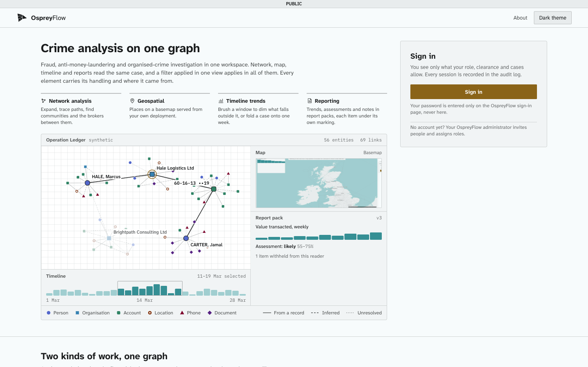

Open your deployment's address. The welcome page never asks for your password: **Sign in** takes you
to the deployment's own sign-in page, at `id.` in front of the same address.

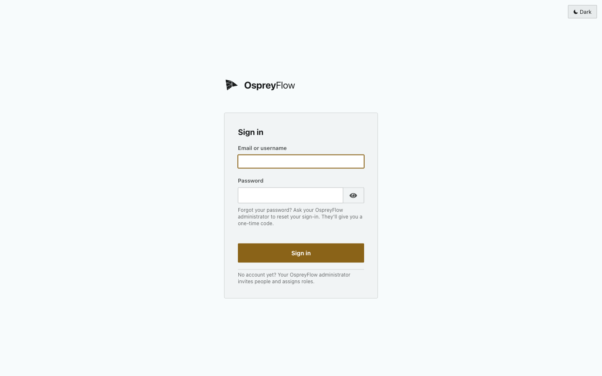

Your administrator invites you. With email set up, you get a link to choose a password; otherwise
they give you a **one-time code** in person, and you choose your password the first time you sign
in. If you forget it, ask your administrator to reset your sign-in. Where your organisation's own
sign-in is set up, the welcome page offers it too.

**Signing out**: the account button at the top right (your name and clearance) has **Sign out**.

## 3. Start

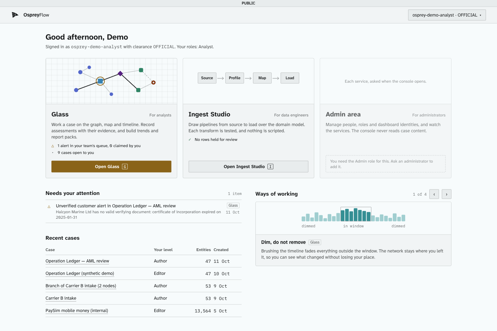

After signing in you arrive at **Start**. It shows the places your roles open — for an analyst, the
**Glass** — with what needs your attention (open alerts, alerts you have claimed) and your recent
cases with your level on each. **G** opens the Glass from here. The OspreyFlow mark at the top left
always brings you back.

## 4. Cases

Everything happens inside a **case**. Your level on a case decides what you may do there:

| Level | You may |
| --- | --- |
| **Viewer** | Open it, browse and query |
| **Editor** | Also change it: add data, expand, edit links, triage alerts |
| **Author** | Also decide who may open it, and which data it reads |

Whoever creates a case is its first Author. **A level never widens what you can see**: a record above
your clearance stays hidden in a case you author. A case you have no level on does not appear at all.

The case menu at the top left lists your cases as a tree: each case with its **branches** beneath
it (a branch is a case of its own, made from nodes you chose — section 5.2), named for how many nodes it
was made from and when, until you rename it. On a branch, the menu's button reads *case › ⑂ branch*.
Each branch's **⋯** offers **Open**, **Rename** and **Delete**; Delete asks once, and the branch leaves
every list for everyone while the case it came from is untouched. Deleting the branch you are in takes
you back to its case. Renaming and deleting are for the branch's Author (an administrator may also
delete). The rail's **Cases** drawer shows the same tree, with **Who can open this case**, which the
Author manages. A link to a case opens it directly. A case reads only its own
**datasets**: search, paths, Explore and watches all stay within them. A record can belong to more than
one dataset; you may see it through any one the case reads, but what it says of where it came from
(its sources) is shown only when the case reads all of them (section 5.6).

**The case brief.** The **Cases** drawer also holds the case's **Brief**: what the case is for.

- **Priority information requirement** is one statement of the question that matters most.
- **Information requirements** are up to twenty, each of up to 2,000 characters, each marked **Open** or
  **Answered**. **Mark answered** and **Reopen** are done by a person; nothing else changes a status,
  and a model never does.
- **Attach…** links a requirement to what answers it: a **Trend**, a **Saved pattern**, an **Assessment**
  or a **Canvas view**, up to ten to a requirement. Choosing an attachment's name opens it where it
  lives: a canvas view opens as a case, a trend opens Reports on its Trends tab, and a pattern or
  assessment takes you to its panel. **Detach** removes the link only.
- Anyone who may read the case reads the brief. Only the case's **Author** edits it (**Edit the priority
  requirement**, **Add a requirement**, **Edit**, **Remove**). Ctrl/Cmd+Enter saves a box and Esc
  cancels it.
- An attachment you may not read is left out entirely: no title, no placeholder and no count. Two
  people with different access can therefore see different attachments under the same requirement.
- Editing the priority, a requirement's text or status, adding one or removing one puts a step,
  "Edited the brief", in **History**. That step cannot be restored, since a brief is not a canvas.
  Attaching and detaching are recorded, but do not appear in History.
- A branch does not inherit the brief.

## 5. The Glass

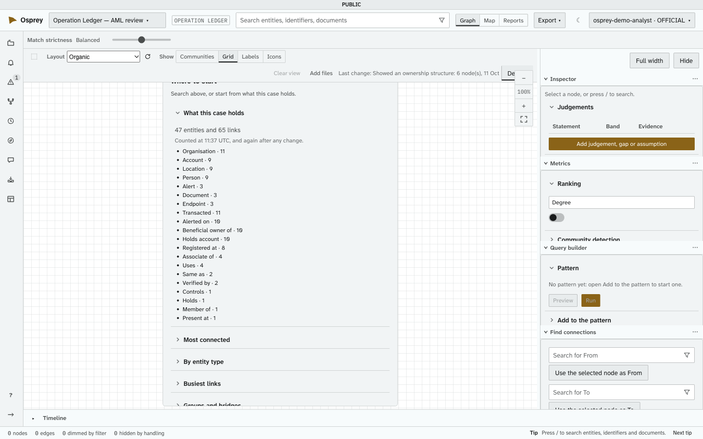

| Part | What it is |
| --- | --- |
| **Top bar** | The case menu, search, the view switch (Graph, Map, Reports), Export, and your account |
| **Left rail** | The places: Explore, Alerts, Ownership, Watches, Questions, History, Dashboards, Help — those your rights allow |
| **Canvas** | The graph, the map or the reports |
| **Right column** | The Inspector, Metrics, the query builder and Find connections, stacked; **Full width** and **Hide** |
| **Timeline** | Folded at the bottom until opened |
| **Status bar** | How many nodes and links are drawn, how many dimmed by a filter, and how many hidden by handling |

### 5.1 Where to start

While the canvas is empty — or any time from the rail's **Explore** — **Where to start** shows what
the case holds: counts of each type, the most connected entities, the busiest links and days, groups
and the entities that bridge them, what is new since the last loads, and starter questions. **Add…**
on any entity draws it alone, with its 25 or 50 busiest links, or with all of them. **Add many from a
list** (section 5.5) is a fold here too.

### 5.2 The graph

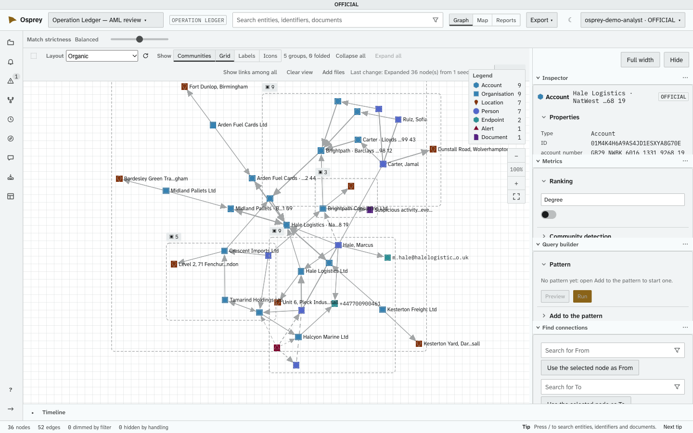

**Selecting.** Click a node; Shift-, Ctrl- or Cmd-click adds or removes one; or draw a lasso. The
selection bar then offers **Expand**, **Show links among these**, **Branch to a new case**,
**Remove from view** and **Clear** (Esc).

**Expanding.** Double-click, or press Enter, to draw a node's links. Right-click (or `\`) opens its
menu: **Show links** lists each kind of relationship with how many there are, so you can draw just
one; **Actions** holds Link to…, Split from…, Find paths to…, Explain cluster, View messages, Branch
selected to a new tab, Set picture, and Mark for suppression. An expansion that would add more than
**500** nodes asks first, offering one relationship at a time, all of them, or nothing. An expansion
past the working set's own limit is refused; reduce what is drawn, or branch, and try again.

**Reading a link.** A link's stroke says where it came from: **solid** from a record, **dashed**
inferred by a model, **dotted** unresolved. Hovering names its type and how many such links join the
two. Right-click a link (or `L`, then `\`) for its menu: its emails, events or messages; **Change
link…**; its change history; a note; or hide it.

**Link types.** A link's colour says its type where the type has one. Under the types, the
**legend** lists the links in view — each type in its colour, with how many — and each has a box:
clear it to leave that type out of the view, tick it to bring it back (in this tab only; nothing is
removed). **Show links** on a node draws one type at a time, so you can, for instance, follow only
who shared a cell with whom. A prison or custody case (the Prison Intelligence Dataset demonstration case is one) carries the links a
prison intelligence analyst works with: **shared a cell with** (with the cell and the dates),
**co-defendant of**, **in conflict with** (with a reason), **visited** (in person or by video), and a
person's **role in** an incident (an assault, a disorder or a find, with what was found), beside the
phones, calls, accounts and payments any case can hold. Two prisoners who call the same outside
number, or are paid from the same account, are joined through that number or account on the graph,
and the number's or account's calls and payments are on the timeline and the map.

**Icons by value.** A type's icon can depend on one of its properties. An **Endpoint** is drawn as a
neutral device; one whose kind is a phone number is drawn as a phone, a PIN account as a keypad, and an
account as an account. In a prison case an **Incident** is drawn as a parcel over a wall for a
throw-over, a clash for an assault, a crowd for a disorder and a magnifier for a find; an incident of
another category keeps the type's icon. Shape and colour stay the type's. The order is: the entity's
own picture, then the icon you chose for the type (the **Icons** control in the canvas toolbar), then
the icon for the value, then the type's icon. A node without the property, or with a value no icon is
given for, is drawn with the type's icon. The **legend** lists **Icons by value** in view, each with its
meaning, such as "Keypad: Endpoint, endpoint kind handle", and how many; the **Inspector** says "Icon
for this value" for the selected node. Both name an icon only where the canvas draws it. As with every
icon, the icon is drawn only when you are zoomed in to the neighbourhood, and past 10,000 nodes nodes
are dots.

**Same-as links.** Records OspreyFlow thinks are one are joined by a same-as link. Its menu offers
**Collapse into one node** (for this view only), **Confirm as the same**, **Mark as not the same**
and **Explain this link**. Confirming or marking needs a reason, kept in the audit with your name.
**Match strictness** at the top of the graph sets how sure a match must be to show records as one —
Strict, Balanced (the default) or Broad — and says how many merged and split.

**Groups.** **Communities** boxes groups of closely linked entities; fold a group from its box, or
press `G` on a node in it. **Layout** offers Organic, Force-directed tree, and Clustered bubbles;
**Arrange** lays everything out afresh. Drag nodes to move them; their positions belong to your view.

**Branching** copies the selection, and the links between it, into a new case of which you are
Author; the case you were in is unchanged.

### 5.3 The map

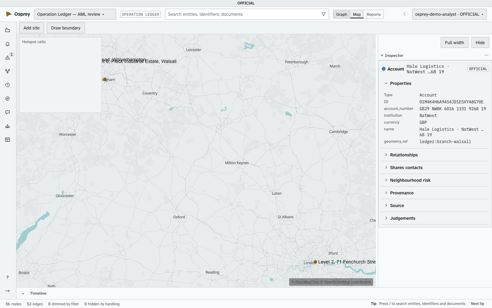

The map shows the same working set and selection as the graph. A location is drawn at its point,
and so is an account, where it is held; a link between two things on the map is drawn as a line —
a payment from an outside account into a prisoner's private cash, for instance. **Add site** places a building's plan
on the map from four matched points and draws a grid whose cells become locations. **Draw boundary**
filters to what falls inside it. **Hotspot cells** counts what is in each cell, and filters as you
choose. If the deployment's basemap is not built, the map says so.

### 5.4 The timeline

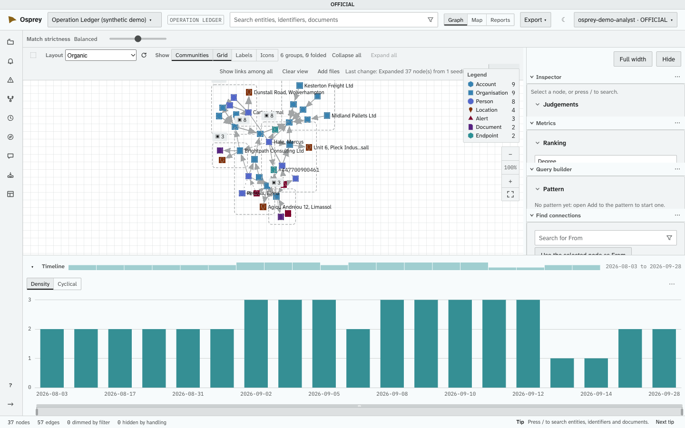

Open the timeline at the bottom. **Drag across the bars** to choose a period: everything outside it
is **dimmed, never removed**, on the graph and the map alike. The slider under the axis zooms the
axis without filtering. **Play** reveals the network as its events happen, at ½× to 8×. The **⋯**
menu sets exact dates, or overlays another case. **Clear filter** removes the period.

**Select what is lit.** With a period chosen, **Select what is lit** replaces your selection with
every node that has a link with at least one event in the period, its two ends included. A link is
*lit* when it has such an event; a node is lit when a lit link touches it. **Undated links are never
lit**: a link with no event has no date to fall in the period, and there is no setting to include it.
The selection bar says so ("Lit in 5 Jan – 30 Apr 2026: undated links are not included") and offers
**Undo select what is lit**, which gives back the selection you had; it is offered while the selection
is still exactly the lit nodes. If nothing is lit, the selection is left alone and it says so. Dates
are UTC. To reach it from the keyboard, set the period with **Set exact dates** in the **⋯** menu.

**Branch to a new case**, pressed while the selection is still what was lit and the period unchanged,
branches only the lit links and the nodes they touch, and the new case's timeline starts and ends
inside the period. Its tab is named for the period, such as "5 Jan – 30 Apr 2026, selected". If the
slice is over the canvas's limit, it says how many and that no tab was made; narrow the period or select
fewer nodes. Change the selection and the branch is an ordinary one.

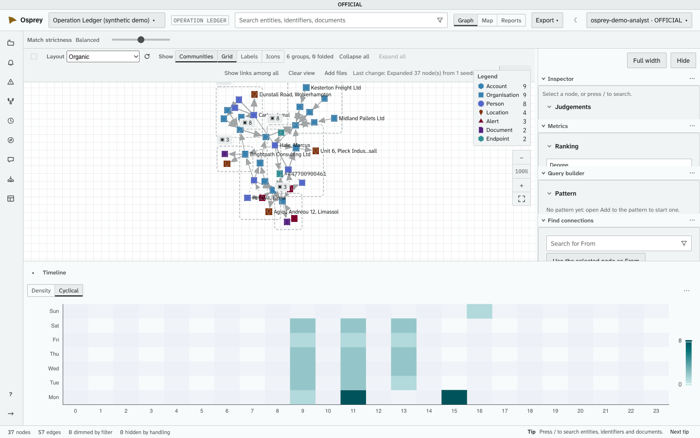

**Cyclical** shows the same events as a grid of weekday against hour, for habits and routines. It
always draws the case's whole range. Hours and days are UTC.

**Choosing cells.** Drag across the grid to choose the cells (a weekday and an hour each) you want; they
stay outlined and the rest of the grid stays visible. For the keyboard, open **⋯** (**More timeline
options**) and **Choose cells (UTC)**: tick the days (Mon to Sun), set **From hour** and **To hour**
(0 to 23), or press **Weekend**. A drag sets the hours too. **Clear** removes the choice, as does **Clear
filter**. Once cells are chosen, the map and its hotspot cells count only the events that fall in them,
the canvas dims what does not, and the status bar counts what is dimmed as for a period. **Select what
is lit** honours them as well: it needs a period chosen on the density view, and lights only links
with an event inside the period and the cells. Choosing cells alone, with no period, does not offer
it.

### 5.5 Search

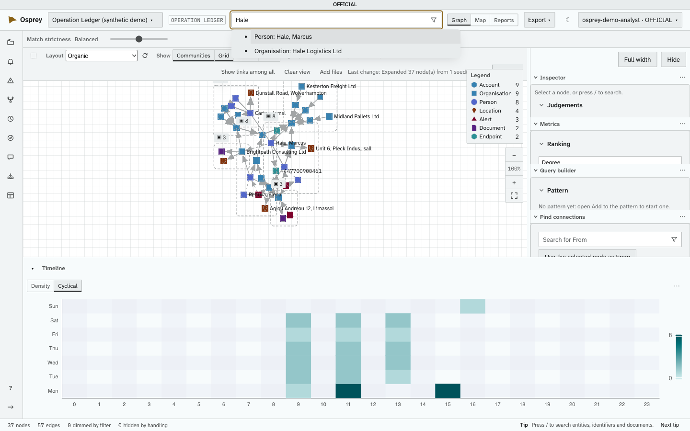

Press `/` anywhere (outside a text box) to search. Suggestions start at two characters, across names,
identifiers and titles; choosing one draws it with what is near it, counting first and asking if it
is a lot. **Filters** narrow by entity type, how the text matches, and whether to look only at what
is already drawn. A phone number or account reference is read the same way however you type it, so
`07700 900640` finds the number held as `+447700900640`.

**Add many from a list.** The list button beside the search box (**Add many from a list**), and the fold
of that name in **Where to start**, take a list of identifiers and draw what is found. Adding needs
Editor on the case; without it, the box says so.

1. Paste identifiers into the box, or choose a `.txt` or `.csv` file (its first column; a first row that
   is a header such as "identifier" or "prison number" is left out). They may be prison numbers,
   National Insurance numbers, phone numbers or account references, one a line or separated by commas
   or spaces. A number written with spaces, such as `+44 7700 900640`, is one number.
2. Press **Count**. It says, for example, "40 identifiers read. 38 found. 2 matched nothing you can
   see. 1 repeated." Nothing is on the canvas yet. Changing the text clears the count, so a count is
   always of what you would add.
3. Press **Add** to put the nodes on the canvas without their links; **Show links among all** in the
   canvas toolbar's View group then draws the links. **Add with all links** draws the links among
   the nodes added and those already there instead. For a very large view it adds the nodes without
   looking for links, as Expand does. **Cancel** (or Esc) empties the box.

What the figures mean. *Found* counts every identifier that resolved, repeats included. *Matched
nothing you can see* is one figure for an identifier that does not exist and one you may not see: the
words, the counts and the work done are the same either way, so a list cannot be used to test whether a
hidden person exists. *Repeated* counts identifiers that name what an earlier one did, so three
spellings of one number count once as found and twice as repeated. If more records than the lookup reads
share a value, it says so, "could not be told apart", rather than guessing. A number is matched only to a
phone number and an account reference only to an account: a PIN holding the same digits is not a match.

The limit is **5,000** identifiers at once. More is refused, naming the figure, and nothing is added;
split the list. A list that would take the canvas past its limit adds nothing, and says how many it would have been against the limit.
The box is never shown an identifier back, only counts.

### 5.6 The Inspector

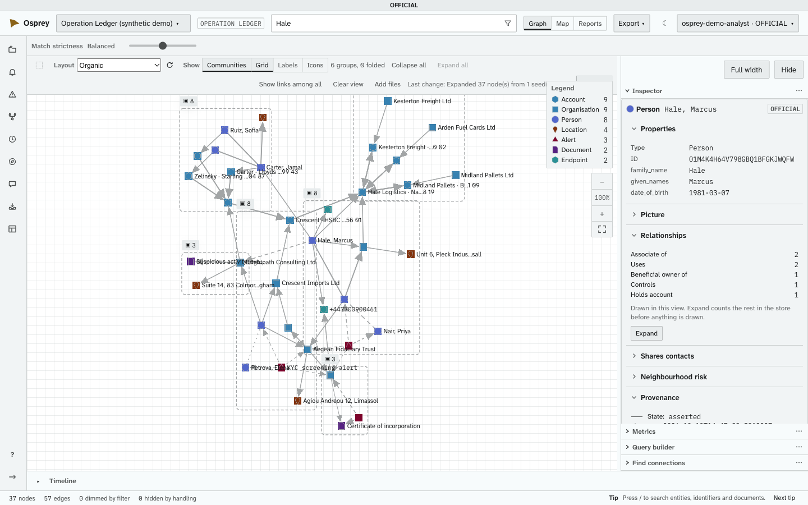

Select one node and the Inspector shows its **properties**, its **picture**, its **relationships**
(how many of each, drawn or not — **Expand** draws the rest), the entities it **shares contacts**
with, its **neighbourhood risk** (alerts within two links over the last 90 days, scored on request
and never stored), its **provenance** — from a record, inferred, or unresolved, and when it was first
seen — its **source**, the file and row it came from (such as a file name and "row 3"), the **icon for
this value** where the type has one (section 5.2), and the **judgements** that cite it. With several selected it summarises them and the links
between them; with a link selected it shows the link's details, notes, events and history, and lets
an Editor **change the link** (with a reason, and what stands behind it).

**Sources withheld.** A record can belong to more than one dataset, and a case reads only some. Its
sources are named only if the case reads every dataset the record belongs to. When it does not, where
the sources would be listed, the Inspector's **Source**, a link's details and the messages view
(**View messages**) say "Its sources are in data this case does not read". They never say "No sources
recorded": there are some, and they are not this case's to see. The node or link itself is still
shown, as you may see it; only where it came from is held back. The same applies in an alert (section
7.2). If an Author widens the case's datasets, records already on your canvas may keep saying this
until you open the case afresh.

### 5.7 Metrics

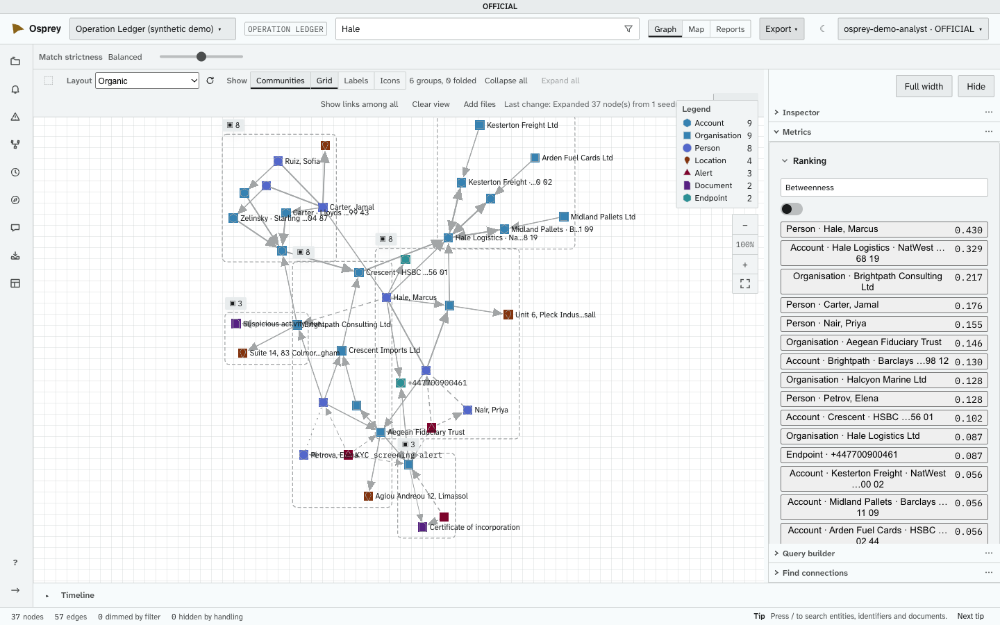

**Metrics** ranks what is drawn by degree, weighted degree, betweenness, eigenvector, PageRank,
clustering coefficient or the clique metric, and can compare two. Choose a row to go to it. Its
filters — relationship strength, a metric's value — dim, never remove. A metric is shown as size,
never as colour.

### 5.8 Find connections

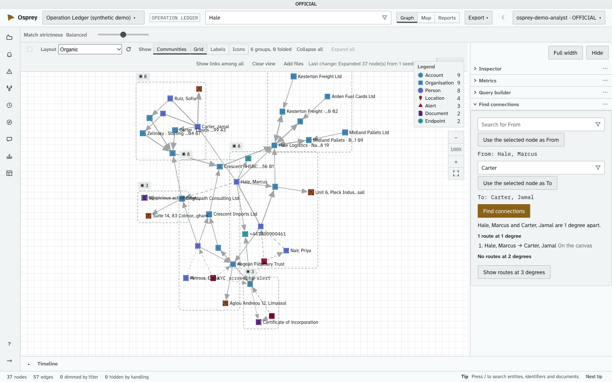

Choose a **From** and a **To** — by search, or the node you have selected — and **Find connections**
says how many degrees apart they are and lists the routes at that distance, then widens one degree
at a time, up to eight. Any route can be drawn on the canvas, marking each node with its distance
from From. **Find paths to…** in a node's menu gives the shortest paths between two selected nodes.

### 5.9 History

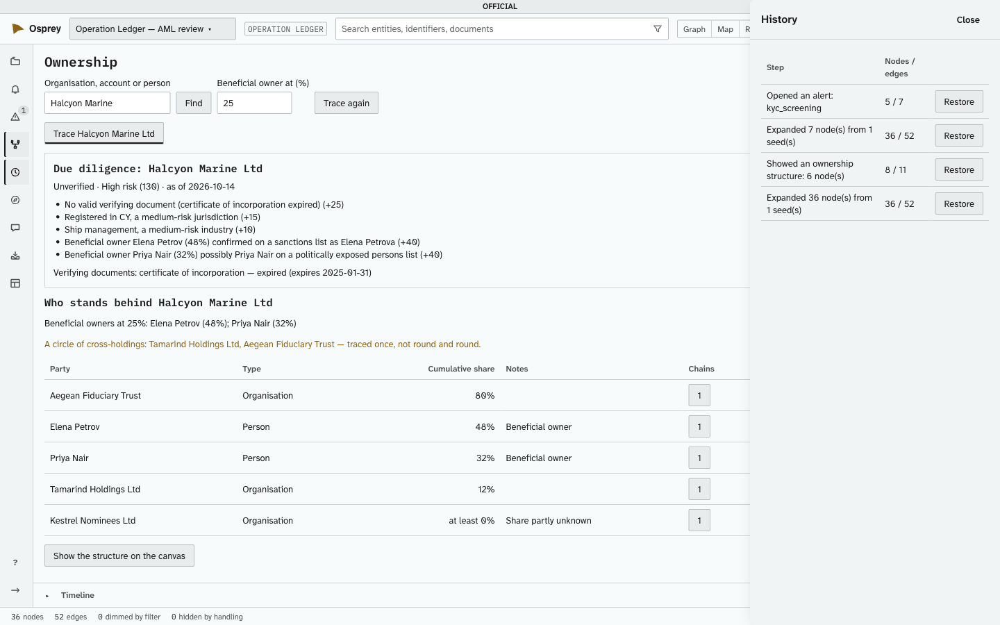

**History** lists what you did to the view as named steps — "Expanded 36 nodes from 1 seed", "Opened
an alert" — with how much each drew. **Restore** goes back to any of them. "Last change" on the
canvas toolbar opens it too. An edit to the case's brief appears as "Edited the brief" and cannot be
restored (section 4).

### 5.10 The query builder

The **query builder**, in the right column, draws a pattern of nodes and links, counts what matches
(**Preview**, "~12 matches") and finds it (**Run**). Under **Add to the pattern** you add a node by type
or pin one you have found, and connect two. Under **Save this pattern** and **Load a saved pattern**
you keep and reuse them.

**A condition on a node.** A node can be narrowed by what one of its properties says. On a node, choose a
property, type a value and press **Add condition**: "people held at an establishment whose `niu_area` is
North Wing" is two nodes, one link and one condition. Each condition is listed, as `niu_area = North
Wing`, with **Remove**.

- It is an equality: the property equals the value you typed. There is no "not", no range ("more than",
  "since"), no list of values and no "contains".
- A node takes up to three conditions, each on a different property; setting a property again replaces
  its value.
- Only text properties the case's data model marks as searchable are offered, and never a sensitive
  one. A pattern that names a sensitive or unsupported property, however it reached the server (a
  saved pattern, a model's proposal, a monitor), is refused with the property named, before anything is
  counted, and is never stored. A number, date or yes-or-no property is refused as not supported.
- The condition counts and runs inside what you may see, like the rest of the pattern: a hidden node
  that would have matched leaves no trace in the count.
- A saved pattern, a monitor and a rule built on it all carry the condition.

**Ask to search.** Above the pattern, **Ask to search** takes a question in words: "who shares a visitor
with the principal?". Press Enter or **Ask**. The model is given only your question and the case's
vocabulary: the entity types, the link types with their ends and direction, and the names of the
searchable text properties. It is not given your data, and it cannot run anything. It proposes a pattern,
which is drawn in the builder with a one-line explanation, a count, and the note "A model proposed this
pattern. Check the pattern before you run it." Nothing runs until you press **Run**, and running changes
nothing in the case. A proposal is a suggestion, not a finding.

- "The principal" or "the selected person" mean what you have selected, and only nodes you may see.
- A proposal is a new, unsaved pattern. **Save** never overwrites the pattern it replaced, and **Restore
  the previous pattern** brings that back. If you edit the pattern while the model is working, the
  proposal is dropped with a message, and you ask again.
- **"Could not express the question as a pattern."** The model's answer used a type, link, property or
  value the case does not have, or something the builder cannot draw. The builder cannot draw
  absence ("who has no phone") or ranges ("since 1 January", "more than five"). Rephrase the question,
  or draw the pattern yourself.
- A small local model will sometimes propose a wrong pattern. That is why the pattern and its count come
  first. It does worst on questions about a particular account, number or handset, since the kind of
  an endpoint is not something a pattern can match. For "more than one" questions, two nodes of one
  type are not forced to be different, so a count can include a node matched twice.
- Asking needs the right to ask the model, and Viewer on the case.

## 6. Questions to the model

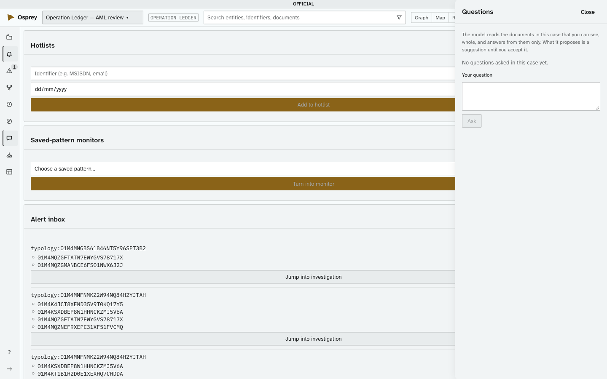

**Questions** asks the deployment's model about the documents in this case that you can see, and about
**graph facts**. It answers from those only, citing each — **Draws on** opens a document. What it
proposes, you **Accept** or **Reject**; an accepted proposal enters the graph as *inferred*.
**Ask the model about these…** on a selection of documents starts a case of its own for them. Asking
needs Editor, and at least one document you can see in the case.

**Graph facts.** Along with the documents, the model is given a numbered, plain account of the graph
around what you have selected and one link beyond it (the whole view when nothing is selected). A
timeline period, if one is set, limits the links and events to it. The account lists each entity by type
and name; each link among them as a fact, `[G-1]`, `[G-2]`, with its type, its two ends by name, its first
and last date, how often it occurred, its dataset's label and whether it is direct or inferred; and the
events for each month. It holds only what you may see, and never an identifier of the system. It has no
path facts: a question about a connection is answered from the links it holds.

In an answer, each `[G-n]` is a button, "Select [G-1] on the canvas". It selects what the fact stands
for and brings it into view: the link if one drawn link is meant, otherwise its nodes. A fact the model
cites that was not in the account it was given is dropped and counted among the items left out.

The documents and the graph facts share one limit. Over it, the question is refused, saying how many
characters each came to and the limit, and that nothing was sent: narrow the selection, narrow the timeline
window, or branch the case, then ask again. Your question stays in the box. Nothing is trimmed. An
answer is shown later only to someone who could see every item it was built from, so a reader cleared
lower does not see an answer built on events above their clearance. An answer kept before that was
recorded may still be shown as before.

To ask in words for a pattern rather than an answer, use **Ask to search** in the query builder (section
5.10).

## 7. Alerts and watches

### 7.1 Alerts

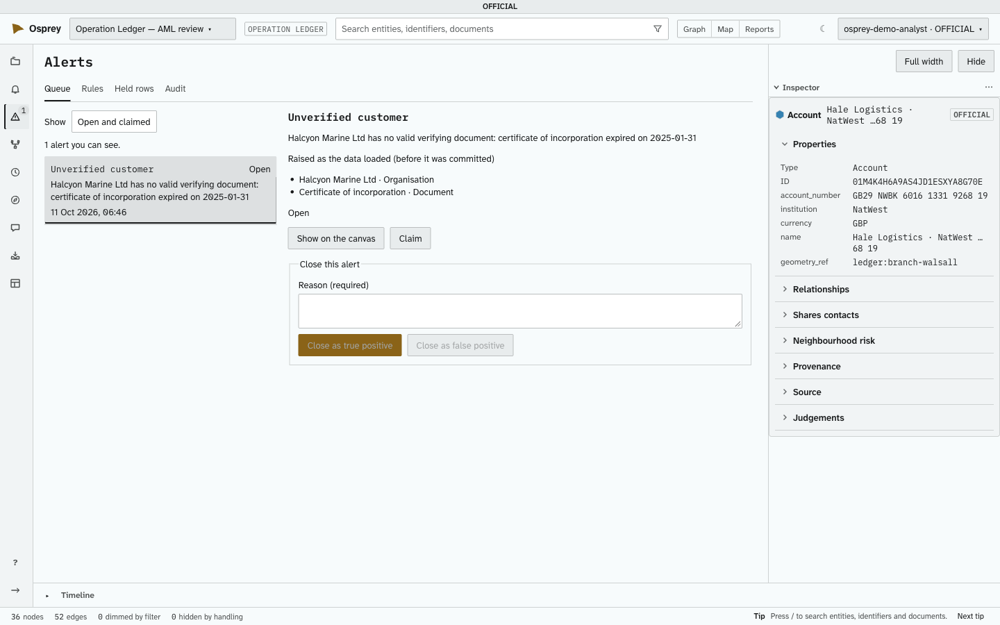

The rail's **Alerts** (its badge counts what is open or claimed) holds the alerts the case's rules
raised — structuring, rapid movement, circular flow, screening matches, shared contact details,
unverified customers, and patterns drawn by analysts. **An alert concerning anything you cannot see
is neither shown nor counted.**

Open one to see why it was raised and what it concerns; **Show on the canvas** draws them. **Claim**
it to work on it (**Release** gives it back). **Close as true positive** confirms the node it raised;
**Close as false positive** leaves it a suggestion. Closing needs a reason. Triage needs Editor; a
Viewer reads. The **Rules** tab shows the rules judging this case; an Author deploys and retires them.

An entry in this queue is raised by a **rule**, a typology such as structuring or a pattern drawn by an
analyst. It is not a hotlist match: those are in **Watches** (section 7.2), and are read there.

### 7.2 Watches

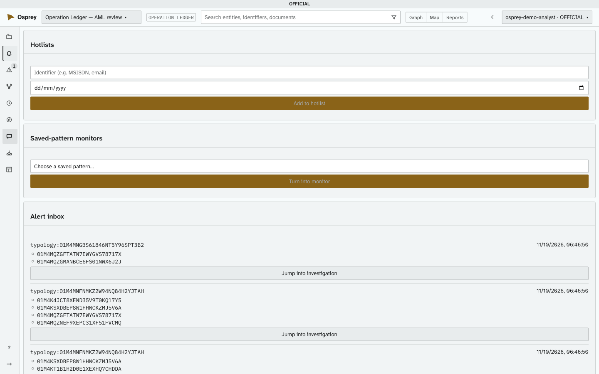

**Watches** keeps a **hotlist** of identifiers — a phone number, an email address — each with a review
date: any data that touches one raises an alert. A **monitor** runs a saved pattern against new data.
Both watch only their case's data. **Jump into investigation** starts a case from an alert. An alert
whose evidence you cannot see says only that a match fired.

**A hotlist alert explains itself.** In **Watches**, under **Alert inbox**, a hotlist alert is headed
"Hotlist alert" and reads, for example:

- "Hotlist: 07700 900640 · review by 31 Jan 2027": the identifier **as you typed it**, and the
  hotlist's review date. If OspreyFlow could not read the text as a phone number or other known kind,
  it was kept as written, and the line says "(kept as written)".
- "Matched: Endpoint +447700900640": the type and name of what it matched.
- "From: pid_seized_comms_batch2.csv, row 3; pid_pin_calls.csv, 2,013 rows": the files the matched record
  came from, and the row in each, or how many rows. Up to five files are named, in the order they were
  first seen; the rest are counted, "and 3 more files", not cut. Where a source has no row, it counts
  records instead.

**Row numbers count data rows from 1**: the first row after the header is row 1, so "row 3" is the
third data row, the fourth line of the file. The Inspector's source, a link's details, Verify's
rejected rows and held rows count the same way. Where two loads of a file
with the same name matched, each is listed. **Jump into investigation** is as it was. Raw rule and node
identifiers are no longer shown.

Only the hotlist's owner sees the identifier and review date, and an alert on another analyst's hotlist
is not listed to you. An alert about something you can no longer see says only "A match fired — no
evidence visible to you." If the matched record was removed from your view between the two reads, the
alert says "Evidence no longer available." and cannot be jumped into. **Where a matched record belongs
to data this case does not read**, the alert names its type and name and says "its sources are in data
this case does not read", with no file and no row (section 5.6): a file name is as much a source as a
row.

## 8. Ownership and due diligence

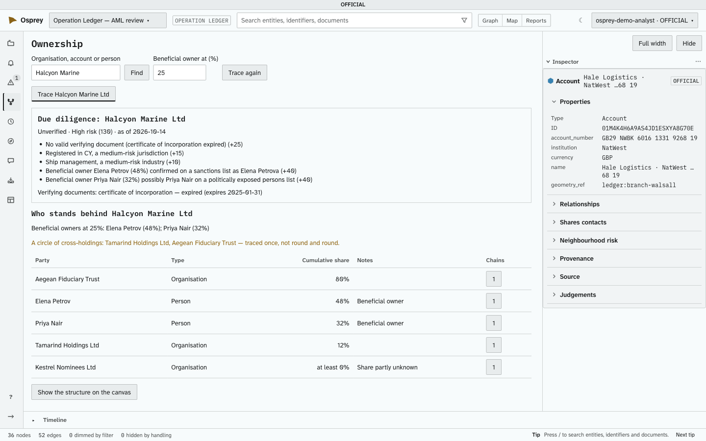

The rail's **Ownership** traces who stands behind an organisation or account: every beneficial owner
at or above the threshold (25% by default), their cumulative share through each chain, and anyone
holding control whatever their share. A circle of cross-holdings is traced once, and said so. **Due
diligence** gives the verification status, risk band and score with each factor's weight, and the
verifying documents. All of it is worked out as you read, from what you can see, and stored nowhere.
**Show the structure on the canvas** needs Editor.

## 9. Reports and dashboards

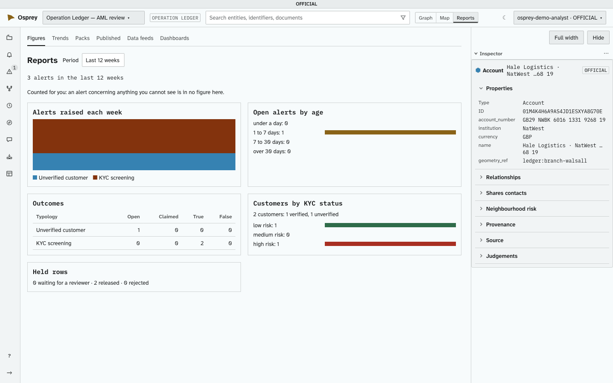

The view switch's **Reports** shows the case's figures over 4, 12, 26 or 52 weeks: alerts raised each
week, open alerts by age, outcomes, customers by status, held rows. Every figure is **counted for
you**: anything you cannot see is in no figure. A period too long to count says to choose a shorter
one; it never shows part of a chart. Other tabs, as your rights allow: **Trends**, **Packs** (report
packs, exported to PDF), **Published**, **Data feeds** and **Dashboards**.

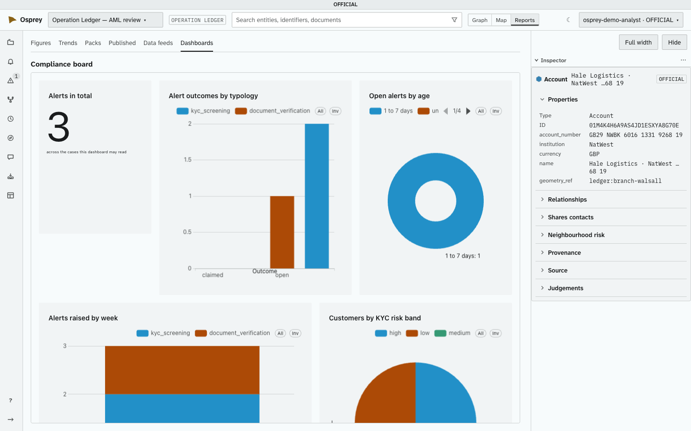

**Dashboards** draws the deployment's boards inside the Glass, showing only those you may open. The
same boards are at `bi.` in front of the deployment's address, signed in the same way.

## 10. Judgements

The Inspector's **Judgements** records what you conclude: a statement, how likely it is on the
probability yardstick, and the evidence for and against. A judgement cannot be saved without at least
one supporting reference. Gaps (open, tasked, answered, closed) and assumptions (with what follows if
one is false) are recorded the same way. A judgement is hidden from anyone who cannot read all of its
supporting evidence, and flagged for review when something it cites is corrected or split.

## 11. Export

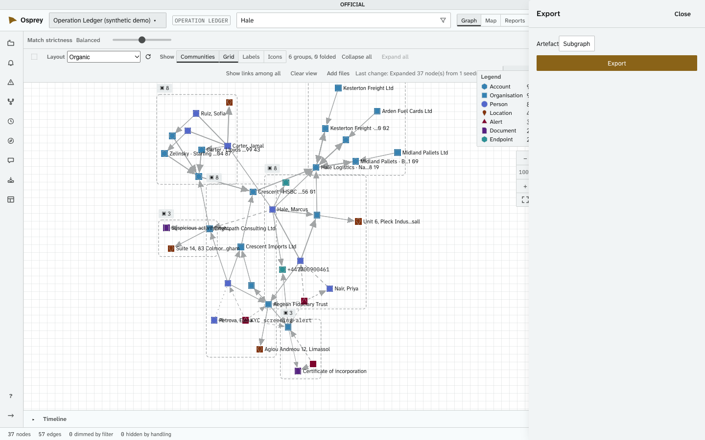

**Export** (on the Graph view) saves what is on the canvas:

| Artefact | File |
| --- | --- |
| **Subgraph** | JSON |
| **Chart** | PNG |
| **Report** | A self-contained HTML page |

Each export is marked — the handling level and the time — and says how many items it left out for
handling. Items that cannot leave are named, with the reason. An item marked *consult originator*
needs a justification and the originator's reference before **Export** is enabled. Every export is
recorded. Report packs export to PDF from the Packs and Published tabs.

## 12. Keys

| Where | Key | Does |
| --- | --- | --- |
| Start | `G` | Open the Glass |
| Anywhere | `/` | Search |
| Anywhere | `?` | The welcome panel, with keys worth knowing |
| Canvas | Tab, Shift+Tab | Move into and out of the canvas |
| Canvas | Arrows | Step to the next or previous neighbour |
| Canvas | Ctrl/Cmd+Arrows | Step within the selection; with Shift, through every node |
| Canvas | Space | Add or remove the focused node from the selection |
| Canvas | Enter | Expand the focused node, or read a document |
| Canvas | `\` | The focused node's or the selected link's menu |
| Canvas | `L`, Shift+`L` | The next or previous link of the focused node |
| Canvas | `G` | Fold or unfold the focused node's group |
| Canvas | `F` | Fit the graph to the view |
| Canvas | Shift+Arrows | Move the selection; with Alt, further |
| Canvas | Delete | Hide the selected link, or remove the selection from view |
| Anywhere | Esc | Clear the selection; close a menu, drawer or reader |
| Forms | Ctrl/Cmd+Enter | Confirm a reason, save a change or a note, ask a question |
| Side panels | Alt+Up, Alt+Down | Move a panel up or down the column |

Every action in the Glass can be reached from the keyboard. Panning, zooming and the lasso are by
pointer only, by design: the arrows, Space and `F` do the same work from the keyboard.
