# OspreyFlow — User Guide

OspreyFlow is an open-source intelligence mapping platform for crime analysis, anti-money-laundering,
fraud detection, and event monitoring and alerting.

For analysts: the people who investigate in OspreyFlow. It covers signing in, the four places,
cases and their views, the graph, the map, the timeline, drawing boards and the case's figures,
monitoring and alerts, and how OspreyFlow decides what you can see. It describes what is built, and
says plainly where something is not yet ("coming").

The other guides in this folder are the [administration guide](administration-guide.md), for
whoever installs and runs OspreyFlow, the [developer guide](developer-guide.md), for data
engineers, and the [architecture guide](architecture-guide.md), for how it is built. The screenshots show the synthetic demonstration cases; no real data appears in them.

<!-- document-control:begin -->
## Document control

**Version 1.61** · 2026-11-14 · For OspreyFlow v0.5.0 · Issued

| Version | Date | What changed |
| --- | --- | --- |
| 1.61 | 2026-11-14 | Step 5's wording sweep, early part. §2: a refresh keeps you signed in and where you were, for the tab alone, forgotten at sign-out (ADR-050 Amendment 3). §3: under GOV.UK, the slim header and phase banner and the one-row context banner on every screen but Home and sign-in (ADR-132 Amendment 8). §5.5: the box's filters as it labels them (Ignore case, Match, Entity types, Only nodes on screen, Reset filters), its more line, its limited line (a *Starts with* search alone), one character with *Only nodes on screen*, and a *Starts with* search of at most 50 characters where there is an index. §6: Ask & Chat for Ask the case. Held by `tests/test_guides_v051_gaps.py`, `test_user_guide_search_results.py` and `test_guide_navigation_words.py`. PDF made by the orchestrator at merge. |
| 1.60 | 2026-11-14 | §5.2: an expansion past the working set's limit may be **run as a batch job** (ADR-151): run on the server as you, saved as a private view of the case, or refused with its figures past a view's own limit of 50,000 nodes and 250,000 links; its result opens as your private view when it is done, and the job carries on with the panel closed. Held by `tests/test_user_guide_batch_expansion.py`. PDF made by the orchestrator at merge. |
| 1.59 | 2026-11-14 | §5.5: the fallback's depth line as studio's fix words it, "Only the first 100 matches are listed, and the filters apply to those alone.", shown only where the search found more than 100: the fallback asks one past its depth, so exactly 100 matches is a whole list. Held by `tests/test_user_guide_search_results.py`. PDF made by the orchestrator at merge. |
| 1.58 | 2026-11-14 | §5.5: the fallback's paging as studio's fix built it: *Next page* offered only while a further page holds records, and where the search reached the fallback's 100, the last page's line adds, even with a dataset or a group chosen, "Only the first 100 matches are listed: narrow the search to see others." in the Conduit's words. Held by `tests/test_user_guide_search_results.py`. PDF made by the orchestrator at merge. |
| 1.57 | 2026-11-14 | §5.5: the search results page as v0.5.2's step 3e′ built it (ADR-145 Amendment 15 Part A, spec 02 §2.0c): Enter on the typed words opens it over the view, a suggestion moved to still chosen; the heading and the Conduit's count, a group's own once chosen; the groups, the datasets and dates, *Clear filters*; 20 a page; each result's *Show on graph* (the records it stands for, one that could not be read said) and, for a document, *Open* (the results set aside while it is read over the view); *Back to ‹view›*; the empty line; the Ask line; a search over 200 characters refused with its limit named, never cut, and the Conduit's other refusals in its words; the fallback's one line, its first 100 exact matches, counts always marked incomplete, datasets without counts and no dates. §12: Enter in the top bar's search box. Held by `tests/test_user_guide_search_results.py`. PDF made by the orchestrator at merge. |
| 1.56 | 2026-11-14 | §7.5: a *Stopped* hotlist or watch says why beside the word, each reason in the Conduit's words (ADR-044 Amendment 1). PDF made by the orchestrator at merge. |
| 1.55 | 2026-11-14 | §6, Ask & Chat: **Whole case** as v0.5.2's Part D(iii) built it (ADR-098 Amendment 9, ADR-129 Amendment 5, rules-b's wording): the case searched with the question's own words, as you, by names and words, not meaning; a question past 200 characters refused with what to do; a document on the canvas read whole, one elsewhere by its passage; each other record a source, `[S-n]`, selecting its records. Held by `tests/test_user_guide_ask_chat.py`. PDF made by the orchestrator at merge. |
| 1.54 | 2026-11-14 | The Glass's navigation as the owner decided it on 13 November (ADR-145 Amendment 15) and the selection's actions as Part C built them (ADR-078 Amendment 1). §3: the banner is the case line, "Case ‹name› ▾ · Views in this case · reads ‹dataset›", *All cases* opening the Cases panel, the cross-link *Open this case's data in the Ingest Studio ↗*; no mode lines. §4: the case switcher and the Cases panel in place of the rail's Cases drawer; *Roles, teams and Authors* from Admin and the Studio. §5's table: the rail Explore, Ask & Chat and History; the view switch Graph, Map, Drawing board and Reports, with Matrix, Figures, Ownership and Connection strength under More views; *Build a report*. §5.2: the selection bar's words and order, the menu's *Expand by link type*, the fold of types with no links, the selection's actions first, the menu key and Shift+F10. §5.12, §5.13, §5.14, §7.1, §8, §9 and §12 follow. Five screenshots marked for a new capture. Held by `tests/test_user_guide_navigation.py`. PDF made by the orchestrator at merge. |
| 1.53 | 2026-11-14 | §7.5 and §7.11: where people sign in with Entra ID, your watches, hotlists and rules run as you, and a scheduled rule's run acts as you, while you have signed in within the last 24 hours (administration guide §6a.7; ADR-148 Amendment 16). PDF made by the orchestrator at merge. |
| 1.52 | 2026-11-14 | §6, Ask & Chat, as v0.5.2's Part D built it (ADR-098 Amendment 7, rules-b's wording): **Read from** (*Selected items*, *Everything on the graph*, *Whole case* not available yet), the *About* and *Will read* lines and the engine before anything is sent, an answer from links and events when there is no document; *Ask the model about these…* on any selection saves a private view and asks there; asking needs Editor, no longer a document. Held by `tests/test_user_guide_ask_chat.py`. PDF made by the orchestrator at merge. |
| 1.51 | 2026-11-13 | §7.5 and §7.11: where people sign in with Entra ID (a shared platform), a load judges only its starter's rules, hotlists and watches, a watch's own runs do not happen, and a scheduled rule is refused (administration guide §6a.7; docs' v0.5.2 sweep, part one). PDF made by the orchestrator at merge. |
| 1.50 | 2026-11-13 | §3, §4, §5 and §5.13–5.14: the Glass's mode toggle is **Graph · Drawing board** (it was *Case · Boards*), with a line saying what each mode is (ADR-145 Amendment 13); **Views ▾** by the graph lists the case's saved views and opens one, the Cases drawer keeping its list (ADR-144 Amendment 3). PDF reprinted alone. |
| 1.49 | 2026-11-13 | §5 and §6: the rail as the owner ruled (ADR-145 Amendment 12): Cases, Explore, *Ask & Chat* (Questions renamed) and Dashboards on the rail; *⋯ More* is *⋯ Explore Details*, holding History, Ownership and Connection strength; Help (and **?**) opens the keys, with the user guide's link, over any view, and closes again. PDF reprinted alone. |
| 1.48 | 2026-11-13 | §3: Home's *What you can do, and what you answer for* is now *Your access and tasks*, across the page below the two columns (ADR-145 Amendment 11, the owner's ruling): *Waiting for you*, "Nothing is waiting for you.", *Your access to each case*, each line "Editor: Operation Ledger (synthetic demo)". |
| 1.47 | 2026-11-12 | §3: Home's guides. *Read the user guide (PDF)* under the Glass's card, the developer guide under the Ingest Studio's and the administration guide under Admin's, each with its place's card alone, opened in a new tab or saved, as the version this deployment was built with (ADR-145 Amendment 10). PDF made by the orchestrator at merge. |
| 1.46 | 2026-11-11 | The second look at 1.45. §7.10: lists are imported in the Ingest Studio by a data engineer, or anyone holding Load screening lists and Edit pipelines; who here sees a refresh's counts. Captions 23 and 26 say that their pictures still show the former Lists and Watches tabs, to be retaken |
| 1.45 | 2026-11-11 | The review of 1.44, against the code. §7.6: *Make live*, *Approve* and *Reject* need Deploy rules and Rules and Monitoring itself, so an Analyst, not a Data Engineer; *Deploy the sentence* needs Deploy rules and Keep watches. §7.1, §7.2, §7.4, §7.9 and §7.10: a rule kept just for its author is listed as a *Watched pattern*, and a template or pattern rule kept so raises medium alerts whatever its template's severity, stated as a known issue. §7.4: *Retire*, *Use* and *Deploy* need Deploy rules. §7.10: the screening lists are shown read-only under *What raises alerts*, and imported, mapped and refreshed in the Ingest Studio's *2 Sources*. Captions 23, 24 and 26 recaptioned |
| 1.44 | 2026-11-11 | Rules' L2.10 and L2.11 as built (ADR-146 Amendment 6). §7.1: the place's four tabs, the one queue's five kinds and its filters. §7.2: a rule's own severity; who sees an alert, *‹Team› only* among them. §7.3: What fired it, Open the board, the lead's Give to and Suppress until…. §7.4 and §7.5: what raises alerts, hotlists and watched patterns there, Save as a watch, Watch for this, drawn items' watches. §7.6: the rule editor: a dataset chosen once, the sentence, Preview, Save the draft, Test on the last 30 days, Make live (Deploy rules), the second person by the dataset's setting, Show as BPMN; no whole-deployment rule. §7.11 and §7.12 brought in line |
| 1.43 | 2026-11-10 | Describes v0.5.0. §7: the alerts journey, the rule editor included, built and no longer *coming*; the section is still to be rewritten for it. |
| 1.42 | 2026-11-10 | Rules' L2.10, case's L3.6 and L3.H1 as built, no longer *coming*. §4: a rule's alerts routed to one team, read by its members and the home case's Authors, given out or suppressed by its lead. §5.14: a drawn item's watch, the *Drawn items* alert when a load meets it, and the load result's count |
| 1.41 | 2026-11-10 | Admin's L2.7 as built. §3: Home's *What you can do, and what you answer for*, with *Why can I do this?*; *Needs you* in the top bar. |
| 1.40 | 2026-11-10 | Promotion as built (case lane's L3.4). §5.14: *Promote…*, its sheet and its checks, one load into the case's dataset, reviewed where the dataset asks; *Promotions from this board*; the board's Alerts panel and the canvas's alert badge. §7.1: the place's tabs as built, Connection strength in the Glass's rail. Still coming: Figures' Drawing panel (the Conduit does not count it yet). |
| 1.39 | 2026-11-09 | Brought up to the product as built (docs lane, D2a). §1: the four places. §3: Home, the place switcher and the context banner. §4: no branches; the new-case form; home cases, a dataset's Authors, teams; levels and roles in the words the Glass's help uses; views in the Cases drawer. §5: the rail, the view switch and More views; §5.2 *Save as a view*; §5.3 the basemap switch and *Find a place*; new §5.13 case views, §5.14 drawing boards, §5.15 your own link types. §9: the case's Figures tab, Dashboards on the rail, the Alert monitoring board, and the Reports Viewer's journey. §7 and the alerts it describes wait for the alerts journey (one queue, what raises alerts, watches, team routing, Raise an alert, the rule editor); its place is now Rules and Monitoring. Coming, and said so: promoting drawn items, *What you can do* on Home. |
| 1.38 | 2026-11-05 | Describes v0.4.12 (v0.4.11 was not released). No change to its content. |
| 1.37 | 2026-11-05 | Describes v0.4.11. No change to its content. |
| 1.36 | 2026-11-05 | The owner's rulings (build order step 33; ADR-112 Amendment 3): §2, when the sign-in page says your email already belongs to an OspreyFlow account, your administrator can join your organisation account to it, after which your organisation's sign-in takes you straight into that account. |
| 1.35 | 2026-11-04 | The owner's ruling (ADR-091 Amendment 1; build order step 30): §5.6, the Inspector shows no identifier meant for a machine — no node id, no link Type ID, and no internal reference such as a place's site reference; properties are named as you read them ("Prison number"); a link's end that is not on the canvas is named in words. Held rows name their source file by its file name. |
| 1.34 | 2026-11-04 | The owner's rulings (ADR-115 Amendment 5, ADR-050 Amendment 2, ADR-114 Amendment 33; build order step 28): §2, the organisation's sign-in button names the organisation's provider; what it means when the sign-in page says your email already belongs to an OspreyFlow account; staying signed in — a window renews its sign-in only while you are working in it, so one left alone asks you to sign in again when you come back, the page kept. |
| 1.33 | 2026-11-04 | Describes v0.4.10. No change to its content. |
| 1.32 | 2026-11-04 | Describes v0.4.9. No change to its content. |
| 1.31 | 2026-11-04 | The owner's ruling (ADR-132 Amendment 5): §4, under the GOV.UK theme the service's name is in the browser tab's title; the band under the GOV.UK header that named it is gone, giving the workspace its height back. |
| 1.30 | 2026-11-04 | Describes v0.4.8. No change to its content. |
| 1.29 | 2026-11-04 | Describes v0.4.7. No change to its content. |
| 1.28 | 2026-11-04 | §6: on a deployment whose own model has an NVIDIA GPU (ADR-135 Amendment 1), it answers much faster and is the larger qwen2.5:14b-instruct, as its "Answered by" line shows. |
| 1.27 | 2026-11-04 | Describes v0.4.6. No change to its content. |
| 1.26 | 2026-11-04 | Describes v0.4.5. No change to its content. |
| 1.25 | 2026-11-03 | Rehearsal fixes (build order step 18c). §5.2: **Show links among these** within a number of degrees says when the routes are already drawn; a node put back on the canvas brings back its links. §5.5: a search result chosen goes into the case before it is drawn, so a large draw you cancel leaves the node in the case. §5.4: **Cyclical** makes the timeline tall enough to read the grid; the grid draws correctly with cells chosen or the map open. §5.5: *Add many from a list* says how many different records were found ("37 found, naming 36 different records") and how many records are in the view after adding. §5.8: each route names its links, so two routes through the same people read apart. §5.6: a source file is named by its file name. A large expansion names relationships by their labels. §5.12: the strength legend is read again when you come back to the window. §9: the Figures' **Outcomes** has a column for every closing reason (True match, False positive, Duplicate, No further action, Referred) and one for closed with no outcome; an alert closed as Referred is no longer counted open. Ask the case names the person who asked at once. |
| 1.24 | 2026-11-03 | §2: staying signed in — a window renews its sign-in by itself, and when your session has ended it asks you to sign in again where you are, without losing the page. |
| 1.23 | 2026-11-03 | Rehearsal fixes (build order step 15). §5.12: the Matrix's Strength and Rarity fill in as each answer arrives, read *Working out…* meanwhile, and a refused rarity no longer blanks the strengths. §7.3: *Give to* offers people only, never a service account. §9.1: a pack says some items are *not shown* (you may not see something they rest on, or it has since been taken back, as a reverted load takes back its alerts), no longer "withheld from you"; a close reason that ends with a full stop is not given a second. |
| 1.22 | 2026-11-02 | Checked against the Glass end to end (build order step 10). §7.1: Monitoring's tabs include **Lists** and **Connection strength**, and say which levels see Held rows and Audit. §5.12: the legend marks the composition, not the rarity measure, as a case override (a case cannot choose the measure). §7.6: the *For* choices as the builder words them (*just me*). |
| 1.21 | 2026-11-02 | §5.12: shared-attribute rarity is now worked out by the client's own measure (one less a shared value's share of the pairs linked through values of its kind), with the earlier measure still to choose; the two compositions, standard and client parity, and the raw sum on the client's scale; an influencer triggered by a dataset; a case switched to client parity by its Author. §7.6: a strength figure on the client's scale. |
| 1.20 | 2026-11-02 | New §5.12, How connection strength is worked out: a link's strength from its own count and recency, the influencers that change it (direct links, and a boost from a record that evidences the link, such as an assault), shared-attribute rarity, the legend, the two new filters in Metrics, the Matrix's two sorts, the Inspector's explanation, who changes influencers, and why two analysts can see different rarity. §7.6: a rule on connection strength or rarity. |
| 1.19 | 2026-11-02 | §4: the demonstration cases each starter brings, and their domains; a public dataset's case. |
| 1.18 | 2026-11-01 | §7.5: a hotlist can hold an account number, matched on the account however its spaces are written. §7.4: a money-flow rule judges only movements between accounts its author may see. §7.10: the UK Sanctions List (FCDO) among the lists; the closed OFSI list says so. |
| 1.17 | 2026-11-01 | §7.3: closing an alert takes one of five closing reasons (True match, False positive, Duplicate, No further action, Referred) and words. §7.5 and the left rail: watches, and the alert inbox, are in Monitoring's Watches tab; the rail has no Watches entry. §7.10: UN and OpenSanctions are marked "licence not confirmed", and whoever manages lists sees only their own unit's counts. Ask to search answers on the engine you choose when the case's data may leave (the engine choice). The mark on the top bar is read aloud as "Osprey, go to Home". |
| 1.16 | 2026-11-01 | §7.11: a rule that runs on a schedule, every day or every week, and its runs. §7.12: a second person's approval — for a rule for the whole deployment, and for closing a high-severity alert; a rule's versions. §7.3 and §7.10 point to them, and a list may be refreshed on a schedule. |
| 1.15 | 2026-11-01 | §7.9: the four new AML templates (a high-risk jurisdiction, large cash, a dormant account reactivated, a sudden rise in velocity). §7.10: screening lists — the Lists tab, re-screening when a list changes, and a match confirmed by a person. |
| 1.14 | 2026-11-01 | §7.6–7.8: a rule written as a sentence, blank by blank from the ontology, and its drawn pattern; frequency and amount conditions; Preview on the last 90 days. |
| 1.13 | 2026-11-01 | §9.1–9.3: an alert in a report pack (open or closed, inferred or confirmed); alert trends in the Trends tab; the monitoring figures dashboards receive. |
| 1.12 | 2026-11-01 | §7 rewritten as Monitoring and alerts: the Monitoring place and its one queue for every kind of alert; severity, who may see an alert, giving it to a member, and closing it with a reason; the typologies as rule templates; whom a hotlist's alerts reach. §12: the canvas says the node the keyboard is on. |
| 1.11 | 2026-11-01 | §5.11: the Matrix, the graph as two tables a screen reader can walk, with its keys in §12. |
| 1.10 | 2026-11-01 | §6: an engine marked "under contract" or "no contract", and one the case's data may not reach shown not available, with the reason. |
| 1.9 | 2026-11-01 | §6: choosing the model engine in Ask the case and Ask to search, and what an answer's "Answered by" line means. |
| 1.8 | 2026-11-01 | The opening says what OspreyFlow is for: intelligence mapping, for crime analysis, anti-money-laundering, fraud detection, and event monitoring and alerting. |
| 1.7 | 2026-10-29 | Describes v0.4.1: the top bar wraps to a second line when its items do not fit, and the map keeps what it showed when the timeline opens. |
| 1.6 | 2026-10-28 | A source row is counted from 1 everywhere it is shown: the first row after the header is row 1. |
| 1.5 | 2026-10-27 | Add many from a list; Select what is lit and the weekday-by-hour cell brush on the timeline; the case brief; icons by value; a property condition on a pattern node; graph facts in an answer; Ask to search; a hotlist alert that explains itself; and sources withheld where a case does not read their data. |
| 1.4 | 2026-10-18 | §5.3: accounts where they are held, and payments as lines, on the map. |
| 1.3 | 2026-10-18 | §5.2: link types in the legend, left out of the view or brought back, and the custody links of a prison case. |
| 1.2 | 2026-10-15 | A cover page, contents, a list of figures, and this version history. |
| 1.1 | 2026-10-14 | Cases and their branches shown as one tree; a branch renamed or deleted where it is listed. |
| 1.0 | 2026-10-14 | First issue, with screenshots of the synthetic demonstration cases. |

<!-- document-control:end -->

---

## 1. What OspreyFlow is

OspreyFlow holds a case's people, organisations, accounts, phones, places, documents and events as
one graph, and gives you one workspace — the **Glass** — in which the network, the map, the
timeline, the Matrix and the case's figures are views of the same working set. Selecting something on
the graph selects it on the map; dimming a period on the timeline dims it everywhere.

OspreyFlow has **four places**, each with one job. You see only the places your roles open:

| Place | Key | What it is for |
| --- | --- | --- |
| **The Glass** | `G` | Investigate a case: search, expand, map, read its figures and its boards. |
| **Ingest Studio** | `I` | Bring data in: sources, pipelines, the domain model and held rows (developer guide). |
| **Rules and Monitoring** | `R` | Work the alerts that rules and watches raise, and see what raises them (section 7). |
| **Admin** | `A` | Run the deployment: people, roles, teams, datasets, models, maps and operations (administration guide). |

Three things about the data run through everything below:

- **What you see is decided for you, and nothing hidden is hinted at.** Every record carries a
  classification and handling codes; you see what your clearance allows, in the cases you have been
  given. A record you cannot see is not drawn, not counted in a figure, and cannot be found by its
  links. The status bar says how many items were hidden by handling — never which. The same holds
  for where a record came from: a record's sources are named only when every dataset the record
  belongs to is one this case reads (section 5.6).
- **A model's findings are suggestions.** Anything a model produces is *inferred*, drawn dashed, until
  a person confirms it. Nothing is promoted automatically.
- **Records are never merged.** Records that seem to be one person or organisation are linked with a
  score, and shown as one at the strictness the case is set to. Change the strictness and they come
  apart again; nothing was overwritten.

## 2. Signing in

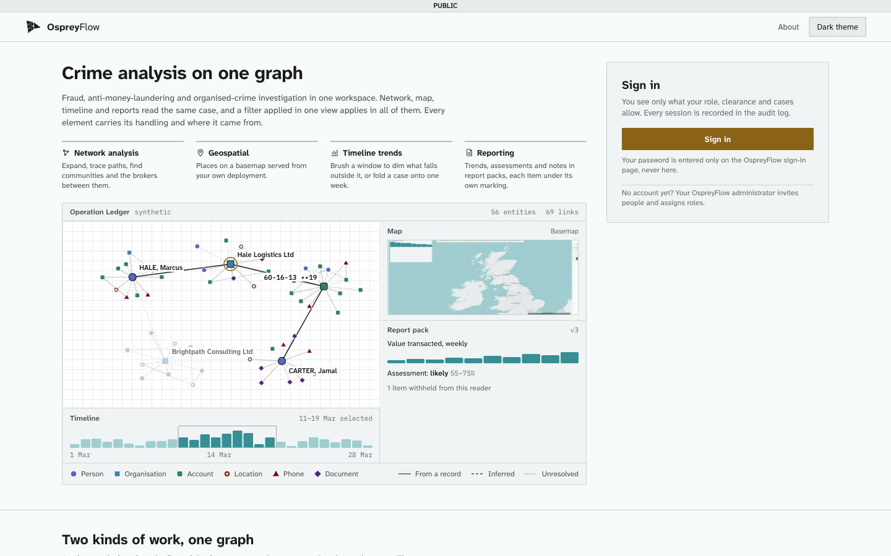

Open your deployment's address. The welcome page never asks for your password: **Sign in** takes you
to the deployment's own sign-in page, at `id.` in front of the same address.

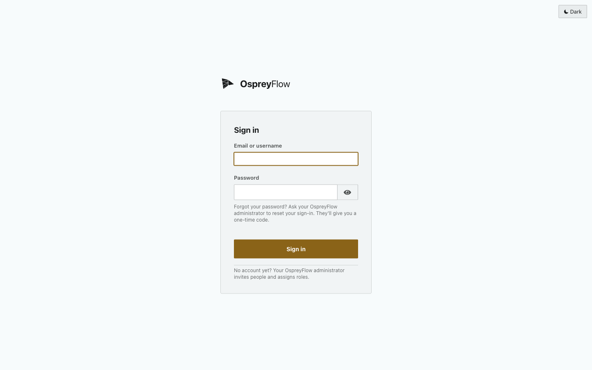

Your administrator invites you. With email set up, you get a link to choose a password; otherwise
they give you a **one-time code** in person, and you choose your password the first time you sign
in. If you forget it, ask your administrator to reset your sign-in. Where your organisation's own
sign-in is set up, the welcome page offers it first, by its name — for example **Continue with
Example Department account** — and goes straight to your organisation's sign-in page. If that page
comes back saying "This email address already belongs to an OspreyFlow account", your administrator
has already made you an account with that address: sign in with it (**Sign in with an OspreyFlow
account**), or ask them to join your organisation account to it — from then on your organisation's
sign-in takes you straight into that account, with everything it holds.

**Staying signed in**: while you are working in a window — typing, clicking, scrolling — it renews
its sign-in by itself, so it never stops you mid-task. A window left alone does not renew, so it does
not keep your session alive for you: after a while away (about half an hour, as your administrator
sets it) you are asked to sign in again when you come back, and the page stays as you left it. When
your session has ended (you have been away, or your administrator has ended it), the window says
**Your session has ended** over the page and offers
**Sign in again**, which signs you in in a small window of its own: the page behind it, with the tab,
the selection, the map and anything you have typed, stays as it is. If the sign-in service cannot be
reached, it says so and offers **Try again**.

**Refreshing the page** keeps you signed in and where you were. It asks the sign-in service's own session
first, without showing you anything, and shows the sign-in page only when that session has ended. Home stays Home, a case stays that case (on the view it had, where that is the graph, the map, the Matrix
or Figures; on any other view, the Glass's first), and Admin, the Ingest Studio and Rules and Monitoring stay
themselves; a place your roles do not open is shown as Home. This is kept for the tab alone, and **Sign out** forgets it, so the next person to sign in there does not start where you were.

**Signing out**: the account button at the top right (your name and clearance) has **Sign out**.

## 3. Home

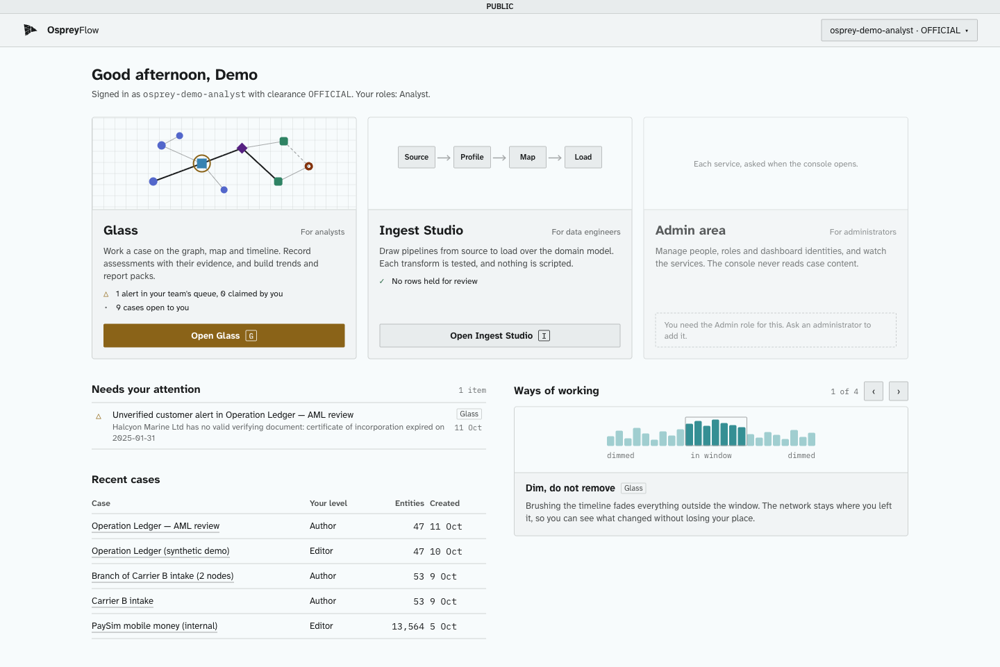

After signing in you arrive at **Home**. It greets you, says who you are signed in as, with your
clearance and your roles, and then shows:

- **a card for each place your roles open**, each with **Open ‹place›** and its key (`G`, `I`, `R`,
  `A`). An analyst sees the Glass and Rules and Monitoring. With no place at all it says "Your account
  opens no place yet. Ask an administrator to give you a role.";
- **the guide for each of those places**, under its card's words: **Read the user guide (PDF)** under
  the Glass, **Read the developer guide (PDF)** under the Ingest Studio and **Read the administration
  guide (PDF)** under Admin. Each opens in a new tab (where your browser does not show PDFs, it is
  saved instead, as `ospreyflow-user-guide.pdf` and so on), as the version this deployment was built with.
  A guide appears only with its place's card, and the deployment checks your roles again before it
  sends it;
- **Needs your attention**: what is waiting for you, such as alerts on your cases ("Nothing needs you
  now." when there is none);
- **Recent cases**: up to six, with your level on each, how many entities each holds and when it was
  made;
- **Ways of working**: four short tips.

Below them, across the page, **Your access and tasks** is worked out for you: **Places you can
open**; **Waiting for you** (each case you are an Author of, the datasets whose promotions you
review, and proposed link types waiting for you, each with a *Why:* line), or "Nothing is waiting
for you."; **Your access to each case**, one line a case ("Editor: Operation Ledger (synthetic
demo)"); and, folded, **What you can do, by place**, where each right has **Why can I do this?**
("Given by your Analyst role.").

**Needs you**, in the top bar beside your account, appears when something waits for you: a promotion
waiting past the days your administrator set (for one who may review it), and proposed link types to
decide in a dataset you work on. Choosing one opens where it is decided, when your rights reach it.
It is hidden when nothing waits.

The OspreyFlow mark at the top left always brings you back.

**Moving between places.** The **place switcher** in the top bar lists the same places; under the
GOV.UK theme it sits inside the GOV.UK header. Under it, a **context banner** says where you are. In
the Glass it is the **case line**: "You are in the Glass · Case ‹name› ▾ · Views in this case · reads
‹dataset›". The case switcher lists your cases, and its last entry, **All cases**, opens the **Cases**
panel; **Views in this case** opens the same panel at the case's views (section 5.13); and the line
names the dataset the case reads, or says "reads no dataset". Graph, Map, Drawing board and Reports are
in the top bar's view switch, not here (section 5). Elsewhere it says "You are in the Ingest Studio",
"You are in Rules and Monitoring" or "You are in Admin". If you can open both the Glass and the Ingest
Studio, the banner offers **Open this case's data in the Ingest Studio ↗**, and from there **← Back to
case ‹name› in the Glass**, which brings you back to the same case and view.

**Under the GOV.UK theme**, on every screen but Home and the sign-in page, the GOV.UK header and the
phase banner are slim, and the context banner, a GOV.UK notification banner, is folded into one row,
"You are in …" at its start, so the canvas has more of the window.

## 4. Cases

Everything happens inside a **case**. Your level on a case decides what you may do there:

| Level | What it means |
| --- | --- |
| **Viewer** | Reads the case. Changes nothing in it. |
| **Editor** | Works the case: adds, links, confirms and works its alerts, as their role allows. |
| **Author** | Answers for the case: gives levels, and may remove it. A dataset's Authors are its home case's Authors. |

Whoever creates a case is its first Author. **A level never widens what you can see**: a record above
your clearance stays hidden in a case you author. A case you have no level on does not appear at all.
What you may do in a case is your level and your **roles** together:

| Role | What it is for |
| --- | --- |
| **Analyst** | Investigates cases, works alerts and keeps watches. Reads figures and boards. |
| **Data Engineer** | Builds and runs pipelines, reviews promotions into a dataset and decides held rows. |
| **Administrator** | Looks after people, roles, teams, datasets and the deployment. Does not investigate by being one. |
| **Reports Viewer** | Reads a case's figures and the dashboards, and sees the alerts on cases they can read. Never works an alert. |
| **Rule author** | Writes the rules that raise alerts, and works the alerts in the queue. |

Your administrator may also have given you a role of the deployment's own, or the **Super user**
preset (Analyst, Data Engineer and Rule author together, still never the second person on your own
work). *Roles, teams and Authors*, opened from Admin and from the Ingest Studio, says the same in full:
each place, role, right and level.

**Starting a case.** **Create case** asks you to name the case and choose what it reads: **Use an
existing dataset…**, or **Make a new dataset — empty, loaded in the Ingest Studio**. You may tick the
case's domain packs here too. A third way starts from **Drawing board**: a drawing as a case of its own
(section 5.14). **Remove**, for a case's Author or an administrator, asks "Remove this case from every
list? Nothing is deleted."

**One dataset, and its home case.** A case reads one **dataset**: search, paths, Explore and watches
all stay within it. A record can belong to more than one dataset; you may see it through the one the
case reads, but what it says of where it came from (its sources) is shown only when the case reads
all of them (section 5.6). Every dataset also has one **home case**, named for it, which holds the
dataset's own reports and its alerts that belong to no working case. A dataset's **Authors** are the
Authors of its home case: they answer for the dataset. Owning is not acting: reviewing a promotion or
accepting a type also needs that right.

**Teams.** A team is a set of people with a lead, made by an administrator. A dataset's Authors may
be a team as well as people: its members answer for the dataset while they are in the team, and not
after. A rule's alerts can go to one team (**‹Team› only**, under the rule's *Alert goes to*): only its
members, and the Authors of the dataset's home case, read them, and its lead, or their cover, gives
each to a member (**Give to**) or sets it aside with **Suppress until…**. *Coming:* a case level
given to a team.

The case switcher on the case line (section 3) lists your cases. Its last entry, **All cases**, opens
the **Cases** panel, which lists them too, with the case's **views** (section 5.13), **Browse all
cases**, and **Who can open this case**, which the Author manages. A link to a case opens it directly.

**The case brief.** The **Cases** panel also holds the case's **Brief**: what the case is for.

- **Priority information requirement** is one statement of the question that matters most.
- **Information requirements** are up to twenty, each of up to 2,000 characters, each marked **Open** or
  **Answered**. **Mark answered** and **Reopen** are done by a person; nothing else changes a status,
  and a model never does.
- **Attach…** links a requirement to what answers it: a **Trend**, a **Saved pattern**, an **Assessment**
  or a **Canvas view**, up to ten to a requirement. Choosing an attachment's name opens it where it
  lives: a canvas view opens as a case, a trend opens Figures on its Trends tab, and a pattern or
  assessment takes you to its panel. **Detach** removes the link only.
- Anyone who may read the case reads the brief. Only the case's **Author** edits it (**Edit the priority
  requirement**, **Add a requirement**, **Edit**, **Remove**). Ctrl/Cmd+Enter saves a box and Esc
  cancels it.
- An attachment you may not read is left out entirely: no title, no placeholder and no count. Two
  people with different access can therefore see different attachments under the same requirement.
- Editing the priority, a requirement's text or status, adding one or removing one puts a step,
  "Edited the brief", in **History**. That step cannot be restored, since a brief is not a canvas.
  Attaching and detaching are recorded, but do not appear in History.

**The demonstration cases a deployment starts with.** Your administrator may have installed
OspreyFlow from a **starter** (a theme and a domain; administration guide §1a). Each starter brings
the demonstration cases of its domain, all synthetic, each set to its domain's packs (so its reports
and choices fit it). Every pack stays available to the cases you create.

| Starter | The demonstration cases it brings | The cases' domain |
| --- | --- | --- |
| `…-crime` | Prison Intelligence Dataset (synthetic demo); HMP fixture (synthetic demo) | NIEM |
| `…-aml` | Operation Ledger (synthetic demo), with its synthetic screening lists | FIBO |
| `…-fraud` | Fixture Corp (synthetic demo); PaySim only if your administrator downloads and adds it | FIBO |
| `…-cyber` | Cyber intrusion (synthetic demo): a STIX 2.1 threat case | STIX |
| `…-blank` | None, and no demonstration accounts | — |

The theme (`ospreyflow-…` or `govuk-…`) changes only the look: under the GOV.UK theme, the browser
tab's title names the service your administrator chose ("<service> – GOV.UK"), the same on every
case. There is no band under the GOV.UK header naming it, so the workspace has the window's height. A dataset your administrator
added from outside, such as a VAST Challenge dataset, is a case of its own named after the dataset,
"(public dataset)".

## 5. The Glass

<!-- needs a new capture: shows the rail and banner before ADR-145 Amendment 15 -->
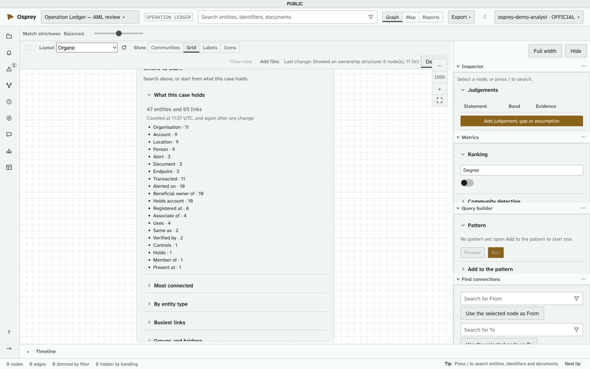

| Part | What it is |
| --- | --- |
| **Top bar** | The place switcher, search, the view switch (**Graph**, **Map**, **Drawing board** and **Reports**, with **Matrix**, **Figures**, **Ownership** and **Connection strength** under **More views**, those your rights allow), **Build a report (opens in new tab)** (section 9), Export, and your account |
| **Context banner** | The case line: the case switcher, **Views in this case** and the dataset the case reads (section 3) |
| **Left rail** | **Explore**, **Ask & Chat** and **History**, those your rights allow, each opening its panel beside the view and closing it again with a second press; **Help** (**?**), which opens the keys and the user guide over any view and closes again with a second press or Esc; and **Show names** |
| **Canvas** | The graph, the map, the Matrix or the case's figures |
| **Right column** | The Inspector, Metrics, the query builder and Find connections, stacked; **Full width** and **Hide** |
| **Timeline** | Folded at the bottom until opened |
| **Status bar** | How many nodes and links are drawn, how many dimmed by a filter, and how many hidden by handling |

### 5.1 Where to start

While the canvas is empty — or any time from the rail's **Explore** — **Where to start** shows what
the case holds: counts of each type, the most connected entities, the busiest links and days, groups
and the entities that bridge them, what is new since the last loads, and starter questions. **Add…**
on any entity draws it alone, with its 25 or 50 busiest links, or with all of them. **Add many from a
list** (section 5.5) is a fold here too.

### 5.2 The graph

<!-- needs a new capture: shows the rail and banner before ADR-145 Amendment 15 -->
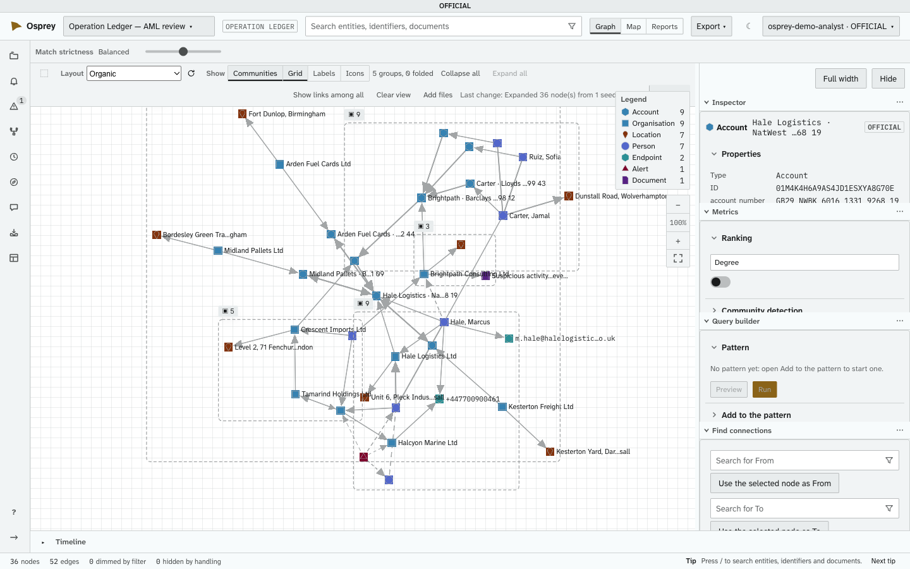

**Selecting.** Click a node; Shift-, Ctrl- or Cmd-click adds or removes one; or draw a lasso. The
selection bar then offers **Expand**, **Show links** (for two or more, with how far to look, "direct"
or "within 2" to "within 6", stepped by − and +), **Ask the model about these…** (section 6), **Save as
a view** (section 5.13), **Remove from view** and **Clear** (Esc), and **Undo select what is lit**
after a selection made by what is lit. Past one degree, **Show links** draws the routes between the
selected nodes, says which pairs are not connected, and says when the routes are already drawn. **Remove from view** and **Clear view** take nodes off the canvas; a node you put back brings
its links in the view back with it.

**Expanding.** Double-click, or press Enter, to draw a node's links. Right-click (or `\`, the menu
key, or Shift+F10) opens its menu, on the selection: a right-click on something not selected selects
it first. The selection's own actions come first, in the bar's words. **Expand by link type** lists
each kind of relationship with how many links it has, so you can draw just one; the kinds with none
fold into one line ("7 types with no links") that opens in place. **Actions** holds what the item
offers, as its type allows: Explain cluster, View messages, Expand group, Read full screen, Add files
held by this…, Set picture… and Mark for suppression; with two selected, only the pair's own: Link
to…, Split from… and Find paths to…. In a view, the menu offers only what changes nothing in the
case. An expansion that would add more than
**500** nodes asks first, offering one relationship at a time, all of them, or nothing. An expansion
past the working set's own limit is refused; reduce what is drawn, save a smaller view, or **Run as a
batch job**. A batch job runs the same expansion on the server as you, reading only what you may see,
and saves what it finds as a private view of the case; nothing is added to the case's own graph. When
it is done, its result opens as your private view; if it cannot be opened, it stays in *Views in this
case*. A result too large for a view to show, more than **50,000** nodes or **250,000** links, is
refused with its figures and saves nothing: narrow it by link type, depth or dates. One batch job of
yours runs in a case at a time, and its panel says so: "Closing this does not stop the job. While it
runs, asking for a batch expansion in this case again follows it."

**Marking for suppression** proposes a record for suppression, in the open. The node is marked, with your reason,
and the Explore panel lists it, with who marked it and when; **Remove suppression mark** takes the mark off. A mark
hides nothing and changes no record: the node is still shown, cited and exported as before, to everyone who may see
it. A suppression that takes effect, once its evidence is loaded through the Ingest Studio, is not built yet.

**Reading a link.** A link's stroke says where it came from: **solid** from a record, **dashed**
inferred by a model, **dotted** unresolved. Hovering names its type and how many such links join the
two. Right-click a link (or `L`, then `\`) for its menu: its emails, events or messages; **Change
link…**; its change history; a note; or hide it.

**Link types.** A link's colour says its type where the type has one. Under the types, the
**legend** lists the links in view — each type in its colour, with how many — and each has a box:
clear it to leave that type out of the view, tick it to bring it back (in this tab only; nothing is
removed). **Show links** on a node draws one type at a time, so you can, for instance, follow only
who shared a cell with whom. A prison or custody case (the Prison Intelligence Dataset demonstration case is one) carries the links a
prison intelligence analyst works with: **shared a cell with** (with the cell and the dates),
**co-defendant of**, **in conflict with** (with a reason), **visited** (in person or by video), and a
person's **role in** an incident (an assault, a disorder or a find, with what was found), beside the
phones, calls, accounts and payments any case can hold. Two prisoners who call the same outside
number, or are paid from the same account, are joined through that number or account on the graph,
and the number's or account's calls and payments are on the timeline and the map.

**Icons by value.** A type's icon can depend on one of its properties. An **Endpoint** is drawn as a
neutral device; one whose kind is a phone number is drawn as a phone, a PIN account as a keypad, and an
account as an account. In a prison case an **Incident** is drawn as a parcel over a wall for a
throw-over, a clash for an assault, a crowd for a disorder and a magnifier for a find; an incident of
another category keeps the type's icon. Shape and colour stay the type's. The order is: the entity's
own picture, then the icon you chose for the type (the **Icons** control in the canvas toolbar), then
the icon for the value, then the type's icon. A node without the property, or with a value no icon is
given for, is drawn with the type's icon. The **legend** lists **Icons by value** in view, each with its
meaning, such as "Keypad: Endpoint, endpoint kind handle", and how many; the **Inspector** says "Icon
for this value" for the selected node. Both name an icon only where the canvas draws it. As with every
icon, the icon is drawn only when you are zoomed in to the neighbourhood, and past 10,000 nodes nodes
are dots.

**Same-as links.** Records OspreyFlow thinks are one are joined by a same-as link. Its menu offers
**Collapse into one node** (for this view only), **Confirm as the same**, **Mark as not the same**
and **Explain this link**. Confirming or marking needs a reason, kept in the audit with your name.
**Match strictness** at the top of the graph sets how sure a match must be to show records as one —
Strict, Balanced (the default) or Broad — and says how many merged and split.
Records drawn into the graph, by a search, an expansion or a list, arrive already shown as one where they
match at the case's strictness, with **Explain cluster** on them. What is shown as one is worked out for you
alone, from the records you may see: a record hidden from you joins nothing. When someone else on the case
changes the strictness, your graph follows the next time you expand it or the case is loaded again, not at
once.

**Groups.** **Communities** boxes groups of closely linked entities; fold a group from its box, or
press `G` on a node in it. **Layout** offers Organic, Force-directed tree, and Clustered bubbles;
**Arrange** lays everything out afresh. Drag nodes to move them; their positions belong to your view.

**Saving a view** keeps the selection, and the links between it, as a view of this case
(section 5.13); the case itself is unchanged.

### 5.3 The map

<!-- needs a new capture: shows the rail and banner before ADR-145 Amendment 15 -->
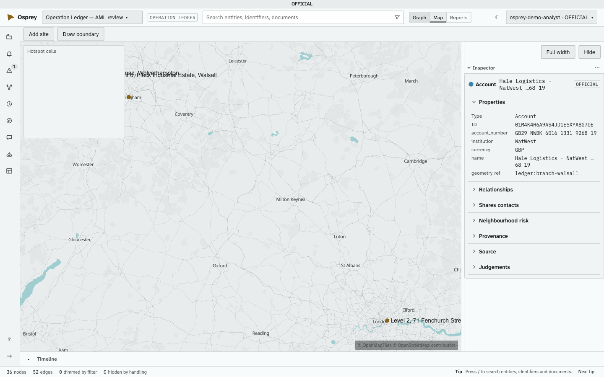

The map shows the same working set and selection as the graph. A location is drawn at its point,
and so is an account, where it is held; a link between two things on the map is drawn as a line —
a payment from an outside account into a prisoner's private cash, for instance. **Add site** places a building's plan
on the map from four matched points and draws a grid whose cells become locations. **Draw boundary**
filters to what falls inside it. **Hotspot cells** counts what is in each cell, and filters as you
choose. If the deployment's basemap is not built, the map says so.

**Basemap.** Where your administrator has made more than one map available, a **Basemap** switch
chooses between them; a map served from outside the deployment is marked as a hosted provider.

**Find a place.** Type at least two letters of a place's name and press **Find**. It searches only the
places in the gazetteer datasets this case reads ("Places come from the gazetteer datasets this case
reads"), never an outside geocoder, and finds a place by its name alone. If none matches, it says "No
place called … is in the gazetteer this case reads".

### 5.4 The timeline

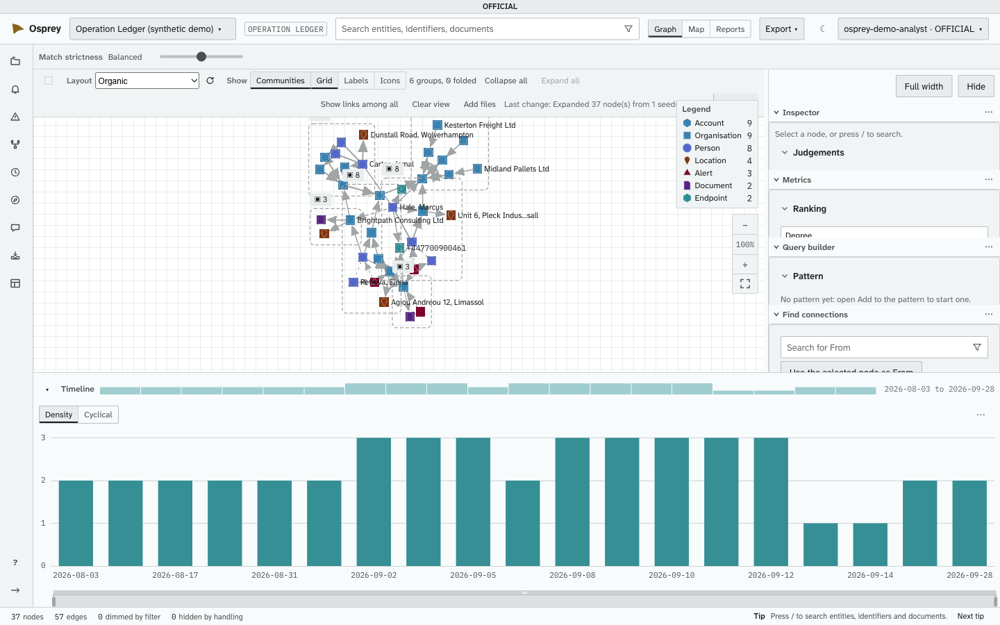

Open the timeline at the bottom. **Drag across the bars** to choose a period: everything outside it
is **dimmed, never removed**, on the graph and the map alike. The slider under the axis zooms the
axis without filtering. **Play** reveals the network as its events happen, at ½× to 8×. The **⋯**
menu sets exact dates, or overlays another case. **Clear filter** removes the period.

**Select what is lit.** With a period chosen, **Select what is lit** replaces your selection with
every node that has a link with at least one event in the period, its two ends included. A link is
*lit* when it has such an event; a node is lit when a lit link touches it. **Undated links are never
lit**: a link with no event has no date to fall in the period, and there is no setting to include it.
The selection bar says so ("Lit in 5 Jan – 30 Apr 2026: undated links are not included") and offers
**Undo select what is lit**, which gives back the selection you had; it is offered while the selection
is still exactly the lit nodes. If nothing is lit, the selection is left alone and it says so. Dates
are UTC. To reach it from the keyboard, set the period with **Set exact dates** in the **⋯** menu.

**Save as a view**, pressed with the lit nodes selected, keeps them as a view of the case
(section 5.13).

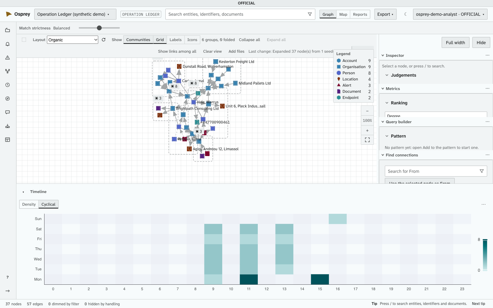

**Cyclical** shows the same events as a grid of weekday against hour, for habits and routines. It
always draws the case's whole range. Hours and days are UTC. Choosing it makes the timeline tall enough
to read the grid's seven rows; a timeline you have made taller stays as it is.

**Choosing cells.** Drag across the grid to choose the cells (a weekday and an hour each) you want; they
stay outlined and the rest of the grid stays visible. For the keyboard, open **⋯** (**More timeline
options**) and **Choose cells (UTC)**: tick the days (Mon to Sun), set **From hour** and **To hour**
(0 to 23), or press **Weekend**. A drag sets the hours too. **Clear** removes the choice, as does **Clear
filter**. Once cells are chosen, the map and its hotspot cells count only the events that fall in them,
the canvas dims what does not, and the status bar counts what is dimmed as for a period. **Select what
is lit** honours them as well: it needs a period chosen on the density view, and lights only links
with an event inside the period and the cells. Choosing cells alone, with no period, does not offer
it.

### 5.5 Search

<!-- needs a new capture: shows the rail and banner before ADR-145 Amendment 15 -->
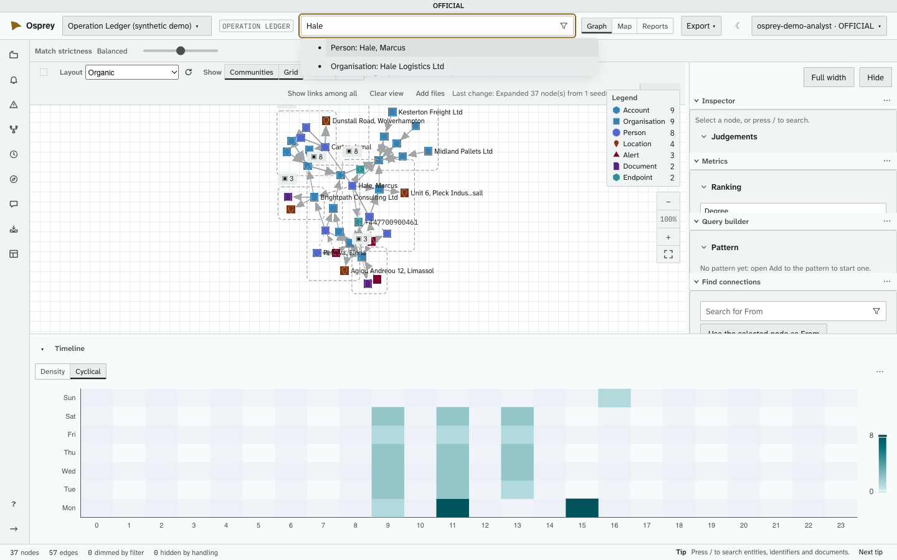

Press `/` anywhere (outside a text box) to search. Suggestions start at two characters (one, with **Only nodes on screen**), across names, identifiers and titles; choosing one puts it in the case and draws it with what is near it (three links
out), counting first and asking if it is a lot. Cancelling a large draw leaves the chosen node in the case
on its own. **Filters** narrow them: **Ignore case**; **Match**, *Starts with*, *Contains* or *Exact*;
**Entity types** (none ticked searches every type); and **Only nodes on screen**. **Reset filters** puts
them back. When more match than are shown, the box says "Showing the first …; more match. Keep typing to
narrow." Where the search index cannot answer a *Starts with* search, the box says so: "Suggestions are limited just
now: only the exact start of a name or identifier matches." A *Starts with* search is at most 50 characters
where there is an index, and a longer one is refused: the box says "Suggestions are unavailable." A phone number or account reference is read the same way
however you type it, so `07700 900640` finds the number held as `+447700900640`.

**The results page.** Press Enter on the words you typed, with no suggestion moved to, and the results
fill the main area over the view you were on, which waits beneath them as it was and cannot be reached
until you leave them; a suggestion moved to with the arrow keys is still chosen by Enter. The page is
headed "Search results for '…'", with the number of records under it as the Conduit counts them: the
total, or a group's own count once you choose one, and "(counts may be incomplete)" when the Conduit
cannot be sure. **All**, then each group with its count, narrows the list. Beside it, under the page's
own filters, **Datasets** and **Dates** narrow it again to what the search offers, and **Clear filters**
undoes them. The search box's **Filters** shape its suggestions alone: the page starts at **All** with
no filter. Results come 20 a page, with **Next page** and **Previous page**. Each gives its name as the
canvas names it, its type, why it matched and its date, and for a document the passage with the
matched words marked. **Show on graph** puts the records the result stands for on the graph, selects
the first and takes you there; a record the result names that could not be read is said, as in "1 of
its 2 records could not be read.", never left out in silence. **Open**, for a document, sets the
results aside and reads it over the view; they come back when you close it. **Back to ‹view›** returns
to the view as you left it. With nothing found the page says "No records match '…'.", or "No records
match '…' in this group." once a group is chosen, with **Clear filters** where a filter is on. Where
Ask & Chat is offered to you, a last line, "Ask a question about '…' instead", opens it with your words
in the question box, sending nothing until you press **Ask**.

A search can be at most 200 characters. A longer one is refused, saying the limit and how many
characters yours has, and is never cut short: shorten it and press Enter again. Other refusals come in
the Conduit's words, as when a date filter's end is before its start ("the date filter ends before it
starts") or a page is asked for past the deepest the search lists ("results are listed 1000 deep at
most; narrow the search to see further").

Where the search index cannot answer, the page says so in one line, such as "Search is limited to
exact identifiers: this deployment has no search index.", and looks no further than the first 100
exact matches. Its counts are of those, and always marked incomplete; the datasets are offered without
counts, and there are no dates to filter by. A date filter already set is not applied, and the line
then adds "The date filter is not applied." **Next page** is offered only while a further
page holds records, and where the search found more than 100, the last page's line adds "Only the
first 100 matches are listed, and the filters apply to those alone.", even when a dataset or a group
has narrowed the list.

**Add many from a list.** The list button beside the search box (**Add many from a list**), and the fold
of that name in **Where to start**, take a list of identifiers and draw what is found. Adding needs
Editor on the case; without it, the box says so.

1. Paste identifiers into the box, or choose a `.txt` or `.csv` file (its first column; a first row that
   is a header such as "identifier" or "prison number" is left out). They may be prison numbers,
   National Insurance numbers, phone numbers or account references, one a line or separated by commas
   or spaces. A number written with spaces, such as `+44 7700 900640`, is one number.
2. Press **Count**. It says, for example, "40 identifiers read. 37 found, naming 36 different records.
   3 matched nothing you can see. 1 repeated." Nothing is on the canvas yet. Changing the text clears the count, so a count is
   always of what you would add.
3. Press **Add** to put the nodes on the canvas without their links; **Show links among all** in the
   canvas toolbar's View group then draws the links. **Add with all links** draws the links among
   the nodes added and those already there instead. For a very large view it adds the nodes without
   looking for links, as Expand does. It then says how many records are in the view ("36 records are
   in the view"): each record once, one already on the canvas included. **Cancel** (or Esc) empties
   the box.

What the figures mean. *Found* counts every identifier that resolved, repeats included. *Matched
nothing you can see* is one figure for an identifier that does not exist and one you may not see: the
words, the counts and the work done are the same either way, so a list cannot be used to test whether a
hidden person exists. *Repeated* counts identifiers that name what an earlier one did, so three
spellings of one number count three times as found, twice as repeated, and as one record; when the
records found are fewer than the identifiers found, the count says how many different records there are. If more records than the lookup reads
share a value, it says so, "could not be told apart", rather than guessing. A number is matched only to a
phone number and an account reference only to an account: a PIN holding the same digits is not a match.

The limit is **5,000** identifiers at once. More is refused, naming the figure, and nothing is added;
split the list. A list that would take the canvas past its limit adds nothing, and says how many it would have been against the limit.
The box is never shown an identifier back, only counts.

### 5.6 The Inspector

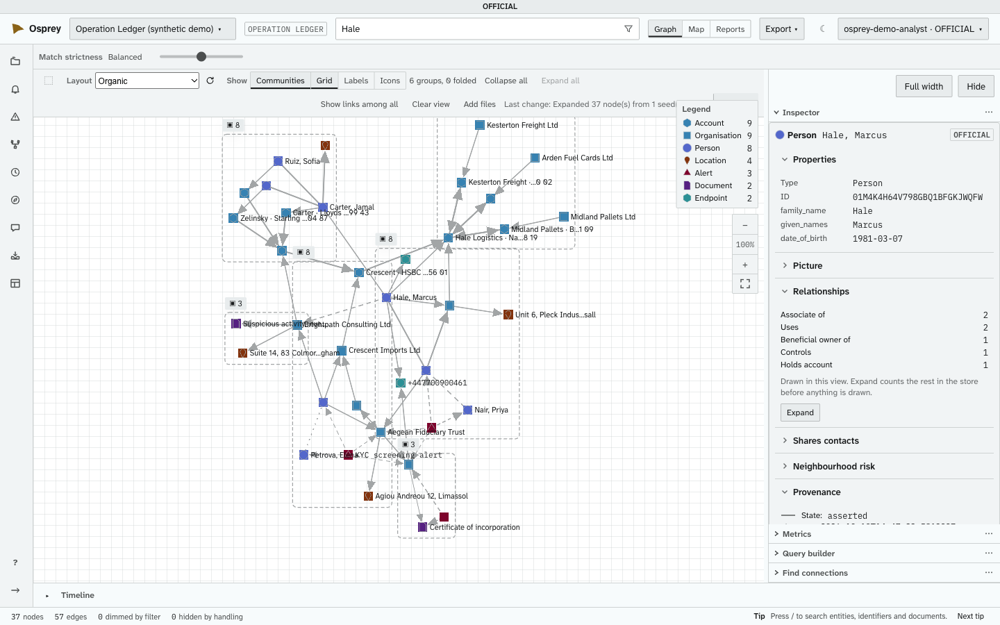

Select one node and the Inspector shows its **properties**, its **picture**, its **relationships**
(how many of each, drawn or not — **Expand** draws the rest), the entities it **shares contacts**
with, its **neighbourhood risk** (alerts within two links over the last 90 days, scored on request
and never stored), its **provenance** — from a record, inferred, or unresolved, and when it was first
seen — its **source**, the file and row it came from (its file name, never the server's folder, and
"row 3"), the **icon for
this value** where the type has one (section 5.2), and the **judgements** that cite it. With several selected it summarises them and the links
between them; with a link selected it shows the link's details, notes, events and history, and lets
an Editor **change the link** (with a reason, and what stands behind it).

**What you read, not what a machine stores.** A property is named as you read it ("Prison number",
not `prison_number`), and a link by its name ("Shared cell with"). The Inspector shows no node id and
no link *Type ID*, and it leaves out references that mean something only to a store or to the system
a record came from: a place's site reference, an organisation's or incident's internal reference, an
email's message id, and where its picture or geometry is kept. They are still on the record, and
search and the map still use them; they are only not shown. A link whose other end is not on the
canvas names that end "an entity not in this view" rather than by its id.

**Sources withheld.** A record can belong to more than one dataset, and a case reads only some. Its
sources are named only if the case reads every dataset the record belongs to. When it does not, where
the sources would be listed, the Inspector's **Source**, a link's details and the messages view
(**View messages**) say "Its sources are in data this case does not read". They never say "No sources
recorded": there are some, and they are not this case's to see. The node or link itself is still
shown, as you may see it; only where it came from is held back. The same applies in an alert (section
7.5). If an Author widens the case's datasets, records already on your canvas may keep saying this
until you open the case afresh.

### 5.7 Metrics

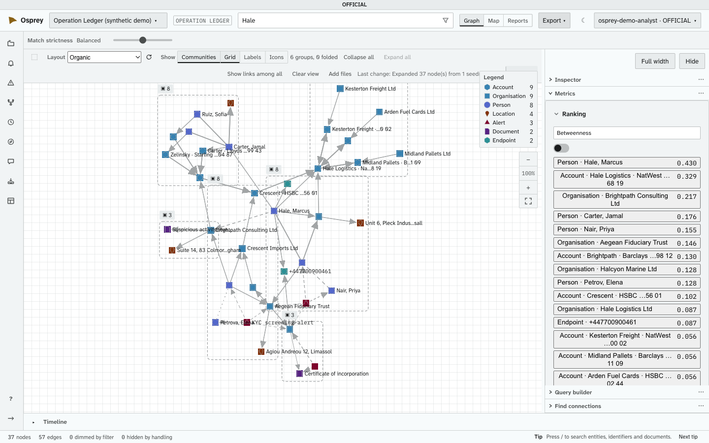

**Metrics** ranks what is drawn by degree, weighted degree, betweenness, eigenvector, PageRank,
clustering coefficient, the clique metric, connection strength or shared-attribute rarity (§5.12),
and can compare two. Choose a row to go to it. Its filters — relationship strength, a metric's
value — dim, never remove. A metric is shown as size, never as colour.

### 5.8 Find connections

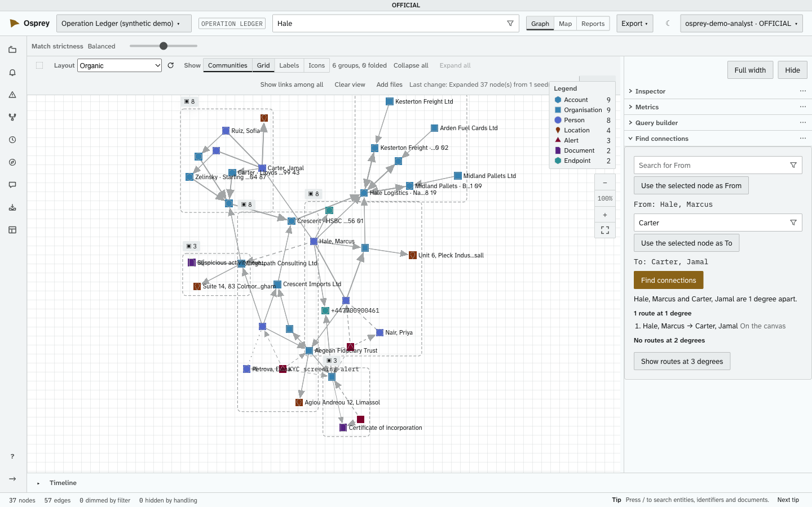

Choose a **From** and a **To** — by search, or the node you have selected — and **Find connections**
says how many degrees apart they are and lists the routes at that distance, then widens one degree
at a time, up to eight. Each route names its people and its links ("Vance, Callum → Fairlop, Dominic →
Skellion, Rory, by passes items to, then associate of"): two routes through the same people by
different links are different routes. Any route can be drawn on the canvas, marking each node with its distance
from From. **Find paths to…** in a node's menu gives the shortest paths between two selected nodes.

### 5.9 History

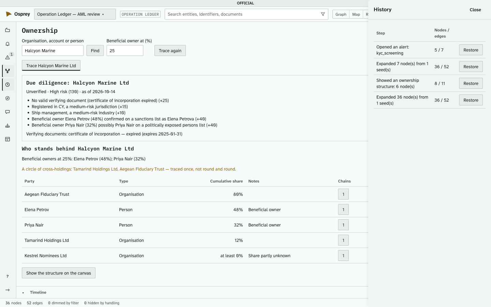

**History** lists what you did to the view as named steps — "Expanded 36 nodes from 1 seed", "Opened
an alert" — with how much each drew. **Restore** goes back to any of them. "Last change" on the
canvas toolbar opens it too. An edit to the case's brief appears as "Edited the brief" and cannot be
restored (section 4).

### 5.10 The query builder

The **query builder**, in the right column, draws a pattern of nodes and links, counts what matches
(**Preview**, "~12 matches") and finds it (**Run**). Under **Add to the pattern** you add a node by type
or pin one you have found, and connect two. Under **Save this pattern** and **Load a saved pattern**
you keep and reuse them.

**A condition on a node.** A node can be narrowed by what one of its properties says. On a node, choose a
property, type a value and press **Add condition**: "people held at an establishment whose `niu_area` is
North Wing" is two nodes, one link and one condition. Each condition is listed, as `niu_area = North
Wing`, with **Remove**.

- It is an equality: the property equals the value you typed. There is no "not", no range ("more than",
  "since"), no list of values and no "contains".
- A node takes up to three conditions, each on a different property; setting a property again replaces
  its value.
- Only text properties the case's data model marks as searchable are offered, and never a sensitive
  one. A pattern that names a sensitive or unsupported property, however it reached the server (a
  saved pattern, a model's proposal, a monitor), is refused with the property named, before anything is
  counted, and is never stored. A number, date or yes-or-no property is refused as not supported.
- The condition counts and runs inside what you may see, like the rest of the pattern: a hidden node
  that would have matched leaves no trace in the count.
- A saved pattern, a monitor and a rule built on it all carry the condition.

**Ask to search.** Above the pattern, **Ask to search** takes a question in words: "who shares a visitor
with the principal?". Press Enter or **Ask**. The model is given only your question and the case's
vocabulary: the entity types, the link types with their ends and direction, and the names of the
searchable text properties. It is not given your data, and it cannot run anything. It proposes a pattern,
which is drawn in the builder with a one-line explanation, a count, and the note "A model proposed this
pattern. Check the pattern before you run it." Nothing runs until you press **Run**, and running changes
nothing in the case. A proposal is a suggestion, not a finding.

- "The principal" or "the selected person" mean what you have selected, and only nodes you may see.
- A proposal is a new, unsaved pattern. **Save** never overwrites the pattern it replaced, and **Restore
  the previous pattern** brings that back. If you edit the pattern while the model is working, the
  proposal is dropped with a message, and you ask again.
- **"Could not express the question as a pattern."** The model's answer used a type, link, property or
  value the case does not have, or something the builder cannot draw. The builder cannot draw
  absence ("who has no phone") or ranges ("since 1 January", "more than five"). Rephrase the question,
  or draw the pattern yourself.
- A small local model will sometimes propose a wrong pattern. That is why the pattern and its count come
  first. It does worst on questions about a particular account, number or handset, since the kind of
  an endpoint is not something a pattern can match. For "more than one" questions, two nodes of one
  type are not forced to be different, so a count can include a node matched twice.
- Asking needs the right to ask the model, and Viewer on the case.

### 5.11 The Matrix

**Matrix** in the view switch shows the same working set as the graph, as two tables: **Entities**
and **Links**. It is the way to work through the graph with a screen reader, or whenever a list reads
better than a picture.

- **Entities** has a row for each node on the graph: its name, as the graph labels it; its type; its
  own marking; its provenance, in words, so a node a model proposed reads **Inferred** until someone
  confirms it; and how many links it has in view. **Links** has a row for each link: its type, the two
  ends, its marking and its provenance.
- The tables hold only what the graph holds. What you are not cleared to see is not in them, and they
  give no count of it. A node a filter dims stays in the table and says **Dimmed by filter**.
- Choose a column's heading to sort by it; choose it again to reverse. Each table's caption says how it
  is sorted and which rows are shown. A long table is shown a hundred rows at a time, with **Previous**
  and **Next**, and the caption says so: "Rows 101 to 200 of 12,481". Nothing is left out without
  saying so.
- The selection is the graph's. Select a row and the Inspector shows that node; go back to **Graph** and
  it is selected there. What you selected on the graph is selected in the Matrix, which opens on the
  page that holds it.
- **Expand** on a row opens the graph and expands that node there, with the same preview and limits as
  expanding it on the graph. **Show** opens the graph with that node selected and centred.
- The Matrix lists the whole working set. Groups folded on the graph, links hidden from the view and
  link types left out from the legend are shown in full.

From the keyboard, each table is one Tab stop. The arrow keys move between cells, Home and End to the
start and end of a row, Page Down and Page Up between pages. Enter selects the row's node; Space adds
it to the selection or takes it out.

### 5.12 How connection strength is worked out

How strong a link is drawn rests on three ideas. Each can be seen, filtered and explained on its own.

**1. The link's own evidence.** A link's stored weight comes from that link alone: how often it
occurred, against what is heavy for its type (forty calls, twelve weeks in one cell, six payments),
and how recently, halving every ninety days. A standing link (custody, family, co-defendants, group
membership) has a fixed weight. No other link moves it, so nothing you cannot see changes it.

**2. Influencers.** An influencer changes how strong a kind of link is drawn when you look at it:

| Part | What it says |
| --- | --- |
| **What triggers it** | A record that evidences the link: for example an Incident whose category is assault, disorder or find, at one end of the link or involving both people. Or **a dataset**: every link in that dataset (an assaults table, say), as the client's own code boosts a whole table. **Direct links** have no trigger. |
| **Which links it changes** | Named link types, such as *In conflict with* or *Role in*; or *a pair linked through a shared value* (two people who share a phone, say), which takes an added boost only. |
| **The change** | **Add** a boost (the usual), **multiply**, set a **floor** (at least this strong), or **exclude** (no stronger than its stored weight). |
| **Its size, and a label** | The label is what the legend shows. |

OspreyFlow ships two. **Direct link**: calls, money transfers, visits and cell shares are drawn
stronger than links that are only inferred or shared. **Evidenced by an assault, disorder or find**:
a role in such an incident, and a conflict, association or cell share between people in one, are drawn
stronger. Their sizes are calibrated so that a boost moves an ordinary link about as far as doubling
its count would, and are marked "to be confirmed with the client". Boosts add up.

**An influencer applies only if you may see the record that evidences the link,** or, for a dataset,
only if your case reads that dataset. An assault report above your clearance never thickens a line
you can see, so it never tells you it exists; a dataset your case does not read is not named in your
legend at all. The stored
weight never changes: influencers are applied as the link is read, so a change takes effect at once.

**3. Shared-attribute rarity.** Two people who share something few others share are more interesting
than two who share what everyone does. A thing two people of one kind share (a cell, a phone number, a
visitor, a report, a group) is a **shared value**. By default rarity is worked out as the client works
it out: a value held by *k* people links *k × (k − 1) / 2* pairs, and its rarity is one less its share
of all the pairs linked through values of its kind. A phone two people share, among phones that link
few pairs, scores near 1; the prison everyone is held in scores near 0. Two people take the rarity of
the rarest value they share. Your installation may choose the earlier measure instead, **inverse
frequency**, which adds, for each thing two people share, the logarithm of how many people there are
over how many share it; the legend says which is in force. It is worked out per dataset unless you
choose across the case's datasets, and **only over what you may see**: if two analysts have different
access, they can see different rarity for the same pair, and both are right for what each may see.
Rarity is its own measure, never folded into the strength, except under client parity (below).

**Two compositions.** How the three ideas make a strength is the installation's choice, shown in the
legend:

| Composition | Strength is | Drawn on |
| --- | --- | --- |
| **Standard** (shipped) | the link's stored weight, from its own count and recency, with the influencers applied | 0 to 1 |
| **Client parity** | rarity plus the influencers' added boosts, with no count and no recency: the client's own sum | 0 to 1, through a curve that keeps the sums' order; the Inspector also shows the **raw sum on the client's scale** |

Under client parity, a stored link's rarity is that of the link itself among the links of its type you
can see in its dataset (one less one over how many there are), and a pair linked through a shared
value takes that value's rarity. Only added boosts count in the sum: a multiplier, floor or exclusion
is left out, and the legend says so. Because rarity is worked out over what you may see, so is a
client-parity strength. An installation chooses its composition in the same way as its influencers (a
proposal and a second person's approval); a case's Author may switch one case to client parity, to
compare the two on the same case, and back.

**Where you see it:**
- **The legend** lists, under *Connection strength*: the composition in force (marked **Case
  override** if the case chose it); the rarity measure, which only the installation chooses; every
  influencer in force in the case — what triggers it, the links it changes, the change and its size,
  and where it came from (shipped, installation-wide, or **Case override**); which link types count
  as direct; and the rarity note. It is read again whenever you come back to the window, so a change
  the case's Author made elsewhere shows when you return.
- **Metrics** (§5.7) offers *Connection strength* and *Shared-attribute rarity* to rank by and to
  filter by. Choose one under **Filter** and slide **Metric value at least**: a link below the
  strength, and a person none of whose links reach it, fade; with rarity, a person whose rarest
  pairing in view is below it fades. Nothing is removed.
- **The Matrix** (§5.11) gives each link its **Strength** and the **Rarity** of its two ends, and sorts
  by either. Each column fills in as soon as its answer arrives (the strengths in a second or two, the
  rarity of a large view's every pair can take longer) and reads **Working out…** until then. A link
  with no strength you can see reads **Not worked out**; two ends with nothing rare to share (of
  different kinds, or in no common dataset) read **None**. If the rarity is refused (a view with too
  many pairs) the strengths still show, and the line above the table says why.
- **The Inspector** explains a selected link under **Connection strength**: its count against what is
  heavy for its type, when it was last seen, the rule and weights version it was worked out under,
  each influencer that changed it and the kind of record (or the dataset) that evidenced it, and what
  its two ends share, rarest first, with the measure named. Under client parity it shows instead the
  link's rarity term, each boost added, and the **raw sum on the client's scale**, beside the strength
  it is drawn at. With two people selected, **What these two share** does the same for them.

**Who changes influencers.** An installation-wide set is proposed in the Glass's **Connection
strength** (under **More views**) by someone holding the right to manage influencers, and takes effect only when **another**
person with that right approves it; the proposer can withdraw it but never approve it, and every
version is kept; a version may also choose the composition and the rarity measure. A case's **Author**
may add influencers for that case, switch off installation-wide ones in it, or choose its composition
under *How strength is worked out in this case*; that needs no second person, because it changes only
that case, and the legend marks it. Both are recorded in the audit.

**Rules on strength.** A rule written as a sentence (§7.6) may say "and the connection strength
between it and … reaches X", or "… the shared-attribute rarity between it and another … reaches X". A
strength figure is on the drawn scale (0 to 1) or **on the client's scale** (the raw sum, which only
client parity has: under the standard composition such a rule raises nothing). It is previewed like
any other, and judged as its author, on what its author may see: it never raises an alert on evidence
its author could not read.

### 5.13 Case views

A **view** is a saved lens on the case: what was drawn, its filters and its period. It is never a
copy: there are no branches, and nothing in a view changes the case.

- **Saving.** Select what matters and choose **Save as a view** in the selection bar; name it under
  **View name** and **Save view**. A new view is yours alone.
- **Finding them.** **Views ▾**, in the graph's toolbar beside *Clear view*, lists the views you may
  see, each marked *Private* or *Shared*, the one open now marked too; choose one to open it. Before
  you have any it says "No saved views yet. Select nodes and choose Save as a view." **Views in this
  case**, on the case line, opens the **Cases** panel at them: each view's name and its *Private* or
  *Shared* tag, the one open now marked "open now", and under them **Open**, **Share with the case**
  and **Delete** ("Delete this view? Nothing on the case is deleted
  with it."). Only the person who saved a view shares or deletes it. Before you have any it says "No
  views yet. Select nodes on the canvas and choose *Save as a view*."
- **Opening one** reads the case through it, read-only. A banner says "View: ‹name›", whether it is
  shared or private, and "Nothing in a view changes the case.", with **Back to the case**. A view
  opened from an alert also says "Opened from an alert" and offers **← Back to the alert**.

### 5.14 Drawing boards

A **drawing board** is where you write down what you know that the data does not yet say: you
declare a person, an account or a place, and draw the links between them. What you draw goes into
the case's own **analyst layer**: it is read with the case's dataset but never written into it, and
no other case can see it or infer it. The analysis canvas never draws.

**Opening a board.** Choose **Drawing board** in the top bar's view switch: "Drawing boards in case
‹name›", and above the board, "Drawing board: your sketch; it does not change the case's data.";
**Graph**, in the same switch, takes you back to the case's data.
**New board** asks for a **Board name** and where to **Start from**: blank, **From a view of this
case**, or **From the selection** (its items as live references); then **Make the board**. A new board
is yours alone until you **Share with the case**; on a board someone else drew you read it, "Read
only: drawn by ‹name›".

**A drawing as a case of its own.** **New drawing as a case of its own** asks for a **Drawing name**,
the **Highest marking it may hold** and a **Starter model** (the POLE core alone, FIBO, NIEM or
STIX), then **Start the drawing**. It makes a drawn dataset, its case with you as Author, and its
board.

**Drawing.** Each item asks "What do you call it?", its type from the dataset's model, its marking,
its **grading** in the deployment's scheme (5x5x5 by default: source, intelligence and handling) and
where it comes from: a source note, a document the case holds, or both. Without a source it says "Give
a source note or choose a document of the case: where this comes from." **Add to board** places it,
"‹name› added to the board, with a watch for it". Dragging an item moves it. To draw a link, drag its
⟶ handle onto another item, hold Alt while dragging, right-click and choose **Draw a link from
here**, or use **Draw a link…** from the keyboard; a link asks the same questions, then **Draw the
link**. A link may join a drawn item to a loaded one; the loaded item is untouched.

- **The marking ceiling.** A board says the highest marking it may hold. An item, an edit or a
  picture marked above it is refused, in words.
- **Your own items only.** You edit the items you drew, and **Withdraw the item** (or **Keep it**)
  instead of deleting it; withdrawing ends its watch, and the record of it is kept.
- **Pictures.** **Add the picture** takes an upload, with **The picture's marking** and **Where the
  picture comes from**, or an image document already on the board. A reader not cleared for the
  picture sees none.
- **Looks like a loaded item.** Where a drawn item resembles something loaded, the board lists the
  pair: **Same: X is Y** keeps a link in this case ("Marked as the same: a link is kept in this
  case, nothing is merged"), and **Not the same** says the opposite. Neither changes the loaded item.
- **Who may draw.** You need the rights to draw on boards and to investigate, and only a board's
  creator draws on it.

**Promote…** sends what you drew into the case's dataset (it is not chosen: it is the dataset the case
reads). It is offered to a board's creator; promoting also needs the case's Author level and the right
to promote (`promote_to_dataset`), and without them you are told "You do not have the right to do
that here." The sheet, **Promote into ‹dataset›**, says the dataset's highest marking and its policy
("you promote it", or "a second person reviews it first"), and lists **What goes**: each item, link,
picture and match decision with its type and marking. Each is checked (its marking within the
dataset's highest, its type in the dataset's model, its grading, and, for a link, both its ends going
too), and one that cannot go says why. **Promote** (or **Send for review**) sends what you ticked as
**one load**, and you are told, for example, "Waiting for review 3 items and 2 links into ‹dataset›,
load ‹id›. A second person reviews it in the Ingest Studio; nothing of it is in the dataset until
then." Each item stays marked as drawn, with its marking and grading. **Promotions from this board**
lists each one as *Waiting for review*, *Committed*, *Rejected* or *Reverted*. A case reading no
dataset, a case reading a composite, and a drawing that is its own dataset promote nothing, and say
so. A promotion is reviewed by one of the dataset's Authors who may review promotions, never by you,
and taken back like any load (the developer guide, section 7.8).

- **Alerts on a board.** A board shows an **Alerts** panel: the case's open alerts by source and age,
  and the newest, counted for you. Nothing is opened from it. On the canvas, an entity with open
  alerts carries a badge: **!** for one, **!3** for three.

**When new data meets a drawn item.** What you draw is watched in the case's dataset, with nothing to
set. When a load writes something that looks like a drawn item (the same identifier, or a like name
of the same type), a **Drawn items** alert, "A load met a drawn item", reaches Rules and Monitoring ›
Alerts, with **Open the board**, and the Ingest Studio's load result says how many it raised for you.
The watch holds while you keep a level on the case. *Coming:* a list of your drawn items' watches,
and a drawn link meeting new data.

### 5.15 Your own link types

When no type fits a link, an Editor may choose **Define a new type…** in the link's change form, say
**Why does no type fit?** and **Propose type**. The type is usable in this case at once, marked
proposed, while a data engineer of the dataset decides it in the Ingest Studio's **1 Model** (added to
the draft domain model, or declined); the person who proposed it never decides it. Its links stay in
the case's analyst layer.

## 6. Ask & Chat: questions to the model

<!-- needs a new capture: shows the rail and banner before ADR-145 Amendment 15 -->
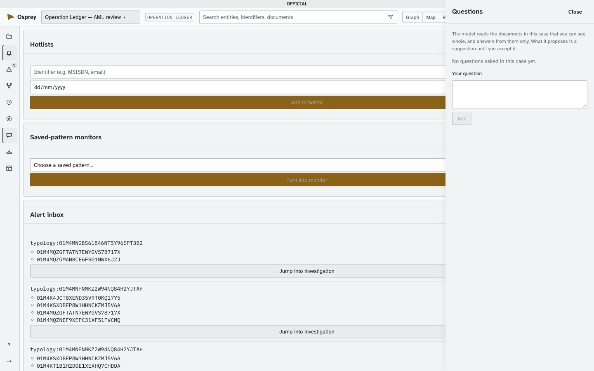

**Ask & Chat** (on the rail; it was named *Questions*) asks the deployment's model about what you choose
under **Read from**: **Selected items** (what you have selected, everything one link from it, and the
documents among them; the choice when something is selected), **Everything on the graph** (every item,
link and document you can see), or **Whole case** (the case searched with your question's own words, as
you, so it finds things by their names and words, not by what they mean; a question of more than 200
characters is refused, with what to do instead). Above the question it says what that is about ("About:
Tarbuck, Kyle and 1 other"), what will be read ("Will read: 1 document, 3 items and 2 links") and which
engine will answer, before anything is sent. It answers from the documents and **graph facts** only,
citing each — **Draws on** opens a document. Under *Whole case*, a document on the canvas is read whole
and one elsewhere in the case by the passage the search found; each other record found is a source,
cited as `[S-n]`, which selects its records on the canvas. With no document to read it answers from the
links and events, and says so under the answer. What it
proposes, you **Accept** or **Reject**; an accepted proposal enters the graph as *inferred*.
**Ask the model about these…** on any selection saves it as a private view and asks there. Asking
needs Editor.

**Graph facts.** Along with the documents, the model is given a numbered, plain account of the graph
around what you have selected and one link beyond it (the whole view when nothing is selected). A
timeline period, if one is set, limits the links and events to it. The account lists each entity by type
and name; each link among them as a fact, `[G-1]`, `[G-2]`, with its type, its two ends by name, its first
and last date, how often it occurred, its dataset's label and whether it is direct or inferred; and the
events for each month. It holds only what you may see, and never an identifier of the system. It has no
path facts: a question about a connection is answered from the links it holds.

In an answer, each `[G-n]` is a button, "Select [G-1] on the canvas". It selects what the fact stands
for and brings it into view: the link if one drawn link is meant, otherwise its nodes. A fact the model
cites that was not in the account it was given is dropped and counted among the items left out.

The documents and the graph facts share one limit. Over it, the question is refused, saying how many
characters each came to and the limit, and that nothing was sent: narrow the selection, narrow the timeline
window, or open a smaller view of the case, then ask again. Your question stays in the box. Nothing is trimmed. An
answer is shown later only to someone who could see every item it was built from, so a reader cleared
lower does not see an answer built on events above their clearance. An answer kept before that was
recorded may still be shown as before.

**Choosing the engine.** Where the deployment offers more than one model engine, a **Model engine**
choice sits above your question: the deployment's own model, and any provider your administrator has
enabled, such as Gemini. The one your administrator chose is selected; change it before you ask to use
another. Where only the deployment's own model is offered,
there is no choice to make, and none is shown. Choosing an engine is a request, not a promise: material
your deployment may not send outside is always answered by its own model, whatever you choose. If an
engine cannot be used — it is no longer enabled, or has no key — the question is refused in words and
nothing is sent; choose another and ask again.

**Engines you cannot choose, and why.** Beside each provider the choice says **under contract** or
**no contract**: whether your organisation holds a privacy agreement with that provider. Your
administrator also decides, for each dataset, whether its material may be sent to a provider at all:
never, only to one under contract, or to any. An engine your case's data may not reach is still listed,
marked **not available**, and cannot be chosen; the reason is written beneath the choice, for example
"Gemini: Not available for this case: “Enron corpus” is set to egress none, never sent to a hosted
engine such as Gemini." If the engine your administrator made the default is one of these, the
deployment's own model is chosen instead. Every dataset starts at "never", so until your administrator
changes yours, every question is answered by the deployment's own model.

**"Answered by …".** Under each answer, a small line says which engine and model produced it, for
example "Answered by Gemini (gemini/gemini-2.5-flash)" or "Answered by This deployment's own model
(qwen2.5:7b-instruct)". It is what the deployment says it used, not what you chose. An answer kept
before engines were named has no such line. **Ask to search** shows the same choice and line, and the
choice applies there too: your question is about the case, so it goes under the case's handling and
from the case's datasets, through the same two checks as Ask & Chat. It reaches the engine you chose
only when the case's material, as you see it, may leave the deployment and every dataset of the case
allows that engine; otherwise the deployment's own model answers, and its line says so.

**On a deployment with a GPU.** Where your administrator has given the deployment's own model an
NVIDIA graphics card (GPU), that model answers much faster than on a computer's processors alone,
and it is a larger one: its line then reads "(qwen2.5:14b-instruct)" instead of
"(qwen2.5:7b-instruct)", unless your administrator chose the smaller model. Nothing else changes:
the same material stays in the deployment, and the same checks decide which engine answers.

To ask in words for a pattern rather than an answer, use **Ask to search** in the query builder (section
5.10).

## 7. Monitoring and alerts

> **Alerts are worked in Rules and Monitoring**, the fourth place (key `R`), which the Analyst and
> Rule author roles open. Its tabs are **Alerts**, **What raises alerts**, **Held rows** and
> **Changes**. An alert has its own address, and **Open the evidence** saves a private view of the
> case and opens it with **← Back to the alert**. Every alert you may see is in one queue (7.1);
> rules are written on a dataset in the rule editor (7.6), tested, then made live.

### 7.1 The Rules and Monitoring place

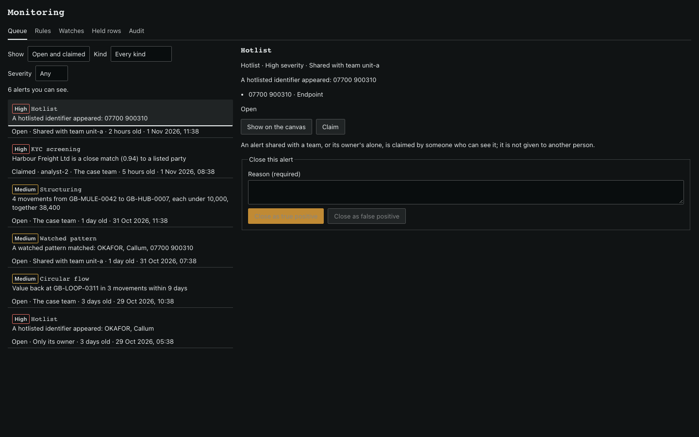

**Rules and Monitoring** (key `R`) is the place for alerts. It works on the case you have open. With
none open, it says "Open a case to see its alerts and what raises them." Its tabs are:

- **Alerts**: the one queue, with the alert you open beside it (§7.3);
- **What raises alerts**: every rule and watch, the rule editor, the templates, your hotlists and
  watched patterns, and the screening lists the rules read (§7.4 to §7.6);
- **Held rows**: the rows a rule held before they loaded. You see it as an Editor or Author of the case;
- **Changes**: the rule audit. You see it as an Author of the case, or as an administrator.

**Connection strength** is not here: it is a view of the Glass, under **More views** (section 5).

**One queue holds every alert you may see.** **Kind** names its five kinds:

- **Rules**: raised by the case's rules — structuring, rapid movement, circular flow, screening
  matches, shared contact details, unverified customers, drawn patterns and rules written as sentences
  for the case;
- **Hotlists**: data touched an identifier on a hotlist (§7.5);
- **Watched patterns**: a saved pattern matched new data (§7.5), or a rule kept just for you raised
  an alert, whether written as a sentence or made from a template or a saved pattern (§7.2's known
  issue);
- **Raised by an analyst**: someone chose **Raise an alert…** in the Query builder. One raised to a
  dataset is headed "Dataset alert";
- **Drawn items**: a load wrote something that looks like an item drawn on a board (§7.5).

**An alert concerning anything you cannot see is neither shown nor counted**, whatever its kind.

Above the list, five choices say which alerts to list:

- **Whose alerts**: **All, suppressed included**, **Mine**, **My teams'** or **Unassigned**. Only
  **All, suppressed included** lists an alert that is suppressed (§7.3);
- **Older than, in days**: a number of days, or blank for any age;
- **Show**: **Open, claimed and closing**, **Closed** or **All**;
- **Kind**: **Every kind**, or one of the five above;
- **Severity**: **Any**, **High**, **Medium** or **Low**.

The server makes the choice, so a count ("4 alerts you can see.") always means what it says.

Each row says its **severity**, what it is ("Hotlist", "Watched pattern", "A load met a drawn item", or
what a rule looks for, such as "Structuring") and what it found. Under that it says where it stands (open, claimed and
by whom, closing or closed), **who may see it** (§7.2), how long it has waited ("2 hours old") and
when it was raised. A suppressed alert also says "Suppressed until", the date and why. An alert
whose load was reverted says "Taken back: the load that raised it was reverted". The most severe
come first, then the newest.

### 7.2 Severity and who sees an alert

Every alert is **high**, **medium** or **low**. A rule written as a sentence, in the rule editor or
just for you, sets its own **Severity** (§7.6). So does whoever chooses **Raise an alert…**. Every
other alert takes its kind's:

| Alert | Severity |
| --- | --- |
| A hotlist match | High |
| A screening match (a case's rule from the template) | High |
| Shared contact details (a case's rule from the template) | Low |
| Any other template's case rule, a watched pattern, a drawn item | Medium |
| A rule made from a template or a saved pattern, kept just for you | Medium, whatever its template |

Each template says, on **What raises alerts**, what a case's rule made from it raises: "Raises
medium-severity alerts."

**Known issue: a rule kept just for you is listed as a watched pattern.** Every alert from a rule kept
just for you is listed as **Watched pattern**, under **Kind: Watched patterns**, not under **Rules**. A
rule just for you written as a sentence keeps the severity it sets. One made from a template or a saved
pattern on **What raises alerts** (which keeps every rule made there just for you, §7.4) is **medium**,
whatever its template says: a screening match from it, high from a case's rule, is medium, and shared
contact details, low from a case's rule, are medium too. A rule for the case, written in the rule
editor (§7.6), is not affected.

Who may see an alert is shown on its row:

- **The case team**: a rule's alert, and one raised to the case, reaches every member of the case.
  One raised to a dataset ("The dataset: everyone with a case on it sees it") is in the queue of that
  dataset's home case.
- **Team ‹name› only**: a rule whose **Alert goes to** names a team (§7.6). Only that team's members
  who hold the case, and the Authors of the dataset's home case, read it. This is enforced in the
  query that reads the queue, not by hiding rows: to anyone else, the alert is not there and is not
  counted.
- **Shared with team …**: a watched pattern's alert, and a hotlist's alert when its owner has shared
  it, reach the owner and the people of the owner's **unit** (the unit your administrator gave your
  account).
- **Only its owner**: a hotlist kept to its owner; a drawn item's alert, which reaches whoever drew
  the item; a rule kept just for you; and an alert raised before teams existed.

### 7.3 Working an alert, and closing it

Open an alert to see **What fired it**, in words, and what it concerns: the people and things it
cites, or the transactions, with when, from, to and the amount. A rule's alert says when it was
raised: "as the data loaded (before it was committed)" or "after the data loaded". What fired a
hotlist alert is in §7.5.

- **Open the evidence** saves a private view of the case with what the alert cites, and opens it with
  **← Back to the alert**. Anyone who reads the alert may use it.
- **Open the board**, on a drawn item's alert, opens the board the item is drawn on.
- **Show on the canvas** draws what it concerns on the case's canvas.
- **Claim** it to work on it. **Release** gives it back.
- **Give to**: an alert for the case team can be given to a member of the case. Choose them by name
  under **Give to**, then **Give**. *Give to* lists the case's Editors and Authors who are people; an
  account a service or a loading script uses is never offered.

**A team's own alerts** (*Team ‹name› only*) have a lead. The team's lead, or their cover while the
cover lasts, sees **As the team's lead** on each:

- **Give to** a member of the team, then **Give to the member**;
- **Suppress until** a date at most 90 days ahead, with why in words, then **Suppress until…**. The
  alert "stays open, in All, and counted open; it ends by itself on that day." **What raises alerts**
  lists it under its rule: "One alert suppressed until", the date, who and why.

An alert shared with a team, or its owner's alone, is claimed by someone who can see it, never given
to another person.

**Closing needs a reason, in two parts.** Under **Close this alert**, choose one **closing reason** —
**True match**, **False positive**, **Duplicate**, **No further action** or **Referred** (the arrow
keys move between them) — and say why in words. **Close the alert** stays unavailable until you have
done both, and says what is missing ("To close it, choose a closing reason and say why, in words.").
Words of only spaces are refused. **True match** confirms what the alert found; every other reason
leaves it a suggestion. OspreyFlow accepts no reason outside this list.

Working alerts needs Editor or Author in the case; a Viewer reads. **Closing a high-severity alert
that someone else may see needs a second person** (§7.12): the button reads **Propose the close**, and
another member approves it.

### 7.4 Rules and templates

**What raises alerts** opens with **Every rule and watch**: one table of the case's rules and watches,
with its **Name**, **Maker**, **Source** (Rule or Watch), **Dataset**, **Owner**, **Draft or live**,
**Expires**, **Last fired**, **Alerts, 30 days** and **Not of interest** (the share closed as not of
interest). Each of the first six columns has a filter. "Counts are of the alerts you can see."

Under it, each rule says what it looks for, how it runs and where it stands:

- how it runs: "Runs after each load commits", "Judges each load before it commits", "Runs on a
  schedule" (§7.11) or "Runs when its screening list refreshes", the last two "as its author";
- where it stands: *active*, *a draft: not live*, *a draft, waiting for a second person's approval to
  go live*, or *retired*.

Each rule has **Versions** (§7.12), and a scheduled rule or one on a list's refresh has **Schedule and
runs**. A rule written in the rule editor also has **Open in the rule editor**, offered to the case's
Authors (§7.6). An Author of the case who holds **Deploy rules** retires a live rule with **Retire**:
in the built-in roles, an Analyst. A rule for the case is written in the rule editor.

**Templates** lists the typologies as named starting points (the four AML templates are in §7.9),
grouped by the work they serve (anti-money-laundering transaction monitoring, KYC, any case), each with
what it looks for and the severity a case's rule made from it raises. **Use** fills **Deploy a rule** with the template's
defaults and puts you on the rule's name; change anything, then **Deploy**. A rule from a saved pattern
is made in the same form: choose the **Typology** *Drawn pattern (from the Query builder)*, then the
**Saved pattern**.

**A rule made here runs just for you.** The form says so: "This rule raises alerts for you; to share
it with the case, write it in the rule editor." Its alerts reach you alone. **Known issue:** they are
listed as **Watched pattern** and are **medium**, whatever the template's severity (§7.2). Everyone in
the case sees the templates; **Use** and **Deploy** need an Author of the case who holds **Deploy
rules** and opens Rules and Monitoring (in the built-in roles, an Analyst), and anyone else reads "A
case Author deploys and retires rules." *Coming:* a template or pattern rule becoming the case's draft, to test and make
live in the rule editor.

The money-flow templates (structuring, rapid movement, circular flow) judge each load's movements with
the movements around them, and only those whose two accounts the rule's author may see, in the rule's
own dataset: a movement between accounts hidden from them shapes no finding.

### 7.5 Watches, and whom a hotlist's alerts reach

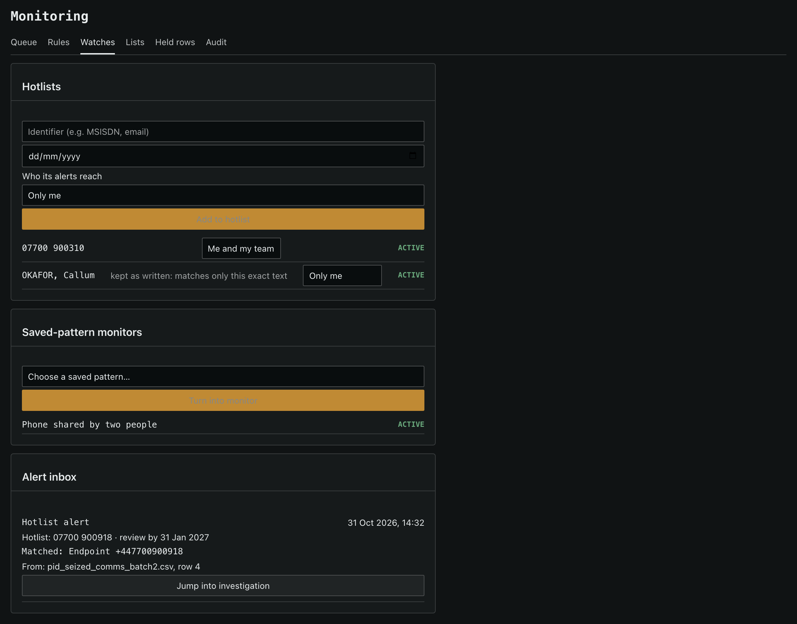

**Your watches are kept on What raises alerts**, under the rules, and their alerts are in the one
queue on **Alerts**. There is no Watches tab and no separate inbox.

- **Hotlists** keep identifiers — a phone number, an email address, an account number — each with a
  **Review date**. Any data that touches one raises an alert. Type the **Identifier**, choose the date
  and **Who its alerts reach**, then **Add to hotlist**. An account number is matched however its
  spaces are written: `GB58 LOYD 3096 1700 7099 43` and `GB58LOYD30961700709943` are the same account.
  If OspreyFlow cannot read the text as a phone number or other known kind, it is "kept as written:
  matches only this exact text".
- **Watched patterns** run a saved pattern against new data. Choose a saved pattern, then **Turn into
  monitor**. Each runs as data loads, and on its own as you choose: "Daily at 06:00, and as data
  loads", "Weekly, and as data loads" or "Only as data loads".

**A watch that is *Stopped* says why**, beside the word, in these words (ADR-044 Amendment 1):

- its owner was disabled, or, as a guest, is no longer admitted: "Its owner can no longer sign in to
  OspreyFlow."
- on a deployment signing in with Entra ID, its owner's access is out of date: "Its owner has not
  signed in to OspreyFlow within the last 24 hours, so their clearance and unit are out of date. It
  is active again at the first load after they sign in."
- on Entra ID, its owner is not in *People and roles*: "Its owner is not a person Admin › People
  holds."
- the identity provider refused: "The identity provider refused to act as its owner."
- its owner's sign-in could not be checked: "Its owner's sign-in could not be checked at the last
  load. It is tried again at the next."
- its owner could not be acted as, for no reason given: "Its owner could not be acted as at the last
  load."
- a watched pattern whose saved pattern is no longer its owner's: "Its saved pattern is no longer
  its owner's."

A hotlist or watch stopped because its owner could not be acted as is active again at the first load
that can act as them. One whose saved pattern is no longer its owner's stays stopped until it is.

**From the Glass.** In the Query builder, **Save as a watch** on a saved pattern makes a watched
pattern of the case's dataset: "Saved as a watch: it runs as data loads and daily, and is kept in
Rules and Monitoring › What raises alerts." In the Inspector, **Watch for this** on an entity that
carries an identifier adds it to your hotlist, reviewed in 90 days: "Watching for ‹identifier›: you
are alerted when it appears in data you may see."

**Drawn items.** Drawing an item on a board sets a watch for it on the case's dataset; there is no
button. When a load writes something that looks like the drawn item (the same identifier, or a
similar name of the same type), an alert, "A load met a drawn item", lands in the queue for whoever
drew it, with **Open the board**. The Studio's load result says "This load raised 2 alerts on your
drawn items: they are in Rules and Monitoring › Alerts". *Coming:* a screen listing your drawn
watches, and a drawn link matching.

**Who a hotlist's alerts reach.** Each hotlist says who its alerts reach: **Only me**, or **Me and my
team**. A new hotlist starts from your deployment's choice (only you, unless your administrator has
chosen otherwise); change it when you make the hotlist, or later on its row ("Alerts from ‹identifier›
now reach your team too."). A hotlist made before this choice existed reaches only you until you
change it. Where your deployment fixes the choice, the panel says so ("Alerts reach only you. The
deployment sets this.") and offers none. A match on data you cannot see is never shared with your
team.

**A hotlist alert explains itself.** Open it in the queue, and under **What fired it** it reads, for
example:

- "Your hotlist entry 07700 900640, reviewed by 31 Jan 2027, 00:00": the identifier **as you typed
  it**, and the hotlist's review date. An identifier kept as written says "(kept as written)". Only
  the hotlist's owner sees this line.
- "+447700900640 (Endpoint): pid_seized_comms_batch2.csv, row 3; pid_pin_calls.csv, 2013 rows": the
  name and type of what it matched, then the files the matched record came from, and the row in each,
  or how many rows. The files are named in the order they were first seen; the rest are counted, "and
  3 more files", not cut. Where a source has no row, it counts records instead.

**Row numbers count data rows from 1**: the first row after the header is row 1, so "row 3" is the
third data row, the fourth line of the file. The Inspector's source, a link's details, Verify's
rejected rows and held rows count the same way. Where two loads of a file with the same name matched,
each is listed. Raw rule and node identifiers are not shown.

An alert on another analyst's hotlist is listed to you only when its owner shares it with your team.
**Where a matched record belongs to data this case does not read**, the alert names its name and type
and says "read from data this case does not read", with no file and no row (section 5.6): a file name
is as much a source as a row.

**Where people sign in with Entra ID** (a deployment on a shared platform), your rules, hotlists and
watches are judged at another person's load, and your watch's own runs happen, only while you have
used OspreyFlow within the last 24 hours. Otherwise, at a load your hotlists and watches are marked
*Stopped*, with that reason beside it, until the first load after you sign in again: the
administration guide, §6a.7, says why.

### 7.6 The rule editor: a rule written as a sentence

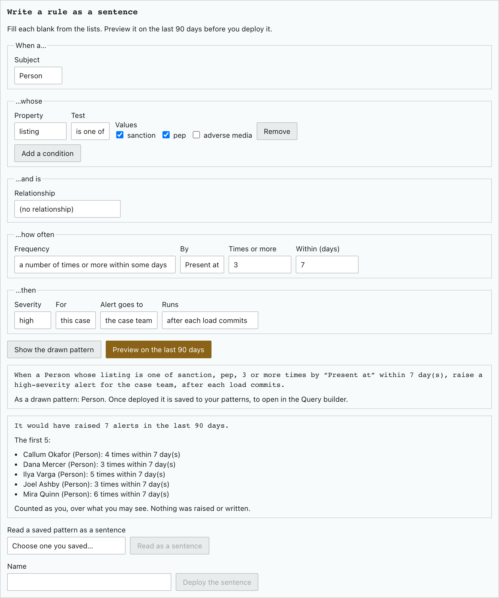

On **What raises alerts**, **Write a rule on a dataset** is the rule editor. A case Author writes the
case's rules there; anyone else reads "A case Author writes the case's rules." Writing and testing a
rule need **Write rules** (the **Rule author** role) as well as the case's Author level.

**1. The dataset.** Choose **The dataset this rule watches** from the case's own datasets (a composite
says "(composite)"), then **Choose the dataset**. "It is chosen once and never changed." The editor
then says "Watching ‹dataset›. Its conditions are offered from this dataset's own model."

**2. The sentence.** **Write a rule as a sentence** builds the rule from blanks, read as one sentence:
*When a* subject *whose* conditions, *and is* related to something, *how often*, *how strongly
connected*, *then* raise an alert. Every blank is a choice from a list made from the dataset's model —
its types, their properties and its link types — so there is nothing to type that could fail to be
understood.

- **Subject.** A type, grouped as people, objects, locations, events and organisations.
- **Whose.** Up to five conditions on the subject's properties: *is*, *is one of*, *is above*, *is
  below*, *is within a time window*, or, for a location, *is within a drawn area* (entered by its four
  corners). A property marked highly sensitive is never offered.
- **And is.** Optionally: *linked by a link type to* something; *within a number of steps of*
  something of a type; *at a location in a drawn area*; *on one of my hotlists*; or, for a person or
  an organisation, *on a screening list*: choose the **Screening list**, from those the dataset may
  read, and the name match you need (**Name match at least**).
- **How often.** Optionally, a number of times, a total amount or a first time, within some days
  (§7.7).
- **How strongly connected.** Optionally: *the connection strength* between the subject and something
  it is linked to (by a link type, or any; to a type, or anything) *reaches* a figure up to 1, or *on
  the client's scale* a raw sum up to 10 (met only under client parity); or *the
  shared-attribute rarity* between it and another of its type *reaches* a figure, per dataset or across
  the case's datasets (§5.12). Both are read from the stored graph, so the rule runs after commit or on
  a schedule, and both are worked out as you, the rule's author, may see them.

**3. Then.**

- **Severity**: low, medium or high.
- **For**: *this case*.
- **Alert goes to**: *the case team*, or a team by name (*‹Team› only*, §7.2). Before you save, the
  editor says who will see its alerts: "Its alerts will appear in Alerts, seen by this case's team.",
  or "… seen by the 6 members of ‹Team› who hold this case and the home case's Authors."
- **Runs**: *after each load commits*; *before each load commits*, when you also choose what **A hit**
  does: *loads with its alert*, or *holds its rows for review* in **Held rows**; *on a schedule*
  (§7.11); or, for a rule on a screening list, *when a screening list refreshes*. A rule that names a
  link runs after commit: "A link is read from the stored graph, so this rule runs after each load
  commits."

**4. Look before you save.** **Show the drawn pattern** shows the same rule as the Query builder would
draw it. **Preview on the last 90 days** says "It would have raised 12 alerts in the last 90 days.",
lists the first few, and says "Counted as you, over what you may see. Nothing was raised or written."

**5. Save the draft.** Give it a **Name**, then **Save the draft**. "‹name› is a draft: it does not run
until it is made live."

**6. Test on the last 30 days.** It says "It would have raised 3 alerts in the last 30 days. Counted as
you, over what you may see. Nothing was raised." The count is yours alone: anyone else reads only
that the draft was tested, and when ("This draft was tested on 10/11/2026."). Until then the editor
says "A rule goes live only once this draft is tested." Saving the draft again needs a new test.

**7. Make live.** **Make live** needs **Deploy rules** (`deploy_rules`) and Rules and Monitoring
itself, which opens to whoever works alerts or writes rules: in the built-in roles, an Analyst. A Data
Engineer holds Deploy rules but cannot open this place. A Rule author opens it but does not hold Deploy
rules, and is not offered the button. The Super user preset gives both. The rule goes live at once ("‹name› is live."), unless its dataset asks for a
second person (its **Promotion of drawn items** setting is *Second person reviews*): then the editor
says "‹dataset› asks for a second person: making it live waits for another Author to approve it." The
rule reads *a draft, waiting for a second person's approval to go live*, and another Author of the
case who holds Deploy rules and opens this place (an Analyst) chooses **Approve**, or **Reject** with a
reason. Neither the draft's author
nor whoever asked for it to go live may approve it.

**Changing a rule.** **Open in the rule editor**, on a case rule's row, opens it on its own dataset, at
its draft if it has one. A live rule runs as it stands while its draft waits: "‹name› runs as it
stands; this draft of it goes live only once tested and made live." A live rule runs as the person who
saved its draft. They must still hold Write rules or Deploy rules, or it raises nothing and says why.

**Show as BPMN**, once a draft is saved, opens the rule read-only as BPMN 2.0: a start event, a
business-rule task that calls the rule's DMN decision table, and an end event. **Close** or Escape
shuts it. Exporting and importing these files is done through the API; the screen has no button
for either.

Every step is in the rule's **Versions** and on the **Changes** tab; a scheduled rule has **Schedule
and runs** (§7.11). No one is offered a rule for the whole deployment.

**A rule just for you.** Under the editor, **Write a rule as a sentence** again offers the same blanks,
for *just me*: "A rule just for you: fill each blank from the lists. Preview it on the last 90 days
before you deploy it. A rule for the case is written above, on its dataset." Its alerts reach you
alone, listed as **Watched pattern** (§7.2). It runs after each load commits or on a schedule. An
Editor or Author of the case who holds **Deploy rules** and **Keep watches** (in the built-in roles, an
Analyst) deploys it with **Deploy the sentence**; anyone else reads "A case Editor deploys a rule for themselves; a case
Author deploys one for the case."

**Patterns and sentences.** Once deployed, a rule's drawn pattern is saved among your patterns, to open
in the Query builder. **Read a saved pattern as a sentence** goes the other way, from a pattern you
drew to a sentence. A pattern a sentence cannot say (more than one link, or a pinned node) is refused
in words. A sentence that names something the model does not declare is refused, naming the blank.

### 7.7 How often: frequency and amount conditions

A sentence may also say how often:

- *a number of times or more within some days* — for example, present at a location 3 or more times
  within 7 days;
- *a total amount over a figure within some days* — the total of a link's declared amount, such as a
  payment's amount, over 10,000 within 30 days;
- *for the first time ever* — the subject's first event of that link type.

The events counted are those of the link type you choose, with the subject at either end. They are
counted as the rule's author: an event you may not see adds nothing to a count or a total, and is
never a "first".

### 7.8 Preview on the last 90 days

**Preview on the last 90 days** runs the rule as you, over the case's stored data, and says how many
alerts it would have raised, with up to five of them. Use it to set a threshold against evidence
before you deploy. A preview raises no alert and writes nothing. It counts only what you may see, so
it says nothing about anything hidden from you. If the rule would judge more subjects than the
working-set limit, the preview is refused and counts nothing: narrow the sentence and preview again.
Frequency conditions are counted over the 90 days.

### 7.9 The AML templates: jurisdiction, cash, dormancy and velocity

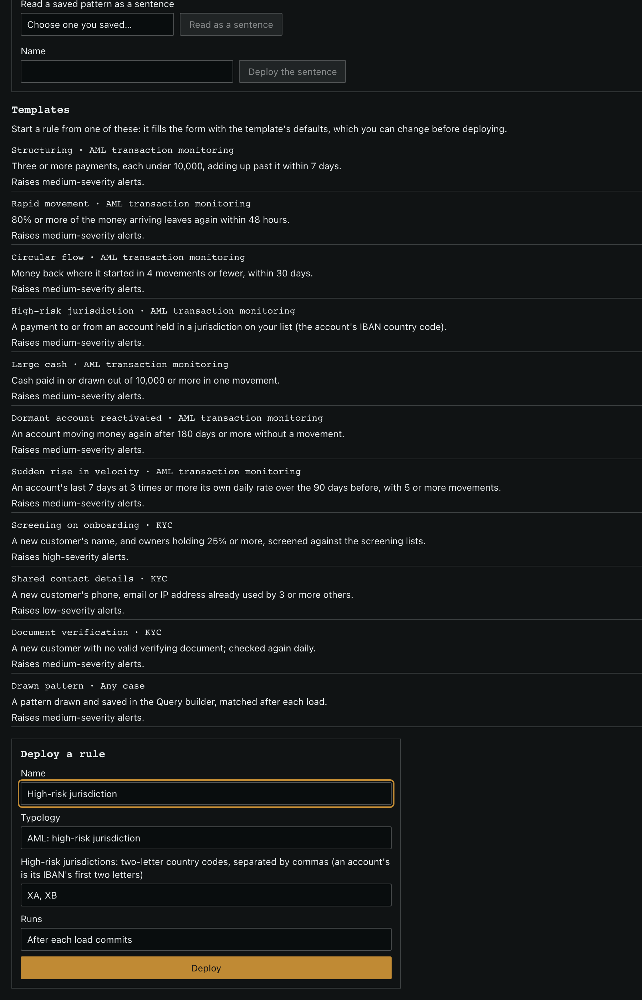

Four templates watch a case's money movements (its *transacted* links), each with settings you choose
and no formula to write:

- **High-risk jurisdiction** — a payment to or from an account held in a jurisdiction on your list.
  Type the list as two-letter country codes, separated by commas (for example `XA, XB`): the list is
  part of the rule, so your organisation's policy list is what you enter. An account's jurisdiction is
  its IBAN's country code, the IBAN's first two letters; an account whose number is not an IBAN has no
  jurisdiction here.
- **Large cash** — cash paid in, drawn out, or either, of an amount at or over a threshold (10,000 by
  default) in one movement.
- **Dormant account reactivated** — an account moving money again after a number of days (180 by
  default) without a movement. An account that has never moved before is new, not dormant.
- **Sudden rise in velocity** — an account whose movements over the last days (7) run at a factor (3)
  or more of its own daily rate over the days before (90), with at least a minimum (5) in the last
  days; measured by the number of movements or by the amount moved. An account with nothing in those
  days before has no rate to rise from and raises nothing.

Each raises a medium-severity alert in the queue (listed under **Rules** from a case's rule, and as a
**Watched pattern** from one kept just for you, §7.2), in words: the movement, the accounts and what
made it a finding. They judge only movements and accounts you could see as the rule's deployer: a movement
hidden from them neither wakes a dormant account nor adds to a rate. The last two compare an account
with its own stored past, so they run after each load commits.

### 7.10 Screening lists, re-screened when they change

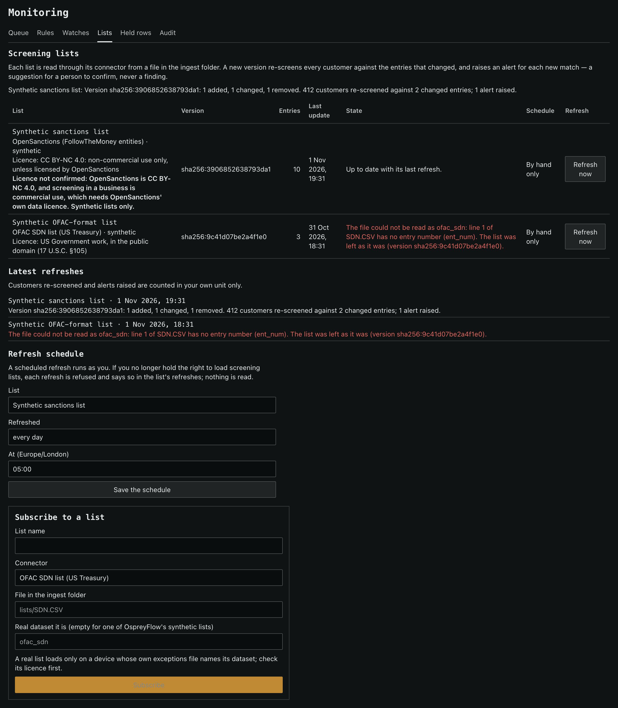

**What raises alerts** shows, read-only, each sanctions, PEP or adverse-media list the deployment
screens against: the
list it is (OFAC, the FCDO's UK Sanctions List, the UN or EU consolidated list, OpenSanctions, or HM
Treasury OFSI's, which closed on 28 January 2026 and is marked "Closed list"), its version, how
many entries it holds, when it last changed, its licence, and its state — up to date, not yet read, or
why its last refresh failed, in words. A list read from a file that is not in its publisher's format is
left as it was, and says so.

When a list changes, OspreyFlow re-screens every customer in every case that has a **Screening on
onboarding** rule (§7.4) against **the entries that changed only** — those added and those whose names,
date of birth or country changed. An entry that did not change was screened when it arrived, so it
raises nothing again. Each new match raises a screening alert in that case's queue, naming the
customer and the list entry, with its score: high from a case's rule, and medium, as a **Watched
pattern**, from a rule kept just for its author (§7.2's known issue). Like every screening match, it is a suggestion:
the link between the customer and the listed party is inferred until a person confirms it, by closing
the alert as a **True match** (§7.3). Customers are screened as the rule's deployer and within the case's
datasets, so no one is screened, or alerted on, outside what that person may see.

**Licence not confirmed.** The **UN** and **OpenSanctions** lists are marked "Licence not confirmed",
with the reason: no open licence was found for the UN list, whose general terms allow personal,
non-commercial use only; OpenSanctions is CC BY-NC 4.0, and screening in a business is commercial use,
which needs its own data licence. Until a licence is confirmed, these connectors read OspreyFlow's
synthetic lists only.

Lists are not added or refreshed here: "Screening lists are imported, mapped and refreshed in the
Ingest Studio's Sources. This tab shows them; it no longer adds or refreshes one." A data engineer does
that in the Ingest Studio's **2 Sources**, under **Screening lists** — or anyone holding both **Load
screening lists** and **Edit pipelines** — and may have a list refreshed every day or every week (the
administration guide, §9.5, says how); the **Schedule** column says when, or "By hand only". Someone
here who also holds Load screening lists sees how many customers each refresh re-screened, and the
alerts it raised, **in their own unit only**. Everyone else sees the lists, not those numbers.

### 7.11 A rule that runs on a schedule

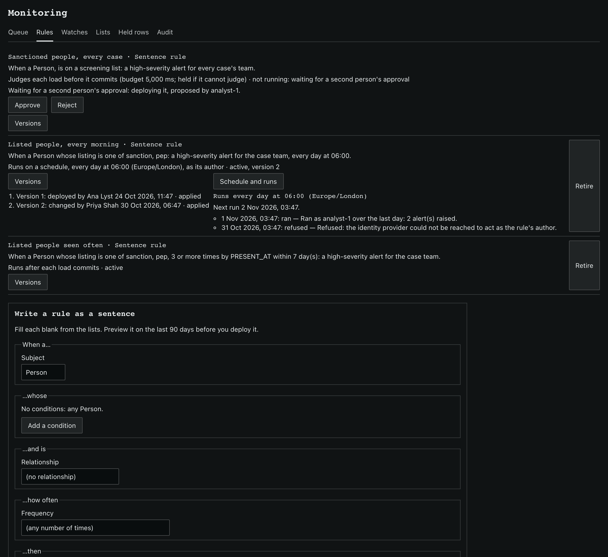

A rule written as a sentence (§7.6) runs as data loads — before or after each load commits — or **on a
schedule**. Choose **Runs: on a schedule**, then **Every** day or week, the day for a weekly rule, and
the hour (UK time). At each run the rule looks at what is already stored over the last day or week,
as you see it, and raises an alert for each new finding, once.

- **It runs as you**, its author, never as the system: it judges only what you may see, and only
  while you may still sign in, still hold Write rules or Deploy rules, and are still an Author of the
  case (an Editor, for a rule just for you).
- **Schedule and runs**, under the rule, says when it runs next and what each run did: how many
  alerts it raised, or why it did not run, in words. A run the deployment missed while it was down is
  said too; after downtime only the latest run happens.
- **If it is refused three times in a row** — say, because you can no longer sign in — it stops, and
  says why. Changing the rule starts it again.
- A rule for the whole deployment does not run on a schedule: it is judged within each case as that
  case's data loads.
- **Where people sign in with Entra ID** (a deployment on a shared platform), a rule's scheduled run
  acts as you only while you have used OspreyFlow within the last 24 hours. Otherwise it is recorded
  as not run, in those words, and runs at its next slot after you sign in; this never stops the
  schedule (the administration guide, §6a.7).

### 7.12 A second person's approval

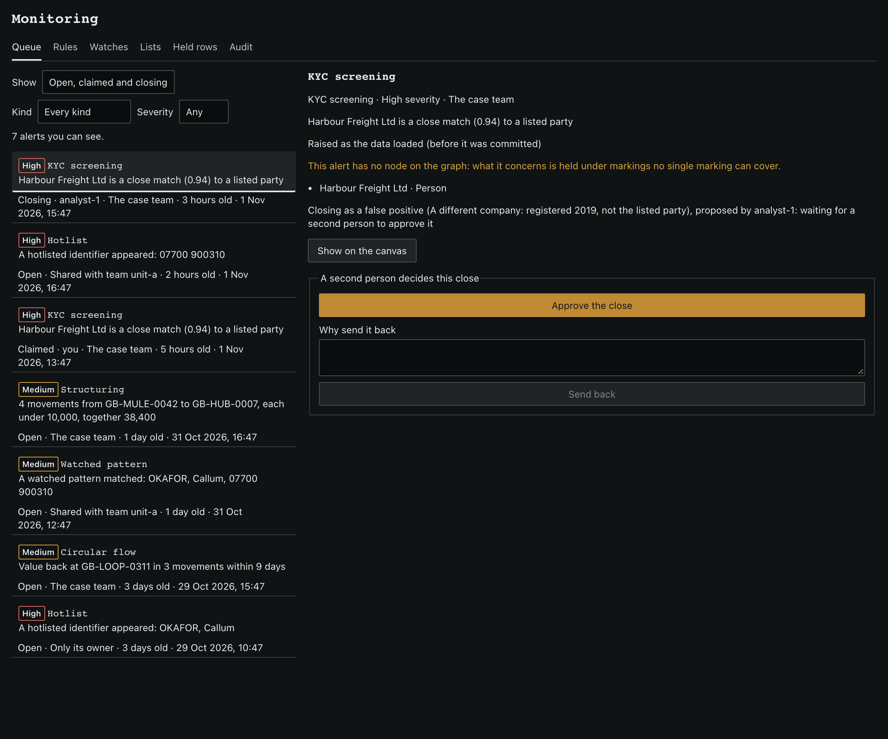

These decisions need a second person with the right, and the person who proposed one can never approve
it.

**A rule for the whole deployment**, made before the rule editor (§7.6 offers none now) — deploying it, changing it or retiring it. A new one is
listed as *not running: waiting for a second person's approval*, with who proposed it; a change or a
retirement waits beside the rule, which runs as it stood until then. Another administrator who is an
Author of the case sees **Approve** and **Reject** (with a reason); a rejected rule never runs. A rule
for one case waits for a second person only where its dataset asks for one, at **Make live** (§7.6); a
rule just for you is not held up: it runs as soon as it is deployed or changed.

**Closing a high-severity alert** that someone else may see. Choosing a closing reason, writing why
and **Propose the close** proposes the close: the alert stays in the queue as *Closing*, with your reason. Another
member who triages alerts in the case opens it and chooses **Approve the close**, or **Send back**
with a reason, which returns it to you, claimed. You may withdraw your own proposal the same way. An
alert only you can see (your own hotlist's, kept to you) has no second reader, and you close it alone.

**Every rule keeps its versions.** **Versions**, under a rule, lists each one: what it did (deployed,
changed or retired), who made it and when, and who approved or rejected it. A changed rule runs as the
person who wrote the change, since it is their judgement now. Everything here is in the case's rule
audit.

## 8. Ownership and due diligence

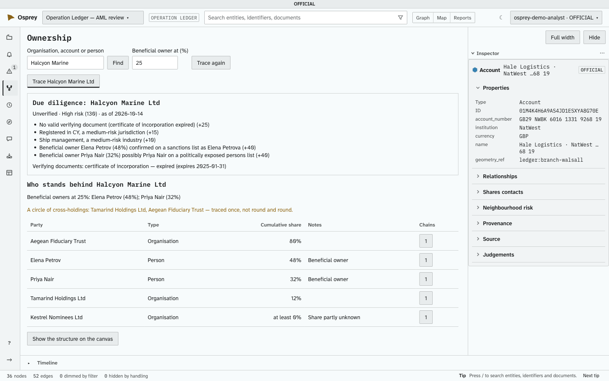

**Ownership**, under **More views** in the Glass, traces who stands behind an organisation or account: every beneficial owner
at or above the threshold (25% by default), their cumulative share through each chain, and anyone
holding control whatever their share. A circle of cross-holdings is traced once, and said so. **Due
diligence** gives the verification status, risk band and score with each factor's weight, and the
verifying documents. All of it is worked out as you read, from what you can see, and stored nowhere.
**Show the structure on the canvas** needs Editor.

## 9. Figures and dashboards

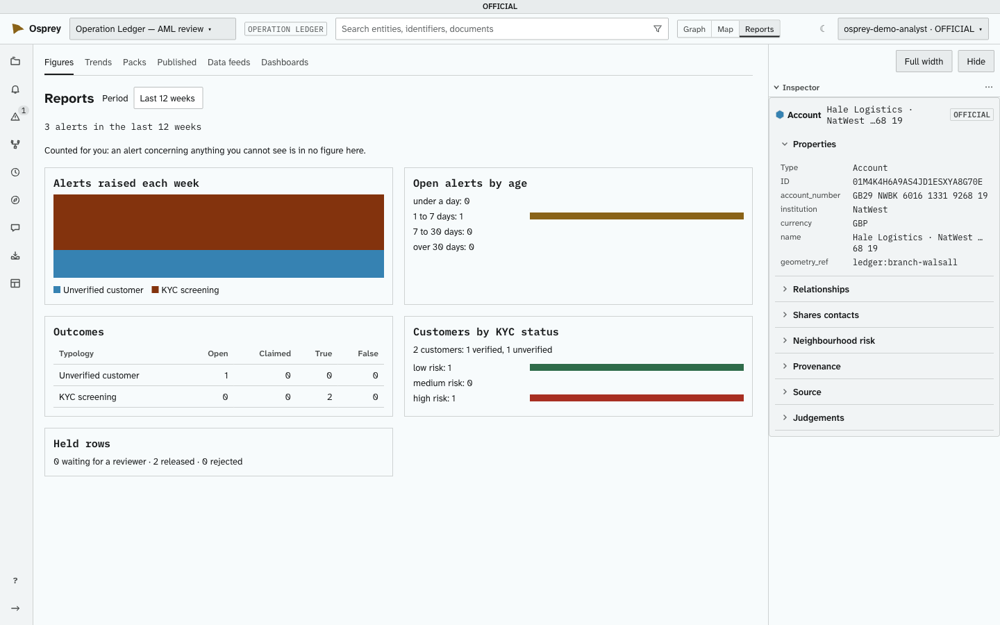

**Figures** (under **More views** in the view switch)
shows the case's own counts over a **Period** of the last 4, 12, 26 or 52 weeks: an **Alerts** panel
(open alerts by source and age, and the newest), alerts raised each week, open alerts by age,
outcomes (open, claimed, each closing reason, and closed with no outcome), customers by KYC status, a
summary of the case's people, objects, locations and events, and held rows (for Editors and above).
**Download the figures (CSV)** is there for whoever may read the case's feed. Every figure is
**counted for you**: anything you cannot see is in no figure. A period too long to count says to
choose a shorter one; it never shows part of a chart. *Coming:* a **Drawing** panel (drawn, promoted,
awaiting review, withdrawn): the Glass has it, but the Conduit does not count it yet, so it is not shown.

Beside Figures, as your rights allow: **Trends**, **Packs** (report packs, exported to PDF),
**Published** and **Data feeds**.

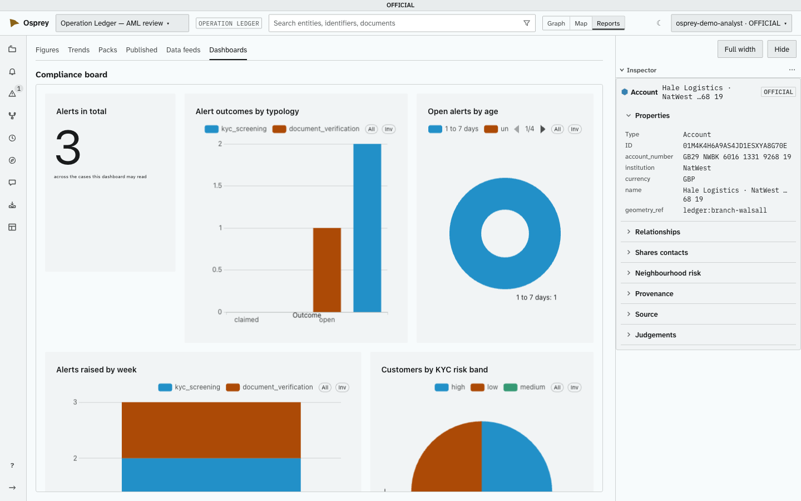

**Reports**, in the view switch (it was named *Dashboards*), is the one door to the deployment's
boards, drawn inside the Glass and showing only those you may open. Where the deployment has its
reporting, **Build a report (opens in new tab)**, beside the switch, opens the boards' own editor at
`bi.`, for whoever may manage dashboards. The same boards are at `bi.` in front of the deployment's address,
signed in the same way. The first is **Alert monitoring**: alerts raised each week and by rule,
closed by outcome, time to close, hotlist matches, and the team view.

**For a Reports Viewer.** Home lists the alerts on the cases you can read, each with **Open in its
case** and **Open the dashboard**; you never work an alert. **Open in its case** opens the case's
Figures with the panel the alert concerns outlined; **Open the dashboard** opens Alert monitoring,
filtered to the alert's rule and period. Both say "From alert: ‹title›", with **← Back to your
alerts** to return Home.

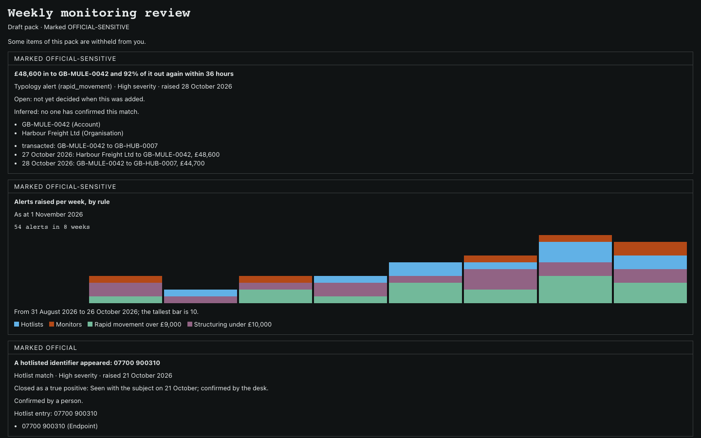

### 9.1 Alerts in a report pack

In **Packs**, under **Add an item**, choose **Alert** and then one of the alerts of the case's queue
that you can see (each listed by severity, status and what it found). The pack keeps the alert as it
was when you added it:

- what it found, in words, its kind, its severity and when it was raised;
- the entities it matched, and its evidence: the links and transactions it cites;
- whether it was still open: an open alert says "Open: not yet decided when this was added";
- if it was closed, its closing reason (for example "Closed as True match") and the words given;
- "Inferred: no one has confirmed this match" until a person confirms it, by closing it as a True
  match. A match is never shown as confirmed on anyone's behalf.

**Refresh** reads the alert again, so an alert added while open can show how it was closed; the
earlier copy stays in the pack's history.

An alert item is marked at the highest marking of what it cites, and rests on every node, link and
transaction it cites. A reader who may not see all of them does not get the item, and is told only
that some items are not shown, never how many or which. The same sentence covers an item whose alert
has since been taken back for everyone: reverting the load that raised it (an administrator's task)
takes back the alert with the load, so its item is not shown to anyone, its adder included. Exporting
checks each item again for the
person exporting; someone who may see none of it is refused, and nothing is recorded.

### 9.2 Alert trends

In **Trends**, **What to count** offers **Events** or **Alerts**. An alert trend counts the alerts
raised each week or month that you may see. Split it by **rule** (each typology rule by its name,
hotlists together, monitors together), **typology**, **severity** or **outcome**, and narrow it with
up to five filters on the same fields. Alerts are counted, never summed. An alert on something you
cannot see is in no bar and no total. Save an alert trend and add it to a pack as any trend; it
is bounded in the same way (104 periods and 12 series), and past that you are asked to narrow it.

### 9.3 The monitoring dashboard

The figures dashboards read now include monitoring figures for every kind of alert: alerts raised
per week by rule, alerts closed per week by outcome, how long alerts took to close, and hotlist
matches per week. They are counted as the dashboard's own account may see them, case by case. A
hotlist kept "only me" is counted for its owner alone, so it never appears on a shared board. An
administrator sets the board up (administration guide §12).

## 10. Judgements

The Inspector's **Judgements** records what you conclude: a statement, how likely it is on the
probability yardstick, and the evidence for and against. A judgement cannot be saved without at least
one supporting reference. Gaps (open, tasked, answered, closed) and assumptions (with what follows if
one is false) are recorded the same way. A judgement is hidden from anyone who cannot read all of its
supporting evidence, and flagged for review when something it cites is corrected or split.

## 11. Export

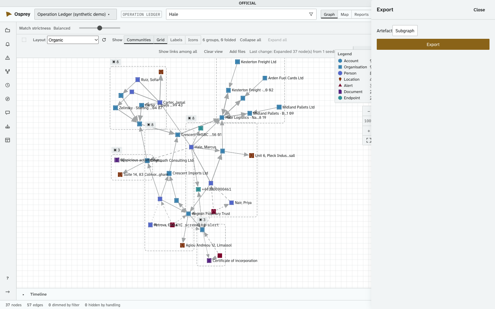

**Export** (on the Graph view) saves what is on the canvas:

| Artefact | File |
| --- | --- |
| **Subgraph** | JSON |
| **Chart** | PNG |
| **Report** | A self-contained HTML page |

Each export is marked — the handling level and the time — and says how many items it left out for
handling. Items that cannot leave are named, with the reason. An item marked *consult originator*
needs a justification and the originator's reference before **Export** is enabled. Every export is
recorded. Report packs export to PDF from the Packs and Published tabs.

## 12. Keys

| Where | Key | Does |
| --- | --- | --- |
| Home | `G`, `I`, `R`, `A` | Open the Glass, the Ingest Studio, Rules and Monitoring or Admin, as your roles allow |
| Anywhere | `/` | Search |
| The top bar's search box | Enter | The search results page for the words typed; with a suggestion moved to by the arrows, that suggestion |
| Anywhere in the Glass | `?` | Opens or closes the welcome panel, with keys worth knowing and the user guide, over any view (as the rail's **Help** does) |
| Canvas | Tab, Shift+Tab | Move into and out of the canvas |
| Canvas | Arrows | Step to the next or previous neighbour; a screen reader hears its name, type and links |
| Canvas | Ctrl/Cmd+Arrows | Step within the selection; with Shift, through every node |
| Canvas | Space | Add or remove the focused node from the selection |
| Canvas | Enter | Expand the focused node, or read a document |
| Canvas | `\`, the menu key, Shift+F10 | The focused node's or the selected link's menu |
| Canvas | `L`, Shift+`L` | The next or previous link of the focused node |
| Canvas | `G` | Fold or unfold the focused node's group |
| Canvas | `F` | Fit the graph to the view |
| Canvas | Shift+Arrows | Move the selection; with Alt, further |
| Canvas | Delete | Hide the selected link, or remove the selection from view |
| Matrix | Arrows, Home, End | Move between cells; with Ctrl, Home and End go to the first and last cell |
| Matrix | Page Down, Page Up | The next or previous page of rows |
| Matrix | Enter | Select the row's node or link |
| Matrix | Space | Add the row's node to the selection, or take it out |
| Anywhere | Esc | Clear the selection; close a menu, drawer or reader |
| Forms | Ctrl/Cmd+Enter | Confirm a reason, save a change or a note, ask a question |
| Side panels | Alt+Up, Alt+Down | Move a panel up or down the column |

Every action in the Glass can be reached from the keyboard. Panning, zooming and the lasso are by
pointer only, by design: the arrows, Space and `F` do the same work from the keyboard.
